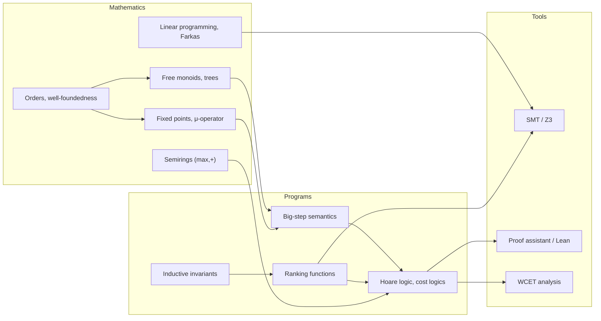
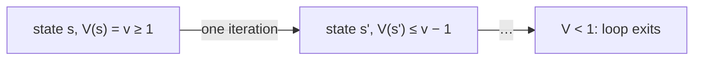
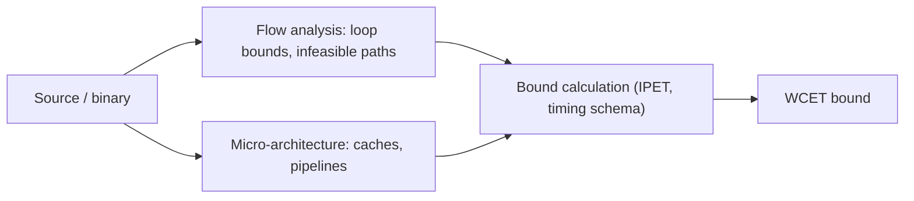

# Part 1 — Background, from zero

What the two papers take for granted, in the order you need it. Each section: the idea, one
example, and where CrossCheck uses it.

## 1. Notation, partial functions, ⊥

- A *relation* `R ⊆ A × B` relates inputs to outputs; a *function* gives one output per
  input; a *partial* function may give none.
- Partial functions are made total by adding a *bottom* element ⊥ ("no result"): `S⊥ = S ∪ {⊥}`.
  In Lean: `Option S` (`none` = ⊥).
- A *transition relation* `s → s'` describes one execution step; it may be
  nondeterministic (several `s'`) or partial (none). CrossCheck's bounds are stated for
  relations, so unknown inputs and faults are covered.

## 2. Orders and well-foundedness

- A *partial order* `≤` is reflexive, antisymmetric, transitive. Example: the prefix order
  on words (`ab ⊑ abc`).
- *Well-founded*: no infinite strictly decreasing chain. Then every non-empty set has a
  minimal element, and induction works. ℕ is the model case.
- **CrossCheck:** the *order-by-composition* `⊑` on traces and trees; the minimal exiting
  trace exists by well-ordering of ℕ (`exists_minimal_iteration`).

## 3. Free monoids, trees, homomorphisms

- The *free monoid* `Σ*`: finite words over an alphabet `Σ`, with concatenation and the
  empty word. Here: words of instructions (execution traces).
- A *homomorphism* maps words to another monoid preserving concatenation. Cost (length or
  weighted length) is one: `cost(t₁·t₂) = cost t₁ + cost t₂`. The valuation `⟦t⟧` (a state
  transformer) is another.
- *Trees* (term algebras) describe recursion: a node per activation, children per call.
  *Grafting* `⊗` replaces leaves by trees; tree powers `B^{⊗d}` describe uniform unfolding.
- A *catamorphism* (fold) computes over a tree bottom-up: size, depth, leaf count.

## 4. Semantics of programs

| Style | Says | Used in CrossCheck |
|---|---|---|
| Operational, big-step | `⟨c, s⟩ ⇓ s'`: `c` from `s` terminates in `s'` | the reference semantics (`WhileBigStep`, `Exec`) |
| Operational, small-step | one step at a time | transition relations |
| Denotational | `⟦c⟧` as a function / least fixed point | the valuation of traces |
| Axiomatic | Hoare triples `{P} c {Q}` | the cost logic (Paper I) |

- *Intensional* = how the computation proceeds (traces, cost). *Extensional* = what it
  computes (final state). CrossCheck keeps both layers and proves them consistent.
- A big-step semantics only sees terminating runs. Paper I's cost logic adds *execution
  prefixes* (`Pre`): every partial run, so a bound also excludes divergence.

## 5. Fixed points, Kleene, the μ-operator

- `while b do c` is the least fixed point of `X = if b then c; X else skip`.
- Kleene: it is the limit of the chain ⊥ ⊑ F(⊥) ⊑ F²(⊥) ⊑ …
- Kleene's μ-operator: `μn. P(n)` = the least `n` with `P(n)`. CrossCheck's minimal
  iteration count `n̄ = min{n | ¬b(fⁿ(s₀))}` is exactly this — a classical ingredient, as
  the papers say.

## 6. Decidability

- The halting problem is undecidable, so is the exact final state of a loop in general.
- Matiyasevich: undecidability persists for polynomial integer arithmetic (Hilbert's 10th).
- Linear integer arithmetic (Presburger) is decidable; linear *rational* arithmetic is
  polynomial (LP). This is why CrossCheck's certificates are linear and rational.

## 7. The (max,+) semiring and the timing schema

- Semiring with `⊕ = max` and `⊗ = +`. Costs compose like this: sequence = `+`, branch =
  `max`, loop with `K` iterations = `K × (test + body) + test`.
- This *timing schema* (Shaw; Puschner & Koza, 1989) is classical. CrossCheck reads it in
  max-plus algebra.

## 8. Ranking functions (potentials)

- A *ranking function* `V` maps states to numbers, is ≥ 1 when the loop runs, and
  decreases by ≥ 1 per iteration. Then the loop runs at most `⌊V(s₀)⌋` times.
- Floyd (1967) for termination; used for complexity bounds since (SPEED, KoAT, …).
- Lyapunov analogy: an energy that strictly decreases.
- Example: `for (i = 0; i < n; i++)` — `V = n − i`, bound `n`.
- Rational potentials, lexicographic pairs and logarithmic potentials are in Paper I.
- **Logarithmic potentials**: if `V ≥ 1` while the loop runs and each iteration divides it,
  `b·V' ≤ V`, the loop runs at most `⌊log_b V₀⌋ + 1` times (binary halving, `n >>= 1`).
  The dual: a counter `u ≥ 1` multiplied by `b` each time, up to a limit `K`, runs at most
  `⌊log_b K⌋ + 1` times (`len <<= 1`). Both reduce to an ordinary ranking function
  (`⌊log_b V⌋ + 1`, resp. `⌊log_b K⌋ + 1 − ⌊log_b u⌋`).

## 9. Invariants

- An *invariant* holds at every loop head; *inductive* if it holds on entry and is
  preserved by one iteration. The analysis proves candidates inductive with Z3
  (Houdini: drop candidates until all remaining ones are inductive).
- A *context* is a constraint on the initial state (e.g. argument ranges at a call site).
  Paper I, `prop:context-bound`: the bound holds under invariant and context.

## 10. Amortisation and recurrences

- *Amortised* analysis (potential method): pay in advance for future expensive steps; gives
  `O(n)` where worst-case products give `O(n²)`. Not done by CrossCheck (known weakness).
- Recurrences `T(n) = 2T(n/2) + n` have closed forms (Master Theorem); loop *acceleration*
  computes closed forms of loop iterates. CrossCheck uses closed forms only for
  translation updates, and potentials otherwise.

## 11. Linear programming and Farkas' Lemma

- *Farkas* (soundness direction): if `p₁ ≤ 0, …, pₘ ≤ 0` and `μ·g = Σ λᵢ pᵢ + r` with
  `λᵢ ≥ 0`, `μ > 0` and a constant `r ≤ 0`, then `g ≤ 0`.
- This turns "for all states, the potential decreases" into linear constraints on the
  potential's unknown coefficients (Colón & Sipma; Podelski & Rybalchenko).
- It is also what the **checker** verifies: every implication of a certificate comes with
  its multipliers `(μ, λ)`, checked by comparing integer coefficients.

## 12. SMT, Z3

- SAT solvers decide propositional formulas; *SMT* solvers add theories (linear arithmetic,
  arrays…). Z3 decides entailments `facts ⊨ goal`, finds models, optimises (`max K`).
- In CrossCheck, Z3 *searches* (potentials, multipliers, bounds); the checker *verifies*.
  Search may be wrong or incomplete; verification is what is trusted.

## 13. Soundness, completeness, precision

- *Sound*: every reported bound is a true bound. *Complete*: every true bound (of the
  considered kind) is found. *Precise*: bounds are close to the truth.
- CrossCheck aims at soundness; it is incomplete (only affine potentials) and its
  precision is measured in Paper II (bounds vs observed loop counts).

## 14. WCET analysis

- WCET tools (aiT, OTAWA, SWEET) need loop bounds (*flow facts*), usually partly written by
  hand. CrossCheck provides flow facts and path costs, **not** time: costs are abstract
  units unless the weights are durations of a processor whose timing is context-free.
- TACLeBench (and Mälardalen before it) are the community's benchmark programs, with loop
  bounds as `#pragma loopbound`.

## 15. Hoare logics for cost, and certificates

- A *Hoare triple* `{P} c {Q}`: from `P`, `c` ends in `Q`. A *cost* triple adds a bound `B`.
  Rules compose triples (sequence, conditional, loop, call, consequence). *Soundness*:
  derivable ⇒ true. (Nielson 1987; Haslbeck & Nipkow 2018 in Isabelle.)
- *Proof-carrying code* (Necula 1997): ship the program with a proof; a small trusted
  checker validates it. CrossCheck's certificates are this, for cost bounds.

## 16. Proof assistants, Lean, axioms

- A proof assistant checks proofs mechanically. Lean 4's kernel checks every proof term;
  `mathlib` is its mathematics library.
- `sorry` = an unproved hole (none here). `#print axioms` lists what a theorem rests on;
  here only Lean's three standard axioms (`propext`, `Quot.sound`, `Classical.choice`).
- A Lean *definition* can also be compiled and run: the checker program is the verified
  definition of `check`, compiled.

## 17. Names that look similar but are not CrossCheck

| Name | What it is | Difference |
|---|---|---|
| Model checking | explores all states | CrossCheck does not enumerate states |
| Abstract interpretation | fixed points in an abstract domain | CrossCheck minimises over traces; its certificate generator does use a polyhedral-style forward analysis |
| Symbolic execution | explores paths with symbolic inputs | the plugin walks paths symbolically *within* a loop body, joins at loop heads |
| Separation logic with time credits | heap-modular cost proofs | no heap in CrossCheck |
| Clang `nonblocking` / RTSan | no blocking calls | no bounds |
