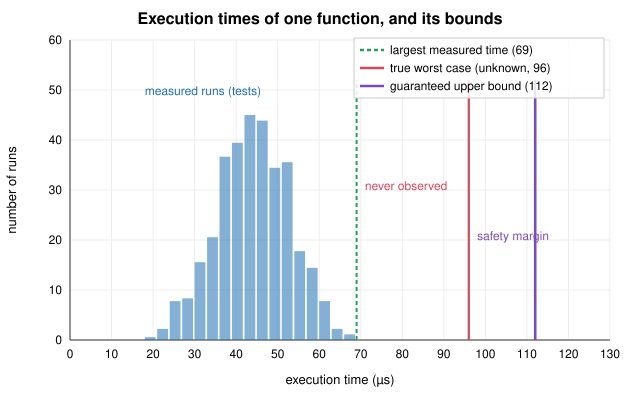
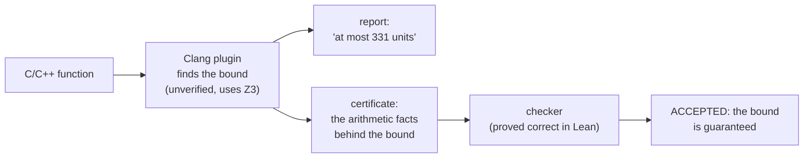
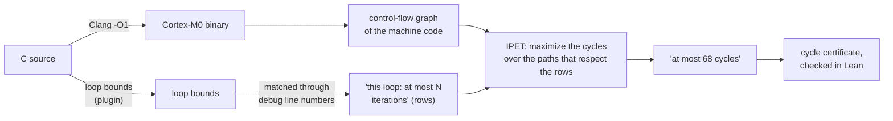

# Part 1 — The big picture

This part tells the whole story once, without technical detail, on one small example.
Every word in **bold** is explained properly in Part 2.

## 1.1 The problem: how long can this function take?

A real-time system must react within a deadline: an airbag controller, a motor drive, an
audio filter called every 1.33 ms. For each function that runs under such a deadline, the
engineer must know its **worst-case execution time** (WCET): the longest time it can take,
over all inputs and all situations.

Testing does not give that number. A test measures one run; the worst run may be one that
the tests never produce. The picture below is the usual one in the WCET literature: the
measured times are a cloud of points, the true worst case is somewhere to the right of
the cloud, and what a certification authority wants is a **guaranteed upper bound** that is
on the right of the true worst case — not too far, or the hardware is oversized for
nothing.



Two things decide the worst case:

1. **The path through the code**: how many times each loop iterates, which branch of each
   `if` is taken, how deep a recursion goes. This is a property of the *program*.
2. **The time of each instruction** on the processor: cycles, cache misses, pipeline
   stalls. This is a property of the *hardware*.

Industrial WCET tools (aiT, OTAWA, Bound-T, RapiTime) do both on the compiled binary. The
first part is the hard one for code with loops, because in general nobody can tell how
many times a loop runs — that is the halting problem. Real-time code is written so that
its loops *do* have bounds, but the tool still has to **find** the bound and **justify**
it. When it cannot, the engineer writes it by hand as an annotation ("this loop runs at
most 64 times"), and the result is only as good as that annotation.

## 1.2 The idea of CrossCheck

CrossCheck works on the **source code**, at compile time, and does three things.



1. **Find the bound.** For each loop, the plugin looks for a quantity that decreases at
   every iteration and cannot go below zero while the loop runs — a **potential**
   (Part 2, section 2.2). If it starts at 16 and drops by at least 1 per iteration, the
   loop runs at most 16 times. To find such a quantity, the plugin asks the solver **Z3**
   to solve a system of linear constraints (sections 2.4–2.7). Bounds of loops are then
   combined into a bound of the function: a sequence costs the sum of its parts, an `if`
   costs its test plus the more expensive branch, a loop costs its number of iterations
   times its body (section 2.12).
2. **Write a certificate.** The plugin, its solver and its heuristics are complex
   programs and certainly have bugs. So it does not just print "16": it writes down
   *why* — the potential, the facts that hold at the head of each loop (**invariants**,
   section 2.3), and for every step of the argument the coefficients that show it
   follows from the previous facts (**Farkas multipliers**, section 2.5).
3. **Check the certificate.** A separate, small program — the **checker** — reads the
   certificate and redoes every step with integer additions and multiplications. It does
   not search for anything; it only verifies. Its correctness is proved once, in the
   proof assistant **Lean** (section 2.14): the proof says that if the checker accepts a
   certificate, then every execution of the certificate's program costs at most the
   stated bound. So the bound no longer depends on the plugin being correct.

This division of labour — a complex untrusted *producer* and a simple trusted *checker* —
is the idea of **proof-carrying code** (Necula, 1997).

## 1.3 One example, followed from start to end

The repository has a small fixed-point FIR filter, `benchmarks/fir_filter.cpp`:

```cpp
constexpr int kTaps = 16;
constexpr int kMaxBlock = 64;

CROSSCHECK_REALTIME
std::int16_t fir_step(Fir& f, std::int16_t x) {
  f.head = (f.head + 1) & (kTaps - 1);
  f.delay[f.head] = x;
  std::int32_t acc = 0;
  int idx = f.head;
  for (int k = 0; k < kTaps; ++k) {               // the tap loop
    acc += static_cast<std::int32_t>(f.coeff[k]) * f.delay[idx];
    idx = (idx - 1) & (kTaps - 1);
  }
  acc >>= 15;
  if (acc > INT16_MAX) acc = INT16_MAX;
  if (acc < INT16_MIN) acc = INT16_MIN;
  return static_cast<std::int16_t>(acc);
}

CROSSCHECK_DEADLINE(22000)
void fir_block(Fir& f, std::int16_t* samples, CROSSCHECK_RANGE(0, kMaxBlock) int n) {
  for (int i = 0; i < n; ++i) samples[i] = fir_step(f, samples[i]);
}
```

The macros are the only annotations: `CROSSCHECK_REALTIME` asks the plugin to analyse the
function and to reject it if it allocates memory, throws, calls through a pointer or has
an unbounded loop; `CROSSCHECK_DEADLINE(22000)` states a budget; `CROSSCHECK_RANGE(0, 64)`
says that `n` is between 0 and 64 — an **assumption**, which the report lists.

### What the plugin says

```text
fir_filter.cpp:27: remark: crosscheck: 'dsp::fir_step': worst-case cost bound 331 units
fir_filter.cpp:45: remark: crosscheck: 'dsp::fir_block': worst-case cost bound 21699 units
                   (deadline 22000), under 1 assumption(s)
```

**Units** are abstract operations: by default each arithmetic operator, assignment, memory
access, comparison and call counts 1 (the **cost model**, section 2.12). They are not
cycles or nanoseconds; Part 5 shows how to get cycles.

How does 331 come about? The report (`--report=FILE`, a JSON file) gives, for the tap
loop:

```json
{ "line": 33, "bound": 16, "verified": true, "potential": "-k + 16",
  "invariants": [ "-k <= 0" ] }
```

- The **potential** is `16 − k`. At the loop head, while the loop runs (`k < 16`) it is
  at least 1; each iteration adds 1 to `k`, so it drops by exactly 1. It starts at 16
  (because `k = 0` on entry). So the loop body runs at most 16 times.
- The **invariant** `−k ≤ 0`, that is `k ≥ 0`, holds every time the loop head is
  reached. It is needed to know that the potential is never larger than 16.
- The body costs at most 17 units, the test `k < 16` costs 2: the loop costs at most
  16 × (2 + 17) + 2 = 306 units (the last test is the one that exits). The code before
  and after the loop adds 25: 331.

For `fir_block`, the plugin finds a bound **in the parameter** `n`: 3 + 339·n units (each
iteration calls `fir_step`, 331 units, plus 8 for the loop's own work). With `n ≤ 64`, this
is at most 21 699 units, below the deadline of 22 000.

### What the certificate contains

With `--opt=certificates=fir.cert.json` the plugin writes one certificate per function.
It is a small program over integer variables, annotated at every step. The checker can
print it (`crosscheck-check --print`):

```text
dsp::fir_step::k := 0    [cost 1]
// ... && dsp::fir_step::k <= 0 && -dsp::fir_step::k <= 0
while (dsp::fir_step::k + -15 <= 0) {
    [test cost 2; invariant -k <= 0 && k - 16 <= 0;
     potential (-k + 16)/1 <= 16/1; body bound 17]
  ...
}
```

Every line is a claim, and every claim comes with numbers that justify it: for example,
that `k − 16 ≤ 0` still holds after `k := k + 1` when the loop test `k − 15 ≤ 0` held is
justified by "1 × (k − 15 ≤ 0)", a **Farkas certificate** (section 2.5).

### What the checker says

```text
ACCEPTED dsp::fir_step: bound 331
ACCEPTED dsp::fir_block: bound 3 + 339*max(0,γ0)
PROGRAM  fir_filter.cpp: ACCEPTED
```

`γ0` is the parameter `n`. The checker is the program `crosscheck-check`, compiled from
Lean code (`formalization/CheckerMain.lean` and the `…Core.lean` modules). The theorem
`Checker.program_sound` says what `ACCEPTED` means: every execution of the certificate's
program, from a state that satisfies its precondition, costs at most the bound.

### The remaining gap: is the certificate's program the C function?

The certificate contains a *model* of `fir_step` (integer variables, assignments, a
`while` loop), produced by the plugin. If the plugin translated the C code wrongly, the
checker would check the wrong program. Two answers:

- the translation is kept simple and is tested (random programs are compiled, run, and
  compared with their bounds: Part 4);
- for a fragment of C, the plugin also exports the function as **mini-C**, a small
  description of the source that is independent of the analysis, and the checker proves
  that the certificate's program is the meaning of that mini-C (**translation
  validation**, Part 3, section 3.8). The trusted part is then the export to mini-C, which
  is a syntactic copy.

## 1.4 From abstract units to processor cycles

A bound in units is not a bound in time. On a simple processor without caches — such as
the Arm **Cortex-M0**, common in microcontrollers — every instruction takes a fixed number
of cycles, written in the processor's manual. CrossCheck's third part (Paper III) uses this:



- The binary is cut into instructions; the **control-flow graph** says which instruction
  can follow which (section 2.16).
- **IPET** (implicit path enumeration) turns "the longest path that respects the loop
  bounds" into a **linear program** (section 2.6), solved by an ordinary LP solver.
- The LP solver's answer comes with a **dual solution** — numbers on the instructions and
  on the loop bounds — that proves the bound (section 2.6). That is the cycle certificate.
  The checker decodes the machine code itself, with a decoder and a cycle table written
  in Lean, builds the graph itself, and checks the dual solution on it.
- The last step removes the loop bounds from the trusted base: the loop bounds are proved
  **on the machine code itself**, with invariants on the processor's registers, its flags
  and the words of the stack frame, and potentials that decrease on each loop's back edge
  (Part 5).

On the 29 TACLeBench kernels compiled for a Cortex-M0, 115 functions receive a cycle bound
accepted by the checker, and in every emulated run the observed cycles stay below it.

## 1.5 What is trusted, mode by mode

Trust is the central question of the whole project. The table says what must be believed
for each kind of result; everything else is checked.

| Result | What must be trusted |
|---|---|
| Bound printed by the plugin, no certificate | The plugin (C++), Z3, the cost model, the annotations |
| Bound with a certificate accepted by the checker | Lean's kernel and compiler; the checker's reading of the JSON file; that the certificate's program models the C function; the annotations |
| … and validated against mini-C | The same, except the model: replaced by the export to mini-C (a syntactic copy) and its stated hypotheses (no signed overflow, no aliasing of tracked variables) |
| Cycle bound of a binary, certified | The Lean specification of the Cortex-M0 (decoder, cycle table), that the code in the certificate is the binary's, the loop bounds (rows) |
| … with loop bounds certified on the code | The specification (now also: effects of the instructions on registers, flags, stack pointer and memory); that the code is the binary's; the stated assumptions on callees (`abi`, `frame`), if used |

What is never covered: interrupts arriving during the function (unless the response-time
analysis of Paper I is used), and the hardware behaving as its manual says. The Cortex-M0
model has been compared with an emulator written for this project, not with a real chip.

## 1.6 The three papers and the code

| | Paper I (`paper/theory/`) | Paper II (`paper/tool/`) | Paper III (`paper/binary/`) |
|---|---|---|---|
| Subject | Theory: loops and recursion as minimisation; bounds by potentials; a cost logic; certificates and a verified checker | The Clang plugin; certificate production; evaluation on benchmarks; comparison with five tools | Cycle bounds of machine code; the checker builds the graph from the code; loop bounds proved on the code |
| Lean | almost everything (about 10 300 lines, 451 theorems) | — | modules `Cycles`, `Thumb`, `ThumbData` (about 2 900 lines, 102 theorems) |
| Measurements | none | TACLeBench, CMSIS-DSP, TPDB, observed counts, five other tools | TACLeBench on Cortex-M0: cycles, certificates, OTAWA, stack |

The code: `clang-plugin/` (C++, the analyser), `formalization/` (Lean: the proofs and the
checker program), `benchmarks/` (the evaluation scripts; `benchmarks/cycles/` for Paper III),
`frontends/rust/` (a Rust front-end through MIR → C).

## 1.7 What CrossCheck is not

- Not a complete WCET analyser for complex processors: it has no cache or pipeline model.
  On the Cortex-M0 none is needed; for other processors the loop bounds are given to OTAWA.
- Not a verified compiler: the bound of a C function is about the C semantics (or the
  mini-C description), the bound of a binary about the binary.
- Not complete: many loops are not bounded (those controlled by values read from memory,
  floating point, pointer chasing). A function that is not bounded is *rejected*, which is
  the safe outcome.
- Not new in its ingredients: ranking functions (Floyd 1967), the timing schema (Shaw,
  Puschner–Koza 1989), Hoare logics for time (Nielson 1984), Farkas' Lemma (1902), IPET
  (Li–Malik 1995), proof-carrying code (Necula 1997). What is new is how they are put
  together, checked end to end in Lean, and carried down to the machine code.
