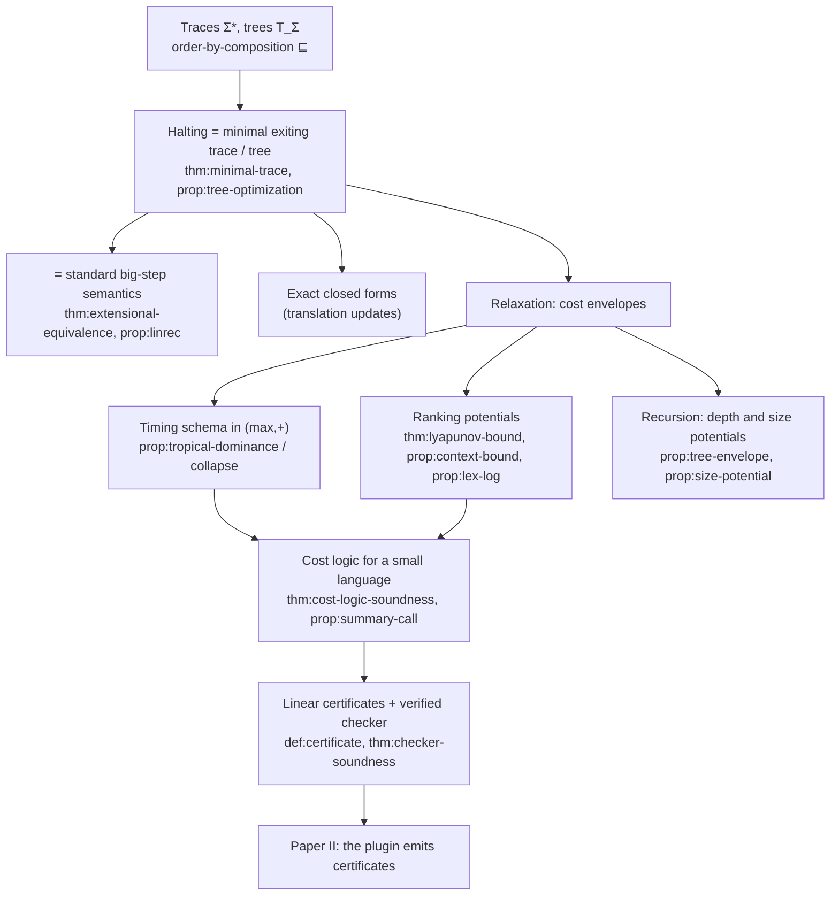
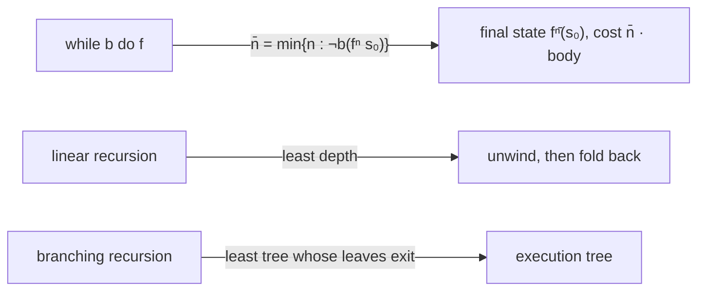
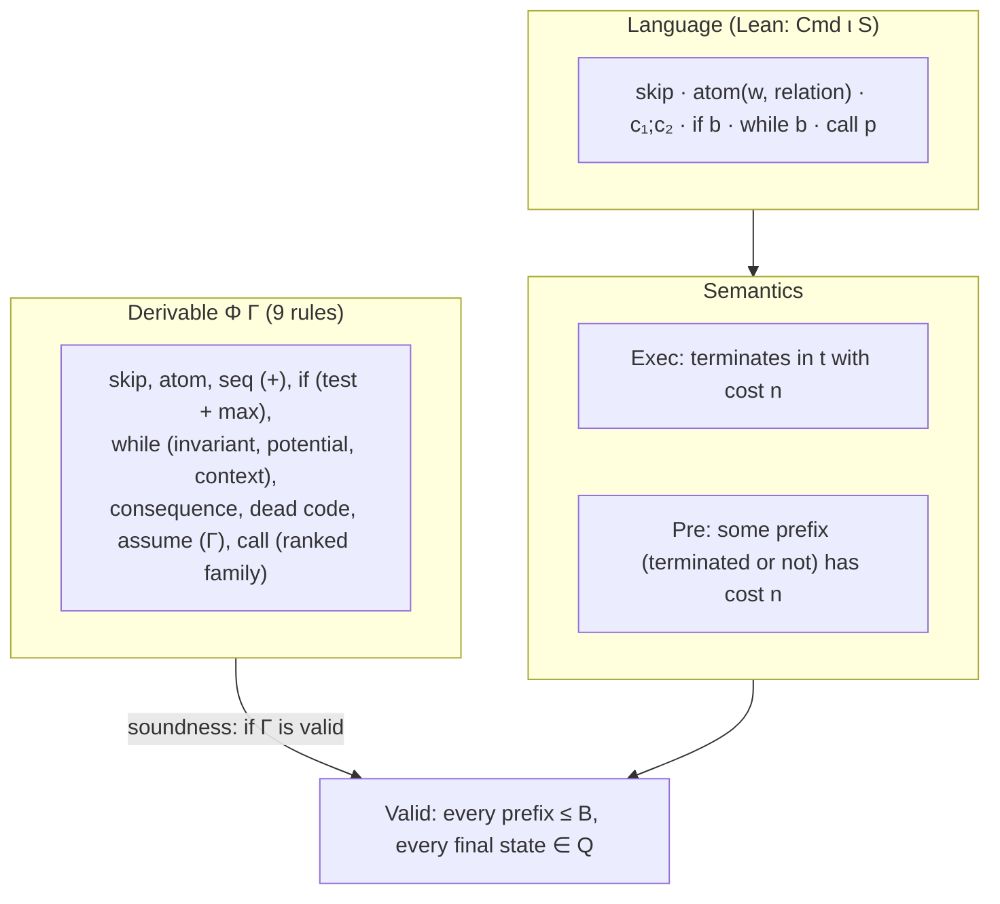
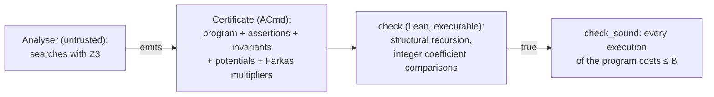
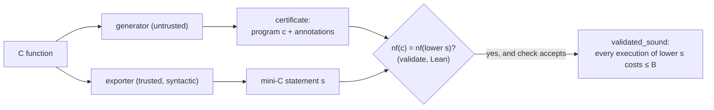
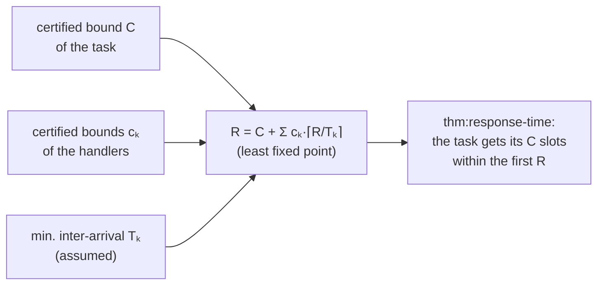
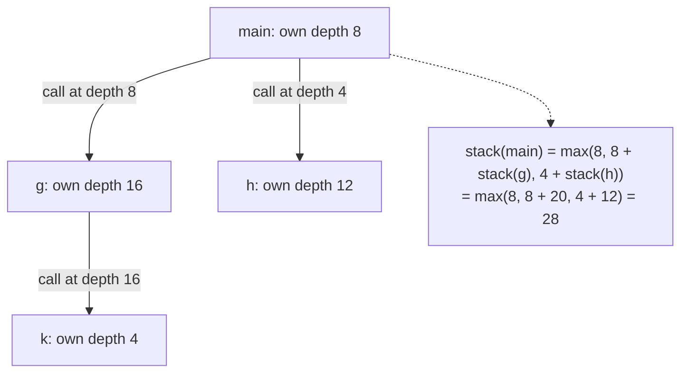

# Part 2 — Reading Paper I (theory and Lean)

`paper/theory/crosscheck-theory.tex`. Every result, in plain words, with its Lean name.
Statements are referred to by label, as in `CLAUDE.md`.

## 1. The story in one diagram

**What is new, honestly** (subsection "Positioning"): the ingredients are classical
(μ-operator, Floyd's ranking functions, the timing schema, time Hoare logics, Farkas). The
contribution is the uniform order-theoretic packaging, machine-checked end to end, and a
cost logic whose loop rule is exactly the analyser's certificate, with an executable
checker. Paper I contains **no measurement**; those are in Paper II.

## 2. Foundations

| Label | In words | Lean |
|---|---|---|
| `def:state-transition` | states `S`, pointed `S⊥`, partial transitions `S → S⊥` | `PointedState`, `PartialTransition` |
| `def:trace-functional` | traces = words of instructions; `t^n` iteration; valuation `⟦t⟧` | `Trace`, `traceIter`, `evalTrace` |
| `def:subadditive-norm` | cost = (weighted) length; additive | `cost`, `wcost` |
| `def:order-by-composition` | `t₁ ⊑ t₂` iff `t₁` is a prefix of `t₂` | prefix order `⊑` |
| `prop:poset-properties` | `⊑` is a partial order; cost is monotone along it | `order_refl/trans/antisymm`, `order_cost_le` |
| `prop:n-monotony` | `tᵐ ⊑ tⁿ` iff `m ≤ n` (for `t ≠ ε`) | `iter_monotone_iff` |
| `thm:minimal-trace` | if some iterate exits, a least exiting one exists | `exists_minimal_iteration` |
| `def:path-selector`, `prop:worst-case-step` | bodies whose trace depends on the state; cost ≤ steps × worst body | `runTrace`, `runTrace_cost_le` |
| `prop:nested-cost` | cost of nested and sequential loops | `nested_trace_cost` |
| `prop:tropical-dominance` | a conditional costs ≤ test + max of branches | `condTrace_cost_le` |
| `thm:extensional-equivalence` | the minimiser = the big-step result of `while` | `while_trace_semantics` |
| `def:tree-algebra`, `def:tree-order` | computation trees, grafting `⊗`, tree prefix order | `BTree`, `graft`, `TreePrefix` |
| `prop:tree-order-properties` | the tree order is a partial order; size is monotone | `treePrefix_*` |
| `def:tree-exponentiation`, `prop:tree-power-complexity` | `B^{⊗d}` has `2^d` leaves and `2^{d+1}−1` nodes | `treePow_*` |

## 3. Loops and recursion as optimisation

- `prop:min_x`: while loops ⇔ minimisation (`whileBigStep_iff_minimalExit`).
- `prop:linrec`: linear recursion ⇔ dual-layer trace optimisation (`framedBigStep_iff`).
- `prop:tree-optimization`: branching recursion ⇔ least feasible tree (`exec_least`,
  `treeBigStep_iff`). Binary in Lean; general arity on paper.

## 4. Relaxation: cost envelopes

- **Timing schema** (`prop:tropical-collapse`): sequence `+`, branch `max`, loop
  `K·(test + body) + test` (`while_cost_bound`). Infeasible paths are not excluded.
- **Ranking** (`def:ranking-potential`, `thm:lyapunov-bound`): an integer potential that
  decreases by `Δ` and is positive while the loop runs gives `⌈V₀/Δ⌉` iterations and
  termination (`ranking_bound`, `ranking_terminates`). The *relational* variant — rational
  `V`, any transition relation (unknown inputs, faults), `n ≤ ⌊V(s₀)⌋`
  (`ranking_bound_floor`) — is what tools use.
- **Invariant and context** (`prop:context-bound`): the conditions are needed only on an
  inductive invariant `I`, with `V ≤ K` on a context `C` of initial states. Consequences:
  facts survive early exits; a function can get a different bound at each call site
  (`run_invariant`, `ranking_bound_of_context`, `call_bound_of_context`).
- **Two more shapes** (`prop:lex-log`): a lexicographic pair `(V₁, V₂)` with `V₂ ≤ K₂` gives
  `⌊V₁(K₂+1) + V₂⌋` steps (an inner counter reset by the outer one); a natural potential
  divided by `b ≥ 2` per step gives `⌊log_b V⌋ + 1` (binary search). These are theorems on
  runs (`lex_ranking_bound`, `log_ranking_bound`). The lexicographic pair is also one
  potential for the loop rule (`lex_potential`): affine when `K₂` is a constant, so the
  ordinary `while` node certifies it.
- **Recursion** (`prop:tree-envelope`, `prop:size-potential`): a depth potential bounds the
  depth `D`, hence `1 + b + … + b^D` activations; a *size* potential `U(x) ≥ 1 + Σ U(xᵢ)`
  bounds the activations by `U(x)` directly, which is linear for divide and conquer
  (`exec_size_le`, `callTree_size_le_potential`).
- **SMT synthesis** (`subsubsec:smt-synthesis`): the universally quantified conditions on
  `V = w·x + c₀` become linear constraints on `w`, `c₀` and Farkas multipliers. The
  soundness direction is in Lean (`farkas_sound`); completeness is cited.

## 5. The cost logic (`subsec:cost-logic`)

- `def:valid-triple`: `{P} c {Q}↓B` is valid iff from `P` every prefix costs ≤ `B` and
  every terminating run ends in `Q`. Bounding *prefixes* is what excludes divergence.
- `def:derivable-triple`: the rules. **Rule 8 (assume)** is how library contracts enter.
  **Rule 9 (call)** handles recursion: a family of call triples indexed by `k`, with a
  rank; each body is proved assuming the members of smaller rank.
- `thm:cost-logic-soundness` (`soundness`): derivable from valid assumptions ⇒ valid.
  Induction on the derivation; the loop case inducts on the execution with a budget `m`;
  the call case by strong induction on the rank.
- `prop:summary-call`: a *symbolic* bound `B(s)` is a family of numeric triples, one per
  budget `k`; a summary can be used at any call where the precondition holds and `B ≤ k`
  (`validSym_call`, `validSym_seq`).
- Weights, architectures, parallelism: one paragraph, **not formalised** (work = sum,
  span = max for fork-join).
- Prior work named in the paper: Nielson 1987; Haslbeck & Nipkow 2018 (three logics for
  deterministic IMP, sound and complete, in Isabelle). Here: soundness only, but relational
  atoms, prefix bounds, and a loop rule that is the analyser's certificate.

## 6. Certificates and the checker (`subsec:checker`)

- Linear instance: integer variables, affine expressions, tests `e ≤ 0`, assertions =
  conjunctions of `ℓ ≤ 0`, possibly over **logical variables** `γⱼ` that no program changes.
- `def:certificate`: the program with every annotation a derivation needs.
- In the loop case, `γⱼ` stands for "the potential before this iteration": the body is
  checked once, from `pot ≤ γⱼ` to `pot + d ≤ γⱼ`; since soundness holds for every value of
  `γⱼ`, the proof instantiates it with the current potential.
- `thm:checker-soundness` (`check_sound`): accepted ⇒ valid. Fragment: assignments, unknown
  values (also with constraints, `havocC`), sequences, conditionals, loops with a linear or
  conjunctive test, calls against summaries, contracts; early exits are expressed by the
  producer with flags (Paper II).
- **Logarithmic loops** (two more loop nodes, each reduced to the same loop rule of the
  logic with a transformed potential, so the logic itself is unchanged):

| Node | Premises checked | Iterations | Potential used in the proof |
|---|---|---|---|
| `while` | `pot ≥ d` under the test; body: `pot ≤ γ` → `pot + d ≤ γ` | `⌊k/d⌋` | `pot / d` |
| `whileLog` | `pot ≥ 1` under the test; body: `pot ≤ γ` → `b·pot ≤ γ`; `pot ≤ k` on entry | `⌊log_b k⌋ + 1` | `⌊log_b pot⌋ + 1` (`logloop_sound`) |
| `whileGrow` | `pot ≥ 1` on entry, `pot ≤ K` under the test; body: `pot ≥ γ` → `pot ≥ b·γ` | `⌊log_b K⌋ + 1` | `N − ⌊log_b pot⌋` (`growloop_sound`) |

  The step in both proofs: `b·y ≤ x`, `x ≥ 1` give `⌊log_b y⌋ + 1 ≤ ⌊log_b x⌋` (or `y ≤ 0`).
  `ilog` is defined by structural recursion (with fuel) so that `decide` can run the
  examples, and proved equal to mathlib's `Nat.log` (`ilog_eq`).

### Validation against the source (`subsec:validation`)

- `def:minic`: mini-C (variables, constants, `+ − ×`, unknown `⊤`; comparisons; skip,
  assign, `cost(ω)`, seq, if, while with `&&`, for); its meaning **is** `lower`, a program
  of the checker without annotations. `nf` erases annotations, `weaken`/`dead` (keeping
  their code), `skip`, the nesting of sequences, trailing zeros.
- Three statements added on 2026-11-16, each lowered to existing programs of the checker
  (so no proof changed):

  | Mini-C statement | Lean | Lowered to |
  |---|---|---|
  | `x = y / c`, `y % c`, `y & c`, `y >> k` | `divStore`, `divFacts`, `divOf` | `if (y ≥ 0) x := ? with facts else x := ?` (e.g. `c·x ≤ y ≤ c·x + c − 1`); a scratch variable holds the old `x` for `x = x / c` |
  | a store into an unsigned variable | `assignU` | `x := e` if `0 ≤ e ≤ hi`, else `x := ?` |
  | `f(a₁, …)` | `call`, `storeArg` | stores of the arguments into the callee's parameter variables, then the checker's `call` node |

- `lem:nf-equiv` (`nf_equiv`): `c` and `nf c` have the same executions and prefixes, same
  costs (associativity, units, congruences; induction on derivations for loops).
- `thm:validated` (`validated_sound`): accepted program + validated body ⇒ the bound holds
  for the source. The idea is translation validation (Pnueli et al. 1998, Necula 2000).

## 7. Worked examples

| Example | Program | Result | Lean |
|---|---|---|---|
| Parametric loop | `while (i++ < 13) { i = i+1; x = y+2; y = x+3; }` | one iteration `(i,x,y) ↦ (i+2, y+2, y+5)`; `n̄ = ⌈(13−R)/2⌉`; for `R = 0`: `(15, 34, 37)`; potential `13 − i`, `Δ = 2`, tight | `parametric_loop_*` |
| Infinite loop | `int i = 0; while (i != 1) i = 0;` | equations infeasible ⇒ no derivation (divergence); no potential | `infinite_loop_diverges` |
| Linear recursion | `foo(a) { if (a > 4) a = foo(a−2)+3; return a+6; }`, `foo(10)` | depth 3, value 37 | `linear_recursion_*` |
| Branching recursion | `foo(x) { if (x > 0) return foo(x−1)+foo(x−1); return 1; }`, `foo(2)` | full binary tree of depth 2, 7 calls, value 4; envelope `2^{x+1}−1`, attained | `binary_recursion_*` |
| Cost logic | `while (i < n) i++` from `i = 0`, `n ≤ 10` | derivable bound 21 | `countLoop_cost` |
| Recursion in the logic | `down() { if (x > 0) { x--; down(); } }` | cost ≤ `3n + 2` from `x ≤ n` | `down_cost` |
| Checker | the counting loop as a certificate | accepted with 21, rejected with 20 | `countCert_checks` (by `decide`) |
| Validation | the same loop in mini-C, `i = i + 1` | validated; `i = i + 2` is not | `countCert_validated`, `countCert_not_validated` |

## 8. Mechanization, scope, limitations

- About 5,800 lines, 288 theorems, 21 modules, no `sorry`, only the standard axioms. Table
  `tab:lean` is mirrored by `formalization/formalization.yaml`.
- **Not mechanised** (the paper lists them): general arity for the tree *order*;
  termination, not just bounds, for relations; the equation-generation rules; Farkas
  completeness; the remark on infinite executions; the parallelism paragraph; lexicographic
  potentials with a symbolic inner bound (with a constant one they are affine; the
  logarithmic ones are checker cases); the translation from C/C++;
  the plugin; the busy-period argument for interrupts.
- Limitations: cost is not time; no amortisation; affine and logarithmic potentials only;
  structured control flow over scalar variables.

### Interrupts and fork-join (`subsec:concurrency`)

- `def:interrupt-model`: slots from the start of the computation; handler activations at
  least `Tₖ` apart, at most `cₖ` slots each, none pending at slot 0; no idle slot while the
  computation is unfinished. `lem:sporadic`: at most `⌈t/Tₖ⌉` activations before `t`.
- `thm:response-time` (`response_time_bound`): the classical bound (Joseph & Pandya 1986,
  Audsley et al. 1993); priority order not needed for this upper bound. The checker
  verifies a claim with `rtaHolds` (`rtaHolds_sound`). Prosa (Coq) is the general
  mechanization to cite.
- `prop:graham` (`greedy_bound`): greedy scheduling of independent tasks, makespan
  `≤ W/p + S`; with certified task bounds (`forkjoin_bound`). Not in the plugin.
- Hypotheses to say aloud: cost = time (needs a timing cost model, Paper II's Cortex-M0),
  no pending activation at the start (the busy-period argument is not mechanized).

### Stack depth (`subsec:stack`)

Cost is a sum along an execution; the stack is a **high-water mark**, a maximum.

- `def:activation-tree`: a tree of activations; each call edge carries the caller's depth.
- `prop:stack` (1) (`highWater_le_of_bound`): any `B` with `own f ≤ B f` and
  `d + B g ≤ B f` at every call site bounds the stack: the rule `stack.py` applies to a
  binary. (2) (`highWater_le_depth`): frames of at most `F`, depth `n` ⇒ `(n + 1)·F`: a
  recursion depth bound gives a stack bound.
- Not formalised: that a machine program's runs are such trees (the processor model).

## 9. Paper I on one page

*Halting is minimality.* Order traces by prefix and trees by grafting; the run of a loop or
of a recursion is the least exiting trace or tree, and that equals big-step semantics.
*Bounds are relaxations.* Replace exact states by potentials and the timing schema to get
sound cost bounds; these compose in a cost logic over a small language with procedures,
recursion and contracts, sound also for diverging runs. *Bounds can be checked.* A linear
instance has certificates that an executable, verified checker validates. All of it is in
Lean.
