# Part 2 — The toolbox: every building block, from zero

The papers take a dozen techniques for granted. This part explains each of them as if you
had never heard of it, on small examples with numbers, and says where it is used in
CrossCheck. Read it in order the first time: each section uses the previous ones.

Contents

1. [Loops and the question "how many times?"](#21-loops-and-the-question-how-many-times)
2. [Potentials (ranking functions)](#22-potentials-ranking-functions)
3. [Invariants](#23-invariants)
4. [Linear constraints and their geometry](#24-linear-constraints-and-their-geometry)
5. [Farkas' Lemma: proving a consequence by adding inequalities](#25-farkas-lemma-proving-a-consequence-by-adding-inequalities)
6. [Linear programming and duality](#26-linear-programming-and-duality)
7. [SAT, SMT and Z3: what CrossCheck asks the solver](#27-sat-smt-and-z3-what-crosscheck-asks-the-solver)
8. [Intervals and calling contexts](#28-intervals-and-calling-contexts)
9. [Fourier–Motzkin elimination, and where CrossCheck uses it](#29-fouriermotzkin-elimination-and-where-crosscheck-uses-it)
10. [Difference constraints, zones and shortest paths](#210-difference-constraints-zones-and-shortest-paths)
11. [Abstract interpretation and widening](#211-abstract-interpretation-and-widening)
12. [Composing costs: the timing schema and cost envelopes](#212-composing-costs-the-timing-schema-and-cost-envelopes)
13. [Recursion: call trees, depth and size potentials](#213-recursion-call-trees-depth-and-size-potentials)
14. [Certificates, checkers, proof assistants and Lean](#214-certificates-checkers-proof-assistants-and-lean)
15. [Machine code in one hour (Cortex-M0)](#215-machine-code-in-one-hour-cortex-m0)
16. [Notation crash course](#216-notation-crash-course)

---

## 2.1 Loops and the question "how many times?"

A loop `while (test) body` runs its body again and again until the test fails. Its cost
is the number of iterations times the cost of one iteration (plus the tests), so the whole
question of bounding a function's cost comes down to bounding **how many times each loop
can iterate**.

Mathematically, if the state of the program is `s` and one iteration turns it into `f(s)`,
the loop stops after the **first** `n` such that the test fails on `fⁿ(s)` (the state after
`n` iterations):

```text
n̄ = min { n ≥ 0 : test is false on fⁿ(s₀) }
```

This "least `n`" is Kleene's **μ-operator** (minimisation). Paper I builds its theory on
this observation: running a loop is solving a minimisation problem (Part 3). If no such
`n` exists, the loop does not terminate.

In general nobody can compute `n̄`, or even decide whether it exists: that is the
**halting problem** (Turing, 1936). This is not an obstacle in practice, because we do not
need the exact number, only an **upper bound**, and only for loops written to be bounded.
The tool is allowed to say "I don't know" (and reject the function); it is not allowed to
give a bound that is too small. Those two properties have names:

- **soundness**: every bound given is correct (never below the true number);
- **completeness**: every loop that has a bound gets one. No tool is complete; CrossCheck
  aims at soundness first and precision second.

> **Expert phrasing.** "The analysis is sound but incomplete: it over-approximates the
> set of executions, so its bounds are safe, and it may reject terminating loops."

---

## 2.2 Potentials (ranking functions)

### The idea

Take `for (int i = 0; i < 10; i++) body;`. Consider the quantity `V = 10 − i`.

- Before the first iteration, `i = 0`, so `V = 10`.
- Each iteration adds 1 to `i`, so `V` drops by exactly 1.
- The loop runs only while `i < 10`, that is while `V ≥ 1`.

A quantity that **starts at most at K**, **drops by at least 1 per iteration**, and **is at
least 1 whenever the loop runs** cannot allow more than `K` iterations: after `K` drops it
would be at most 0, and the loop would have stopped.

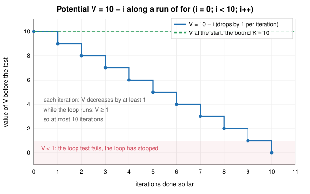

Such a quantity is a **ranking function** (Floyd, 1967); Paper I calls it a **ranking
potential**, by analogy with the potential energy of physics, which also only decreases.
(The control-theory name is a **Lyapunov function**: a quantity that decreases along every
trajectory of a system and proves that it settles. Paper I's `thm:lyapunov-bound` is named
after it.)

### The three conditions, precisely

For a loop with test `b` and a potential `V` (a function of the variables):

1. **Positivity**: whenever the test `b` is true, `V ≥ 1`.
2. **Descent**: whenever the test is true, one iteration lowers `V` by at least 1:
   `V(after) ≤ V(before) − 1`.
3. **Bound on entry**: when the loop starts, `V ≤ K`.

Then the loop iterates at most `K` times (Lean: `ranking_bound`; when `V` is rational, at
most `⌊K⌋` times: `ranking_bound_floor`).

Why "at least 1" and not "at least some ε > 0"? With rational numbers, a potential that
drops by 0.5 per iteration would allow `2K` iterations: the conditions must be scaled.
CrossCheck allows a scale: "drops by `Δ`" gives `⌈K/Δ⌉` iterations. In certificates the
potential is written as `e/d` (an affine expression divided by an integer `d`), which is
the same thing.

### More examples

**Loop with a bound in a variable.** `for (i = 0; i < n; i++)`: `V = n − i`. On entry
`V = n`, so the bound is `n` — a bound *in the parameter*. If `n ≤ 64` is known (an
annotation, or a calling context, section 2.8), the bound is 64.

**A body with a data-dependent step.** If the body sometimes does `i += 3` and sometimes
`i += 1`, the potential `V = 20 − i` drops by 3 or by 1. The descent condition asks only
"at least 1", so the bound is still 20; the actual run may be shorter.

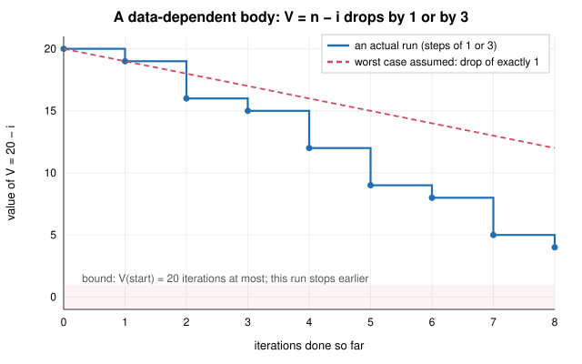

**Two variables.** `while (lo < hi) { if (...) lo++; else hi--; }`: `V = hi − lo` drops by 1
whichever branch runs.

**A loop where no linear potential works.** `while (x > 0) x = x / 2;` (integer division).
`V = x` drops by at least 1, so the bound is the initial value of `x` — correct but very
loose (1000 for `x = 1000`). The real number of iterations is `⌊log₂ x⌋ + 1 = 10`. Paper I
also proves a **logarithmic potential** rule (`log_ranking_bound`): if a natural-number
quantity is at least divided by `b ≥ 2` at every iteration, the loop runs at most
`⌊log_b V⌋ + 1` times. The plugin uses it for loops that divide or multiply a counter by a
constant (certificate nodes `whileLog`, `whileGrow`).

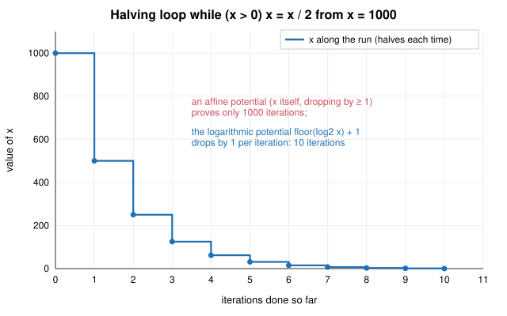

**Nested loops.** In

```c
for (i = 0; i < n; i++)
  for (j = 0; j < m; j++) body;
```

the inner loop has potential `m − j`, bound `m`, and the outer has `n − i`, bound `n`; the
inner body runs at most `n·m` times. For the "triangular" nest `for (j = 0; j < i; j++)`
the product `n·n` is safe but loose: the exact count is `n(n−1)/2`. Section 2.12 shows the
envelopes on a plot.

**Lexicographic potentials.** Some loops need two quantities: an outer one that drops
while the inner one may grow back, like the digits of an odometer. Paper I proves the rule
for a pair `(V₁, V₂)` with `V₂ ≤ K₂` (`lex_ranking_bound`): it is the same as the single
potential `V₁·(K₂ + 1) + V₂`, so the ordinary rule covers it (`lex_potential`).

### Pitfalls

- **The conditions must hold for every state the loop can be in**, not only those of one
  run. That is why the next section (invariants) is needed: often the conditions only
  hold for the states that the program can actually reach.
- **Overflow.** In C, `i++` on `int` overflows at 2³¹ − 1. CrossCheck assumes signed
  overflow does not happen (it is undefined behaviour in C), and proves that unsigned
  arithmetic does not wrap before relying on it. On machine code (Part 5), wrap-around is
  part of the semantics and every sum is checked for it.

> **In the code.** The plugin searches potentials in `clang-plugin/src/core/Solver.cpp`,
> function `synthesizeRanking` (section 2.7 explains how). The certificate node is `while`
> in `formalization/ImperativeOptimization/CheckerCore.lean`; the theorem behind it is
> `loop_sound` in `Checker.lean`.

---

## 2.3 Invariants

### The idea

Take

```c
int i = 0;
while (i != n) { i++; }      // with 0 ≤ n
```

The potential `V = n − i` drops by 1 per iteration. Is it at least 1 while the loop runs?
The test says `i ≠ n`, which allows `i > n` — then `V` would be negative. In fact `i > n`
never happens: `i` starts at 0, never exceeds `n`, and stops exactly at `n`. The fact
"`i ≤ n` at the loop head" is an **invariant**: a property true every time execution
reaches that point. With it, `i ≠ n` and `i ≤ n` give `i ≤ n − 1`, so `V ≥ 1`.

### Inductive invariants

How do we know a property is an invariant without running the program forever? By
induction, exactly as in mathematics:

1. **Base case**: it holds the first time the loop head is reached (from what is known
   before the loop);
2. **Inductive step**: if it holds at the loop head and the test is true, it holds again
   after one iteration of the body.

A property that passes both checks is an **inductive invariant**. For `i ≤ n`: base case
`0 ≤ n` (given); inductive step: from `i ≤ n` and `i ≠ n`, we get `i ≤ n − 1`, so after
`i++`, `i ≤ n`. ✓.

Not every true invariant is inductive on its own: sometimes a property is true but can
only be proved together with another one. The analyser therefore proves sets of facts
together.

### How the plugin finds them: guess and check (Houdini)

The plugin does not "discover" invariants by deep reasoning. It **guesses** a list of
candidates — simple ones: each variable's range on entry, `x ≥ 0` when `x` only grows,
`a ≤ b` and `a < b` for pairs of variables compared in the test — and then **checks** them:

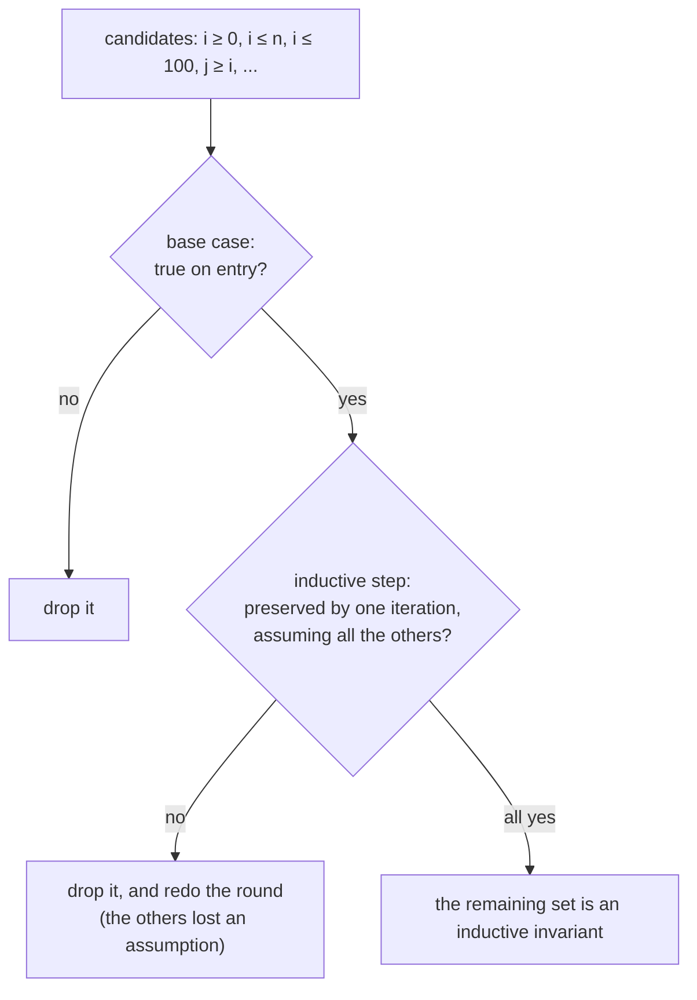

Each check is a question to Z3 (section 2.7): "do these facts imply that one?". Dropping a
candidate may break another one that relied on it, hence the rounds until nothing changes.
This scheme is known as **Houdini** (Flanagan and Leino, 2001).

> **Pitfall.** The CLAUDE.md rule "candidate loop invariants are kept only if Z3 proves
> base case and inductive step" is a soundness rule of the analyser: an unproved candidate
> must never be kept, even when the search budget runs out (then the candidates are
> dropped, which is safe).

> **In the code.** `clang-plugin/src/analysis/Analyzer.cpp`, the candidate list near
> `std::vector<Candidate> candidates` and the "Houdini-style refinement" loop (`refine`).
> In certificates, invariants are the `inv` fields of `while` nodes; the checker re-proves
> base case and step with Farkas certificates (section 2.5).

---

## 2.4 Linear constraints and their geometry

Almost every fact CrossCheck manipulates is a **linear constraint**: a sum of variables
with integer coefficients compared with a constant, like

```text
x − 10 ≤ 0          y − x ≤ 0          2a + 3b − c + 7 ≤ 0
```

CrossCheck writes every constraint in the form **`e ≤ 0`**, where `e` is an **affine
expression** (a linear combination of variables plus a constant). `x ≥ 3` becomes
`3 − x ≤ 0`; `x = 5` becomes two constraints, `x − 5 ≤ 0` and `5 − x ≤ 0`.

**Strict inequalities over integers.** `x < y` is not of the form `e ≤ 0`, but for integers
`x < y` is the same as `x ≤ y − 1`, that is `x − y + 1 ≤ 0`. This rounding is valid only
for integers; it is one reason why CrossCheck reasons about integer variables.

### The picture

A constraint on two variables `x, y` is a **half-plane**: the line `e = 0` splits the plane,
and `e ≤ 0` is one side. A set of constraints is the intersection of half-planes, a
**convex polygon** (in more dimensions, a **polyhedron**). In the figure of section 2.5,
`x ≤ 10` is the region left of the vertical blue line and `y ≤ x` the region below the
diagonal; together they form the shaded triangle (extended downwards).

Three questions are asked about such sets, again and again:

| Question | In the picture | Name |
|---|---|---|
| Is the set empty? | Do the half-planes leave any point? | **feasibility** (empty = **infeasible** = the facts contradict each other) |
| Do the facts imply a constraint `g ≤ 0`? | Is the whole polygon on the good side of the line `g = 0`? | **entailment** |
| What is the largest value of an expression on the set? | How far can we go in one direction inside the polygon? | **optimisation** (a **linear program**, section 2.6) |

For example, the facts `x ≤ 10` and `y ≤ x` *entail* `y ≤ 10`: the whole triangle is below
the dashed line. They do not entail `y ≥ 0` (the triangle extends downwards).

> **Expert phrasing.** "The abstract states are conjunctions of linear constraints, i.e.
> convex polyhedra; entailment between them reduces to linear programming."

---

## 2.5 Farkas' Lemma: proving a consequence by adding inequalities

### The trick

How can a program be *convinced* that `x ≤ 10` and `y ≤ x` imply `y ≤ 10`, without drawing
pictures? By **adding the inequalities**:

```text
  (x − 10 ≤ 0)          multiplied by 1
+ (y − x  ≤ 0)          multiplied by 1
  ---------------
   y − 10 ≤ 0           which is exactly the goal
```

Adding two true inequalities gives a true inequality; multiplying one by a **non-negative**
number keeps it true (multiplying by a negative number would flip it). So: if a
non-negative combination of the facts gives the goal, the goal follows from the facts.

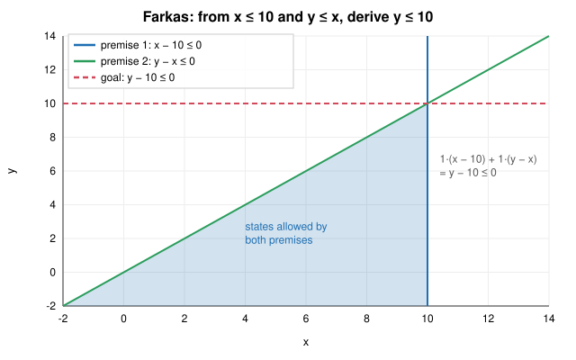

The numbers used (here 1 and 1) are called **Farkas multipliers**, and the list of them is a
**Farkas certificate** of the implication.

### The precise rule, and slack

The combination does not have to give *exactly* the goal: it may give something
*stronger*. In general, write each fact as `pᵢ ≤ 0` and the goal as `g ≤ 0`. A
certificate is a list of numbers `λᵢ ≥ 0` (and a positive number `μ`, for scaling) such
that

```text
μ · g − Σᵢ λᵢ · pᵢ   is a constant (all variables cancel), and that constant is ≤ 0.
```

Then `μ·g ≤ Σ λᵢ pᵢ ≤ 0`, so `g ≤ 0`. Example: facts `x − 10 ≤ 0`, `y − x ≤ 0`; goal
`y − 12 ≤ 0`. With `μ = 1`, `λ = (1, 1)`: `(y − 12) − (x − 10) − (y − x) = −2 ≤ 0` ✓ (the goal
is weaker than what the facts give, by 2).

**Contradictory facts prove anything.** If the facts are contradictory, say `x − 10 ≤ 0`
and `11 − x ≤ 0` (`x ≤ 10` and `x ≥ 11`), their sum is `1 ≤ 0`, a false constant. Any goal
then follows — multiply the contradiction by a large enough number. Certificates use this
for paths that cannot happen (dead code).

### The two directions of the lemma

- **Easy direction (soundness)**: if a certificate exists, the goal follows. This is just
  the argument above. It is proved in Lean (`farkas_sound` in `Certificate.lean`,
  `entails1_sound` in `Checker.lean`).
- **Hard direction (completeness)**: if the goal follows from the facts (over the
  rationals) and the facts are satisfiable, a certificate *always exists*. This is
  **Farkas' Lemma** (Gyula Farkas, 1902). It is why searching for certificates is not a
  waste of time: whenever the implication is true, there is something to find. CrossCheck
  never needs this direction to be sure of its results — it is cited, not proved in Lean.

Over the **integers** the hard direction can fail: `2x ≤ 1` and `2x ≥ 1` have no integer
solution, but no non-negative combination gives a false constant over the rationals
(`x = 1/2` satisfies both). CrossCheck only uses the easy direction, which holds over the
integers as well, so it may miss some integer facts but never accepts a false one.

### Why this is the heart of the checker

Checking a Farkas certificate needs only multiplications and additions of integers: build
`μ·g − Σ λᵢ pᵢ`, check every coefficient is zero and the constant is not positive. No
search, no solver, no rational arithmetic. Every inference of a CrossCheck certificate —
an invariant preserved by an assignment, a potential that drops, a branch condition that
implies a fact — is reduced to such a check.

> **In the code.** The checker's function is `entails1` in
> `formalization/ImperativeOptimization/CheckerCore.lean`:
>
> ```lean
> def entails1 (ps : List Lin) (g : Lin) (cert : Nat × List Nat) : Bool :=
>   let r := (g.smul cert.1).add ((comb cert.2 ps).smul (-1))
>   decide (0 < cert.1) && isZero r.sv && isZero r.lv && decide (r.c ≤ 0)
> ```
>
> `cert.1` is `μ`, `cert.2` the `λᵢ`, `comb` the sum `Σ λᵢ pᵢ`. In certificate files a
> Farkas certificate is written `{"mu": 1, "lam": [1, 0, 1]}` (source certificates) or
> `[mu, [[index, λ], ...]]` (binary loop certificates). The plugin finds them with Z3
> (`farkas` in `clang-plugin/src/core/Cert.cpp`); the binary producer with shortest paths
> (section 2.10) or a linear program (`Prover` in `benchmarks/cycles/binloops.py`).

---

## 2.6 Linear programming and duality

### Linear programs

A **linear program** (LP) asks for the largest (or smallest) value of a linear expression
over a polyhedron:

```text
maximise    3x + 2y
subject to  x + y ≤ 4,   x ≤ 3,   x ≥ 0,   y ≥ 0
```

The answer is reached at a corner of the polygon (here `x = 3, y = 1`, value 11). Solvers
(the simplex method, interior-point methods; HiGHS, CPLEX, Gurobi, the optimiser inside Z3)
solve LPs with millions of variables. An **integer linear program** (ILP) also requires
integer solutions; it is much harder in general.

### Duality: a certificate for an optimum

How can a solver *prove* that 11 is the maximum, not just claim it? With Farkas again:
combine the constraints to get the objective on the left.

```text
  2 · (x + y ≤ 4)       →  2x + 2y ≤ 8
+ 1 · (x ≤ 3)           →  x       ≤ 3
  ------------------------------------
                           3x + 2y ≤ 11
```

The multipliers `(2, 1)` are a **dual solution**. Any feasible dual solution gives an upper
bound on the maximum (**weak duality**); the best dual solution gives exactly the maximum
(**strong duality**). So an LP solver's answer comes with a cheap certificate: the dual
multipliers. Checking it is one Farkas check.

### IPET: the longest path of a program as a linear program

Here is how WCET tools turn "the longest path through the code" into an LP (**implicit path
enumeration technique**, Li and Malik, 1995). Take the control-flow graph of a loop:

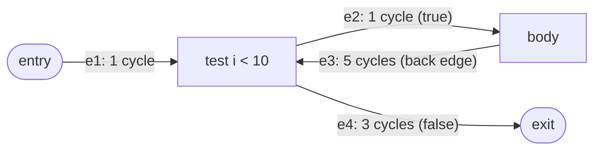

Introduce one unknown per edge: `x_e` = how many times edge `e` is taken in a run. Then:

- **flow conservation**: at each node, the number of entries equals the number of exits.
  At the test: `x_e1 + x_e3 = x_e2 + x_e4`. At the entry, 1 run starts: `x_e1 = 1`; at the
  exit, it ends: `x_e4 = 1`.
- **loop bound** (a "row"): the back edge is taken at most 10 times per entry:
  `x_e3 ≤ 10 · x_e1`.
- **objective**: maximise the total cycles `1·x_e1 + 1·x_e2 + 5·x_e3 + 3·x_e4`.

The solution is `x_e3 = x_e2 = 10`: `1 + 10 + 50 + 3 = 64` cycles. The LP never lists the
paths (there are too many), hence "implicit".

### The dual of IPET: potentials

The dual solution of IPET has a beautiful reading. It gives every node a number `π`, a
**potential** ("the cycles that may still be spent from here"), and every loop row a
multiplier `λ`. The dual constraints say, for every edge `u → v`:

```text
cost(u → v) + π(v) − π(u) ≤ (what the loop rows pay for this edge)
```

Summed along any run from entry to exit, the `π` terms **telescope** (each intermediate
`π` appears once with `+` and once with `−`), leaving `cost ≤ π(entry) − π(exit) +
(row terms)`, and the row terms are at most `λ · (row bound)`. That is the bound.

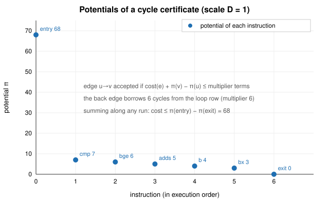

This is exactly what a **cycle certificate** of Paper III contains: a scale `D`, potentials
`π`, multipliers `λ` and the bound; the checker checks one inequality per edge.

> **In the code.** `benchmarks/cycles/ipet.py`: `lp_multipliers` asks scipy's HiGHS solver
> for the dual multipliers (untrusted), makes them integer, and `potentials` computes the
> `π` exactly by longest paths (Bellman-Ford). The checker: `checkFn` in
> `formalization/ImperativeOptimization/CyclesCore.lean`; the theorem: `Cycles.cycles_sound`
> and `program_sound`.

---

## 2.7 SAT, SMT and Z3: what CrossCheck asks the solver

### What an SMT solver is

A **SAT solver** answers: "is there an assignment of true/false to these boolean variables
that makes this formula true?" An **SMT solver** (satisfiability *modulo theories*) answers
the same question for formulas that also contain integers, reals, arrays, bit-vectors…:
"is there an integer `x` such that `x > 3 ∧ 2x < 9`?" (yes: `x = 4`). **Z3** (Microsoft
Research) is the most widely used one. It answers:

- **sat**, with a **model** (example values);
- **unsat**: no values exist;
- **unknown**: it gave up (timeout, or a theory it cannot decide).

Z3 also has an **optimiser** (`z3::optimize`): find values that maximise or minimise an
expression subject to constraints.

### The three questions CrossCheck asks Z3

All three are in `clang-plugin/src/core/Solver.cpp`.

**1. Entailment — "do these facts imply that one?"** (`entails`). To check that facts
`F` imply a goal `g ≤ 0`, ask Z3 whether `F ∧ g > 0` is satisfiable. If **unsat**, no state
satisfies the facts and violates the goal: the implication holds. If sat or unknown, the
plugin treats it as "not proved". Used for invariant candidates (section 2.3), for branch
conditions, for "this path is dead".

**2. Intervals — "what is the smallest and largest value of `e` under these facts?"**
(`boundsOf`). Two optimisation queries, maximise `e` and minimise `e`. Then — the rule
matters — **the answer is not trusted**: the plugin asks question 1 again, "do the facts
imply `e ≤ max`?", and keeps the end only if Z3 proves it. The comment in the code says it:
*"Never trust the optimiser alone: the bound must be entailed."* Intervals are used for
calling contexts (section 2.8) and for the ranges of variables.

**3. Synthesis of a potential — "find `V` such that the three conditions of section 2.2
hold"** (`synthesizeRanking`). This is the clever one. We look for `V = w₁x₁ + … + wₙxₙ + c₀`
with *unknown* coefficients `w` and `c₀`. The conditions say "for **all** states satisfying
the facts, `V(after) ≤ V(before) − 1`" — a formula with a "for all", which solvers handle
badly. Farkas' Lemma removes the "for all": the condition holds for all states if and only
if there are multipliers `λ ≥ 0` combining the facts into it. Writing that equality
coefficient by coefficient gives **linear** equations in the unknowns `w`, `c₀` and `λ`
together:

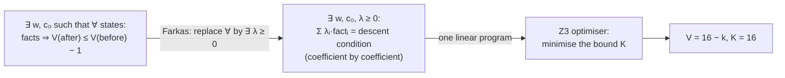

One linear program per loop finds the potential, the multipliers and the best bound
`K` at once. (This construction is due to Colón and Sipma, 2001, and to Podelski and Rybalchenko,
2004.) The function `addFarkas` in `Solver.cpp` writes these constraints.

### Why nothing Z3 says is trusted

Z3 is a large program; like any large program it has bugs, and it can time out.
CrossCheck never relies on it alone:

- an interval end found by the optimiser is re-proved by an entailment query;
- a potential found by synthesis is checked again when the loop is analysed;
- and, above all, everything that ends up in a certificate is re-checked by the Lean
  checker with integer arithmetic only.

If Z3 is wrong, the worst outcome is a rejected function or a certificate that the
checker refuses — never an accepted wrong bound.

**Timeouts and budget.** Each query has a timeout; the plugin also counts its total
"solver work" per function (`budget=N`). When the budget runs out, optional searches stop
and unproved candidates are dropped. Precision is lost, soundness is not.

> **Expert phrasing.** "Ranking functions are synthesised by Farkas-based constraint
> solving (Colón–Sipma, Podelski–Rybalchenko); the SMT solver is in the untrusted
> producer, and its results are re-validated by a verified checker."

---

## 2.8 Intervals and calling contexts

An **interval** `[lo, hi]` is the simplest description of a set of numbers: everything
between two ends (an end may be missing: `[0, +∞)`). For a variable, "its interval at this
point" means: every value it can have there lies in `[lo, hi]`.

Intervals are what CrossCheck uses for **calling contexts**. A function

```c
void f(int n) { for (int i = 0; i < n; i++) work(); }
```

has bound `n`, which is unbounded on its own (`n` could be 2³¹ − 1). But the program calls
`f` only from a few places, with arguments that the plugin can bound:

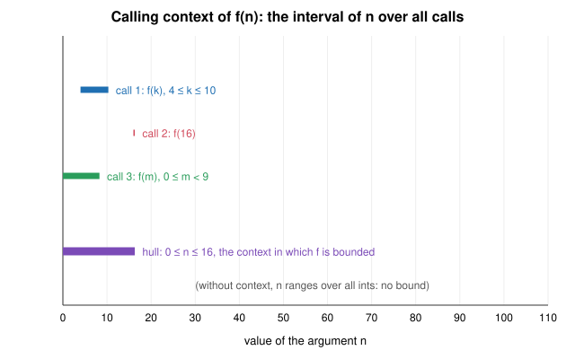

The **hull** of the argument intervals (the smallest interval containing all of them) is
the **calling context** of `f`: here `0 ≤ n ≤ 16`. Inside that context, `f` costs at most
16 iterations. The report gives two numbers for each loop and function: the bound valid
**for every call** (none here) and the bound **in the program's calling contexts** (16).

Why intervals and not something richer? Because they are cheap, because the join of two
intervals is easy (the hull), and because the theorem behind them is simple
(`prop:context-bound` in Paper I: a potential only needs to be bounded on the states of the
context). The price: relations between arguments (`f(k, 2k)`) are lost.

> **Pitfall.** A bound "in context" holds only for the calls that exist in the analysed
> program. A new caller can break it. The report labels which bounds are in context.

> **In the code.** `Context = std::vector<Interval>` and the call records in
> `clang-plugin/src/analysis/Analyzer.cpp`; each interval end is computed by `boundsOf`
> (section 2.7) and re-checked by `entails`.

---

## 2.9 Fourier–Motzkin elimination, and where CrossCheck uses it

### What it is

**Fourier–Motzkin elimination** (Fourier 1826, Motzkin 1936) is the oldest algorithm for
linear inequalities. To eliminate a variable `x` from a set of constraints, split them into
those that give an upper bound on `x`, those that give a lower bound, and those without
`x`; then **every pair** (lower, upper) gives a new constraint without `x`:

```text
facts:   x ≤ 10,   y ≤ x,   y ≥ 0
upper bounds of x:  x ≤ 10
lower bounds of x:  x ≥ y
pair:   y ≤ x ≤ 10   ⇒   y ≤ 10
result (x eliminated):   y ≤ 10,   y ≥ 0
```

Repeating this until one variable remains decides feasibility, computes projections ("what
do the facts say about `y` alone?") and entailment. Each new constraint is a non-negative
combination of the old ones, so Fourier–Motzkin is in fact a **constructive proof of
Farkas' Lemma**: following the eliminations backwards yields the multipliers.

### Where CrossCheck uses it, and where it does not

- **The certificate generator uses it, in a small and bounded way.** When it writes the
  assertion that holds after `x := e`, it must *forget* the old value of `x`: it renames
  the old `x` to a temporary variable, adds `x = e`, and eliminates the temporary by
  Fourier–Motzkin (function `eliminate` in `clang-plugin/src/core/Cert.cpp`, called from
  the certificate part of `Analyzer.cpp`). The same function projects assertions onto
  the variables that matter when it looks for a bound in the parameters
  (`symbolicUpper`). To keep the blow-up under control, a combination whose coefficients
  overflow is dropped, and at most 64 constraints are kept. Dropping a constraint only
  makes the assertion **weaker**, which is always safe: the checker then has less to work
  with, and may refuse the certificate, but never accepts a false claim.
- **The analyser does not use it.** For its questions (entailment, intervals, synthesis
  of potentials) it calls Z3 (section 2.7), because elimination **blows up**: each
  elimination can square the number of constraints — `m` constraints can become `m²/4`,
  then `m⁴/16`… — and simplex-based solvers are much faster on these problems.
- **The checker does not need it.** Whatever algorithm finds the multipliers, the checker
  only checks them (section 2.5). Fourier–Motzkin, the simplex method and the shortest
  paths of the next section are interchangeable *producers* of the same certificates.
- **Integers.** Fourier–Motzkin is exact over the rationals; over the integers it needs
  extra rounding steps (the Omega test, Pugh 1991). The generator only uses it to write
  assertions that are then *checked*, so the rational version is enough.

It is also worth knowing because reviewers think in its terms ("projection",
"elimination"), and because it explains why Farkas certificates always exist for true
rational implications.

> **Expert phrasing.** "Entailment is decided by an SMT solver; Fourier–Motzkin is used
> only to project assertions in the untrusted certificate generator, with a cap on the
> number of constraints; certificates are Farkas multipliers, independent of how they were
> found."

---

## 2.10 Difference constraints, zones and shortest paths

A special case of linear constraints is very common in loops: **difference constraints**,
of the form `x − y ≤ c` (and bounds `x ≤ c`, `−x ≤ c`). "`i ≤ n`", "`i ≥ 0`",
"`r0 = r4 + 1`" are all of this kind.

A set of difference constraints is a **graph**: one node per variable, plus a node `0` for
constants; the constraint `x − y ≤ c` is an edge from `y` to `x` of weight `c`.

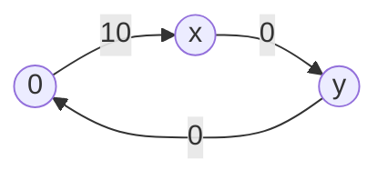

The graph above encodes `x ≤ 10` (edge `0 → x`, weight 10), `y ≤ x` (edge `x → y`, weight 0)
and `y ≥ 0` (edge `y → 0`, weight 0: `0 − y ≤ 0`). Then:

- **every path gives a consequence**: the path `0 → x → y` has weight 10, so `y − 0 ≤ 10`.
  The shortest path from `u` to `v` is the **tightest** consequence `v − u ≤ (length)`.
- **the path is a Farkas certificate**: adding the constraints along the path gives the
  consequence, all multipliers equal to 1.
- **a negative cycle means a contradiction**: adding the constraints around a cycle of
  negative weight gives `0 ≤ (negative)`.

Computing all shortest paths at once (the **Floyd–Warshall** algorithm) gives the
**closure**: every implied difference constraint. This structure is called a
**difference-bound matrix** or a **zone** (Dill 1989, Miné 2001); it is the standard abstract
domain of timed automata and of many static analysers.

> **In the code.** Paper III's producer (`benchmarks/cycles/binloops.py`) represents the
> invariants of machine code as zones (`class Zones`), and proves most obligations by a
> shortest path (`Prover._path`) or a negative cycle (`Prover._cycle`), falling back to a
> linear program for the rest. The IPET potentials (section 2.6) are longest paths in the
> control-flow graph, computed by Bellman-Ford, the sister algorithm.

---

## 2.11 Abstract interpretation and widening

### Computing invariants by running the program on descriptions

**Abstract interpretation** (Cousot and Cousot, 1977) computes invariants by executing the
program on *descriptions of sets of states* instead of on states. With intervals: start
with `i ∈ [0, 0]` before `while (i < 10) i++;`, and run the loop body on the interval:

| Round | Interval of `i` at the loop head |
|---|---|
| 0 | `[0, 0]` (entry) |
| 1 | `[0, 0]` joined with `[1, 1]` (after one body) = `[0, 1]` |
| 2 | `[0, 2]` |
| 3 | `[0, 3]` … |

The interval grows by one per round; for a loop of 10⁹ iterations this takes 10⁹ rounds.

### Widening and narrowing

**Widening** forces termination: when a bound keeps growing, jump to infinity (or to the
next "interesting" constant, a **threshold**, such as the constants of the program's
tests). Then **narrowing** recovers precision by running the loop once more with the test:
from `i ∈ [0, +∞)` and the test `i < 10`, the body gives `i ∈ [1, 10]`, joined with the
entry `[0, 0]`: `[0, 10]`.

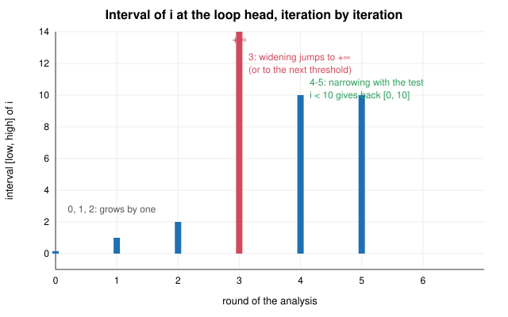

The result is guaranteed to be an inductive invariant (a **post-fixpoint**): applying one
more round to it gives something inside it.

> **In the code.** The plugin does *not* use classical abstract interpretation: it runs the
> code symbolically (each variable is an affine expression over unknown inputs) and
> searches invariants by guess-and-check (section 2.3). Paper III's producer of machine-code
> certificates *does* use abstract interpretation, on zones (section 2.10), with widening at
> loop headers to thresholds taken from the code's constants and three descending
> (narrowing) rounds (`analyse` in `benchmarks/cycles/binloops.py`). In both cases the
> result is untrusted: the checker re-proves the invariants.

---

## 2.12 Composing costs: the timing schema and cost envelopes

### The cost model

The plugin counts **abstract instructions**: each arithmetic, bitwise or comparison
operator, each assignment, each memory access, each call (plus the callee's bound) counts
one unit by default (`weight-CLASS=N` changes a class's weight). This is a **cost norm**:
the cost of a sequence is the sum of the costs of its parts.

### The timing schema

Costs of structured code compose by three rules (Shaw 1989; Puschner and Koza 1989):

| Construct | Bound |
|---|---|
| `A; B` | `cost(A) + cost(B)` |
| `if (t) A else B` | `cost(t) + max(cost(A), cost(B))` |
| `while (t) A` with at most `K` iterations | `K · (cost(t) + cost(A)) + cost(t)` |

The `if` rule takes the more expensive branch on every iteration, even if the program
cannot actually take it every time (**infeasible paths** are not excluded); that is
pessimistic but safe.

Paper I notes that these rules are the operations of the **tropical semiring** `(max, +)`:
"plus" is `max` (choosing a branch) and "times" is `+` (sequencing). This is a convenient
algebraic language, nothing deeper.

### Cost envelopes and dominance

A function's cost depends on its inputs. The exact cost is a complicated function (a
"staircase"); a bound is a simpler function that stays **above** it everywhere — an
**envelope**. Different methods give different envelopes. For the triangular nest
`for (i < n) for (j < i) body`:

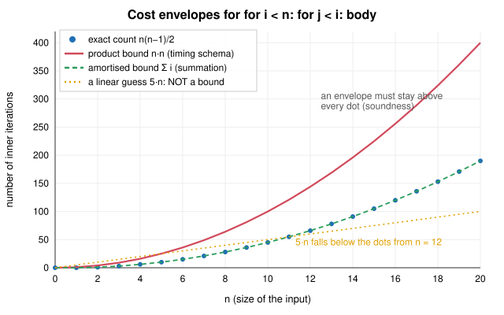

- the dots are the exact number of inner iterations, `n(n−1)/2`;
- the timing schema multiplies the bounds: `n · n` (red), always above the dots — sound but
  about twice too large;
- summing the inner bound over the outer iterations, `Σ i`, gives exactly `n(n−1)/2`
  (green) — the **amortised** bound, which Paper I proves as a rule (`prop:amortised-loop`)
  and the checker accepts for the two triangular shapes (`triOk`, `whileUp`);
- a guess like `5·n` (orange) may look plausible for small `n` but crosses the dots: it is
  **not** an envelope. An envelope must dominate the exact cost for **every** input.

"Dominates" is the key word: an envelope `B` dominates the cost `C` if `C(x) ≤ B(x)` for all
`x`. A tool is sound exactly when every bound it gives dominates the true cost.

> **Pitfall.** Big-O notation (`O(n²)`) is about growth rates and hides constants; a WCET
> bound must be a concrete function with its constants, valid for every input, not only
> asymptotically.

---

## 2.13 Recursion: call trees, depth and size potentials

A recursive function calls itself; its executions form a **call tree**: the root is the
first call, its children the calls it makes, and so on. The cost is (at most) the number of
nodes times the cost of one activation.

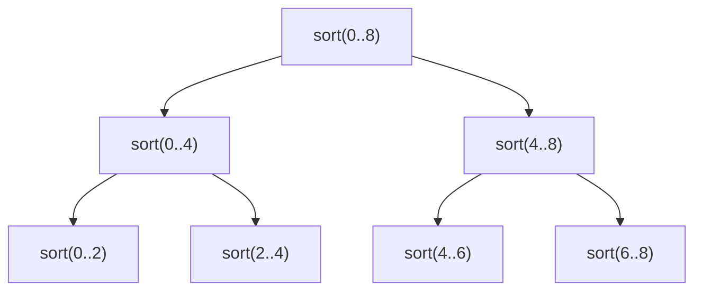

Two ways to bound the tree:

- **Depth potential**: a quantity that drops by at least 1 from a call to each of its
  recursive calls (here `log₂(length)`), bounds the **depth** `D`. A tree of depth `D` where
  each node has at most `b` children has at most `1 + b + … + b^D` nodes. For the example,
  depth 3 and `b = 2`: at most 15 nodes. Exact, but this formula can be very loose for
  unbalanced recursions.
- **Size potential**: a quantity `U` with `U(x) ≥ 1 + U(x₁) + … + U(x_k)` whenever `x` calls
  `x₁ … x_k` bounds the **number** of nodes by `U(x)` directly. For divide and conquer on a
  range of length `L`, `U = 2L − 1` works: linear, where the depth formula gives
  `2^(log L + 1)`.

Paper I proves both (`exec_depth_le`, `callTree_size_le_potential`, for any number of
children in `Arity.lean`). The plugin bounds linear recursion (one recursive call) by a
depth potential; recursion is **not** in the certificate fragment (the checker accepts
calls only to earlier functions).

---

## 2.14 Certificates, checkers, proof assistants and Lean

### Why a checker

Finding a bound is search; checking it is arithmetic. The producer (plugin, LP solver,
Z3) can be as complex as needed because it is not trusted; only the checker must be
correct. This is **proof-carrying code** (Necula 1997): the code ships with a proof, and
the consumer runs a small proof checker.

### What a proof assistant is

A **proof assistant** is a program in which mathematical definitions, statements and proofs
are written in a precise language, and every proof step is checked by a small core, the
**kernel**. If Lean accepts a proof, the statement follows from the definitions and the
axioms, with no gap — assuming the kernel is correct (it is small and has been studied a
lot; several independent checkers exist for Lean's proof format).

**Lean 4** is both a proof assistant and a programming language: the checker's code
(`CheckerCore.lean`, `ThumbCore.lean`, …) is an ordinary program, compiled to an
executable, and the *same* definitions are the subject of the theorems (`Checker.lean`,
`ThumbData.lean`). There is no gap between the program that runs and the program that is
proved, except Lean's compiler.

**mathlib** is Lean's mathematics library (lists, integers, `linarith`, `omega`…). The
proofs use it; the checker program uses only Lean's core, so that its trusted base stays
small.

### Axioms

Every Lean proof rests on axioms. CrossCheck uses only the three standard ones: `propext`
(equivalent propositions are equal), `Quot.sound` (quotients) and `Classical.choice` (the
axiom of choice). The command `#print axioms data_sound` lists them. A proof that used
`sorry` (an admitted gap) or a new axiom would show it there; the project forbids both.

### What "proved in Lean" does and does not mean

It means: **if** the checker accepts a certificate, **then** the mathematical statement
holds **for the model of the program in the certificate**. It does not mean that the model
is the C function (that is the translation question of Part 1), nor that the Lean model of
the processor is the real chip (Part 5). Saying exactly where these boundaries are is part
of the honesty that the AGMAI rules ask for.

> **In the code.** `formalization/` (`lake build`); Part 7 is a tutorial.

---

## 2.15 Machine code in one hour (Cortex-M0)

Paper III works on the instructions of an Arm Cortex-M0, a small 32-bit processor used in
microcontrollers. You need only the following.

### Registers and words

The processor has 16 registers of 32 bits: `r0`–`r7` (the **low registers**, used by most
16-bit instructions), `r8`–`r12`, `sp` (the **stack pointer**, r13), `lr` (the **link
register**, r14: the return address of a call) and `pc` (the **program counter**, r15: the
address of the current instruction). A 32-bit value is a **word**. Arithmetic is
**modulo 2³²**: `0xFFFFFFFF + 1 = 0` (**wrap-around**).

The same 32 bits can be read as **unsigned** (0 … 2³² − 1) or **signed** (two's complement,
−2³¹ … 2³¹ − 1): `0xFFFFFFFF` is 4 294 967 295 unsigned and −1 signed.

### Flags and conditional branches

Arithmetic instructions that end in `S` (`ADDS`, `SUBS`, `MOVS`) and comparisons (`CMP`,
`CMN`, `TST`) set four **flags**:

| Flag | Meaning after `CMP a, b` (computes `a − b`) |
|---|---|
| `N` (negative) | bit 31 of `a − b` |
| `Z` (zero) | `a = b` |
| `C` (carry) | `a ≥ b` as unsigned numbers (no borrow) |
| `V` (overflow) | the signed subtraction overflowed |

A conditional branch tests the flags: `BEQ` (Z), `BNE` (not Z), `BHS`/`BCS` (C: unsigned ≥),
`BLO`/`BCC`, `BHI`, `BLS`, `BGE` (N = V: **signed** ≥), `BLT`, `BGT`, `BLE`, … So a C loop
`for (i = 0; i < 10; i++)` compiles to something like:

```text
0x100  movs r0, #0        ; i = 0
0x102  cmp  r0, #10       ; flags of i − 10
0x104  bge  0x10a         ; exit if i ≥ 10 (signed)
0x106  adds r0, #1        ; i++
0x108  b    0x102         ; back edge
0x10a  bx   lr            ; return
```

Paper III's checker must know, after `cmp r0, #10; bge`, that the branch was not taken
only if `r0 < 10` as signed numbers. It keeps two **ghost** variables, the operands of the
last flag-setting operation, and translates each condition into linear facts on them
(`lem:cond-facts`; for signed comparisons, a case split on the signs).

### The stack, calls and the calling convention

The stack grows **downwards**: `push {r4, lr}` lowers `sp` by 8 and stores two words;
`sub sp, #8` reserves 8 bytes for local variables; `str r0, [sp, #4]` stores `r0` into the
**stack frame**; `pop {r4, pc}` restores and returns. At `-O1`, a C local variable that
must survive a call is often kept in a stack slot.

A call (`bl f`) jumps to `f` with the return address in `lr`. The **Arm procedure call
standard** (AAPCS) says that a function may change `r0`–`r3` and the flags, but must give
back `r4`–`r7` (and `r8`–`r11`) and `sp` as it found them. Paper III does not assume this
unless asked (`abi`): without it, a call may change every register.

### Control-flow graph and cycles

The **control-flow graph** has one node per instruction and an edge to each possible next
instruction: one for ordinary instructions, two for conditional branches (taken / not
taken), none for a return. On the Cortex-M0 with zero-wait-state memory, every instruction
has a fixed cycle count given in the Technical Reference Manual: most data instructions 1
cycle, loads and stores 2, a taken branch 3, a not-taken conditional branch 1, `BL` 4,
`PUSH`/`POP` 1 + the number of registers. This fixed table is what makes cycle bounds
possible without a cache or pipeline model.

---

## 2.16 Notation crash course

| Notation | Read as | C/C++ intuition |
|---|---|---|
| `ℕ`, `ℤ`, `ℚ` | naturals 0, 1, 2…; integers; rationals | unbounded `unsigned`, `long long`, exact fractions |
| `A × B` | pairs | `std::pair<A, B>` |
| `A → B` | (total) functions | a pure function defined on every input |
| `A ⇀ B` | partial functions | may fail or be undefined on some inputs |
| `fⁿ` | `f` applied `n` times | a `for` loop calling `f` |
| `∀ x, P x` / `∃ x, P x` | for all / there exists | |
| `P ⟹ Q` | `P` implies `Q` | |
| `⌊x⌋`, `⌈x⌉` | floor, ceiling | `std::floor`, `std::ceil` |
| `Σᵢ aᵢ` | sum over `i` | `std::accumulate` |
| `min { n : P n }` | the least `n` with `P n` | the first index where a search succeeds |
| `max(0, x)` | `x` if positive, else 0 | `std::max(0, x)` |
| `x mod 2³²` | the remainder of `x` divided by 2³² | `uint32_t` arithmetic |
| `S⊥` | the states, plus a "failure" value `⊥` | `std::optional<State>` |
| `Σ*` | the finite words (lists) over an alphabet `Σ` | `std::vector<Instr>` |
| `t ⊑ t'` | `t` is a prefix of `t'` | `t'` starts with `t` |

**Orders.** A **partial order** `≤` is reflexive (`x ≤ x`), transitive and antisymmetric
(`x ≤ y` and `y ≤ x` give `x = y`); "partial" because two elements may be incomparable. A
**least element** of a set is below all its elements. An order is **well-founded** if
there is no infinite strictly decreasing chain — `ℕ` is, `ℤ` is not. Termination proofs are
always, in the end, a well-founded order: the potential's values in `ℕ`.

**Induction.** To prove `P(n)` for every `n`, prove `P(0)` and that `P(n)` implies
`P(n + 1)`. Almost every Lean proof in the repository is an induction: on a number, on a
list (the steps of a run), on a tree, or on a derivation.

**Semantics.** A program's **semantics** is a mathematical definition of what it does.
**Big-step** semantics relates a program and a start state to its final state ("running `c`
from `s` ends in `t`"); **small-step** semantics describes one step at a time. CrossCheck's
cost logic uses big-step relations with a cost (`Exec`) and a relation for prefixes of
possibly infinite runs (`Pre`), so that non-terminating runs are bounded too.
