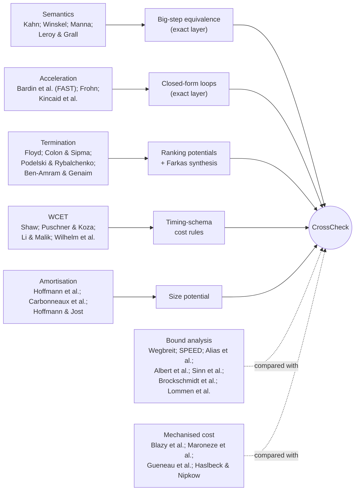

# Part 3 — The bibliography, explained

> **Read this first.** The summaries below were written by an AI from its general
> knowledge of the literature. The **bibliographic data** (authors, title, venue, year,
> pages) of *every* entry of `crosscheck.bib` were checked on 2026-11-13 against
> Crossref (by DOI), DataCite (the Dagstuhl papers) or Open Library (the books); the
> three web pages were checked to exist. Not confirmable this way: Matiyasevich 1970
> (only a reprint is indexed). One error was found and fixed (Blazy et al.: published
> 2014, not 2013). The **content** of the papers was **not** read. The "confidence" line says how
> standard the summarised facts are: *high* = textbook-level, widely repeated
> facts; *medium* = specific details (tool names, exact scope) that you should check
> in the paper before quoting them. `AI_USAGE.md` §3 item 7 asks you to read every
> newly cited paper; this part is a map for that reading, not a substitute.

Contents

- [How the references fit together](#how-the-references-fit-together)
- [Timeline](#timeline)
- A. [Semantics and computability](#a-semantics-and-computability) — Manna, Winskel, Kahn, Leroy & Grall, Matiyasevich, Diekert & Rozenberg
- B. [Static analysis foundations](#b-static-analysis-foundations) — Cousot & Cousot
- C. [Termination and ranking functions](#c-termination-and-ranking-functions) — Floyd, Colón & Sipma, Podelski & Rybalchenko (×2), Ben-Amram & Genaim
- D. [Automatic cost and bound analysis](#d-automatic-cost-and-bound-analysis) — Wegbreit, SPEED, Alias et al., Albert et al., Sinn et al., Brockschmidt et al., Lommen et al.
- E. [Amortised resource analysis](#e-amortised-resource-analysis) — Hoffmann et al., Carbonneaux et al., Hoffmann & Jost
- F. [Loop acceleration and closed forms](#f-loop-acceleration-and-closed-forms) — FAST, Frohn, Kincaid et al.
- G. [WCET analysis](#g-wcet-analysis) — Shaw, Puschner & Koza, Li & Malik, Wilhelm et al.
- H. [Mechanised cost analysis](#h-mechanised-cost-analysis) — Blazy et al., Maroneze et al., Guéneau et al., Haslbeck & Nipkow
- I. [Mathematics and tools](#i-mathematics-and-tools) — Baccelli et al., Schrijver, Cormen et al., Z3, Lean 4, mathlib
- J. [Real-time C++ and AI policy](#j-real-time-c-and-ai-policy) — Clang function effects, AGMAI
- [What is *not* cited and might be asked about](#what-is-not-cited-and-might-be-asked-about)

## How the references fit together

Solid arrows are the *direct* technical debts: which body of work each part of
CrossCheck builds on. Dotted arrows are the works CrossCheck is compared with: bound
analysers (more precise than CrossCheck) and mechanised cost analyses (verified tools or
program logics, different in scope). Matiyasevich and Cousot & Cousot motivate the
approach; Baccelli et al., Schrijver, Cormen et al., Z3, Lean and mathlib are tools and
mathematical references.

## Timeline

| Year | Work | Why it matters here |
|---|---|---|
| 1967 | Floyd, *Assigning Meanings to Programs* | invents inductive assertions and ranking-function termination proofs |
| 1970 | Matiyasevich, *Enumerable sets are Diophantine* | Hilbert's 10th problem undecidable → exact loop analysis undecidable |
| 1974 | Manna, *Mathematical Theory of Computation* | fixed-point theory of programs, verification |
| 1975 | Wegbreit, *Mechanical Program Analysis* | first automatic cost analysis |
| 1977 | Cousot & Cousot, *Abstract Interpretation* | the dominant static-analysis framework |
| 1986 | Schrijver, *Theory of Linear and Integer Programming* | reference for Farkas' Lemma |
| 1987 | Kahn, *Natural Semantics* | big-step semantics |
| 1989 | Shaw; Puschner & Koza | timing schema: sum / max / bound × body |
| 1992 | Baccelli et al., *Synchronization and Linearity* | (max,+) algebra |
| 1993 | Winskel, *Formal Semantics of Programming Languages* | standard textbook |
| 1995 | Li & Malik, IPET; Diekert & Rozenberg, *Book of Traces* | WCET path analysis by ILP; (unrelated) Mazurkiewicz traces |
| 2001 | Colón & Sipma | linear ranking functions by Farkas |
| 2004 | Podelski & Rybalchenko (×2) | complete LRF synthesis; transition invariants |
| 2008 | Wilhelm et al. survey; Z3; FAST | WCET state of the art; SMT solver; acceleration |
| 2009 | SPEED; Leroy & Grall; Cormen et al. 3rd ed. | bound analysis; coinductive big-step; algorithms textbook |
| 2010 | Alias et al. | multidimensional rankings → complexity |
| 2011 | Albert et al. | cost relations → closed forms |
| 2012 | Hoffmann, Aehlig, Hofmann | multivariate amortised analysis |
| 2013–14 | Blazy et al.; Maroneze et al. | verified loop bounds / WCET in CompCert |
| 2014 | Sinn et al.; Ben-Amram & Genaim | amortised bounds (Loopus); complexity of LRF synthesis |
| 2015 | Carbonneaux et al. | certified C resource bounds |
| 2016 | Brockschmidt et al. | runtime & size bounds (KoAT) |
| 2018 | Guéneau et al.; Haslbeck & Nipkow | mechanised complexity reasoning (Coq, Isabelle) |
| 2019 | Kincaid et al. | closed forms for numerical loops |
| 2020 | Frohn; mathlib paper | modular acceleration; Lean's library |
| 2021 | de Moura & Ullrich | Lean 4 |
| 2022 | Lommen et al.; Hoffmann & Jost | KoAT with twn-loops; AARA survey |
| 2024– | Clang function effects | compile-time non-blocking checks |
| 2026 | AGMAI | responsible release of AI-generated mathematics |

---

## A. Semantics and computability

### `manna1974mathematical` — Z. Manna, *Mathematical Theory of Computation*, McGraw-Hill, 1974

**What it is.** A classic textbook on the mathematical foundations of programming:
computability (Turing machines, undecidability), predicate calculus, **verification of
programs** (Floyd's inductive assertions, Hoare-style reasoning, termination via
well-founded sets), flowchart schemas, and the **fixed-point theory of programs**:
recursive programs denote least fixed points of functionals; proof techniques such as
computational induction.

**Why cited.** For the fixed-point reading of `while` (the `Y` combinator form in
Section "Loops and Recursion…") and as standard background on fixed-point semantics
(Related Work, "Semantics").

**Relation.** CrossCheck uses the same chain of approximations as fixed-point
semantics but picks its *first exiting element* rather than its limit.
Confidence: high (you have read it — check the chapter numbers you cite).

### `winskel1993formal` — G. Winskel, *The Formal Semantics of Programming Languages: An Introduction*, MIT Press, 1993

**What it is.** The standard graduate textbook on semantics, built around a small
imperative language IMP: operational semantics (big-step rules for `while`),
denotational semantics (least fixed points, domain theory: cpos, continuity), axiomatic
semantics (Hoare logic, soundness and completeness), and their equivalence proofs; later
chapters on functional languages, recursion, and domains.

**Why cited.** Background for Foundations, the big-step rules `eq:bigstep-while`, the
fixed-point remark, and "symbolic evaluation in the style of operational semantics".

**Relation.** The CrossCheck equivalence theorem is in the spirit of Winskel's
operational/denotational equivalence proofs, but between big-step semantics and a
minimisation problem. Confidence: high.

### `kahn1987natural` — G. Kahn, *Natural Semantics*, STACS 87, LNCS 247, pp. 22–39

**What it is.** The paper that named and systematised **big-step operational semantics**
("natural semantics"): the meaning of a program is given by inference rules deriving
judgments like `env ⊢ expr ⇒ value`, in the style of natural deduction. Developed in the
Centaur/Typol environment at INRIA (rules were executable).

**Why cited.** As the origin of the big-step semantics that CrossCheck's minimisation is
proved equivalent to (`thm:extensional-equivalence`). Confidence: high.

### `leroy2009coinductive` — X. Leroy & H. Grall, *Coinductive Big-Step Operational Semantics*, Information and Computation 207(2), 2009

**What it is.** Big-step semantics only describes terminating runs. Leroy and Grall add a
**coinductive** (possibly infinite derivation) big-step relation for divergence, prove
equivalences with small-step semantics in Coq, and use it for compiler-correctness proofs
that also preserve non-termination (relevant to CompCert).

**Why cited.** Related Work "Semantics": in CrossCheck divergence is the *infeasibility*
of the minimisation, whereas Leroy & Grall capture it positively with coinduction.

**Possible question.** "Can you prove divergence with your framework?" — Only negatively:
`infinite_loop_diverges` shows no big-step derivation exists. A coinductive treatment
would let you state divergence as a property; this is not done. Confidence: high.

### `matiyasevich1970enumerable` — Y. Matiyasevich, *Enumerable Sets Are Diophantine*, Doklady 1970

**What it is.** The final step of the proof that **Hilbert's 10th problem is
undecidable**: every recursively enumerable set of natural numbers is Diophantine (the
set of parameters for which a polynomial equation has integer solutions). Builds on
Davis, Putnam, Robinson ("MRDP theorem").

**Why cited.** Introduction and the "Decidability Boundaries" remark: loops with
polynomial integer updates already have undecidable exit problems, which justifies
relaxation. Confidence: high.

### `diekert1995traces` — V. Diekert & G. Rozenberg (eds.), *The Book of Traces*, World Scientific, 1995

**What it is.** The reference collection on **Mazurkiewicz traces**: words modulo an
independence relation (letters `a`, `b` that commute are swapped freely), used to model
concurrent executions up to reordering of independent actions.

**Why cited.** Only to say CrossCheck traces are *not* these (they are plain words of the
free monoid). A pre-emptive answer to a referee confused by the word "trace". Confidence: high.

## B. Static analysis foundations

### `cousot1977abstract` — P. Cousot & R. Cousot, *Abstract Interpretation: A Unified Lattice Model…*, POPL 1977

**What it is.** The founding paper of **abstract interpretation**: program properties
are computed as fixed points in an abstract lattice that soundly approximates the
concrete semantics; termination of the fixed-point iteration on infinite lattices by
**widening** (and precision recovery by narrowing). Basis of tools such as Astrée,
Frama-C EVA, and the cache analyses inside aiT.

**Why cited.** Introduction: the "iterative fixed-point approximations" that CrossCheck
contrasts itself with.

**Relation / likely question.** "Isn't your invariant inference abstract interpretation?"
— The plugin's Houdini step and merge of states are simple over-approximations; it does
not use a widening-based abstract domain. Ranking-potential synthesis replaces iteration
for the bound itself. Confidence: high.

## C. Termination and ranking functions

### `floyd1967assigning` — R. W. Floyd, *Assigning Meanings to Programs*, 1967

**What it is.** Founding paper of program verification: annotate flowchart edges with
logical assertions ("inductive assertions"), verify each edge locally; proves termination
by mapping states to a **well-founded set** that decreases along every cycle — the first
**ranking functions**. Hoare's logic (1969) is its structured-program descendant.

**Why cited.** Origin of ranking functions (Introduction, Positioning, Ranking Potentials).
Confidence: high.

### `colon2001synthesis` — M. Colón & H. Sipma, *Synthesis of Linear Ranking Functions*, TACAS 2001

**What it is.** Automatic synthesis of **linear ranking functions** for loops with linear
guards and updates, using polyhedral reasoning / Farkas-style duality to turn the ∀
conditions into constraints on the coefficients.

**Why cited.** The template + Farkas method that `subsubsec:smt-synthesis` and the plugin
adopt unchanged. Confidence: high for the idea; medium for algorithmic details
(they used a polyhedral library rather than an LP solver, as far as the AI recalls).

### `podelski2004complete` — A. Podelski & A. Rybalchenko, *A Complete Method for the Synthesis of Linear Ranking Functions*, VMCAI 2004

**What it is.** For **simple linear loops** (a single conjunction of linear inequalities
relating pre- and post-state), a polynomial-time LP-based method that finds a linear
ranking function **if and only if one exists** (over the rationals/reals): completeness
via Farkas' Lemma.

**Why cited.** Together with Colón & Sipma, the method used; also the "quantitative form
used for bound analysis". Confidence: high.

### `podelski2004transition` — A. Podelski & A. Rybalchenko, *Transition Invariants*, LICS 2004

**What it is.** A program terminates iff its transition relation's transitive closure is
contained in a *finite union* of well-founded relations (a **disjunctively well-founded
transition invariant**) — by Ramsey's theorem. Avoids finding one global ranking
function; foundation of the **Terminator** tool (Cook, Podelski, Rybalchenko 2006).

**Why cited.** Introduction (Lyapunov-style potentials) and Related Work: a generalisation
of the single-ranking-function approach. CrossCheck does not use it. Confidence: high.

### `benamram2014ranking` — A. M. Ben-Amram & S. Genaim, *Ranking Functions for Linear-Constraint Loops*, JACM 61(4), 2014

**What it is.** Complexity classification: for loops given by linear constraints, deciding
the existence of a **linear ranking function** is in **PTIME over the rationals** but
**coNP-complete over the integers** (integer points can admit ranking functions that the
rational relaxation does not); also treats lexicographic ranking functions.

**Why cited.** Related Work and `subsubsec:smt-synthesis`: explains why the Farkas method
is *sound but incomplete* for integer loops. Confidence: high for the PTIME/coNP result.

## D. Automatic cost and bound analysis

### `wegbreit1975mechanical` — B. Wegbreit, *Mechanical Program Analysis*, CACM 18(9), 1975

**What it is.** The **METRIC** system: derives closed-form cost expressions (best,
worst, average) for simple Lisp programs by setting up and solving difference equations.
The first automatic complexity analysis.

**Why cited.** Historical origin of automatic resource-bound derivation. Confidence: high.

### `gulwani2009speed` — S. Gulwani, K. Mehra, T. Chilimbi, *SPEED: Precise and Efficient Static Estimation of Program Computational Complexity*, POPL 2009

**What it is.** Microsoft's bound analyser for C/C++: instruments loops with **counter
variables**, uses an abstract-interpretation invariant generator to bound the counters in
terms of inputs, and composes them (handles nested loops, multiple counters per loop,
user-defined data structure quantitative functions).

**Why cited.** Classic example of ranking/invariant-based complexity bounds (Positioning,
Related Work). Confidence: high for the counter-instrumentation idea.

### `alias2010multi` — C. Alias, A. Darte, P. Feautrier, L. Gonnord, *Multi-dimensional Rankings, Program Termination, and Complexity Bounds of Flowchart Programs*, SAS 2010

**What it is.** Synthesises **lexicographic (multi-dimensional) affine ranking functions**
for flowchart programs by linear programming (inspired by polyhedral scheduling), and
derives **complexity bounds** by counting the points of the ranking domain. Tool: Rank.

**Why cited.** Quantitative use of ranking functions for bounds (Ranking Potentials;
Positioning). Also the natural next step for CrossCheck (lexicographic potentials).
Confidence: high for the method; medium for tool details. Page numbers checked on the web.

### `albert2011closed` — E. Albert, P. Arenas, S. Genaim, G. Puebla, *Closed-Form Upper Bounds in Static Cost Analysis*, JAR 46(2), 2011

**What it is.** The **cost relation** approach (COSTA tool, PUBS solver): a program is
translated into recurrence-like *cost relations*; closed-form upper bounds are obtained by
bounding the number of applications of each relation with ranking functions and the cost
of each application by maximisation over invariants.

**Why cited.** Cost via recurrences solved into closed forms — the closest analogue of
CrossCheck's "equation generation" layer. Confidence: high.

### `sinn2014complexity` — M. Sinn, F. Zuleger, H. Veith, *A Simple and Scalable Static Analysis for Bound Analysis and Amortized Complexity Analysis*, CAV 2014, LNCS 8559, pp. 745–761

> Corrected on 2026-11-12 while writing this guide: the bib entry previously had a wrong
> title ("Complexity Analysis for Programs via Amortized Invariants") and wrong pages
> (191–207). Title, pages and DOI 10.1007/978-3-319-08867-9_50 were checked on the web
> (Springer PDF header; arXiv:1401.5842).

**What it is.** The **Loopus** approach: abstract the program to **difference constraints**
(`x' ≤ y + c`), then compute bounds by reasoning about how much each counter can be
reset/incremented — capturing **amortised** behaviour of nested loops (inner loop total
work bounded globally, not per outer iteration). Scales to real C code.

**Why cited.** Bounds from ranking functions/invariants; and as the method that is
"asymptotically more precise" than CrossCheck's product envelope for nested loops.
Confidence: high for the idea (difference constraints, amortised bounds, Loopus);
bibliographic data verified.

### `brockschmidt2016analyzing` — M. Brockschmidt, F. Emmes, S. Falke, C. Fuhs, J. Giesl, *Analyzing Runtime and Size Complexity of Integer Programs*, TOPLAS 38(4), 2016

**What it is.** The **KoAT** approach: alternates the computation of **runtime bounds**
(how often each transition runs, from ranking functions) and **size bounds** (how large
variables can grow), modularly, for integer transition systems. Competitive at the
Termination Competition (complexity category).

**Why cited.** Modern ranking-function-based bound analysis. Confidence: high.

### `lommen2022automatic` — N. Lommen, F. Meyer, J. Giesl, *Automatic Complexity Analysis of Integer Programs via Triangular Weakly Non-Linear Loops*, IJCAR 2022

**What it is.** Extends KoAT: for **twn-loops** (triangular, weakly non-linear updates —
each variable's update depends linearly on itself and polynomially on "earlier"
variables), closed forms of the iterates exist; the paper uses them to obtain runtime
bounds for such loops inside the modular KoAT framework.

**Why cited.** Recent work combining closed forms with bound analysis — close to
CrossCheck's two layers. Confidence: medium (check the precise class and results).

## E. Amortised resource analysis

### `hoffmann2012multivariate` — J. Hoffmann, K. Aehlig, M. Hofmann, *Multivariate Amortized Resource Analysis*, TOPLAS 34(3), 2012

**What it is.** **AARA** with multivariate polynomial potentials for first-order
functional programs: types are annotated with potential coefficients; type inference
generates linear constraints solved by LP; yields polynomial bounds (tool **RAML**).

**Why cited.** Potential-based amortised analysis (Related Work), the source of the
"potential method" attribution for `prop:size-potential`, and the nested-loop precision
comparison. Confidence: high.

### `carbonneaux2015compositional` — Q. Carbonneaux, J. Hoffmann, Z. Shao, *Compositional Certified Resource Bounds*, PLDI 2015

**What it is.** Automatic amortised analysis for **C programs** (tool **C4B**), based on a
quantitative Hoare logic with potential functions over program variables; inference by LP;
bounds are **certified** by generating proofs checked in Coq (via a verified
infrastructure).

**Why cited.** Certified resource bounds for C — the nearest "mechanised + practical"
competitor. Confidence: high for the overall approach; medium for the certification
pipeline details.

### `hoffmann2022two` — J. Hoffmann & S. Jost, *Two Decades of Automatic Amortized Resource Analysis*, MSCS 32, 2022

**What it is.** A survey of AARA since Hofmann & Jost (POPL 2003): linear and polynomial
potentials, higher-order functions, imperative programs, probabilistic programs, lower
bounds, implementations.

**Why cited.** A survey pointer for potential-based analysis. Confidence: high.

## F. Loop acceleration and closed forms

### `bardin2008fast` — S. Bardin, A. Finkel, J. Leroux, L. Petrucci, *FAST: Acceleration from Theory to Practice*, STTT 10(5), 2008

**What it is.** The **FAST** tool and theory for counter systems: computes the exact
effect of iterating a loop arbitrarily often (**acceleration**) when the loop's
transition is a translation/affine map with finite monoid; sets represented in
**Presburger arithmetic**; enables exact reachability for flat systems.

**Why cited.** CrossCheck's exact layer = acceleration + minimisation; Presburger fragment
in the decidability remark. Confidence: high.

### `frohn2020calculus` — F. Frohn, *A Calculus for Modular Loop Acceleration*, TACAS 2020

**What it is.** A calculus that **combines** several acceleration techniques (for
different kinds of updates/guards) modularly, conjunct by conjunct of the guard, so that
loops no single technique handles can be accelerated; implemented in **LoAT**.

**Why cited.** Recent work on acceleration (Related Work). Confidence: medium.

### `kincaid2019closed` — Z. Kincaid, J. Breck, J. Cyphert, T. Reps, *Closed Forms for Numerical Loops*, POPL 2019

**What it is.** Computes **closed forms** for loops with (possibly non-linear) numerical
updates by over-approximating them with *solvable polynomial maps* / linear dynamical
systems whose iterates have closed forms (exponential-polynomials), used for invariant
generation and termination/complexity reasoning in the algebraic program analysis
framework (CRA / ComPACT line of work).

**Why cited.** Recurrences solved into closed forms (Related Work). Confidence: medium —
read the abstract before describing its exact class of loops.

## G. WCET analysis

### `shaw1989reasoning` — A. C. Shaw, *Reasoning About Time in Higher-Level Language Software*, IEEE TSE 15(7), 1989

**What it is.** Introduces **timing schemas**: each high-level construct gets a formula
for its execution time from the times of its parts — sequence: sum; `if`: condition +
max (or [min, max] interval) of branches; loop: iterations × (test + body) + final test;
plus a timing logic for reasoning about real-time properties of programs.

**Why cited.** The direct prior art of the branch/loop cost rules (`prop:tropical-dominance`,
`prop:tropical-collapse`, the loop rule of the plugin). CrossCheck adds the derivation
from a trace semantics and the Lean proof. Confidence: high for the schema; medium for the
logic part.

### `puschner1989calculating` — P. Puschner & C. Koza, *Calculating the Maximum Execution Time of Real-Time Programs*, Real-Time Systems 1, 1989

**What it is.** Source-level **MAXT** (maximum execution time) computation for real-time
programs (in the MARS project context): language constructs that make timing analysable —
mandatory loop bounds, bounded recursion forbidden or annotated, "scopes"/markers to
express path information — and a timing-schema-style calculation.

**Why cited.** Together with Shaw, the origin of the timing schema; its "every loop must be
bounded" restriction is the ancestor of the plugin's real-time profile. Confidence: high
for the general content; medium for the annotation details.

### `li1995ilp` — Y.-T. S. Li & S. Malik, *Performance Analysis of Embedded Software Using Implicit Path Enumeration*, DAC 1995

**What it is.** **IPET**: WCET path analysis as an **integer linear program** over
basic-block execution counts, with structural flow constraints and user/derived loop
bounds and path constraints; maximise Σ count × block time. Avoids enumerating paths
explicitly. Tool: cinderella. Now the standard bound-calculation method (aiT, OTAWA).

**Why cited.** Introduction and Related Work: IPET requires loop bounds as input — the
gap that bound analyses (and CrossCheck) fill. Confidence: high.

### `wilhelm2008worst` — R. Wilhelm et al., *The Worst-Case Execution-Time Problem — Overview of Methods and Survey of Tools*, ACM TECS 7(3), 2008

**What it is.** The reference survey of WCET analysis: problem statement (safe and tight
bounds), architecture of static tools (flow analysis, value analysis, cache/pipeline
analysis, IPET bound calculation), measurement-based methods, and a survey of tools (aiT,
Bound-T, RapiTime, SWEET, Heptane, Chronos, …) by their authors.

**Why cited.** The definition of WCET and the decomposition CrossCheck positions itself in
(Limitations: "cost is not time"). Confidence: high.

### `gustafsson2010malardalen` — J. Gustafsson, A. Betts, A. Ermedahl, B. Lisper, *The Mälardalen WCET Benchmarks: Past, Present and Future*, WCET 2010, OASIcs 15, pp. 136–146

**What it is.** The paper describing the Mälardalen benchmarks, the set of small C
programs (sorting, matrix code, DSP filters, CRC, …) collected in 2005 that WCET tools
have used to compare themselves, notably in the WCET Tool Challenge 2006. It discusses
their properties and weaknesses and proposes how the collection should evolve.

**Why cited.** As the predecessor of TACLeBench, in subsection `subsec:tacle`.
Bibliographic data checked on the publisher's page (DROPS) in November 2026; content
summarised from the abstract. Confidence: high for the data, medium for the content.

### `falk2016taclebench` — H. Falk et al. (10 authors), *TACLeBench: A Benchmark Collection to Support Worst-Case Execution Time Research*, WCET 2016, OASIcs 55, pp. 2:1–2:10

**What it is.** The successor collection (53 programs in the paper), gathered from
several research groups and tool vendors, Mälardalen included, and made uniform: self-contained C with no library or OS
dependency, fixed inputs, and **flow facts** written as `#pragma loopbound min X max Y`
on every loop. Programs are grouped as kernel, sequential, application, test and
parallel.

**Why cited.** Subsection `subsec:tacle` runs the plugin on the 29 *kernel* programs
and compares its loop bounds with the flow facts (Table `tab:tacle`; script
`benchmarks/tacle/run_tacle.py`). Flow facts hold for the fixed input, so they are a
reference rather than a proven worst case; one of them is loose (quicksort, 20 vs 19).
Bibliographic data checked on DROPS; content from the paper's abstract and the
repository. Confidence: high.

### `lattner2004llvm` — C. Lattner & V. Adve, *LLVM: A Compilation Framework for Lifelong Program Analysis & Transformation*, CGO 2004, pp. 75–86

**What it is.** The paper introducing LLVM: a typed SSA intermediate representation
kept through the whole life of a program, with analyses and optimisations as passes.
*ScalarEvolution* is LLVM's analysis of how integer values evolve in loops (chains of
recurrences); among other things it computes a loop's maximum *backedge-taken count*.

**Why cited.** As the baseline loop-bound analysis of `tab:tools`. Data checked on
Crossref. Confidence: high.

### `falke2011termination` — S. Falke, D. Kapur, C. Sinz, *Termination Analysis of C Programs Using Compiler Intermediate Languages*, RTA 2011, LIPIcs 10, pp. 41–50

**What it is.** Proving termination of C by compiling to LLVM IR and translating the IR
into integer term rewrite systems (tool KITTeL; converter llvm2kittel). Memory
contents are abstracted away: only integer variables in registers are kept.

**Why cited.** llvm2kittel is KoAT2's C front-end in the comparison; its abstraction of
memory explains KoAT2's symbolic and missing bounds. Data checked on DROPS. Confidence:
high.

### `giesl2019termcomp` — J. Giesl, A. Rubio, C. Sternagel, J. Waldmann, A. Yamada, *The Termination and Complexity Competition*, TACAS 2019 (TOOLympics), LNCS, pp. 156–166

**What it is.** The description of the yearly competition of termination and
complexity provers, and of its benchmark collection, the Termination Problem Database
(TPDB).

**Why cited.** The paragraph "Complexity benchmarks" uses TPDB's C complexity programs
(`benchmarks/tpdb`), on which KoAT2 and CoFloCo are evaluated. Data checked on Crossref
(DOI 10.1007/978-3-030-17502-3_10). Confidence: high.

### `floresmontoya2014cofloco` — A. Flores-Montoya, R. Hähnle, *Resource Analysis of Complex Programs with Cost Equations*, APLAS 2014, LNCS, pp. 275–295

**What it is.** The paper behind CoFloCo: cost bounds for programs given as cost
equations, with a control-flow refinement that splits loops into phases before bounding
them.

**Why cited.** CoFloCo is run in the comparison (`tab:tools`) on the integer programs
llvm2kittel produces for KoAT2, which makes the two complexity analysers directly
comparable. Data checked on Crossref (DOI 10.1007/978-3-319-12736-1_15); the description
is from the tool's README. Confidence: high for the reference.

### `demichiel2008orange` — M. de Michiel, A. Bonenfant, H. Cassé, P. Sainrat, *Static Loop Bound Analysis of C Programs Based on Flow Analysis and Abstract Interpretation*, RTCSA 2008, pp. 161–166

**What it is.** The paper behind oRange, the loop-bound analyser of the OTAWA WCET
tool chain: it works on C source, analyses the program from its entry point, and
produces loop bounds (and flow facts) by abstract interpretation over the program's
values.

**Why cited.** oRange is the WCET flow-analysis tool in the comparison (`tab:tools`).
Its whole-program analysis explains why it bounds more loops, and more tightly, than
CrossCheck on TACLeBench. Data checked on Crossref (DOI 10.1109/RTCSA.2008.53); the
paper's content is described from memory and the tool's README. Confidence: high for
the reference, medium for the description.

### `infercost` — The Infer Team, *Cost: Complexity Analysis* (Infer documentation, v1.3.0)

**What it is.** Meta's Infer computes, per function, a symbolic execution cost (from
its interval analysis InferBo), to flag cost regressions in code review. The
documentation lists its limits, including "We do not handle recursion".

**Why cited.** Third tool of `tab:tools`. A tool documentation page, not a paper.

## H. Mechanised cost analysis

### `blazy2013formal` — S. Blazy, A. Maroneze, D. Pichardie, *Formal Verification of Loop Bound Estimation for WCET Analysis*, VSTTE 2013

**What it is.** A **loop bound estimation** for WCET, implemented and **proved correct in
Coq** on CompCert's intermediate representation, using program slicing and a value
analysis to bound loop iterations.

**Why cited.** The closest mechanised work on loop bounds (Related Work). CrossCheck's
mechanisation is of the theory, theirs of an analyser. Confidence: high for the topic;
page numbers checked on the web.

### `maroneze2014formally` — A. Maroneze, S. Blazy, D. Pichardie, I. Puaut, *A Formally Verified WCET Estimation Tool*, WCET 2014

**What it is.** Extends the previous work to a **formally verified WCET estimation tool**
integrated in CompCert: verified loop bounds plus an IPET-style computation, with the
cost model at the level of CompCert's intermediate language (no cache/pipeline modelling).

**Why cited.** Shows a verified end-to-end (flow-level) WCET estimator exists; CrossCheck
does not compete with it on verification scope. Confidence: medium for the details.

### `gueneau2018fistful` — A. Guéneau, A. Charguéraud, F. Pottier, *A Fistful of Dollars: Formalizing Asymptotic Complexity Claims via Deductive Program Verification*, ESOP 2018

**What it is.** In Coq with **CFML** (characteristic formulae + separation logic), program
specifications include **time credits** ("$"), and asymptotic claims (O-notation) are
formalised properly (with filters, so that "O" is compositional and not abused); applied
to verified algorithms.

**Why cited.** Mechanised (interactive) cost reasoning — a different point in the design
space: manual proofs per program vs CrossCheck's automatic bounds. Confidence: high.

### `nielson1987hoare` — H. R. Nielson, *A Hoare-like Proof System for Analysing the Computation Time of Programs*, Science of Computer Programming 9(2), 1987, pp. 107–136

**What it is.** An early Hoare-style proof system in which triples also bound the
computation time of a program.

**Why cited.** The cost logic of `subsec:cost-logic` is of this kind; cited so that the
idea is not presented as new. Data checked on Crossref (DOI 10.1016/0167-6423(87)90029-3).
Confidence: high for the reference; the content was not read — the paper carries an
`\authortodo` asking you to state the differences precisely.

### `haslbeck2018hoare` — M. P. L. Haslbeck & T. Nipkow, *Hoare Logics for Time Bounds: A Study in Meta Theory*, TACAS 2018

**What it is.** In Isabelle/HOL, formalises and compares several **Hoare logics with time
bounds** (e.g. Nielson's logic for big-O bounds, a quantitative Hoare logic in the style of
Carbonneaux et al., separation logic with time credits), proving soundness and
completeness and relating them.

**Why cited.** Formalised program logics for running time. Confidence: medium for the exact
list of logics.

## I. Mathematics and tools

### `baccelli1992synchronization` — F. Baccelli, G. Cohen, G. J. Olsder, J.-P. Quadrat, *Synchronization and Linearity*, Wiley, 1992

**What it is.** The reference book on **(max,+) algebra** and its use for discrete-event
systems (timed Petri nets, manufacturing, railway timetables): such systems are *linear*
in (max,+), with eigenvalue theory giving cycle times.

**Why cited.** For the (max,+) semiring reading of the timing schema. A WCET expert may
find "tropical" vocabulary unusual; the paper presents it as a reading, not a technique.
Confidence: high.

### `schrijver1986theory` — A. Schrijver, *Theory of Linear and Integer Programming*, Wiley, 1986

**What it is.** The standard reference on LP/ILP theory: polyhedra, **Farkas' Lemma** and
its variants (including the affine form), duality, total unimodularity, complexity.

**Why cited.** Reference for the affine Farkas' Lemma. Confidence: high.

### `cormen2009introduction` — T. Cormen, C. Leiserson, R. Rivest, C. Stein, *Introduction to Algorithms*, 3rd ed., MIT Press, 2009

**What it is.** The algorithms textbook ("CLRS"). Cited for the **Master Theorem** for
divide-and-conquer recurrences. Confidence: high.

### `demoura2008z3` — L. de Moura & N. Bjørner, *Z3: An Efficient SMT Solver*, TACAS 2008

**What it is.** The tool paper of **Z3** (Microsoft Research): DPLL(T)-style SMT solver
with theories for arithmetic, bit-vectors, arrays, quantifiers; widely used in program
verification. The optimisation extension νZ came later (2015).

**Why cited.** The solver used by the synthesis and the plugin. Confidence: high.

### `demoura2021lean4` — L. de Moura & S. Ullrich, *The Lean 4 Theorem Prover and Programming Language*, CADE-28, 2021

**What it is.** System description of **Lean 4**: a dependently typed functional
programming language and proof assistant, re-implemented in itself, with an extensible
macro/elaborator system, efficient compiled code, and a small trusted kernel.

**Why cited.** The proof assistant used. Confidence: high.

### `mathlib2020` — The mathlib Community, *The Lean Mathematical Library*, CPP 2020

**What it is.** Description of **mathlib** (then for Lean 3): design (typeclass hierarchy
for algebra and order, bundled structures), scope, community process. The current Lean 4
version (mathlib4) is what the project uses.

**Why cited.** The library the formalisation builds on. Confidence: high.

## J. Real-time C++ and AI policy

### `clangeffects` — The Clang Team, *Function Effect Analysis* (Clang documentation), and *RealtimeSanitizer*

**What it is.** Recent Clang attributes `[[clang::nonblocking]]`, `[[clang::nonallocating]]`
(and `blocking`/`allocating`) declare function effects; the compiler checks
(`-Wfunction-effects`) that a non-blocking function does not call anything that may
block or allocate (including through inferred effects of callees). **RealtimeSanitizer**
(RTSan) detects such calls at run time.

**Why cited.** Related Work "Compile-time real-time checks": closest compiler feature to
the plugin's profile. It enforces *absence of unbounded operations*; CrossCheck adds
*bounds* on loops and recursion. Confidence: high (documentation pages checked on the web
in November 2026).

**Practical note.** The plugin could reuse these attributes as a complement; a reviewer
from the C++ community may ask why the profile is not expressed with them.

### `agmai2026responsible` — AGMAI, *Responsible Release of AI-Generated Mathematics*, 29 September 2026

**What it is.** Recommendations on releasing mathematics produced with AI: the human author
must understand and verify every argument and take responsibility; disclose model names,
prompts, summarised reasoning, time and cost; search and cite prior literature;
traditional write-up; formalise as far as possible with a clear statement of what is
formalised; deposit in a repository with persistent identifiers.

**Why cited.** The "Statement on the Use of AI". Its compliance audit is in
`AI_USAGE.md` §2. Confidence: high (summarised in `AI_USAGE.md` from the page itself).

---

## What is *not* cited and might be asked about

A referee may ask why these are absent. None is required, but have an answer ready.

| Work | Why it might come up | Suggested answer |
|---|---|---|
| Hoare 1969, *An Axiomatic Basis for Computer Programming* | program logics | Floyd is cited for ranking functions; Hoare logic is not used |
| Plotkin 1981, *Structural Operational Semantics* | small-step semantics | the paper uses big-step only |
| Scott & Strachey; Kleene 1952 | fixed points, μ-operator | could be added if a referee wants primary sources for μ / Kleene's theorem |
| Tarjan 1985, *Amortized Computational Complexity* | potential method origin | `prop:size-potential` cites Hoffmann et al.; Tarjan is the original source of the potential method — consider adding |
| Flanagan & Leino 2001, *Houdini* | the plugin's invariant inference | describes the implementation, not the theory; could be added to the Prototype section |
| Cook, Podelski, Rybalchenko 2006, *Terminator* | termination tools | Transition Invariants is cited |
| Kozen 1997, KAT | algebra of while programs | removed with the KAT remark (Nov 2026) |
| AbsInt aiT, OTAWA, SWEET papers | WCET tools | Wilhelm et al. survey covers them |
| Carbonneaux et al. 2017 (Pastis), Fiedor et al., Sinn et al. JAR 2017 | newer bound analyses | candidates if a referee asks for more recent bound-analysis work |
