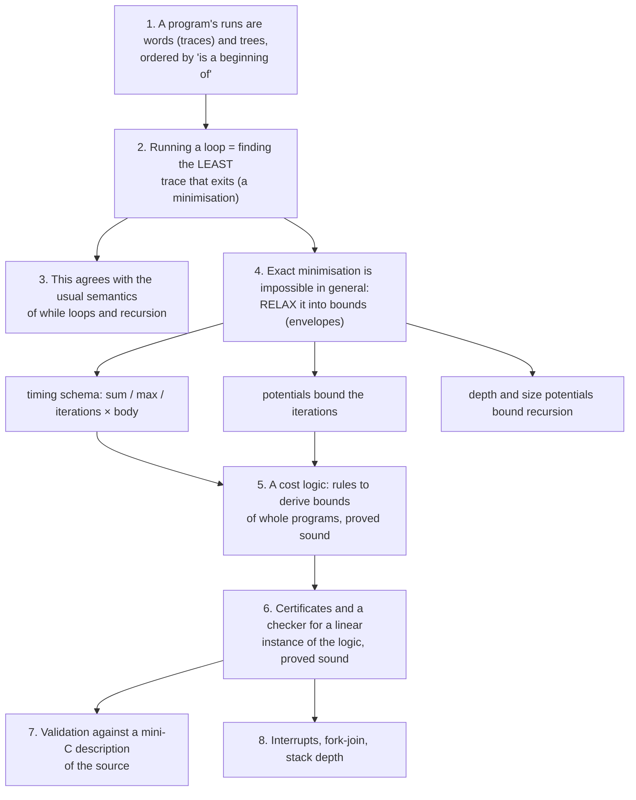
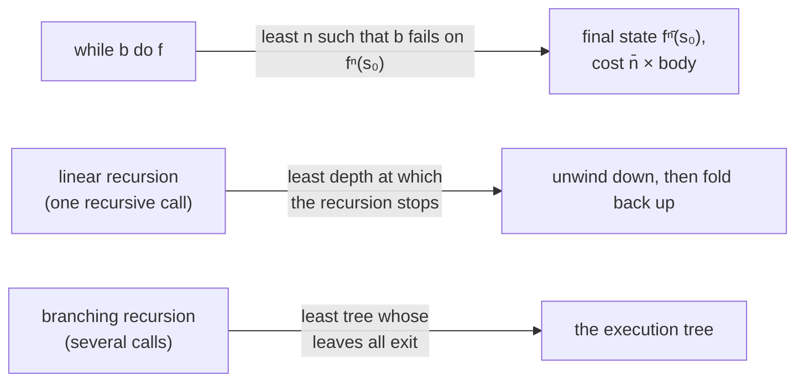
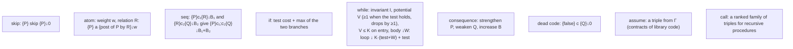
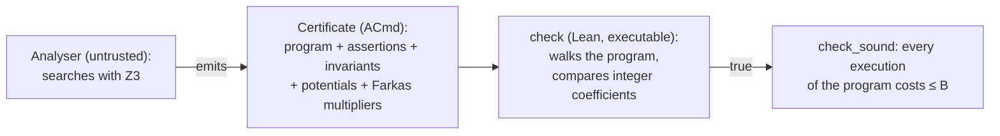
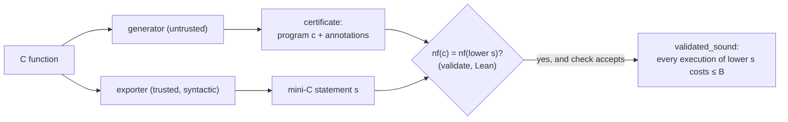
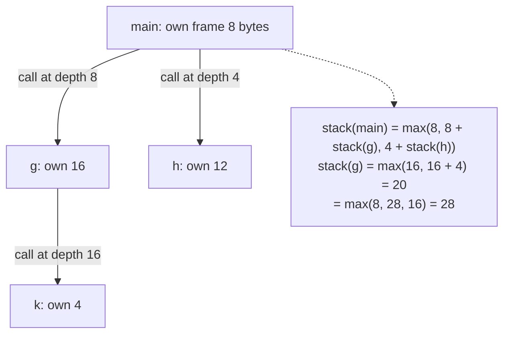

# Part 3 — Paper I explained: the theory and its Lean proofs

`paper/theory/crosscheck-theory.tex`. This part follows the paper's sections in order. For
each one: what it says in plain words, why it is needed, a small example, and where it is
in Lean. Labels (`thm:…`) are the LaTeX labels; search for them in the `.tex` file.

Before reading, you should be comfortable with Part 2, sections 2.1–2.7 and 2.12–2.14.

## 3.1 The story of Paper I in one picture



What is **new**, honestly (the paper's "Positioning" subsection says it): the ingredients
are classical — Kleene's μ-operator, Floyd's ranking functions, the timing schema of Shaw
and of Puschner–Koza, Nielson's Hoare logic for running time, Farkas' Lemma. The
contribution is to put them in one framework where every step is proved in Lean, and to
make the loop rule of the logic be *exactly* what the analyser emits, so that an
executable checker can validate the analyser's output. Paper I contains no measurement.

---

## 3.2 Foundations (`sec:foundations`)

### States, instructions, failure

A **state** is everything the program can observe (the values of its variables). An
instruction is a **partial transition**: it turns a state into a new state, or fails
(division by zero, failed assertion). Failure is represented by an extra value `⊥`
("bottom"); `S⊥` is the set of states plus `⊥` (`def:state-transition`; Lean `PointedState`,
`PartialTransition`). Once in `⊥`, a run stays in `⊥`.

### Traces and their meaning

A **trace** is the sequence of instructions a run executes, written as a word
`t = a₁ a₂ … aₙ`. The set of all finite words is `Σ*` (Σ is the set of instructions). A trace
has two readings (`def:trace-functional`):

- its **meaning** `⟦t⟧`: the state transformation obtained by running `a₁`, then `a₂`, …
  (composition of the instructions' transitions; Lean `evalTrace`);
- its **cost**: its length, or a weighted length (`def:subadditive-norm`; Lean `cost`,
  `wcost`). The cost of `t₁ t₂` is the cost of `t₁` plus the cost of `t₂`.

`tⁿ` is `t` repeated `n` times (Lean `traceIter`, notation `t ^[n]`): the trace of `n`
iterations of a loop whose body always executes the trace `t`. The paper calls the two
readings the **two layers**: the *intensional* layer (traces, their order and their cost)
and the *extensional* layer (the states they produce). Equation `eq:iter-hom` says the two
agree: the meaning of `tⁿ` is the meaning of `t` applied `n` times (`evalTrace_iter`).

### The order-by-composition

`t₁ ⊑ t₂` means **`t₁` is a beginning (prefix) of `t₂`** — `t₂` is `t₁` followed by more
instructions (`def:order-by-composition`). This is a partial order (`prop:poset-properties`;
`order_refl`, `order_trans`, `order_antisymm`) and cost grows along it (`order_cost_le`). For
the iterations of one body, `tᵐ ⊑ tⁿ` exactly when `m ≤ n` (`prop:n-monotony`;
`iter_monotone_iff`): the iterations of a loop form a chain, and "more iterations" means
"later in the order". This is the usual prefix order of words; the tree order is
Courcelle's order on trees (1983), with a leaf in the role of the undefined tree Ω.

### The minimal exiting trace (`thm:minimal-trace`)

Among the iterates `t⁰, t¹, t², …` some may "exit" (the loop test fails after them). The
theorem: if one exits, there is a **least** one. Its proof is the well-ordering of the
natural numbers — every non-empty set of naturals has a least element. Lean:
`exists_minimal_iteration`. This least exiting trace is what the loop executes.

### Bodies whose path depends on the state (`def:path-selector`, `prop:worst-case-step`)

A loop body with an `if` does not execute the same trace every time. A **path selector**
chooses, from the current state, which trace the body runs. Then the cost of `n`
iterations is at most `n` times the most expensive body path (`runTrace_cost_le`) — the
first appearance of the "iterations × worst body" rule.

### Nested loops, conditionals, the tropical algebra

`prop:nested-cost` gives the cost of nested and sequential loops (sums and products of
iteration counts). `prop:tropical-dominance` says a conditional costs at most its test plus
the larger branch (`condTrace_cost_le`). Together these are the timing schema of Part 2,
section 2.12; the paper remarks they are the operations of the `(max, +)` semiring.

### Big-step semantics (`thm:extensional-equivalence`)

The usual definition of what `while b do f` means is **big-step semantics**: a set of rules
"if `b` is false in `s`, the loop ends in `s`; if `b` is true, run `f` and continue". The
theorem says that the least exiting trace gives exactly the final state of these rules
(`while_trace_semantics`, and `whileBigStep_iff_minimalExit` in `WhileLoop.lean`). This is
the bridge: the minimisation view is not a new semantics, it is the standard one seen
differently.

### Computation trees

For recursive functions, a run is a **tree** of calls (Part 2, section 2.13), not a word.
The paper defines trees, **grafting** `T₁ ⊗ T₂` (hang `T₂` under every leaf of `T₁`), the
**tree order** (a tree is below another if the other is obtained by replacing some leaves
by subtrees), and **tree powers** `B^{⊗d}` (graft `B` onto itself `d` times: the full tree of
depth `d`) (`def:tree-algebra`, `def:tree-order`, `def:tree-exponentiation`). For binary trees,
`B^{⊗d}` has `2^d` leaves and `2^{d+1} − 1` nodes (`prop:tree-power-complexity`;
`treePow_leafCount`, `treePow_size`). Lean covers **binary** trees for the order; counting
bounds for any number of children are in `Arity.lean`.

---

## 3.3 Loops and recursion as optimisation problems (`sec:optimization`)

The three results of this section say the same thing for three kinds of repetition:



- `prop:min_x` (`whileBigStep_iff_minimalExit`): a `while` loop ends in state `t` exactly
  when `t = f^{n̄}(s₀)` for the least `n̄` at which the test fails.
- `prop:linrec` (`framedBigStep_iff`, `linRec_iff`): a linear recursion `foo(a) = …
  foo(g(a)) …` computes by going down `n̄` levels (the least depth where the base case
  holds), then combining the results back up — two layers of the same minimisation.
- `prop:tree-optimization` (`exec_least`, `exec_unique`, `treeBigStep_iff`): for a
  recursion with several calls, the execution tree is the **least** tree (in the tree
  order) all of whose leaves are base cases.

Why bother? Because it makes "how many iterations?" a precise mathematical object (`n̄`, the
least element of a set), which the next section bounds from above.

---

## 3.4 From exact minimisation to bounds (`sec:application`)

### Equation generation (`subsec:equation-generation`)

For simple loops — each variable updated by `x := x + c` (a **translation**) — the iterates
have a closed form `x_n = x₀ + n·c`, and `n̄` can be solved exactly. The paper describes rules
that generate such equations from code. **Not mechanised** (the paper says so). The worked
example of section 3.10 uses them.

### Relaxation and envelopes (`subsec:asymptotic-relaxation`)

In general there is no closed form. The paper **relaxes**: instead of computing `n̄`, bound
it. Three tools:

1. **The timing schema** (`subsubsec:tropical-semiring`, `prop:tropical-collapse`): sum for
   sequences, max for branches, `K · (test + body) + test` for a loop of at most `K`
   iterations (Lean `while_cost_bound`).
2. **Ranking potentials** (`subsubsec:ranking-potentials`): the three conditions of Part 2,
   section 2.2.
   - `def:ranking-potential`, `thm:lyapunov-bound` (`ranking_bound`, `ranking_terminates`,
     `wcet_bound`): an integer potential that is ≥ 1 while the loop runs and drops by at
     least `Δ` per iteration gives at most `⌈V₀/Δ⌉` iterations, and the loop terminates.
     The relational version (`ranking_bound_floor`) allows a rational potential, unknown
     inputs and nondeterminism: at most `⌊V(s₀)⌋` iterations. This is the one tools use.
   - `prop:context-bound` (`run_invariant`, `ranking_bound_of_context`,
     `call_bound_of_context`): the conditions are needed only on the states of an
     **inductive invariant** `I`, and the bound `K` only on a **context** `C` of start states.
     This is what makes calling contexts (Part 2, section 2.8) sound: a function can have a
     different bound at each call site.
   - `prop:lex-log`: lexicographic pairs and logarithmic potentials (Part 2, section 2.2).
3. **Recursion** (`subsubsec:compositional-wcet`): `prop:tree-envelope` (depth potential;
   `exec_depth_le`, `exec_size_le`) and `prop:size-potential` (size potential;
   `callTree_size_le_potential`, `callTree_size_le_geom`).

### How the potentials are found (`subsubsec:smt-synthesis`)

Exactly as in Part 2, section 2.7: a potential `V = w·x + c₀` with unknown coefficients; the
"for all states" conditions become, through Farkas, linear constraints on `w`, `c₀` and the
multipliers; an SMT solver solves them. The sound direction is in Lean (`farkas_sound`,
`farkas_sound_affine`); the completeness of Farkas' Lemma is cited.

---

## 3.5 A cost logic for a small language (`subsec:cost-logic`)

### Why a logic

Section 3.4 bounds one loop at a time. A real function has sequences, branches, loops
inside loops, calls. A **program logic** is a set of rules that build bounds of large
programs from bounds of their parts, like a type system builds types. The classic example
is **Hoare logic**, whose statements are **triples** `{P} c {Q}`: "if `c` starts in a state
satisfying `P` and ends, it ends in a state satisfying `Q`". The cost logic adds a bound:
`{P} c {Q}↓B`.

### The language

`Cmd` in `Language.lean`: `skip`; an **atom** (any relation between states with a weight —
assignments, unknown inputs, faults are all atoms); sequence `c₁; c₂`; `if b then c₁ else c₂`;
`while b do c`; `call p` (procedures, recursion allowed). Two semantics:

- `Exec`: the program **terminates** from `s` in `t` with cost `n`;
- `Pre`: some **prefix** of a run (terminated or not) has cost `n`.

### Valid triples (`def:valid-triple`)

`{P} c {Q}↓B` is **valid** when, from any state of `P`, every prefix of every run costs at
most `B`, and every run that terminates ends in `Q`. Bounding **prefixes**, not only
terminated runs, is what forbids infinite runs: an infinite run has prefixes of every
length, so no finite `B` bounds them.

### The rules (`def:derivable-triple`)



Two rules deserve a word:

- **assume** (rule 8) takes a triple from a set `Γ` of **assumed contracts**: that is how
  library functions without code (`memcpy`, an operating-system call) enter, with a
  stated cost. The soundness theorem holds *relative to* `Γ`: if the contracts are true.
- **call** (rule 9) handles recursion: a family of triples indexed by a budget `k`, each
  body proved assuming the triples of smaller rank — an induction built into the rule.

### Soundness (`thm:cost-logic-soundness`)

Every derivable triple (from valid assumptions `Γ`) is valid (Lean `soundness`). The proof
is by induction on the derivation; the loop case needs a second induction on the run with a
budget; the call case a strong induction on the rank.

### Symbolic bounds and summaries (`prop:summary-call`)

A bound may depend on the initial state, like `3 + 339·n`. Such a **symbolic** bound is a
family of numeric triples, one per value; a function's **summary** (its symbolic bound and
pre/postconditions) can be used at every call where the precondition holds
(`validSym_call`, `validSym_seq`). The second part of the proposition is Nielson's
composition rule (1987).

### Amortised loops (`prop:amortised-loop`)

The loop rule pays every iteration the worst body. When the cost of an iteration depends on
the potential (the inner loop of a triangular nest), the iterations can be summed
(`valid_whileSum`, `valid_whileMono`). Prior work: Nielson 1987, whose while rule takes the
loop's time as a solution of a recurrence in the unfoldings and derives bubble sort's
triangular sum this way; Healy et al. 2000 (WCET), Albert, Genaim and Masud 2011 (cost
analysis). The paper claims only the rule's checker case and its Lean proof. Part 2, section 2.12 has the picture.

### Prior work

Nielson's logic (thesis 1984, paper 1987) is the origin of Hoare logics for running time;
Shaw (1989) extended Hoare logic with a real-time variable; Haslbeck and Nipkow (2018)
formalised three such logics in Isabelle for a deterministic language; Atkey (2010) proved an
amortised resource logic sound in Coq and found its annotations by linear programming, the
design closest to CrossCheck's (untrusted search, checked proof). CrossCheck's logic is
weaker in one way (only soundness, not completeness) and different in three: atoms are
relations (unknown inputs), triples bound non-terminating runs too, and the loop rule takes
exactly the analyser's certificate as premises.

---

## 3.6 Certificates and a verified checker (`subsec:checker`)

### The linear instance

The logic of section 3.5 works for any kind of state and any assertions. To check bounds
automatically, the paper fixes a **linear instance**: integer variables, affine
expressions, tests `e ≤ 0`, and assertions that are conjunctions of linear constraints
(Part 2, section 2.4), possibly over **logical variables** `γⱼ` that no instruction changes
(they name values such as "the potential at the start of this iteration", or the parameter
`n` of a symbolic bound).

### What a certificate is (`def:certificate`)

A certificate is the program **with every annotation a derivation needs**: an assertion
between consecutive statements, an invariant and a potential for each loop, the bound of
each part, and a Farkas certificate for every inference (Lean type `ACmd`, file format in
`docs/certificate-format.md`). The checker `check` walks it and verifies each step with
`entails1` (Part 2, section 2.5).



### A tiny certificate, read by hand

The Lean example `countCert`: `i := 0; while (i < n) i := i + 1` with `n ≤ 10` known.

| Step | Claim | Justification the checker verifies |
|---|---|---|
| `i := 0` | after it: `i = 0`, `n ≤ 10` | substitution, then Farkas with multipliers 1 |
| loop entry | invariant `0 ≤ i ≤ n` | from `i = 0` and `0 ≤ n` (premises) |
| loop test true | potential `n − i ≥ 1` | from the test `i − n + 1 ≤ 0` (multiplier 1) |
| body `i := i + 1` | potential drops by 1; invariant kept | substitute `i + 1`, Farkas |
| entry bound | `n − i ≤ 10` on entry | from `i = 0`, `n ≤ 10` |
| total | 10 iterations × (test 1 + body 1) + test 1 = **21** | arithmetic |

The checker accepts it with bound 21 and rejects it with 20 (`countCert_checks`, by
`decide`: Lean runs the checker inside the proof).

### What the loop node checks

In the loop case, the logical variable `γⱼ` stands for "the potential at the start of this
iteration": the body is checked **once**, from `pot ≤ γⱼ` to `pot + d ≤ γⱼ` (the potential
dropped by `d`). Because the check is valid for every value of `γⱼ`, the soundness proof can
instantiate it with the actual potential of each iteration.

Three loop nodes exist:

| Node | What is checked | Iterations | Potential used in the proof |
|---|---|---|---|
| `while` | `pot ≥ d` under the test; body: `pot ≤ γ` → `pot + d ≤ γ` | `⌊k/d⌋` | `pot / d` |
| `whileLog` | `pot ≥ 1` under the test; body: `pot ≤ γ` → `b·pot ≤ γ`; `pot ≤ k` on entry | `⌊log_b k⌋ + 1` | `⌊log_b pot⌋ + 1` (`logloop_sound`) |
| `whileGrow` | `pot ≥ 1` on entry, `pot ≤ K` under the test; body: `pot ≥ γ` → `pot ≥ b·γ` | `⌊log_b K⌋ + 1` | `N − ⌊log_b pot⌋` (`growloop_sound`) |

Two more nodes accept the amortised triangular nests (`triOk`, `whileUp`/`upOk`).

### The theorems

- `thm:checker-soundness` (`check_sound`): if `check` accepts, the triple is valid.
- `def:program-certificate`, `thm:program-soundness` (`program_sound`): a file with several
  functions; calls are checked against the callee's summary (calls only to functions
  earlier in the file: no recursion in certificates) or against an assumed contract.

---

## 3.7 Validation against the source (`subsec:validation`)

### The problem

The certificate's program is produced by the plugin from the C code. If the plugin's
translation is wrong, the checker validates the wrong program. **Translation validation**
(Pnueli et al. 1998; Necula 2000) checks each translation instead of proving the translator.



- `def:minic`: **mini-C**, a small language (variables, `+ − ×`, unknown values, `if`,
  `while`, `for`, comparisons). Its meaning is defined by `lower`: a mini-C statement means
  a checker program without annotations.
- The checker computes a **normal form** `nf` of both programs (erase annotations, flatten
  sequences, drop `skip`) and compares them (`validate`). `lem:nf-equiv` (`nf_equiv`): a
  program and its normal form have the same runs and costs.
- `thm:validated` (`validated_sound`): if the certificate is accepted and validated, the
  bound holds for the mini-C description.
- `def:minic-jumps`, `thm:validated-jumps` (`MiniCJump`): `break`, `continue`, `return` and
  `switch` get their own direct meaning; the checker eliminates them with flag variables,
  and `sim` proves that each direct run is matched by a run of the eliminated program that
  costs at least as much.

The trusted part becomes the exporter, which is a syntactic copy of the C code into mini-C,
with stated hypotheses: no signed overflow, no aliasing of the tracked variables.

---

## 3.8 Interrupts, fork-join, stack depth

### Interrupts (`subsec:concurrency`)

A function may be interrupted by handlers. Its **response time** — from its start to its
end, interrupts included — is bounded by the classical equation of fixed-priority
scheduling (Joseph and Pandya 1986):

```text
R = C + Σₖ cₖ · ⌈R / Tₖ⌉
```

where `C` is the function's cost, `cₖ` the cost of handler `k` and `Tₖ` its minimum time
between two activations. Solve by iteration from `R₀ = C`. Example: `C = 10`, one handler
`c = 2`, `T = 10`: `R₁ = 10 + 2·⌈10/10⌉ = 12`, `R₂ = 10 + 2·⌈12/10⌉ = 14`,
`R₃ = 10 + 2·⌈14/10⌉ = 14`: the response time is at most 14.

- `def:interrupt-model`, `lem:sporadic` (`sporadic_count`): at most `⌈t/Tₖ⌉` activations of
  handler `k` in the first `t` slots.
- `thm:response-time` (`response_time_bound`): the bound holds, with `C` and `cₖ` certified
  bounds; the checker verifies a claimed `R` (`rtaHolds`, `rtaHolds_sound`).
- Hypotheses to say aloud: one cost unit = one time slot (true only with a timing cost
  model, Part 5), and no handler activation pending at the start (the classical
  busy-period argument removes it; not mechanised).
- `prop:graham` (`greedy_bound`, `forkjoin_bound`): Graham's bound for independent tasks
  on `p` processors: makespan ≤ total work / `p` + longest task.

### Stack depth (`subsec:stack`)

Cost adds up along a run; **stack** usage is a maximum: the deepest point reached.



- `def:activation-tree`; `prop:stack` (`highWater_le_of_bound`): any numbers `B` with
  `own(f) ≤ B(f)` and `depth of call + B(g) ≤ B(f)` at every call site bound the stack;
  (`highWater_le_depth`) frames of at most `F` bytes and recursion depth `n` give `(n+1)·F`.
- Applied to Cortex-M0 binaries in Paper III.

---

## 3.9 The worked examples (`sec:examples`)

| Example | Program | What it shows | Lean |
|---|---|---|---|
| Parametric loop | `while (i++ < 13) { i = i + 1; x = y + 2; y = x + 3; }` from `i = R` | one iteration maps `(i, x, y)` to `(i + 2, y + 2, y + 5)`; `n̄ = ⌈(13 − R)/2⌉`; from `R = 0`: 7 iterations, final `(15, 34, 37)`; potential `13 − i` with `Δ = 2`, tight | `parametric_loop_*` |
| Infinite loop | `int i = 0; while (i != 1) i = 0;` | the equations have no solution: no exit; no potential exists | `infinite_loop_diverges` |
| Linear recursion | `foo(a) { if (a > 4) a = foo(a − 2) + 3; return a + 6; }`, `foo(10)` | depth 3, value 37 | `linear_recursion_*` |
| Branching recursion | `foo(x) { if (x > 0) return foo(x − 1) + foo(x − 1); return 1; }`, `foo(2)` | full binary tree of depth 2: 7 calls, value 4; envelope `2^{x+1} − 1`, attained | `binary_recursion_*` |

---

## 3.10 Mechanisation and its limits (`sec:mechanization`, `sec:limitations`)

The development for Paper I: about 10 400 lines of Lean 4 over mathlib, 460 theorems, no
`sorry`, only Lean's three standard axioms. Table `tab:lean` maps every statement to its
Lean theorems; `formalization/formalization.yaml` is the same table in machine-readable
form.

**Not mechanised** (the paper lists them; say them aloud if asked):

- the tree *order* for more than two children (the counting bounds are general);
- termination (not just bounds) for relational, nondeterministic updates;
- the equation-generation rules; the completeness of Farkas' Lemma;
- lexicographic potentials with a symbolic inner bound (with a constant one they are
  affine and covered);
- recursion in the checker (calls only to earlier functions);
- the C/C++ front end and the plugin itself (C++), Z3;
- the busy-period argument for interrupts; parallel composition in the logic.

**Limitations** (the paper's `sec:limitations`): cost is not time; affine and logarithmic
potentials only; amortisation only for two triangular shapes; structured control flow over
scalar integer variables.

---

## 3.11 Paper I on one page

*Running a loop is a minimisation.* Order runs by "is a beginning of"; a loop's run is the
least run that exits, which is the standard semantics. *Bounds are relaxations of that
minimisation.* Potentials bound the number of iterations, the timing schema composes costs,
depth and size potentials bound recursion. *They compose in a logic.* A Hoare-style cost
logic with procedures, recursion and contracts is sound, also for runs that never end.
*They can be checked.* A linear instance has certificates that an executable checker,
proved sound, verifies with integer arithmetic; a certificate can be validated against a
description of the source. All of it is in Lean.
