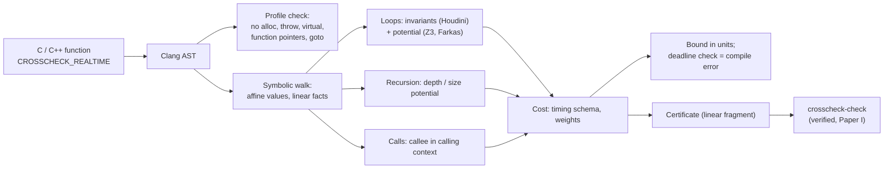
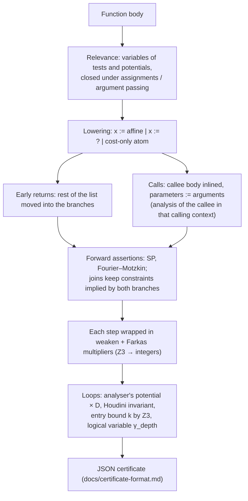
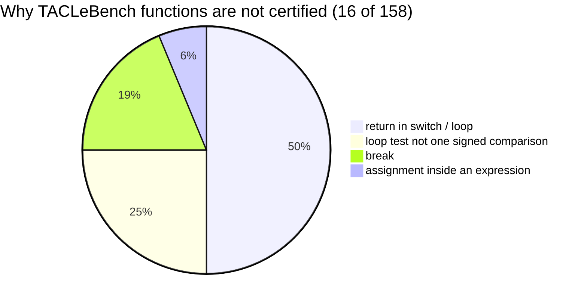

# Part 3 — Reading Paper II (the plugin and its evaluation)

`paper/tool/crosscheck-tool.tex`. Paper II holds every measurement; it cites Paper I's
results by number (`[3, Theorem 6.2]`, via `xr`).

## 1. What the plugin does

- **Input**: annotations `CROSSCHECK_REALTIME`, `DEADLINE(n)`, `RANGE(lo, hi)`,
  `REQUIRE(cond)`; trusted ones (`LOOP_BOUND`, `ASSUME`, `COST`) are listed in the report.
- **Two kinds of bound per loop**: *for every call* of its function (under the declared
  preconditions only), and *in context* (for the calls the program makes from its entry
  point, `--opt=entry=main`). Always say which one a figure is.
- **Certificates**: for functions in the fragment, the bound no longer rests on the
  analyser or on Z3 — only on the checker (proved) and on the lowering from C++ to the
  certificate's program (not proved).

## 2. How certificates are produced (paragraph "Certificates")

- Why inlining is sound: a callee cannot modify its caller's tracked variables (their
  address is never taken); its cost is that of its body plus the call overhead.
- Why moving the rest into branches is sound: it is the same control flow, written
  structurally.
- The certified bound equals the plugin's, except when the forward assertions prove a path
  infeasible (lower: `__kernel_cosf`) or when a loop's entry bound is rounded up (higher).

## 3. Results to remember

| Measurement | Result | Where |
|---|---|---|
| Example programs (`tab:plugin`) | 13 functions bounded, 3 programs rejected as intended; 10 of 15 bounded functions (helpers included) certified | `benchmarks/README.md` |
| TACLeBench, 220 loops (`tab:tacle`) | for every call: 126 bounded, 100 = flow fact; in context: 137 bounded, 128 = flow fact | `benchmarks/tacle/README.md` |
| Observed loop counts (208 loops run) | no bound of CrossCheck below an observed count; geometric mean bound/observed: 1.93 (every call), 1.06 (in context) | `compare_tools.py` |
| Certificates on TACLeBench | 156 of 158 bounded functions, all accepted; 9 entry functions (142 before early exits, `switch`, `&&` and unsigned) | `run_tacle.py --certificates` |
| ScalarEvolution (LLVM) | 113 loops; identical to ours on 99 of 103 common loops | `tab:tools` |
| oRange (OTAWA) | 131 loops; identical to our in-context bounds on all 113 common loops; one bound below the observed count (`filterbank`) | `tab:tools` |
| KoAT2 / CoFloCo | 5 / 8 entry functions numerically bounded; CoFloCo never looser than KoAT2 on the same programs | `tab:tools` |
| Infer | 14 entry functions, but ignores recursion (constant cost for Fibonacci) | `tab:tools` |
| TPDB, 553 programs | CrossCheck 10 as is, 165 with input ranges; KoAT2 288, CoFloCo 264 | `benchmarks/tpdb/README.md` |
| TACLeBench sequential + app, 572 loops | in context 317 bounded, 297 = flow fact; 5 below a flow fact, all dead code or overstated `sizeof` facts; 232 of 252 functions certified | `benchmarks/tacle/README.md` |

**Exports (paragraph "Exports")**: loop bounds as FFX (OTAWA; `source` + `line`,
`maxcount`) or AIS/AIS2 (aiT; routine linker name + loop number, in source order: a
caveat), SARIF for code scanning, a cost diff for CI. On TACLeBench our FFX equals oRange's
on 114 loops. Not yet loaded into OTAWA or aiT.

**Related work (Paper II, `sec:related`)**: bound analysers (SPEED, Loopus, KoAT, CoFloCo,
COSTA, C4B), WCET flow analysis (IPET, oRange), verified and certified bounds (Blazy,
Maroneze et al. in CompCert; C4B; proof-carrying code), Clang's function effects. The
point to make: CompCert-based tools verify the analysis down to the compiler's
representation; CrossCheck verifies a small checker and leaves the C++ → certificate
translation unverified.

## 4. How to read the evaluation honestly

- Flow facts are a reference for the benchmark's fixed input, not a proof; two of them are
  one below the observed count (`while (1)` left by `break`: they count completed
  iterations).
- Observed counts are for one input; a bound above them is not necessarily loose.
- The other tools answer other questions (asymptotic complexity, cost regressions,
  whole-program flow facts) and were not tuned.
- On TPDB, CrossCheck is clearly weaker: no symbolic bounds, no multi-phase or disjunctive
  potentials.

## 5. Paper II on one page

A compiler plugin bounds loops and recursion of real-time C/C++ at compile time; callees
are analysed in their calling contexts; for a linear fragment it emits certificates that a
Lean-verified checker accepts (156 of 158 bounded TACLeBench functions). Its in-context
loop bounds agree with oRange's wherever both exist, and never fall below observed loop
counts. On complexity benchmarks it is weaker than KoAT2 and CoFloCo.
