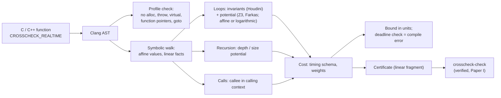
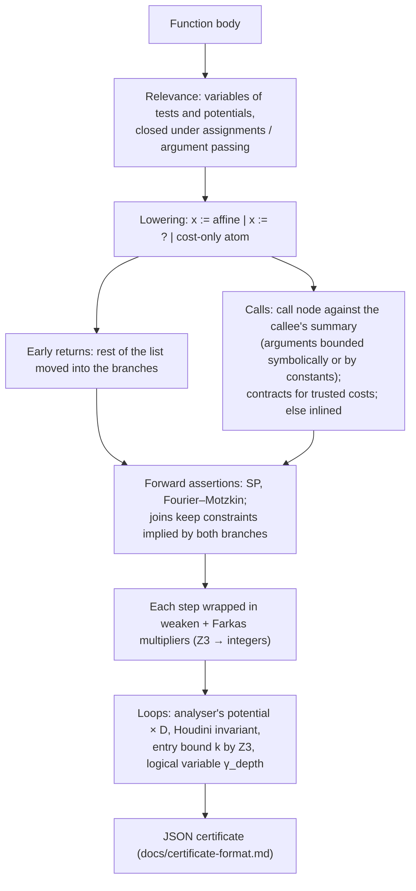

# Part 3 — Reading Paper II (the plugin and its evaluation)

`paper/tool/crosscheck-tool.tex`. Paper II holds every measurement; it cites Paper I's
results by number (`[3, Theorem 6.2]`, via `xr`).

## 1. What the plugin does

- **Input**: annotations `CROSSCHECK_REALTIME`, `DEADLINE(n)`, `RANGE(lo, hi)`,
  `REQUIRE(cond)`; trusted ones (`LOOP_BOUND`, `ASSUME`, `COST`) are listed in the report.
- **Two kinds of bound per loop**: *for every call* of its function (under the declared
  preconditions only), and *in context* (for the calls the program makes from its entry
  point, `--opt=entry=main`). Always say which one a figure is.
- **Certificates**: for functions in the fragment, the bound no longer rests on the
  analyser or on Z3 — only on the checker (proved) and on the lowering from C++ to the
  certificate's program (not proved).

## 2. How certificates are produced (paragraph "Certificates")

- Why inlining is sound: a callee cannot modify its caller's tracked variables (their
  address is never taken); its cost is that of its body plus the call overhead.
- Why moving the rest into branches is sound: it is the same control flow, written
  structurally.
- The certified bound equals the plugin's, except when the forward assertions prove a path
  infeasible (lower: `__kernel_cosf`) or when a loop's entry bound is rounded up (higher).

## 3. Results to remember

Figures of 2026-11-15, after logarithmic potentials (`whileLog`, `whileGrow`) and exact
unsigned division. Always say whether a loop figure is *for every call* or *in context*.

| Measurement | Result | Where |
|---|---|---|
| Example programs (`tab:plugin`) | 13 functions bounded, 3 programs rejected as intended; 10 of 15 bounded functions (helpers included) certified | `benchmarks/README.md` |
| TACLeBench kernels, 220 loops (`tab:tacle`) | for every call: 132 bounded, 105 = flow fact; in context: 141 bounded, 131 = flow fact; 11 of 29 entry functions bounded | `benchmarks/tacle/README.md` |
| Observed loop counts (208 loops run) | no bound of CrossCheck below an observed count; geometric mean bound/observed: 1.83 (every call), 1.03 (in context) | `compare_tools.py --check` |
| Certificates on the kernels | 158 of 162 bounded functions, all accepted; 10 entry functions; 124 calls checked against the callee's summary | `run_tacle.py --certificates` |
| Validation against the source | 93 of the 158 kernel certificates validated against mini-C, none failing (113 of 231 on sequential/app) | `run_tacle.py --minic` |
| ScalarEvolution (LLVM) | 113 loops; of 104 common loops, 99 identical, ours smaller by one on 4, LLVM's smaller by one on 1 (`fft` doubling loop: 10 vs 11) | `tab:tools` |
| oRange (OTAWA) | 131 loops; identical to our in-context bounds on all 114 common loops (115 in the FFX files); one oRange bound below the observed count (`filterbank`) | `tab:tools`, `compare_ffx.py` |
| KoAT2 / CoFloCo | 5 / 8 entry functions numerically bounded (ours: 11); CoFloCo never looser than KoAT2 on the same programs | `tab:tools` |
| Infer | 14 entry functions, but ignores recursion (constant cost for Fibonacci) | `tab:tools` |
| Sequential + app, 572 loops | every call 274 bounded, 258 = flow fact; in context 329 and 304; 10 in context below a flow fact, none a counter-example (dead code, overstated facts); 231 of 263 functions certified | `benchmarks/tacle/README.md` |
| CMSIS-DSP, 786 functions | as is 161 bounded; with assumed ranges 616 (78%), 1,044 of 1,234 loops analysed (one file timed out) | `benchmarks/cmsis/README.md` |
| Cortex-M0 cycles | 104 of 267 functions; 5 entry functions at 1.24 to 2.49 times the emulated run; 10 calls and 43 loops compared, no violation; one `fft` function 970 times (product of nested bounds) | `benchmarks/cycles/README.md` |
| TPDB, 553 programs | CrossCheck 10 as is, 171 with input ranges (130 certified, 97 with a symbolic summary); KoAT2 288, CoFloCo 264 | `benchmarks/tpdb/README.md` |
| Rust examples | 11 of 12 functions translated, 6 bounded, 3 certified, 1 validated; 382 differential runs, no mismatch | `frontends/rust/README.md` |

Why the 4 bounded kernel functions without a certificate are not certified:

| Function | Reason |
|---|---|
| `bitcount_bit_shifter` | assignment inside an expression |
| `ludcmp_test` | symbolic entry bound with a symbolic body bound |
| `fft_bit_reduct`, `fft_main` | bounded by a logarithmic potential that the generator's invariant does not show positive |

**What Paper II adds beyond loop bounds** (paragraphs of `sec:implementation`):

| Paragraph | Content | Trusted |
|---|---|---|
| Validation against the source | the function exported as mini-C (`MiniC.cpp`), compared with the certificate's program by the checker (`thm:validated`) | the exporter; no signed overflow, no aliasing of tracked variables |
| Rust | `rustc` MIR (text, rustc 1.100.0) translated to C, then the same pipeline | the translation (tested differentially) |
| Interrupts | `CROSSCHECK_INTERRUPT(T)`: response time from certified bounds (`response_time_bound`, checked by `rtaHolds`) | the period `T`; one cost unit = one time slot |
| Cycles on a predictable processor | timing schema on the Cortex-M0 binary, loop bounds from the source loops | the timing table; the matching of binary to source loops (checked on runs) |

**Exports (paragraph "Exports")**: loop bounds as FFX (OTAWA; `source` + `line`,
`maxcount`) or AIS/AIS2 (aiT; routine linker name + loop number, in source order: a
caveat), SARIF for code scanning, a cost diff for CI. On TACLeBench our FFX equals oRange's
on 115 loops. Not yet loaded into OTAWA or aiT.

**Related work (Paper II, `sec:related`)**: bound analysers (SPEED, Loopus, KoAT, CoFloCo,
COSTA, C4B), WCET flow analysis (IPET, oRange), verified and certified bounds (Blazy,
Maroneze et al. in CompCert; C4B; proof-carrying code), Clang's function effects. The
point to make: CompCert-based tools verify the analysis down to the compiler's
representation; CrossCheck verifies a small checker and leaves the C++ → certificate
translation unverified.

## 4. How to read the evaluation honestly

- Flow facts are a reference for the benchmark's fixed input, not a proof; two of them are
  one below the observed count (`while (1)` left by `break`: they count completed
  iterations).
- Observed counts are for one input; a bound above them is not necessarily loose.
- The other tools answer other questions (asymptotic complexity, cost regressions,
  whole-program flow facts) and were not tuned.
- On TPDB, CrossCheck is clearly weaker: the analyser needs numeric ranges (summaries exist
  only in certificates), no multi-phase or disjunctive potentials.
- CMSIS-DSP figures rest on assumed input ranges, with no observed counts and no
  certificates; cycle bounds are compared with our own interpreter, not with hardware.
- A loose bound is reported as such: the `fft` cycle bound (970 times the run) shows the
  cost of products of nested bounds without amortisation.

## 5. Paper II on one page

A compiler plugin bounds loops and recursion of real-time C/C++ at compile time; callees
are analysed in their calling contexts; for a linear fragment it emits certificates that a
Lean-verified checker accepts (158 of 162 bounded TACLeBench kernel functions; 93 also
validated against the source). Loops get affine or logarithmic potentials. Its in-context
loop bounds agree with oRange's wherever both exist, and never fall below observed loop
counts. On complexity benchmarks it is weaker than KoAT2 and CoFloCo.
