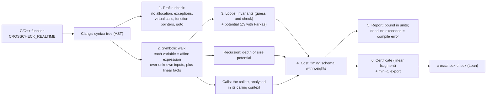
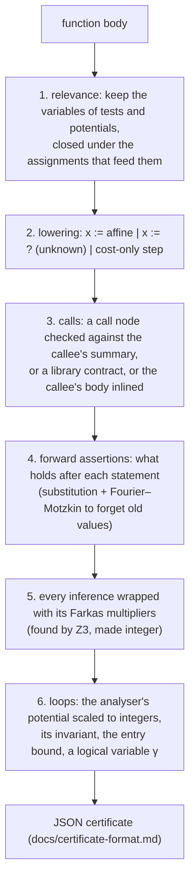

# Part 4 — Paper II explained: the plugin and its evaluation

`paper/tool/crosscheck-tool.tex`. Paper II describes the Clang plugin and measures it. It
cites Paper I's results by their numbers (it is built after Paper I and reads its labels).
Every measurement of the project is in Paper II, except those on binaries (Paper III).

## 4.1 What the plugin does, step by step

1. **Profile check.** A real-time function must not allocate memory, throw, call through a
   function pointer or a virtual function, or use `goto`: those make the cost impossible
   to bound statically (or are forbidden by coding standards like MISRA). The plugin
   rejects them with a compile error.
2. **Symbolic walk.** The plugin walks the function's syntax tree. Instead of numbers, each
   variable holds an **affine expression** over symbols that stand for unknown values (the
   parameters, values read from memory). Along each path it collects **facts**: linear
   constraints over these symbols (from tests, from annotations, from the ranges of types).
   This is **symbolic execution**, limited to affine values. Anything non-affine (a product
   of two variables, a value read through a pointer) becomes a fresh unknown symbol.
3. **Loops.** For each loop it finds candidate invariants and keeps the inductive ones
   (Part 2, section 2.3), then asks Z3 for a potential (section 2.7). If none is found, it
   tries a logarithmic potential, then a lexicographic one (by retrying with more candidate
   invariants). If still none, the loop is **unbounded** and the function is rejected,
   with a probable cause in the report ("the test reads memory", "no range for `n`").
4. **Cost.** The timing schema (section 2.12) combines the bounds, with the weights of the
   cost model.
5. **Report.** A remark per function with its bound, a compile error if it exceeds the
   declared deadline, and a JSON report with every loop's bound, potential, invariants and
   the assumptions used.
6. **Certificate.** For the functions in the **certificate fragment** (integer variables,
   structured loops, calls to earlier functions), a certificate for the checker; with
   option `minic`, also the function as mini-C, for validation.

### Annotations

| Annotation | Meaning | Trusted? |
|---|---|---|
| `CROSSCHECK_REALTIME` | analyse this function; reject it if not bounded | — |
| `CROSSCHECK_DEADLINE(n)` | the bound must be ≤ `n` units, else a compile error | — |
| `CROSSCHECK_DEADLINE_CYCLES(n)`, `_US(n)` | a time budget, recorded and checked after compilation on the binary (Part 5) | the processor model |
| `CROSSCHECK_RANGE(lo, hi)` on a parameter | the argument is in `[lo, hi]` | proved at the analysed call sites; **assumed** for callers outside the program |
| `CROSSCHECK_REQUIRE(cond)` | a precondition relating parameters (`lo < hi`) | as for `RANGE` |
| `CROSSCHECK_ASSUME(cond)` | a fact from this point on (e.g. after reading a hardware register) | **yes** |
| `CROSSCHECK_LOOP_BOUND(n)`, `CROSSCHECK_BOUNDED(n)` | this loop iterates at most `n` times | **yes**, unless a tighter bound is derived |
| `CROSSCHECK_COST(n)` | cost of a function whose body is not analysed | **yes** |
| `CROSSCHECK_INTERRUPT(T)` | an interrupt handler activated at most once every `T` units | **yes** (`T`) |

Every trusted annotation goes into the report's list of **assumptions**: a bound "under 1
assumption" holds only if the assumption is true.

### Two kinds of bound: for every call, and in context

For each loop and function the report gives two numbers:

- **for every call**: valid whatever the arguments, given only the declared preconditions;
- **in context**: valid for the calls the program actually makes from its entry point
  (option `entry=main`), using the calling contexts (Part 2, section 2.8).

Always say which one a figure is. On TACLeBench the second is much better, because many
kernels use helper functions whose loop bounds come from the caller's constants.

## 4.2 How certificates are produced

The certificate generator (`clang-plugin/src/core/Cert.cpp` and the "Certificates" part of
`Analyzer.cpp`) turns the analysed function into a checker program with all its
annotations:

- **Relevance** keeps the certificate small: variables that cannot influence a loop test or
  a potential are replaced by unknowns ("havoc").
- **Early exits** (`break`, `continue`, `return`) are expressed with flag variables and
  conditionals, because the checker's language is structured; the checker eliminates the
  same jumps in the mini-C source in the same way (Paper I, section 3.7 of this guide).
- **Calls**: a call to a function already in the file is checked against that function's
  summary (its symbolic bound and pre/postconditions), with the arguments bounded; calls to
  library code use assumed contracts (`docs/contracts.md`).
- The certified bound equals the plugin's bound, except when the forward assertions prove
  a path impossible (then lower) or a loop's entry bound is rounded up (then higher).

A certificate that the checker refuses is reported, never used. On TACLeBench every
emitted certificate is accepted.

## 4.3 The benchmarks, and what each measurement means

### TACLeBench

**TACLeBench** (Falk et al. 2016) is the standard benchmark collection of the WCET community:
small C programs (kernels: sorting, filters, matrix operations, FFT, CRC…) and larger ones
(sequential, application, parallel), each with a `main` and fixed input data. Its loops
carry `loopbound` **flow facts**: the number of iterations for the shipped input,
determined by its authors. They are a reference, not a proof.

The script `benchmarks/tacle/run_tacle.py` fetches TACLeBench at a pinned revision, runs the
plugin on every kernel *without any annotation*, and compares each loop's bound with the
flow fact.

| What | Result (2026-11-16/17) | How to read it |
|---|---|---|
| 29 kernels, 220 loops, for every call | 133 bounded, 105 equal to the flow fact | the rest are bounded only in context, or not at all |
| … in context | 142 bounded, 131 equal to the flow fact; 12 of 29 `main` functions bounded | the calling contexts recover helper loops |
| Certificates | 161 of 165 bounded functions certified, all accepted | the 4 others: an assignment inside an expression, a symbolic bound inside a symbolic loop, two logarithmic loops whose invariant is not shown positive |
| Validation against mini-C | 152 of the 161 validated | one not validated (the generator inlined a call that the source keeps); the rest have callees outside the file or calls in loop tests |

### Observed loop counts

`benchmarks/tacle/measure_loops.py` compiles each kernel with a counter on every loop, runs
it, and records the largest number of iterations per entry. CrossCheck's bound must never
be below an observed count (that would be a soundness bug): **none is**, on 208 loops run.
The geometric mean of bound / observed is 1.85 for the bounds valid for every call and 1.04
in context (the largest ratio, 7.2, is binary search, bounded linearly instead of
logarithmically). `compare_tools.py --check` fails the CI build if a bound is ever below an
observed count.

### Five other tools (`tab:tools`)

The same files were given, without annotations, to five tools that answer related
questions:

| Tool | What it computes | Result on the kernels |
|---|---|---|
| LLVM ScalarEvolution | constant trip counts per loop, one function at a time | 113 loops; of 104 common loops, 99 identical |
| oRange (OTAWA's loop-bound tool) | loop bounds of the whole program, from `main` | identical to CrossCheck's in-context bounds on 114 of 115 common loops; one oRange bound is below the observed count (`filterbank`) |
| KoAT2 | complexity bounds of integer programs (translated from C by llvm2kittel) | 5 `main` functions bounded numerically (CrossCheck: 12) |
| CoFloCo | cost relations, same input as KoAT2 | 8 `main` functions; never looser than KoAT2 |
| Infer (cost analysis) | symbolic cost per function | 14 `main` functions, but it ignores recursion (constant cost for Fibonacci) |

The other tools were run untuned, in network-less containers, and their answers are stored
in `benchmarks/tacle/results/`. They are not wrong where they differ: they answer different
questions (asymptotic complexity, whole-program constants).

### The Termination and Complexity Competition (TPDB)

TACLeBench favours CrossCheck (constant loop bounds). The complexity category of the
**Termination Problem Database** (553 C programs with integer parameters, symbolic costs)
favours complexity analysers. With option `symbolic` (no input ranges needed; a potential
is enough, and the certificate generator derives a bound in `max(0, x)`, `max(0, x − y)`
terms, possibly quadratic), **147** programs get a certificate valid for all inputs; KoAT2
and CoFloCo bound 288 and 264. CrossCheck is clearly weaker there, and the paper says so.

### CMSIS-DSP

Arm's signal-processing library for Cortex-M (786 functions). With each file alone and no
annotation, 161 functions are bounded (sizes are parameters without ranges); with every
integer input assumed in `[1, 1024]` and illustrative contracts for `memset`/`memcpy`, 616
(78%). No observed counts, no certificates: this is a coverage measurement, under stated
assumptions.

### Industrial programs and Rust

ROSACE (flight control, 5 threads) and DEBIE (satellite instrument) from TACLeBench's
parallel category: 73 of 86 and 111 of 187 functions bounded. The Rust front end
(`frontends/rust/`) translates MIR to C; on the examples, 6 of 12 functions bounded, 3
certified and validated, and 382 differential runs (Rust vs generated C) without mismatch.

## 4.4 Tests against executions

The analyser is not verified, so it is tested where the proof does not reach:

- **Random programs** (`clang-plugin/tests/fuzz_bounds.py`): a generator writes functions with
  loops of the shapes the analyser targets (counters, steps, halving, resets, early exits)
  and arbitrary combinations; each is analysed, compiled with counters and run on all inputs
  of its declared ranges. In a campaign of 120 files (1 632 loops, 1.23 million runs), 863
  loops were bounded and **none below an executed count**. The same runs execute the
  exported ACSL invariants and variants as checks, and compare the mini-C export with the
  compiled code.
- **Mutated certificates** (`formalization/test/mutate_certificates.py`): one integer of an
  accepted certificate is changed; a mutant that the checker still accepts is run by an
  independent interpreter of certificate programs on random states. Of 2 029 mutants,
  1 983 were rejected; the 46 accepted ones were still true (a larger bound, other valid
  multipliers). This tests the checker's *reader* of JSON files, which the proof does not
  cover.

These tests found real defects, all fixed and described in the paper (a loop bound of 0
for a body that starts once; a static local re-initialised at every call — the latter
produced an accepted certificate of the wrong program, which is exactly the "translation
gap" of Part 1).

## 4.5 How to present the evaluation honestly

- Flow facts hold for one input; observed counts are for one input; a bound above them is
  not necessarily loose.
- The other tools were not tuned and answer other questions.
- On TPDB CrossCheck is weaker; certified bounds are at most quadratic in the parameters.
- CMSIS-DSP figures rest on assumed ranges.
- Cost units are not time (Part 5 for cycles).

## 4.6 Related work (Paper II's `sec:related`)

Bound analysers (SPEED, Loopus, KoAT, CoFloCo, COSTA, C4B), WCET flow analysis (IPET,
oRange, aiT), verified and certified bounds (Blazy et al. and Maroneze et al. in CompCert;
Carbonneaux et al.; proof-carrying code), Clang's function-effect attributes. The point to
make: the CompCert-based tools verify the analysis down to the compiler's intermediate
representation; CrossCheck verifies a small checker and leaves the C → certificate
translation unverified (or validated against mini-C).

## 4.7 Paper II on one page

A compiler plugin bounds loops and recursion of real-time C/C++ at compile time, analysing
callees in their calling contexts; for a linear fragment it emits certificates that a
Lean-verified checker accepts (161 of 165 bounded TACLeBench kernel functions, 152 also
validated against the source). Its in-context loop bounds agree with oRange's on all but
one common loop and are never below observed counts. Without annotations it certifies
bounds valid for all inputs for 147 of 553 complexity benchmarks, where KoAT2 and CoFloCo
bound 288 and 264.
