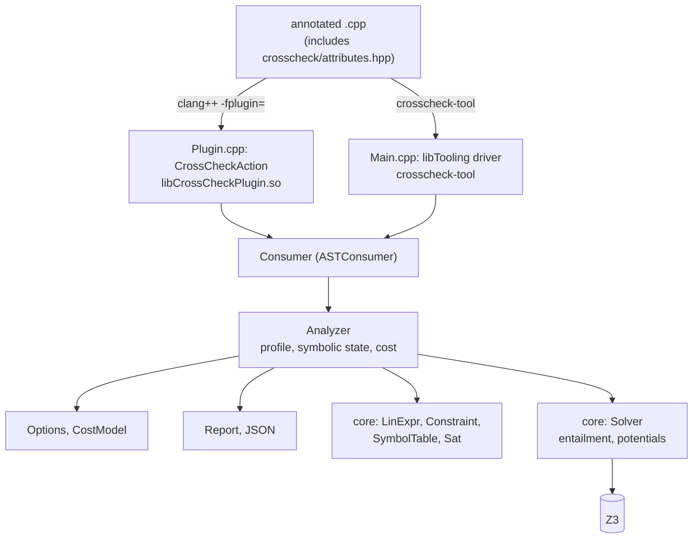
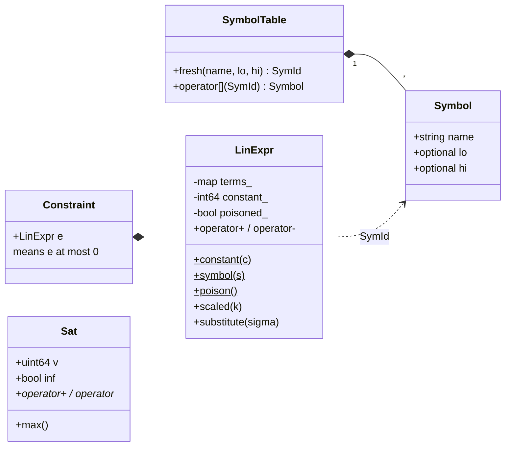
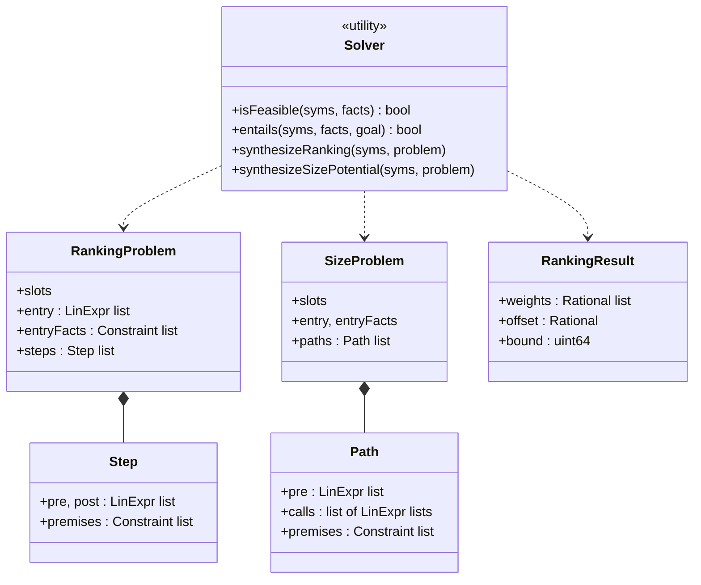
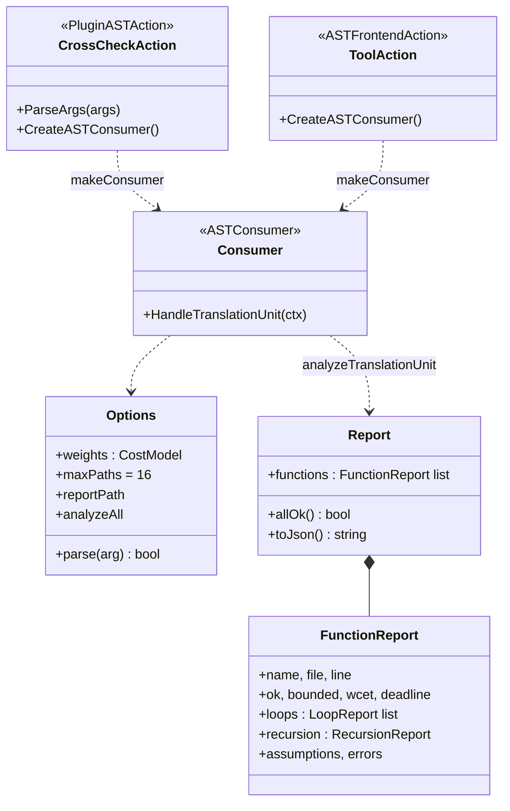
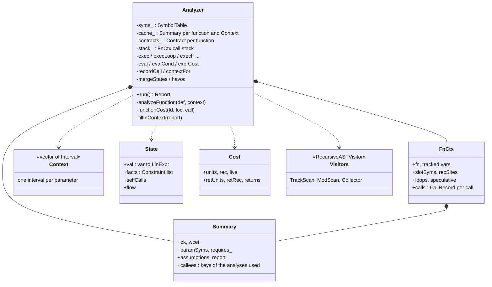
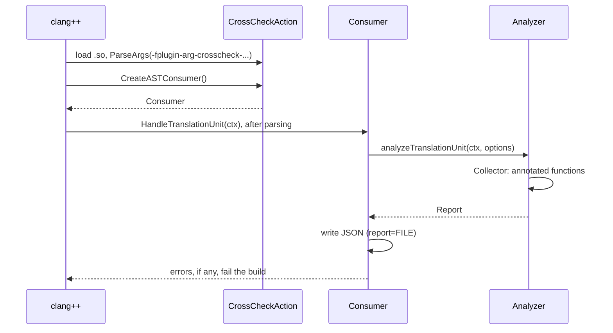
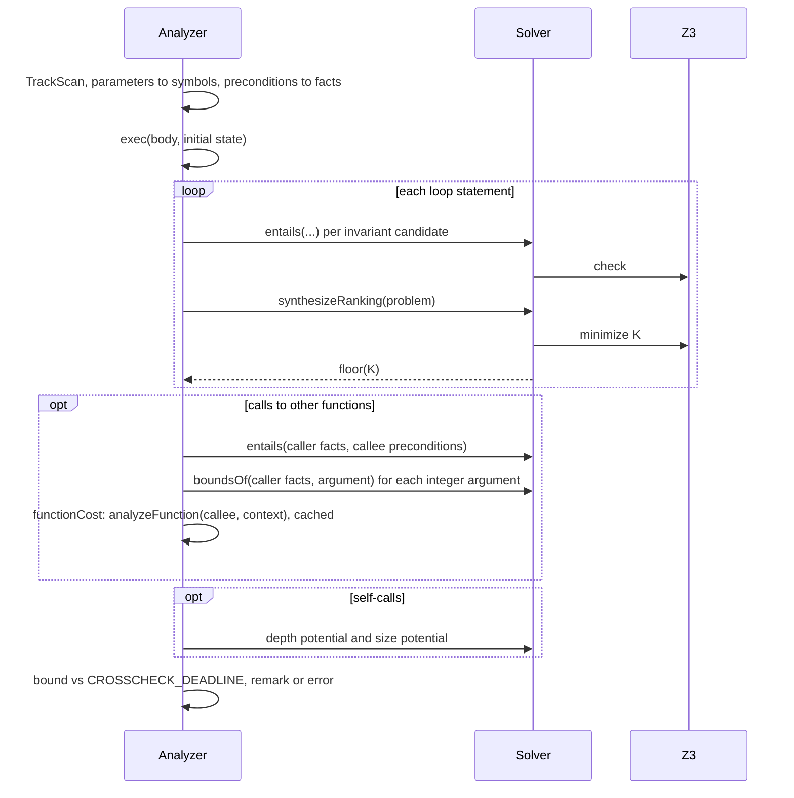
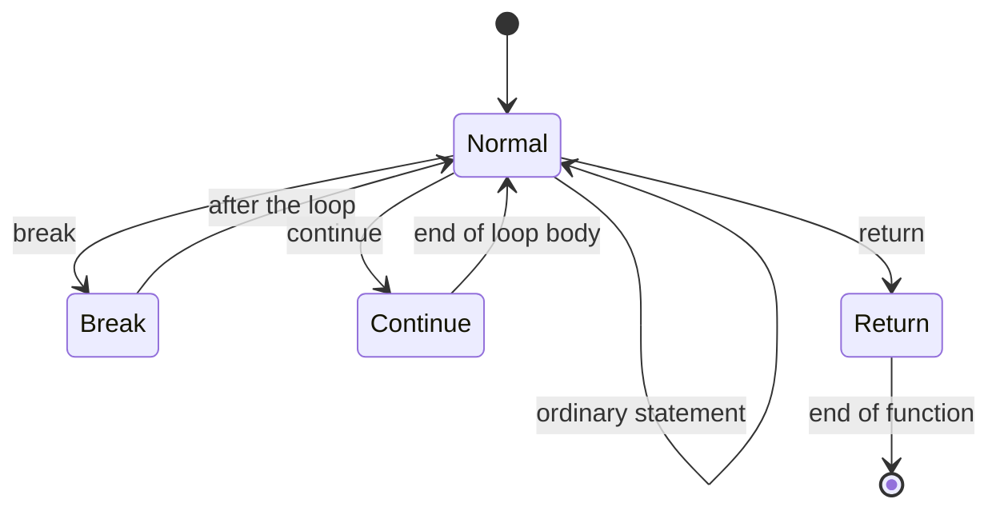
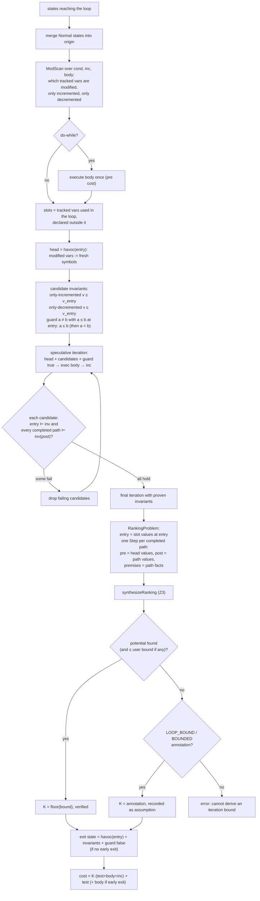
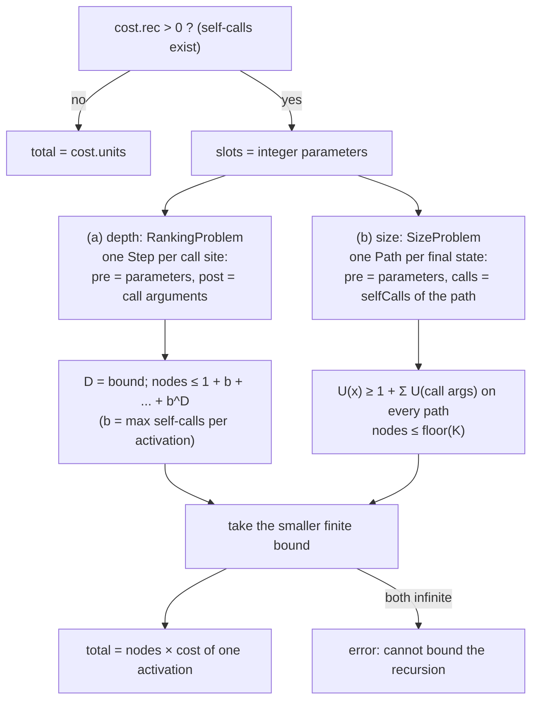

# Part 4 — The Clang plugin, explained

This part documents `clang-plugin/` for someone who knows C++ and UML but has never
written a Clang tool. It covers what the plugin computes, how the code is
organised, how each algorithm works (traced on real examples with the tool's real
output), and how to extend it. User-level documentation (annotations, options) is
in `clang-plugin/README.md`; this part is the developer's view.

Contents

1. [What the plugin does, in one example](#1-what-the-plugin-does-in-one-example)
2. [Clang concepts you need](#2-clang-concepts-you-need)
3. [Architecture (component diagram)](#3-architecture)
4. [Static structure (class diagrams)](#4-static-structure)
5. [Dynamic behaviour (sequence diagram)](#5-dynamic-behaviour)
6. [The symbolic state: the extensional layer](#6-the-symbolic-state-the-extensional-layer)
7. [The cost algebra: the intensional layer](#7-the-cost-algebra-the-intensional-layer)
8. [Loops: from AST to ranking potential (activity diagram)](#8-loops-from-ast-to-ranking-potential)
9. [Inside the solver: the Farkas encoding, worked out](#9-inside-the-solver-the-farkas-encoding-worked-out)
10. [Recursion: depth and size potentials](#10-recursion-depth-and-size-potentials)
11. [Calls, the profile, assumptions](#11-calls-the-profile-assumptions)
12. [Soundness argument and trusted base](#12-soundness-argument-and-trusted-base)
13. [Tests](#13-tests)
14. [How to extend it](#14-how-to-extend-it)
15. [Suggested reading order of the source](#15-suggested-reading-order-of-the-source)

---

## 1. What the plugin does, in one example

```cpp
#include <crosscheck/attributes.hpp>

CROSSCHECK_DEADLINE(500)
int sum(const int* a, CROSSCHECK_RANGE(0, 64) int n) {
  int s = 0;
  for (int i = 0; i < n; ++i) s += a[i];
  return s;
}
```

Output of `crosscheck-tool --summary --report=sum.json sum.cpp -- -std=c++20 -Iinclude`:

```
sum.cpp:4:5: remark: crosscheck: 'sum': worst-case cost bound 453 units (deadline 500), under 1 assumption(s)
OK   sum: 453 units
```

and the JSON report:

```json
{ "name": "sum", "ok": true, "wcet": 453, "deadline": 500,
  "loops": [{"line": 6, "bound": 64, "verified": true, "potential": "-i + 64"}],
  "recursion": null,
  "assumptions": ["preconditions of 'sum' hold at its external call sites"],
  "errors": [] }
```

What happened, in paper terms:

1. **Profile**: nothing forbidden (no `new`, `throw`, virtual calls…).
2. **Loop bound**: Z3 found the ranking potential `V = 64 − i` (decrease 1, ≥ 1 while
   the loop runs, because `i < n ≤ 64`), and the least `K` with `V(entry) ≤ K` is
   `V(i = 0) = 64`. So at most 64 iterations (`ranking_bound_of_le` in Lean).
3. **Cost** (unit weights), by the timing schema:

   | Part | Units | Why |
   |---|---|---|
   | `int s = 0;` | 1 | assignment |
   | `int i = 0;` | 1 | assignment |
   | test `i < n` | 2 | comparison (arith) + branch |
   | body `s += a[i]` | 3 | subscript (memory) + compound assignment (arith + assign) |
   | increment `++i` | 2 | arith + assign |
   | loop | 64 × (2+3+2) + 2 = 450 | `K·(test+body+inc) + final test` (`while_cost_bound`) |
   | `return s;` | 1 | ret |
   | **total** | **453** | ≤ 500 ⟹ accepted |

4. **Assumption**: `n ∈ [0, 64]` is assumed inside `sum`; for callers that the plugin
   analyses it is *proved*; for external callers it is reported as an assumption.

With `CROSSCHECK_RANGE(0, 100)` the bound becomes 705 > 500 and the build fails.

## 2. Clang concepts you need

| Concept | What it is | Where used |
|---|---|---|
| **AST** (abstract syntax tree) | Clang's typed tree of the program after parsing and semantic analysis: `Decl` (declarations: `FunctionDecl`, `VarDecl`, `ParmVarDecl`), `Stmt` (statements: `ForStmt`, `IfStmt`, `ReturnStmt`…), `Expr` (expressions, a subclass of `Stmt`: `BinaryOperator`, `CallExpr`, `ImplicitCastExpr`…) | everywhere in `Analyzer.cpp` |
| `ASTContext` | owns the AST of a translation unit; gives types, sizes, source manager, diagnostics | passed to `analyzeTranslationUnit` |
| `ASTConsumer` | callback object receiving the AST; `HandleTranslationUnit` is called once the whole file is parsed | `Consumer.cpp` |
| `FrontendAction` / `PluginASTAction` | "what to do with this file"; a plugin action can run before the main action (code generation) | `Plugin.cpp` (`AddBeforeMainAction`) |
| `FrontendPluginRegistry::Add<T>` | static registration: when Clang loads the `.so` with `-fplugin=`, the registry learns the name `crosscheck` | `Plugin.cpp` |
| **libTooling** (`ClangTool`, `CommonOptionsParser`) | library to write standalone tools that run Clang's frontend on files | `Main.cpp`, tests |
| `RecursiveASTVisitor<Derived>` | CRTP visitor: override `VisitXxx` to be called on each node of type `Xxx` | `TrackScan`, `ModScan`, `Collector` |
| `dyn_cast<T>(p)` / `isa<T>(p)` | LLVM's RTTI-free `dynamic_cast` | dispatch on node kinds |
| `AnnotateAttr` | the attribute created by `[[clang::annotate("name", args…)]]`; args are constant expressions | reading `CROSSCHECK_*` annotations |
| `DiagnosticsEngine` | emits errors/warnings/remarks with source locations; a plugin error fails the compilation | `Analyzer::error`, remarks |
| `SourceManager` | maps `SourceLocation` to file/line; knows system headers and macro expansions | locations in reports |

**How the annotations reach the AST.** `CROSSCHECK_DEADLINE(500)` expands to
`[[clang::annotate("crosscheck::deadline", 500)]]`, which Clang attaches to the
`FunctionDecl` as an `AnnotateAttr`. Statement-level annotations such as
`CROSSCHECK_LOOP_BOUND(n)` expand to `((void)sizeof(::crosscheck::detail::loop_bound(n)))`:
a valid C++ expression, never evaluated (so the marker functions need no definition and
the code compiles with any compiler), which the analyser recognises by the callee name
inside the `sizeof` (`asMarker`).

## 3. Architecture



Layers: `src/plugin` and `src/tool` are entry points; `src/analysis` (Consumer,
Analyzer, Options, Report) uses the Clang libraries; `src/core` (expressions, constraints,
cost arithmetic, Solver) uses only Z3.

Build targets (`CMakeLists.txt`):

| Target | Kind | Content |
|---|---|---|
| `crosscheck_core` | static lib | `src/core/*.cpp` (+ Z3); compiled with exceptions (Z3's C++ API throws) |
| `crosscheck_analysis` | static lib | `src/analysis/*.cpp` (+ Clang); compiled like LLVM (no RTTI) |
| `CrossCheckPlugin` | module (`.so`) | `Plugin.cpp` + the two libs |
| `crosscheck-tool` | executable | `Main.cpp` + the two libs + libTooling |
| `core_test`, `analyzer_test` | GoogleTest executables | unit and end-to-end tests |
| `plugin_accepts_*`, `plugin_rejects_*` | CTest commands | run real `clang++ -fplugin=…` on each benchmark file |

The layering rule (in `CLAUDE.md`): `core` must not include Clang headers (so the
solver logic is unit-testable alone), and `analysis` must not know whether it runs as
a plugin or a tool.

## 4. Static structure

### 4.1 Core (`src/core`)

Values (expressions, constraints, costs):



Solver interface (problems in, certificates out):



Key design decisions:

- **Symbols are immutable unknowns** (the "extensional layer" unknowns of the paper).
  A program *variable* is mapped to a `LinExpr` over symbols; assigning to the
  variable changes the map, never a symbol. Consequence: a fact about symbols, once true
  on a path, stays true on that path forever — this is what makes it safe to accumulate
  facts without ever removing them (soundness rule 1 in `CLAUDE.md`).
- **Poison** instead of exceptions: an affine computation that overflows `int64` or is
  not affine yields a poisoned `LinExpr`, which every consumer treats as "unknown"
  (dropping a premise is always sound; a poisoned bound expression aborts the synthesis).
- **`Sat`** = saturating natural numbers with `∞` ("unbounded"), with `0 × ∞ = 0`
  (a loop that never runs costs nothing even if its body is unbounded).
- **`treeNodes(b, d)`** = `1 + b + … + b^d` (Lean `geom`, `RTree.size_le_geom`).

### 4.2 Analysis (`src/analysis`)

Entry points, options and report:



Inside the analyser (all in `Analyzer.cpp`):



- `Analyzer` is in an anonymous namespace in `Analyzer.cpp`; the public entry is the free
  function `analyzeTranslationUnit(ASTContext&, const Options&)`.
- `cache_` memoises one `Summary` per pair (function, `Context`). The empty context is
  the analysis that holds for every call; a non-empty one adds intervals on the
  parameters (see section 11). `stack_` is the analysis call stack (used to detect
  recursion and mutual recursion).
- `contracts_` holds each function's declared preconditions (`RANGE`/`REQUIRE`), computed
  by `contractOf` without analysing the body, so that `checkContract` does not depend on
  the order in which functions are analysed.
- `FnCtx::speculative > 0` marks "trial" executions (e.g. Houdini rounds): diagnostics
  and loop reports are suppressed so that only the final run produces output.

## 5. Dynamic behaviour

Loading the plugin and reaching the analyser:



Analysing one function:



The standalone tool follows the same path from `CreateASTConsumer` on, with
`ClangTool::run` instead of the compiler driver; it merges the reports of all files and
exits with status 1 if any function is rejected.

## 6. The symbolic state: the extensional layer

A `State` is one symbolic path:

- `val`: tracked variable ↦ affine expression over symbols;
- `facts`: linear constraints over symbols (path condition, ranges, invariants);
- `selfCalls`: argument vectors of the recursive calls made so far on this path;
- `flow`: how the path left the last statement.



The analyser executes statements on a **vector of states** (one per path), forks at
`if`, and joins with `mergeStates` when more than `maxPaths` (16) states with the same
flow exist (`limitStates`) and at loop entry.

**Which variables are tracked** (`TrackScan`, then `trackable` in `analyzeFunction`):
local (or parameter) integer, non-volatile, address never taken, never bound to a
reference or captured by a lambda, every use a plain read, assignment target or `++/--`
operand. Everything else — globals, fields, array elements, results of calls — is an
*unknown*: a fresh symbol with only its type's range (and not even that for 32/64-bit
types, see below).

**Expressions** (`eval`, `arith`): `+`, `−`, multiplication by a constant, `<<` by a
constant are exact. Division by a positive constant `c` of a provably non-negative `a`
gives a fresh `q` with facts `c·q ≤ a ≤ c·q + c − 1`; `%`, `&` with a constant mask give
fresh symbols with range facts. Anything else → unknown.

**Conditions** (`evalCond`) produce a `CondResult`: the constraints implied when the
condition is true (`ifTrue`) and when false (`ifFalse`), plus disequalities `a ≠ b`
(not linear: kept aside and turned into `a < b` or `a > b` once the order is known,
`addDisequalities`).

**Integer types** (`fit`, `arithResult`, `symbolRange`):

- signed overflow is undefined behaviour ⇒ assumed not to happen (results stay exact);
- unsigned arithmetic wraps ⇒ the result is used only if Z3 proves it stays in range,
  otherwise it becomes unknown;
- a symbol of an 8/16-bit type gets its type range; a 32/64-bit symbol gets **no** range
  from its type. Reason: otherwise "`i` cannot exceed `INT_MAX`" would yield bounds like
  2³¹ iterations — formally sound, useless for real time, and hiding real bugs.

**Merging** (`mergeStates`): keeps the common prefix of the fact lists; a variable with
the same value on all paths keeps it; otherwise it becomes a fresh symbol, with the
interval hull if the values differ by constants, or with the bounds that dominate all
incoming values (this keeps clamps such as `if (len > 8) len = 8;`, i.e. `len' ≤ 8`).

**Havoc** (`havoc`): at a loop head, every tracked variable modified in the loop
(found by `ModScan`) gets a fresh symbol — the loop-head state represents *any*
iteration. Information is then recovered by proven invariants.

## 7. The cost algebra: the intensional layer

`Cost` (top of `Analyzer.cpp`) carries **two** worst cases:

- `units`/`rec`: the worst path that **falls through** to the next statement
  (`live` says whether such a path exists);
- `retUnits`/`retRec`: the worst path that **leaves the function** by `return`.

`rec` counts self-calls (for recursion). Operations:

| Function | Meaning | Paper |
|---|---|---|
| `seq(a, b)` | `a` then `b`: fall-through = `a + b`; returning = `max(a.ret, a + b.ret)`; if `a` cannot fall through, `b` is unreachable | sequence = `+` (⊗) |
| `alt(a, b)` | either branch: componentwise `max` | branch = `max` (⊕) |
| `times(k, a)` | `k` repetitions of `flat(a)` | loop = bound × body |
| `returning(a)` | a `return` statement: all of `a` becomes "returning" | |
| `flat(a)` | forget the distinction: max of both | |

Why two components: `if (c) return a; rest;` costs `cond + max(a, rest)`, not
`cond + a + rest`. The paper calls this "refined so that a path ending in `return` is not
charged for the code that follows it".

Per-expression weights (`exprCost`, `CostModel`): arithmetic/comparison/logic → `arith`;
assignment → `assign`; compound assignment and `++`/`--` → `arith + assign`; `a[i]`,
`*p`, `p->x` → `memory`; `&&`, `||`, `?:` and statement tests → `branch`; `return` →
`ret`; int↔float conversion → `convert`; call → `call` + callee bound. Reads of locals,
literals, implicit casts, `.` member access are free.

Statement rules (`exec*`): declarations `init + assign`; `if` = test + `alt`; `switch`
= test + **sum** of all cases (sound with fall-through); loop = `K·(test + body + inc) +
test` (+ one more body if the loop can exit early via `break`/`return`); do-while = one
body first.

## 8. Loops: from AST to ranking potential

`Analyzer::execLoop` (about 230 lines) is the heart of the plugin.



Points worth explaining to an expert:

- **One transition per path.** The body may have several paths (branches); each
  completed path is a separate `Step`. The potential must decrease on *every* one
  (relational ranking: `ranking_bound_floor`).
- **Paths that leave early** (`break`, `return`) are not steps: they end the loop. They
  only add "one more partial body" to the cost.
- **Houdini** (`for (;;)` loop with `entails` checks): a greatest-fixed-point
  computation of the inductive subset of the candidates. Each check is an entailment
  over ℤ; `unknown` counts as "not entailed", so a candidate is kept only if proved.
- **Exit state.** After the loop, modified variables are unknown, but if the loop can
  only be left through its guard, the proven invariants and the negated guard hold
  (e.g. after `for (i = 0; i < n; ++i)`, the analyser knows `i ≥ 0` and `i ≥ n`).
- **Nested loops.** The inner loop is analysed inside the outer body; its bound must be
  derivable from the outer head state (symbols), so it is a bound valid for *every*
  outer iteration (`M_max` of the paper) — hence the product, without amortisation.

The "Unsound" tests show what must *not* get a bound: `while (i < n) { if (c[i]) i++; }`
(no progress on one path), `for (...; i < n; ...) { n++; }` (moving bound),
`for (unsigned i = 10; i < 20; i -= 1)` (wrap), `while (i < n) i += m;` (step may be 0),
aliasing through a pointer, `continue` that skips the increment, an inner loop that
undoes the outer progress, a counter reset, a diverging do-while.

## 9. Inside the solver: the Farkas encoding, worked out

`synthesizeRanking` (`src/core/Solver.cpp`) builds one `z3::optimize` problem over the
reals with unknowns

- `w_j` (one weight per slot), `c0` (offset), `K` (bound);
- for each Farkas application, one multiplier `λ_i ≥ 0` per premise.

For each live step (premises feasible), it requires, *for all* values of the symbols
satisfying the premises:

```
descent:     Σ_j w_j·(post_j − pre_j) + 1 ≤ 0          (V(post) ≤ V(pre) − 1)
positivity:  −Σ_j w_j·pre_j − c0 + 1 ≤ 0              (V(pre) ≥ 1)
```

and on entry: `Σ_j w_j·entry_j + c0 − K ≤ 0`, `K ≥ 0`, minimise `K`.

Each "∀ symbols: premises ⟹ target ≤ 0" goes through `addFarkas`. Write premise `i` as
`p_i·x + q_i ≤ 0` and the target as `c·x + d ≤ 0` (where `c` and `d` are *linear in the
unknowns* `w`, `c0`, `K`). The certificate is `λ ≥ 0` with

```
for every symbol s:   Σ_i λ_i·p_i[s] = c[s]          (coefficients match)
                      d ≤ Σ_i λ_i·q_i                 (constant is weaker)
```

Why this proves the implication: for any `x` satisfying the premises,
`c·x + d = Σ λ_i p_i·x + d ≤ Σ λ_i p_i·x + Σ λ_i q_i = Σ λ_i (p_i·x + q_i) ≤ 0`.
That is Lean's `farkas_sound_affine`. Note the products `λ_i·p_i[s]` and `w_j·(known
coefficient)` are linear in the unknowns, so the whole problem is a linear program.

**The `sum` example, by hand.** Slots `(n, s, i)` (sorted by declaration). Entry:
`(n, 0, 0)`. Head symbols `s_h`, `i_h`; proven invariant `i_h ≥ 0`. One path:
premises `0 ≤ n ≤ 64`, `i_h ≥ 0`, guard `i_h < n` (i.e. `i_h − n + 1 ≤ 0`);
`post = (n, s', i_h + 1)` with `s'` unknown (it depends on `a[i]`).

Z3 returned `w = (0, 0, −1)`, `c0 = 64`, i.e. `V = 64 − i`:

- descent: `w·(post − pre) + 1 = −1·1 + 1 = 0 ≤ 0`: all coefficients of the target are
  zero, so `λ = 0` works;
- positivity: target `i_h − 64 + 1 = i_h − 63 ≤ 0`. Certificate: `λ = 1` on
  `i_h − n + 1 ≤ 0` and `λ = 1` on `n − 64 ≤ 0`; their sum is `i_h − 63 ≤ 0`. ✓
- bound: `V(entry) = 64 − 0 = 64`, so the least `K` is 64.

(`V = n − i` would also work with `K = 64`; the solver may return any optimum.)

**Feasibility pre-filter.** Steps whose premises are unsatisfiable (dead paths) are
removed first (`feasibleClosed`); if the entry facts are infeasible, the loop is
unreachable and the bound is 0. Ranges of symbols (`Symbol::lo/hi`) are added as
premises by `closePremises`.

**Why reals, not integers?** Farkas multipliers and potentials over ℚ make the problem
an LP (fast, complete for rational ranking functions). The price: integer-only
arguments can be missed (Ben-Amram & Genaim), which leads to a safe rejection.

**Timeouts**: 10 s per query. An exception or `unknown` yields "no potential" (safe).

## 10. Recursion: depth and size potentials

During the walk of a function body, a call to the function itself (`functionCost`
compares canonical declarations) costs `call` and increments `rec`; `evalCall` records
the argument values (for integer parameters) in `State::selfCalls` and a `RecSite`
(premises + arguments). At the end of `analyzeFunction`:



Size-potential constraint per path (`synthesizeSizePotential`): with `k` calls,
`U(pre) ≥ 1 + Σ_i U(call_i)` ⟺ `Σ_j w_j(Σ_i call_i[j] − pre[j]) + (k−1)·c0 + 1 ≤ 0`,
Farkas-encoded like the ranking conditions. If paths were merged so that the self-call
lists are not exact (`recImprecise`), the size certificate is not attempted.

Real output on `benchmarks/divide_and_conquer.cpp`:

| Function | Certificate | Activations | Cost per activation | Bound |
|---|---|---|---|---|
| `range_max(lo, hi)` | size potential `2·hi − 2·lo − 1` | 511 | 14 | 7,154 |
| `table_lookup(…, lo, hi)` | depth potential `2·hi − lo − 1` (b = 1) | 512 | 12 | 6,144 |
| `merge_sort(…, lo, hi)` | size potential `2·hi − 2·lo − 1`; merge loops bounded by `hi − k` and `256 − k` | 511 | 6,161 | 3,148,271 |

`range_max` shows why the size potential exists: the depth potential gives depth ≤ 509
and a binary tree bound of ~2⁵¹⁰ calls; the size potential gives 511. `merge_sort` shows
the lack of amortisation: each of the 511 activations is charged a full 256-element merge.
`table_lookup` (a binary search) gets a linear depth because only affine potentials are
searched (log would need a non-linear one).

Lean: `callTree_size_le_geom`, `geom_closed` (depth), `callTree_size_le_potential` (size),
module `Arity`.

## 11. Calls, the profile, assumptions

`functionCost(fd, loc)` decides what a call costs, in this order:

1. `operator new/delete` (non-placement), `malloc`, `free`, … → **error** (allocation).
2. `CROSSCHECK_COST(n)` on the declaration → `call + n`, **assumption**.
3. The function itself → self-call (recursion, see above).
4. A function already on the analysis stack → **error** (mutual recursion).
5. Trivial methods/constructors → constant.
6. A body is available → analyse it in the calling context of this call
   (`analyzeFunction(def, context)`, cached; see below), propagate its assumptions, **error** at the call site if it is not real-time safe (with the root
   reason, e.g. "`std::vector<int>::push_back` … `operator new`").
7. Known constant-time libm/builtins (`sqrt`, `fabs`, `__builtin_clz`, …) → one call unit,
   **assumption** "library function … assumed to cost one call unit".
8. `[[noreturn]]` → call unit.
9. Otherwise → **error** "no definition is available; declare its cost with CROSSCHECK_COST".

Preconditions (`checkContract`): at an analysed call site, the callee's `RANGE`/`REQUIRE`
facts, instantiated with the argument expressions, must be **entailed** by the caller's
facts; otherwise error.

**Calling contexts** (paper: `prop:context-bound`; Lean: `ranking_bound_of_context`,
`call_bound_of_context`). The cost of a call depends on what is known about its
arguments:

1. `evalCall` → `recordCall`: in each state in which the call is evaluated, ask Z3 for
   the interval of every integer argument (`boundsOf`, each end re-checked by `entails`)
   and join it into `FnCtx::calls[call]`. Not done in speculative walks.
2. `functionCost` → `contextFor(call, def)`: the joined intervals, or no context if
   nothing is known, or if the function already has 8 contexts.
3. `analyzeFunction(def, context)` adds the intervals to the initial facts.

Three rules keep this sound, each with a test in the `Calls/UnsoundContext` suite:

- **Evaluate before costing.** Every statement evaluates its expressions on all states
  first and computes `exprCost` afterwards, so the context covers every state the cost
  stands for. (The generic iteration of a loop stands for all iterations.)
- **Same type.** An argument counts only if its expression already has the parameter's
  type; otherwise a conversion could change the value.
- **No context for self-recursive functions** (`callsItself`): the context holds for the
  first activation only.

`fillInContext` computes the report's in-context fields at the end: starting from the
entry functions (option `entry=NAME`, or the analysed functions nobody calls) it follows
`Summary::callees` and, for each function, takes the worst result over the analyses
reached.

**Loop exits.** `execLoop` ends with one state for the exit through the guard
(invariants + negated guard) and one state per `break` path (Lean: `run_invariant`).
`mergeStates` keeps, for a variable whose values differ, the constant interval valid on
all merged paths.

Other profile checks are spread over `exprCost` (`new`, `throw`, `dynamic_cast`,
temporaries with destructors), `execDecl` (VLAs, locals with destructors), `exec`
(`try`, `goto`), `calleeCost` (virtual calls that cannot be devirtualised, function
pointers).

**Assumptions** (`Analyzer::assume`) are collected per function and propagated to
callers, so the report of a top-level function lists *everything* its bound depends on.

## 12. Soundness argument and trusted base

The meaning of a reported bound (from `clang-plugin/README.md`): **if** the listed
assumptions hold, the code has no undefined behaviour, and the analyser is correct,
**then** every execution performs at most the reported number of weighted abstract
operations.

| Step | Justified by |
|---|---|
| potential decreasing by ≥ 1 and ≥ 1 on each step ⇒ ≤ ⌊K⌋ iterations | Lean `ranking_bound_floor`, `ranking_bound_of_le` |
| λ multipliers ⇒ the ∀-implication | Lean `farkas_sound_affine` |
| loop cost `K·(test+body)+test` | Lean `while_cost_bound` |
| branch = max | Lean `branch_supremum_bound`, `condTrace_cost_le` |
| depth `D`, branching `b` ⇒ ≤ `geom b D` activations | Lean `callTree_size_le_geom` |
| size potential ⇒ ≤ ⌊U⌋ activations | Lean `callTree_size_le_potential` |
| AST → symbolic state, facts, invariant candidates, cost counting | **trusted C++** (reviewed + tested) |
| Z3 answers (`unsat` for entailment, models for synthesis) | **trusted** (the model is not re-checked) |
| Clang front-end, standard library headers | trusted |

Honest weak points to mention if asked: the model returned by Z3 is not independently
re-checked (a cheap improvement: re-verify the Farkas certificate with exact rational
arithmetic); the C++ translation is the largest unverified component; the cost is on the
source AST, not on the generated code.

## 13. Tests

`ctest` runs 120 tests:

| Executable / suite | Count | What it checks |
|---|---|---|
| `core_test`: `LinExpr`, `Sat`, `Solver`, `Ranking`, `SizePotential`, `Bounds` | 17 | arithmetic, entailment, intervals, potentials on hand-built problems (no Clang) |
| `analyzer_test`: `Loops` | 28 | loop shapes that must be bounded, with expected bounds (including facts kept after `break`) |
| `analyzer_test`: `Loops/Unsound` (parameterised) | 13 | loops that **must be rejected** — soundness regressions |
| `analyzer_test`: `Contexts` | 5 | calls bounded through the calling context, with the expected costs |
| `analyzer_test`: `Calls/UnsoundContext` (parameterised) | 6 | calls that **must be rejected** (unknown, wrapping or recursive arguments) |
| `analyzer_test`: `RealTime/Profile` (parameterised) | 11 | constructs that violate the real-time profile (allocation, `throw`, virtual calls, …) |
| `analyzer_test`: `Recursion`, `Cost`, `Profile`, `Contracts`, `Deadline`, `Report`, `Options` | 20 | the other features |
| `analyzer_test`: `Benchmarks` | 10 | expected figures on `benchmarks/*.cpp` (Table `tab:plugin`) |
| `plugin_accepts_*` / `plugin_rejects_*` | 10 | real `clang++ -fplugin=` runs, exit status |

`tests/test_support.hpp::analyze(code)` runs the analysis on a C++ string through
`runToolOnCodeWithArgs` and returns the `Report`, so most tests are three lines: code,
analyse, `EXPECT_EQ(fn(r, "f").wcet, …)`.

Run a subset: `./build/analyzer_test --gtest_filter='Loops/Unsound*'`.

## 14. How to extend it

**Add a statement kind.** Add a branch in `Analyzer::exec` (or a new `execXxx`): update
the states (values, facts, flow) *and* return its `Cost`. Add tests in `Loops`/`Cost`.

**Add a cost rule or certificate.** Per `CLAUDE.md`: add or cite the Lean theorem that
justifies it (or state that none exists), and add a must-be-rejected test.

**Add an annotation.** Add the macro in `attributes.hpp` (`[[clang::annotate]]` for
declarations, a `detail::` marker in `sizeof` for statements), read it with
`findAnnotation`/`asMarker`, and route anything trusted through `assume(...)`.

**Improve precision** (the roadmap in `CLAUDE.md`):

- *lexicographic potentials*: several `RankingProblem`s with a priority order (Alias et al.);
- *logarithmic depth* for halving recursions: a size potential already gives linear
  activations; logarithmic depth needs a non-affine template;
- *amortised recursion cost*: charge each activation a cost that depends on its
  arguments (e.g. `hi − lo` for the merge) and sum with a size-potential-like LP;
- *re-check certificates*: verify the Farkas multipliers with exact rationals after Z3.

**Debugging tips.** `--summary` for one line per function; `report=FILE` for potentials
and assumptions; reduce the failing code to a test in `analyzer_test.cpp`; set
`max-paths=1` to see if path merging is responsible for an imprecision.

## 15. Suggested reading order of the source

1. `include/crosscheck/attributes.hpp` (65 lines) — the user interface.
2. `src/core/LinExpr.hpp`, `Cost.hpp` — the data types.
3. `src/core/Solver.hpp` (the comments state the mathematical contract), then
   `Solver.cpp` (`addFarkas` first).
4. `src/plugin/Plugin.cpp`, `src/analysis/Consumer.cpp` — the plumbing (100 lines).
5. `src/analysis/Analyzer.cpp`, in this order: the `Cost` functions (top), `State`,
   `analyzeFunction` (≈ line 2040), `exec` (≈ 1770), `execLoop` (≈ 1520),
   `functionCost` (≈ 1110), `eval`/`evalCond`/`arith` (≈ 600–1000), `mergeStates`/`havoc`
   (≈ 1210), `recordCall`/`contextFor` (≈ 1980), `fillInContext` (≈ 2180).
6. `tests/analyzer_test.cpp` — the `Unsound` suite is the best specification of what
   the analyser must refuse.
