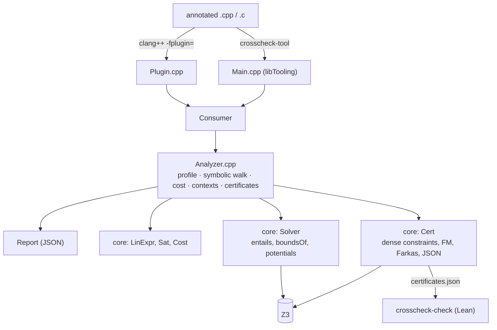
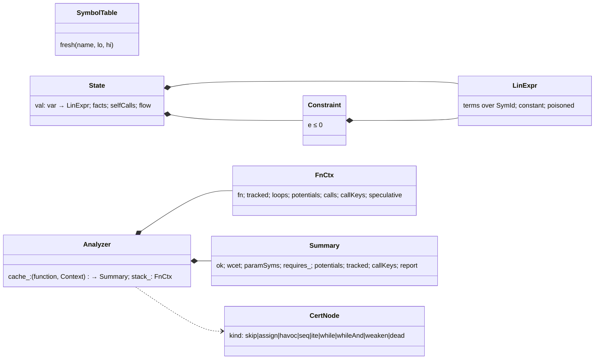
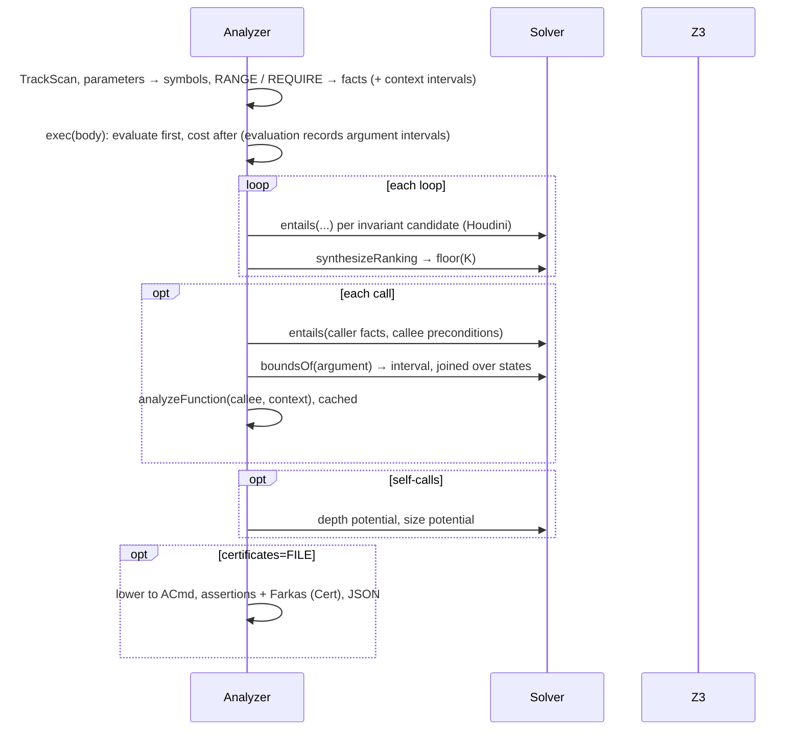
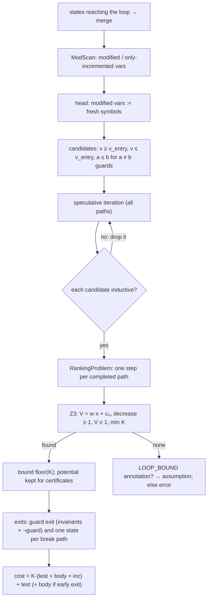
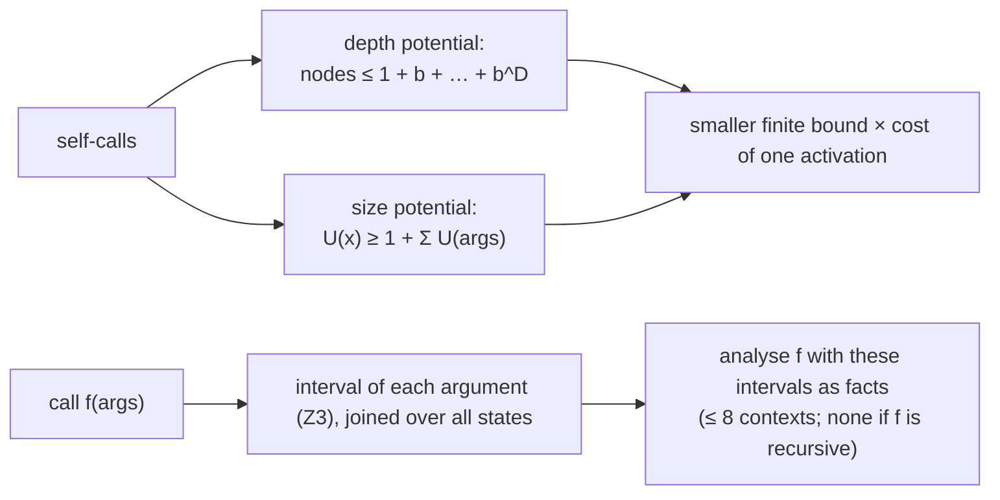
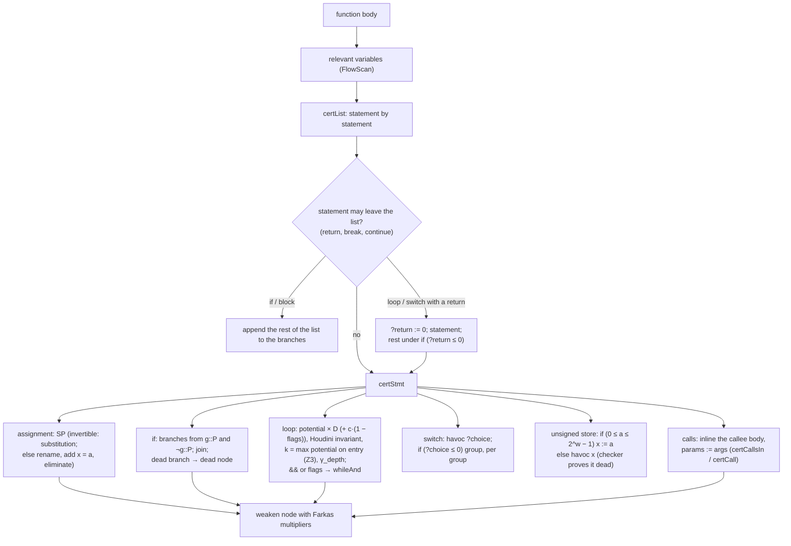

# Part 4 — The Clang plugin, inside

`clang-plugin/`, about 5,000 lines of C++ (`src/`) and 1,250 lines of tests. User manual:
`clang-plugin/README.md`; certificate format: `docs/certificate-format.md`.

## 1. One example, end to end

```cpp
CROSSCHECK_DEADLINE(500)
int sum(const int* a, CROSSCHECK_RANGE(0, 64) int n) {
  int s = 0;
  for (int i = 0; i < n; ++i) s += a[i];
  return s;
}
```

`crosscheck-tool --summary --opt=certificates=c.json sum.cpp -- -std=c++20 -Iinclude` gives
`OK sum: 453 units`, and `crosscheck-check c.json` gives `ACCEPTED sum: bound 453`.

| Part | Units (unit weights) | Why |
|---|---|---|
| `int s = 0; int i = 0;` | 2 | two assignments |
| test `i < n` | 2 | comparison + branch |
| body `s += a[i]`, then `++i` | 3 + 2 | subscript, compound assignment; increment |
| loop | 64 × (2 + 5) + 2 = 450 | potential `64 − i` (Z3), `K = 64`, `while_cost_bound` |
| `return s;` | 1 | |
| **total** | **453** | ≤ 500: accepted |

## 2. Architecture



Rules (`CLAUDE.md`): `core` includes no Clang header (it is unit-tested alone); `analysis`
does not know whether it runs as plugin or tool.

## 3. Data structures



- **Symbols are immutable**: a variable maps to an affine expression over symbols; an
  assignment changes the map, never a symbol. A fact, once true on a path, therefore stays
  true, and facts are never removed (soundness rule 1).
- **Poison** means "unknown": overflow or non-affine values. Dropping a premise is always
  sound.
- **`Sat`**: saturating naturals with ∞, and `0 × ∞ = 0`.
- **Context**: one interval per integer parameter; `cache_` is keyed by (function, context).

## 4. Analysing one function



## 5. Loops



**Farkas, by hand** (`sum`): premises `0 ≤ n ≤ 64`, `i ≥ 0`, `i − n + 1 ≤ 0`. Positivity
of `V = 64 − i` means `i − 63 ≤ 0`, which is `1·(i − n + 1) + 1·(n − 64)`. The
multipliers `(1, 1)` are the certificate; `farkas_sound_affine` says this suffices.

**Must-be-rejected tests**: no progress on one path; moving bound; unsigned wrap; step
possibly 0; aliasing through a pointer; `continue` skipping the increment; an inner loop
undoing the outer progress; a counter reset; a diverging do-while; and 6 call cases
(unknown or wrapping argument, recursive callee, global argument…).

## 6. Recursion and calls



Examples (`benchmarks/divide_and_conquer.cpp`): `range_max` gets 511 activations from a
size potential (a depth potential would give about 2⁵¹⁰); `merge_sort` gets 3,148,271 units
(no amortisation); `table_lookup` gets a linear depth (no logarithmic potential in the
plugin).

## 7. Certificates (`Analyzer.cpp`, section "Certificates", ≈ line 2213; `core/Cert.cpp`)



What is easy to get wrong, and why the code is as it is:

- **Syntactic lists.** The checker compares some lists exactly (assignment preconditions,
  loop pre- and postconditions). `Cert.cpp` reproduces Lean's `vadd`, `vsmul`, `unit`,
  `Lin.subst`, `toLin`, `negLin` and `ghost`, so that vectors match, trailing zeros
  included.
- **Rational reasoning.** The checker's Farkas check is rational, so `normalize` divides by
  a gcd only when the constant is divisible too (no integer tightening).
- **Overflow.** Products in Fourier–Motzkin are checked; an overflowing combination is
  dropped (a weaker assertion, still sound). Z3's multipliers are scaled to integers and
  re-verified before emission.
- **Relevance.** Only the variables that can influence control enter the certificate; this
  avoids the blow-up on DSP code with large constants (`jfdctint`).
- **Costs.** `costOf(e)` is the plugin's own `exprCost` in speculative mode, where a call
  costs only its overhead; the callee's body is inlined separately (both arms of a `?:`
  that call functions are inlined in sequence: a sum, where the plugin takes the max).
- **Jumps.** `break`, `continue` and `return` inside loops set flag variables; the loop
  test becomes `C test ∧ ?break ≤ 0 ∧ ?return ≤ 0` (`whileAnd`), and the potential gains
  `c·(1 − Σ flags)` because the leaving iteration does not decrease the C potential.
  An inlined callee gets its own flags (`certCall` saves and restores `exits`, `ret`,
  `hints`); before this, a callee's `return` inside a caller's loop crashed the
  generator.
- **Join hints.** When two branches are joined inside a loop body, the constraints the
  loop needs at the end of its body (`hints`) are tried as join candidates; without them
  a `return` in an inner loop lost the outer loop's ghost constraint.
- **Unsigned.** `certAffine` is exact (signed arithmetic, value-preserving conversions
  only); `certModular` gives a value modulo 2^w for unsigned stores; `certStore` adds
  the range test. Nothing about wrap-around is decided by the generator alone.

## 8. Trusted base

| Step | Justified by |
|---|---|
| ranking certificate ⇒ ≤ ⌊K⌋ iterations | `ranking_bound_floor`, `ranking_bound_of_context` |
| Farkas multipliers ⇒ implication | `farkas_sound_affine` |
| loop cost, branch = max | `while_cost_bound`, `condTrace_cost_le` |
| recursion bounds | `callTree_size_le_geom`, `callTree_size_le_potential` |
| **an accepted certificate** ⇒ the bound of its program | `check_sound` |
| AST → symbolic state, invariants, cost counting | trusted C++ (tests) |
| AST → certificate's program (lowering) | trusted C++ |
| Z3 | trusted for uncertified bounds only |

## 9. Tests (128)

| Suite | Count | Checks |
|---|---|---|
| `core_test` (`LinExpr`, `Sat`, `Solver`, `Ranking`, `SizePotential`, `Bounds`, `Cert`) | 20 | arithmetic, entailment, intervals, potentials, the checker's vector operations, Farkas, elimination |
| `analyzer_test`: `Loops`, `Contexts`, `Recursion`, `Cost`, `Profile`, `Contracts`, `Deadline`, `Report`, `Options`, `Certificates` | 57 | expected bounds and behaviours |
| `Loops/Unsound`, `Calls/UnsoundContext` | 19 | must be rejected |
| `RealTime/Profile` | 11 | forbidden constructs |
| `Benchmarks` | 10 | Table `tab:plugin` figures |
| `plugin_accepts_*` / `plugin_rejects_*` | 10 | real `clang++ -fplugin=` runs |
| `certificates_accepted_by_lean_checker` | 1 | emit and check the certificates of the examples and of `tests/certificates/` (jumps, `switch`, `&&`, unsigned); fails if the tool crashes (needs `-DCROSSCHECK_CHECKER=…`) |

## 10. Extending it

- **New statement kind**: a branch in `exec` (states *and* cost); in `certStmt` if it should
  be certified; tests, including a must-be-rejected case.
- **New certificate shape**: first a rule in Lean (`Language`), then `check`
  (`CheckerCore`) with its proof (`Checker`), then the generator. Never the other way round.
- **Debugging**: `--summary`; `report=FILE`; `crosscheck-check --print`. The report's
  `certificate` field says why a certificate is missing, with a line number.

Reading order: `attributes.hpp` → `core/LinExpr.hpp`, `Cost.hpp`, `Solver.hpp` →
`Analyzer.cpp`: `analyzeFunction` (≈ 2081), `exec` (≈ 1814), `execLoop` (≈ 1568),
`functionCost` (≈ 1156), certificates (≈ 2213) → `core/Cert.cpp` → `tests/analyzer_test.cpp`.
