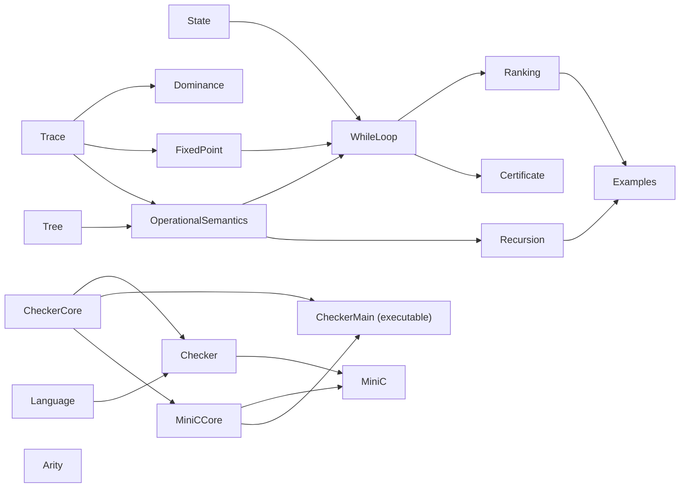

# Part 5 — Lean 4: enough to read and change this repository

`formalization/`: 21 modules, about 5,700 lines, 284 theorems, plus `CheckerMain.lean` (the
checker program). Lean `v4.16.0`, mathlib `v4.16.0`.

## 1. The mental model

A theorem is a type; a proof is a value of that type; checking a proof is type-checking
(Curry–Howard). The small *kernel* re-checks everything; tactics are untrusted helpers.

| C++ | Lean |
|---|---|
| `int f(int x);` | `def f (x : ℤ) : ℤ := …` |
| `std::pair<A, B>` | a proof of `P ∧ Q`: one of `P` and one of `Q` |
| `std::variant<A, B>` | a proof of `P ∨ Q`: one of `P` or one of `Q` |
| function `B f(A)` | a proof of `P → Q` |
| template over `T` | a proof of `∀ x, P x` |
| `static_assert(2 + 2 == 4)` | `example : 2 + 2 = 4 := rfl` |

Functions are total and pure: partiality is `Option` (⊥ = `none`), recursion must
terminate. Types can depend on values (`t ⊑ w`, `n ≤ m`).

```bash
cd formalization
lake exe cache get        # once: prebuilt mathlib
lake build                # 0 errors, 0 warnings expected
lake build crosscheck-check && .lake/build/bin/crosscheck-check --print test/certificates/count.json
```

In an editor (VS Code + Lean extension) the *infoview* shows the goal at the cursor.

## 2. The language, by example from this repository

```lean
inductive Cmd (ι S : Type) where           -- an inductive type: a tagged union
  | skip | atom (w : ℕ) (r : S → S → Prop) | seq (c₁ c₂ : Cmd ι S)
  | ite (w : ℕ) (b : S → Bool) (c₁ c₂ : Cmd ι S) | while (w : ℕ) (b : S → Bool) (c : Cmd ι S)
  | call (w : ℕ) (p : ι)

structure Lin where                        -- a record
  sv : List Int
  lv : List Int
  c : Int
  deriving DecidableEq                     -- generated equality test (used by `check`)

def dot : List ℤ → Env → ℤ                 -- structural recursion on the list
  | [], _ => 0
  | a :: l, f => a * f 0 + dot l (fun i => f (i + 1))
```

- **`Prop` vs `Bool`**: `b s = true` is a proposition about a boolean; `decide p` turns a
  decidable proposition into a `Bool`. The checker returns `Bool` so that it can run;
  `check_sound` says what `true` means.
- **Inductive predicates** define relations by rules: `Exec Φ c s t n` has one constructor
  per big-step rule; `Derivable` has one per proof rule. Proofs about them go by
  `induction h` over the derivation.

## 3. Tactics you will meet

| Purpose | Tactics |
|---|---|
| structure | `intro`, `rintro ⟨x, hx, rfl⟩`, `exact`, `apply`, `refine ⟨_, ?_⟩`, `constructor`, `use`, `have`, `show`, `calc`, `·`, `<;>`, `by_contra` |
| cases / induction | `cases h with`, `rcases`, `obtain`, `induction n with`, `… generalizing s`, `induction n using Nat.strong_induction_on`, `interval_cases`, `subst` |
| rewriting | `rw [h, ← h']`, `simp [defs]`, `simp only`, `simpa using h`, `dsimp`, `unfold`, `push_cast`, `norm_num` |
| decision | `omega` (ℕ/ℤ linear, also `/`, `%` by constants, `max`, `toNat`), `linarith` / `nlinarith` (ordered fields), `ring`, `decide` (evaluate a closed decidable statement — used to *run* the checker inside a proof) |

Rules of thumb: arithmetic side condition → `omega` (ℕ, ℤ) or `linarith` (ℚ);
an identity → `ring`; induction on a relation with a fixed command → first
`generalize hW : Cmd.while w b c = W at h`, then `induction h`, closing the other cases by
`cases hW` (see `while_exec_bound`).

## 4. Numbers and coercions

- `ℕ` subtraction truncates (`3 − 5 = 0`): `omega` knows it.
- Casts `(n : ℚ)` are inserted automatically; `push_cast`, `exact_mod_cast` and `norm_cast`
  move them around.
- `⌊x⌋₊` is `Nat.floor`; `Nat.floor_mono`, `Nat.le_floor`, `Nat.lt_floor_add_one` are the
  lemmas used for bounds.
- `Int` division `k / d` is Euclidean; `Rat.floor_intCast_div_natCast` links it to `⌊k/d⌋`.

## 5. The modules



| Module | Lines | Key content |
|---|---|---|
| `State` | 31 | `PointedState S := Option S`, partial transitions |
| `Trace` | 303 | traces, `traceIter`, `cost`, `wcost`, prefix order `⊑`, `exists_minimal_iteration`, nested loops |
| `Tree` | 315 | `BTree`, `graft`, `TreePrefix` (the paper's tree order), `fullTree`, `treePow_*` |
| `Dominance` | 93 | branch rule `condTrace_cost_le`, `branch_supremum_bound` (also the unused `≼_O`) |
| `FixedPoint` | 75 | `evalTrace`, homomorphism `evalTrace_concat`, `evalTrace_iter` |
| `OperationalSemantics` | 56 | `MinimalIter`, `LoopConstraint`, `LinearRecurrence` |
| `WhileLoop` | 252 | `WhileBigStep`, `whileBigStep_iff_minimalExit`, `while_trace_semantics`, `runTrace_cost_le` |
| `Ranking` | 125 | integer potentials: `ranking_bound`, `ranking_terminates`, `wcet_bound` |
| `Recursion` | 236 | linear recursion (`framedBigStep_iff`), trees (`exec_least`, `treeBigStep_iff`, `exec_size_le`) |
| `Certificate` | 280 | relational rational potentials `ranking_bound_floor`; invariants/contexts `ranking_bound_of_context`, `call_bound_of_context`; `farkas_sound`; `while_cost_bound`; `lex_potential`, `lex_ranking_bound`, `log_ranking_bound` |
| `Arity` | 230 | trees of any arity, `callTree_size_le_geom`, `callTree_size_le_potential` |
| `Language` | 563 | `Cmd`, `Exec`, `Pre`, `Valid`, `Derivable` (9 rules), **`soundness`**, `ValidSym`, `validSym_call`; examples `countLoop_cost`, `down_cost` |
| `CheckerCore` | 388 | the checker's definitions, no mathlib: `Lin`, `PExp`, `entails1`, symbolic bounds `SB`, `ACmd` (with `whileAnd`, `whileLog`, `whileGrow`, `call`), `ilog` (structural, so `decide` evaluates it), `FunCert`, **`check`**, **`checkProgram`** |
| `Checker` | 1,340 | **`check_sound`** (triple and frame, given `FunSpec` of the callees), `loop_sound`, `logloop_sound`, `growloop_sound` (logarithmic loops via the same loop rule), `ilog_eq`, `loopBoundOk_sound`, **`program_sound`** (induction over the functions; contracts as hypotheses), `certified_cost_le`; examples by `decide`: `countCert_checks`, `countSym_checks` (bound `1 + 2·max(0,n)`), `exProgram_checks` and `exMain_cost` (a call), `exProgram_17_rejected` |
| `MiniCCore` | 275 | mini-C, no mathlib: `MExp`, `MCond`, `MStmt` (incl. `divStore`, `assignU`, `call`, each lowered to existing checker programs: `divFacts`, `divOf`, `storeArg`); **`lower`** (its meaning, as a program of the checker); normal form `nf` (annotations, `weaken`/`dead`, `skip` and nesting of sequences removed); **`validate`** |
| `MiniC` | 285 | `CImp`/`CEquiv` (same executions and prefixes), congruences, `seq_assoc`, `nf_equiv`, **`validated_sound`** (accepted program + validated body ⇒ the source meets the bound); examples `countCert_validated`, `countCert_not_validated` |
| `ResponseCore` | 50 | no mathlib: `rtaHolds C hs R` (`C + Σ cₖ⌈R/Tₖ⌉ ≤ R`), `rtaSearch` (the iteration); used by the checker program |
| `Interrupts` | 260 | schedule model `Admissible`, `sporadic_count`, `handler_demand`, **`response_time_bound`**, `rtaHolds_sound`; example schedule `oneRun_admissible` |
| `ForkJoin` | 120 | greedy (list) scheduling `Greedy`, **`greedy_bound`** (Graham: `p·L ≤ W + p·S`), `forkjoin_bound` (with certified task bounds), `load_lower` |
| `Stack` | 150 | stack depth as a high-water mark: activation trees `ActTree`, `highWater`, **`highWater_le_of_bound`** (the composition rule of `benchmarks/cycles/stack.py`), `highWater_le_depth` (from a recursion depth) |
| `Examples` | 270 | the paper's four examples |

## 6. Three proofs worth reading

**`ranking_bound_floor`** (`Certificate`): along a run, `V(σ k) ≤ V(σ 0) − k` (induction,
`run_descent`); the last step has `V ≥ 1`; so `n ≤ V(σ 0)`, and `Nat.le_floor` finishes.

**`soundness`** (`Language`): `induction h`, one case per rule. The set of assumptions `Γ`
grows in the `call` rule, so the statement is an implication `(Γ valid) → Valid …` and each
case starts with `intro hΓ`; the `call` case is a strong induction on the rank.

**`check_sound`** (`Checker`): `induction c`, one case per certificate node; each case
applies the corresponding `valid_*` lemma of `Language`. The loop case sets the logical
variable `γⱼ` to the current potential with `Function.update ρ j (pot.eval s)` and uses
`holds_update_logical` (the invariant does not mention `γⱼ`).

**`logloop_sound`** (`Checker`): no new rule of the logic. The proof applies
`valid_while` (the linear loop rule) to the potential `logPot b pot = ⌊log_b pot⌋ + 1`
(0 if `pot ≤ 0`); the only arithmetic is `logPot_step` (`b·y ≤ x`, `1 ≤ x` ⇒
`logPot y + 1 ≤ logPot x`, from `Nat.log_div_base` and `Nat.log_mono_right`).
`growloop_sound` is the mirror image, with `N − ⌊log_b pot⌋` and `log_grow`.

## 7. Common errors

| Message | Usually means |
|---|---|
| `unknown identifier 'ℕ'` | file without mathlib: write `Nat`, `Int` (`CheckerCore`) |
| `don't know how to synthesize placeholder` | a `_` Lean cannot infer: name the variable (`@whileTrue _ _ _ s' …`) |
| `omega could not prove the goal` | a non-linear term or a missing hypothesis: `have` it first |
| `failed to synthesize instance` | a missing type class (decidability, order); add the instance argument or `decide`-able form |
| unused variable warning | prefix with `_`; the build must stay warning-free |
| very long build of an executable | it imports mathlib: executables must import only `CheckerCore` and Lean core |

## 8. Exercises

1. Prove `countLoop_cost` for `n ≤ 20` (bound `41`).
2. State and prove `valid_skip` for a two-element `skip; skip`.
3. Build a certificate JSON for `while (i < n) i += 2` and run `crosscheck-check` on it.
4. Which rule of the logic does the checker's `call` node implement? (Answer: rule 6, the
   call rule, with the callee's triple instantiated at the arguments — a summary,
   `validSym_call`; contracts are the assumed triples of rule 8. Rule 9, recursion, is not a
   checker case: calls go to earlier functions only.)
