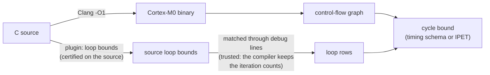

# Part 5 — Paper III explained: certified cycle bounds of machine code

`paper/binary/crosscheck-binary.tex`. Paper III takes the step from source code to the
**compiled binary**: bounds in processor cycles, checked by the Lean checker on the machine
code itself. Read Part 2, sections 2.5, 2.6, 2.10, 2.11 and 2.15 first.

## 5.1 Why go down to the binary

A bound in abstract units (Parts 3 and 4) is about the source code. The deadline is about
time on a processor, and the processor runs the compiled code, which the compiler may have
transformed (loops rotated, functions inlined, variables kept in registers or on the
stack). A certification argument must eventually be about the binary.



The chain has four links: (1) the source loop bound, (2) the match between source and binary
loops, (3) the graph of the binary and the computation of the bound, (4) the timing of the
processor. Paper III makes the checker responsible for (3), and then for (2), by proving
the loop bounds on the machine code itself.

## 5.2 The processor and its timing

The target is the **Arm Cortex-M0** (ARMv6-M, Thumb instructions), with zero-wait-state
memory: no cache, no branch prediction, and every instruction has a fixed cycle count in
the Technical Reference Manual (Part 2, section 2.15). That is what makes exact cycle
counting possible without a micro-architectural model.

- `benchmarks/cycles/m0.py`: a decoder of the Thumb instructions, the cycle table, an ELF
  loader and an **interpreter** written for this project. It runs each kernel, counts
  cycles with the same table, and the kernels check their own results.
- `test_m0.py` compares the cycle table row by row with the manual (87 rows), and the
  interpreter with the C semantics.
- `m0core.c`: the same interpreter in C, for long runs (`mpeg2` executes about 200 million
  instructions: about ten minutes in Python, a second or two in C). It is not a second
  definition of the instructions: `m0.py` still decodes the code, and any instruction the C
  core does not handle exactly as `m0.py` does goes back to `m0.py`. `test_m0core.py` runs
  every 16-bit encoding through both and compares.
- `run_qemu.py`: an outside check of the interpreter. The same memory image runs on QEMU
  (a Cortex-M3 board, which executes these instructions in the same way) and on `m0.py`;
  the result and the number of times each instruction address runs must be equal. They are,
  on the 50 programs QEMU can run. This checks what the instructions do, not how many cycles
  they take: QEMU does not model the timing.

## 5.3 First step: cycles by the timing schema (`wcet.py`)

`benchmarks/cycles/wcet.py` builds the control-flow graph of each function of the binary,
finds its **natural loops** (a loop = a header that dominates a back edge's source), and
matches each binary loop with a source loop through the **debug line table**. The plugin's
report gives each source loop its first and last line (`line`, `end_line`), so a source loop
is a range of lines. Take the lines of the binary loop's own instructions (not those of a
loop nested inside it), keep those that fall in some source loop's range, and choose the
innermost source loop whose range holds all of them. Lines outside every loop are dropped:
compilers often give moved code the function's first line. Example (`fft`, compiled by GCC):
the outer loop (lines 118-137) is rotated, and its own code carries lines 118, 119, 126, 129,
136 and also 132, the test of the inner `while` (lines 132-135); only the outer loop's range
holds all of them, so the outer loop is chosen,
not the inner one with its bound of 11. If no single range holds them all, the largest bound
among the loops whose first line occurs is taken. The source loop's bound
(from the plugin, in context) bounds the binary loop. The timing schema then gives the
function's cycles.

Results on the 29 TACLeBench kernels: **107 of 267 functions** get a cycle bound, including 6
`main` functions, at 1.24 to 2.46 times the emulated run; on the 11 calls and 45 loops
compared with the emulator, no bound is exceeded. This step trusts the matching (checked on
the runs) and the cycle table.

**A second compiler** (paragraph "Another compiler" of Paper III). The same kernels compiled
by GCC (`run_cycles.py --gcc`) also give 107 bounded functions, but GCC inlines less, so the
runs compare 73 calls instead of 11. That wider check found two errors in what this step
trusts, invisible on Clang's binaries: the source had been analysed as if `long` had 64 bits
(the host's data model; the Cortex-M0 has 32), which halved a loop bound of `sha`; and
the old matching rule ("line of the back-edge branch first") gave a rotated loop of `fft` the
bound of its inner loop. Both are fixed (the plugin now analyses for the target, and the
matching uses line ranges, as above). The lesson: a check by execution only covers what the
runs reach.

## 5.4 Second step: a certificate for the cycle bound (`sec:graphs`)

### IPET and its dual, on an example

Take the counting loop (Lean `Thumb.exCode`), at address `0x100`:

```text
0x100  movs r0, #0       1 cycle
0x102  cmp  r0, #10      1
0x104  bge  0x10a        3 if taken, 1 if not
0x106  adds r0, #1       1
0x108  b    0x102        3
0x10a  bx   lr           3
```

The loop row: the back edge `0x108 → 0x102` is taken at most 10 times per entry
`0x100 → 0x102`, that is `x(0x108→0x102) − 10·x(0x100→0x102) ≤ 0`. The worst case:
`1 + 10 × (1 + 1 + 1 + 3) + (1 + 3) + 3 = 68` cycles.

The **cycle certificate** (`def:cycle-certificate`) is: a scale `D = 1`, a potential `π` per
instruction (and 0 at the exit), a multiplier `λ = 6` for the row, and the bound `B = 68`:

| Instruction | `π` |
|---|---|
| `0x100` | 68 |
| `0x102` | 7 |
| `0x104` | 6 |
| `0x106` | 5 |
| `0x108` | 4 |
| `0x10a` | 3 |
| exit | 0 |

The checker verifies, for every edge `u → v` with cost `w` and row coefficient `a`:
`D·w + π(v) − π(u) ≤ λ·a`.

| Edge | `w` | `a` | `w + π(v) − π(u)` | `λ·a` | OK |
|---|---|---|---|---|---|
| `0x100 → 0x102` (entry) | 1 | −10 | 1 + 7 − 68 = −60 | 6 × −10 = −60 | ✓ |
| `0x102 → 0x104` | 1 | 0 | 1 + 6 − 7 = 0 | 0 | ✓ |
| `0x104 → 0x106` (not taken) | 1 | 0 | 1 + 5 − 6 = 0 | 0 | ✓ |
| `0x104 → 0x10a` (taken) | 3 | 0 | 3 + 3 − 6 = 0 | 0 | ✓ |
| `0x106 → 0x108` | 1 | 0 | 1 + 4 − 5 = 0 | 0 | ✓ |
| `0x108 → 0x102` (back edge) | 3 | 1 | 3 + 7 − 4 = 6 | 6 × 1 = 6 | ✓ |
| `0x10a → exit` | 3 | 0 | 3 + 0 − 3 = 0 | 0 | ✓ |

and the exit condition `π(entry) − π(exit) + λ·(row's right-hand side) ≤ D·B`:
`68 − 0 + 6 × 0 ≤ 68` ✓. Why this proves the bound: sum the edge inequalities along any run;
the `π` terms telescope (Part 2, section 2.6) and the `λ·a` terms add up to `λ` times the
row's value on the run, which is ≤ 0 because the row holds. So the run's cycles are ≤ 68.
The back edge "borrows" 6 cycles per iteration from the row, and the entry "pays back"
60 = 6 × 10.


`prop:cycles` (Lean `Cycles.cycles_sound`, `program_sound`) proves this for any graph with
calls (a call edge costs the callee's claimed bound; claims may be circular for recursive
functions, since the induction is on the depth of runs). The certificate is found by an
LP solver (scipy's HiGHS) and made exact (`benchmarks/cycles/ipet.py`); the checker never
solves anything.

Maroneze et al. (2014) validated the IPET solution of their CompCert WCET tool with a Farkas
certificate in Coq: the same idea, there on CompCert's assembly, here on any binary.

## 5.5 Third step: the checker builds the graph itself (`sec:machine`)

If the producer supplies the graph, the graph is trusted. In Paper III's format
(`crosscheck-binary-cycles`), the certificate contains **the machine code itself** (the
16-bit halfwords of the code region) and, per function, its entry and the addresses of its
instructions. The checker:

1. **decodes** each instruction with a decoder written in Lean (`Thumb.decode`): its size,
   its effect on the program counter (sequential, conditional branch to `t`, branch, call,
   return, or `stop` for anything not modelled) and its cycles;
2. checks the list of addresses is **closed** (every successor is in the list, no `stop`);
3. **builds** the graph (one edge per successor) and checks the cycle certificate on it.

`def:machine-run`, `thm:machine-cycles` (Lean `Thumb.binary_sound`, `translate`): every run of
the machine code — a sequence of instruction addresses in which each step is allowed by the
decoder — is a walk of the built graph with the same cycles, so the bound holds for it.

**The decoder is trusted**, as an instruction-set specification is. It is tested against the
interpreter's decoder on all 2¹⁶ halfwords and against llvm-objdump on the 24 285 instructions
of the kernels (`test_thumb.py`): no difference. It is not validated on hardware (Fox and
Myreen's ARM model in HOL4 is, and is the standard to aim at).

**A board harness** (`benchmarks/hardware/`, not run). The cycle table can only be
confirmed on a real processor. `hw.py build` links each kernel's object file, unchanged,
with a small start-up file for an STM32F0 board (a Cortex-M0 microcontroller): it starts a
32-bit timer, calls `main`, stops the timer, and prints the count on the serial line. It
also records what the emulator predicts for the same object. `hw.py measure` flashes the
board and reads the counts, and `hw.py report` checks two things: the board never exceeds
the certified bound (soundness), and the board equals the emulator on kernels without
library calls (the cycle table). The emulator's prediction uses the single-cycle
multiplier, which the STM32F0 is believed to have; the bounds use 32 cycles, which is safe
either way. The register addresses come from ST's reference manual and have not been tried
on a board yet.

Result: all 107 functions certified; the checker checks 223 functions (with the run-time
division routines), 8 333 instructions, in 0.15 s. IPET bounds are below the timing schema for
60 functions, equal for 47.

## 5.6 Fourth step: loop bounds proved on the machine code (`sec:loops`)

The loop rows are still assumptions: they come from the source through the debug lines. To
remove them, the checker must see **why** the loop at `0x102` iterates at most 10 times: it
needs the values of `r0`, which the program-counter semantics of 5.5 ignores.

### The data semantics (`def:data-run`)

A state now holds the eight low registers `r0`–`r7`, the four flags, the stack pointer and
the memory. Each instruction has an **effect** (`Thumb.effect`, `Thumb.stackEffect`):

| Instruction | Effect in the model |
|---|---|
| `ADDS rd, rn, #k`, `SUBS`, `ADDS rd, rn, rm`, … | `rd := (rn ± k) mod 2³²`; flags of the addition or subtraction (AddWithCarry) |
| `MOVS rd, #k` | `rd := k`; flags: any |
| `MOV rd, rm` (low registers) | `rd := rm`; flags kept |
| `CMP rn, #k`, `CMP rn, rm`, `CMN` | registers kept; flags of `rn − k` (or `rn + rm`) |
| `LSLS rd, rm, #s` | `rd := rm·2^s` if that is below 2³², otherwise any value (two cases in every proof); flags: any. `LSLS rd, rm, #0` is `MOVS rd, rm`: `rd := rm` |
| `NEGS rd, rm` | `rd := (0 − rm) mod 2³²`; flags of that subtraction |
| `MVNS rd, rm` | `rd := 2³² − 1 − rm` (all bits flipped); flags: any |
| `STM rn!, {list}` | `rn := rn + 4·(number of registers)`; the registers of the list are kept |
| `LDM rn!, {list}` | the registers of the list: any; `rn := rn + 4·n` if `rn` is not in the list |
| `LDR rt, [pc, #i]` (literal pool) | `rt :=` the word of the code at that address (the code is assumed not to be written while the program runs) |
| `LDR rt, [sp, #i]` | `rt :=` the word at `sp + i` |
| `STR rt, [sp, #i]` | the word at `sp + i` `:= rt` |
| `SUB sp, #k`, `ADD sp, #k`, `PUSH`, `POP` | `sp` moved by the constant; `PUSH` writes the words just below `sp` |
| other loads | the destination register: any value |
| other stores, calls | memory: any word may change (except the frame, under `frame`) |
| `BL` (call) | `r0`–`r3`, flags: any; `r4`–`r7` and `sp` also any unless `abi` |
| everything else | the registers it may write: any; flags: any if it may change them |

"Any value" is a safe over-approximation: the model allows more behaviours than the real
processor, so a bound for all runs of the model is a bound for the real runs. A conditional
branch is taken **exactly when its condition holds** on the flags.

### The certificate (`def:loop-certificate`)

For each instruction `a`:

- a **kind** `k_a`: which operation set the flags (`none`, `add` or `sub`);
- two **ghost** variables `g₁, g₂`: the operands of that operation (after `cmp r0, #10`,
  `g₁ = r0`, `g₂ = 10`);
- an **offset** `δ_a` of the stack pointer from its value at the function's entry (or
  unknown);
- an **invariant** `I_a`: linear constraints over `r0`–`r7`, the ghosts, and the **tracked
  words** of the frame (the words at `sp₀ − k` for a list of offsets `k`).

For each certified loop: its header, its body, a scale `D`, a bound `N`, and a potential
`Φ_a` (an affine expression) for each instruction of the body.

The checker verifies, for every transition `a → a'` (every successor, every wrap-around case
of an addition, every disjunct of a branch condition), with Farkas certificates:

1. the successor's invariant holds after the instruction;
2. for every loop: `κ(a, a') + Φ(a', after) − Φ(a, before) ≤ 0`, where `κ` is `D` on a back
   edge into the header, `−N` on an entry edge into the header, 0 otherwise.

### The example, again

For the counting loop the producer finds:

| Instruction | Kind | Invariant (main facts) | Potential `Φ` |
|---|---|---|---|
| `0x102 cmp r0, #10` | none | `r0 ≤ 10` | `10 − r0` |
| `0x104 bge` | sub | `r0 ≤ 10`, `g₁ = r0`, `g₂ = 10` | `10 − r0` |
| `0x106 adds r0, #1` | sub | `r0 ≤ 9`, `g₁ = r0`, `g₂ = 10` | `10 − r0` |
| `0x108 b 0x102` | add | `1 ≤ r0 ≤ 10` | `11 − r0` |

Check a few transitions by hand:

- `0x104 → 0x106` (branch not taken): `bge` not taken means "signed `g₁ < g₂`", which the
  lemma `lem:cond-facts` turns into a disjunction of linear facts (split by the signs). With
  `g₁ = r0 ≤ 10` and `g₂ = 10`, every disjunct gives `r0 ≤ 9`: the invariant of `0x106`.
- `0x106 → 0x108` (`adds r0, #1`): `r0' = r0 + 1 + m·2³²` with `m ∈ {0, −1, 1}`. With `r0 ≤ 9`
  and `0 ≤ r0`, only `m = 0` is possible (the other cases contradict the invariant: a
  Farkas certificate of `0 ≤ −1`). Then `Φ(0x108, after) = 11 − (r0 + 1) = 10 − r0 = Φ(0x106)`:
  the potential does not increase. ✓
- `0x108 → 0x102` (back edge, `κ = D = 1`): `1 + (10 − r0) − (11 − r0) = 0 ≤ 0` ✓ — the
  potential drops by 1 per iteration.
- `0x100 → 0x102` (entry, `κ = −N = −10`): after `movs r0, #0`, `−10 + (10 − 0) = 0 ≤ 0` ✓.
- `0x104 → 0x10a` (exit): `0 + 0 − (10 − r0) ≤ 0` needs `r0 ≤ 10`: the invariant ✓.

`thm:machine-loops` (Lean `ThumbData.data_sound`): if all this checks, then on every run of the
data semantics the potentials **telescope** — summed along the run, the `κ` terms (which are
exactly the row's coefficients) are at most `Φ(entry) ≤ N` — so the loop's row holds, the run
is a run of 5.5, and the cycle bound applies. Nothing about the loop is trusted any more.
The Lean example `exData_sound` states it for this code: every data run costs at most 68
cycles, with no trusted row.

### Stack slots, and two assumptions

At `-O1`, a counter that must survive a call is often kept in the stack frame
(`str r0, [sp, #4]` … `ldr r0, [sp, #4]`). The model tracks the words of the frame accessed
through SP: the certificate lists their offsets, and gives the offset of SP at every
instruction; the checker verifies the offsets along every transition (`PUSH`, `SUB sp`
move SP by known constants), and knows which tracked word a load or store through SP touches.

A store through another register (`str r1, [r0, r5]`) or a call could, in principle, write
anywhere — including the frame. Two assumptions, each stated in the certificate and in the
checker's verdict, cover the usual case:

- **`abi`**: callees preserve `r4`–`r7` and `sp` (the Arm procedure call standard).
- **`frame`** (per function): no store through another register and no call writes the
  function's frame. This is true of C code without undefined behaviour **if the function
  never takes an address of its frame**, so the checker refuses `frame` for a function that
  writes an SP-derived address into a register (`add rd, sp, #i`, `mov rd, sp`).

**`abi`, checked instead of assumed** (Paper III `thm:machine-conv`, Lean `ThumbConv`).
Whether a callee preserves `r4`–`r7` and `sp` is a property of its code, which the checker
has. Compilers follow one pattern, which the checker now verifies on every function
(`convOk`):

```text
push {r4, r5, lr}      @ entry: save the registers of r4-r7 that the function writes
...                    @ writes r4, r5 freely; never r6, r7; stores through SP stay below the saved words
pop  {r4, r5, pc}      @ every return: the same list, with SP back where the push left it
```

Restoring works only if nothing overwrites the saved words between the `push` and the `pop`.
No analysis of the function's own instructions can show that for stores through pointers, so
it becomes the one hypothesis left: **no stack smashing** (the words where a function saves
registers are written by no store through a pointer and no callee). Memory-safe code
satisfies it, whatever its callees were compiled with. The proof (`drunL_drun`) is an
induction on the depth of calls in a *linked* semantics where a callee's run starts in the
caller's state and the caller resumes with the callee's final `r0`–`r7` and `sp`: callees
of smaller depth restore `r4`–`r7` and `sp`, so every call is a step with `abi`, and the
existing proof of the loop bounds applies unchanged. The checker reports `abi` as checked
when every function keeps the convention, and otherwise names the functions that do not
(typically one whose SP is set from a register, so that its offsets are unknown).

### How the producer finds the certificate

`benchmarks/cycles/binloops.py`, untrusted:

1. **Offsets of SP** by data flow from the entry (an offset is dropped where two paths
   disagree).
2. **Kinds** of flags by data flow.
3. **Congruences** modulo powers of two (Part 2, end of section 2.11), computed on the
   checker's own post-expressions, so that the checker accepts exactly what was derived.
4. **Invariants** by abstract interpretation over **zones** (Part 2, sections 2.10–2.11): for
   registers, ghosts and tracked words; widening at loop headers to thresholds from the
   code's constants; three narrowing rounds; the facts of each branch rounded with the
   congruences (a counter stepped by 4 that exits at 80 gets `≤ 76`).
5. **Potentials** by trying `±x` for every register and tracked word and `±(x − y)` for the
   variables compared at the exits, with per-instruction constants computed as longest paths,
   and a scale `D` in {1, 2, 4, 8}. If that fails, **one linear program** looks for a
   potential with a *different* linear part at each instruction (Part 2, sections on Farkas
   and LP duality): the unknowns are the potentials' coefficients, the bound and the Farkas
   multipliers of every obligation; since the invariants are already fixed, every obligation
   is linear in these unknowns, and the program minimizes the bound (Colón & Sipma 2001;
   Alias et al. 2010 for one function per control point). Why it is needed: in
   `countnegative`, the loop counter lives in a register at some instructions and in a stack
   word at others, so no single expression `±x` decreases all along the loop. The solution
   is rational; it is rounded, scaled to integers (the scale becomes `D`) and proved again
   exactly. The solver (HiGHS) gets at most 5 s per program: the first runs without a limit
   hung for hours on one badly scaled program (constants up to 2³²).
6. **Farkas certificates** for every obligation: shortest paths in the difference graph, a
   negative cycle for contradictory cases, a linear program otherwise.
7. Anything that cannot be proved is **dropped** (an invariant constraint, or a loop, whose
   row then stays trusted). The checker decides.

### Results (`sec:evaluation`)

| Configuration | Kernel loops certified on the code (of 403) | Functions with a certified cycle bound |
|---|---|---|
| no assumption | 143 (142 before the matching by line ranges, 136 without the wrap-to-zero step below, the same without the disjunctive invariants, 131 without the exact shift, 121 without the exact effects, 116 without the linear programs, 73 without congruences) | 116 |
| `abi` | 200 (199, 193, 193, 183, 173, 167, 105) | 116 |
| `abi` and `frame` | 260 (257 before the jump indices bounded by the invariants, 256, 250, 246, 229, 215, 175 before the frame-pointer exception, 169, 107) | 121 |

All 116 loops of the division routines are certified in every configuration (none before the
disjunctive invariants below). Every certificate
is accepted, and in the emulated runs no loop exceeds its certified bound. The 9 functions
gained over the 107 of 5.3 have loops that the source analysis does not bound but the binary
analysis does (`fac_fac`, `fir2dim_pin_down`, the copy and fill loops of `md5` and `pm`); with both assumptions,
three functions of `bitcount` too.

Congruences made the largest difference: before them, 177 of the 210 loops whose counter
was tracked but had no potential left the loop on equality with a step above 1.

The frame pointer. Clang's `-O1` prologue sets up a frame pointer (`add r7, sp, #12`): r7
then holds an address of the frame. Until 2026-11-19 the checker refused `frame` for every
such function (190 of 265), and `frame` added only 2 loops. A pointer to the frame is only
dangerous if something can store through it, so the checker now allows that one instruction
provided r7 is never read afterwards except as the base address of a load (reading stack
arguments) or by the prologue's `PUSH` (which saves the caller's r7). The assumption itself
is unchanged, and the Lean proof never depended on this check: it only decides where the
assumption may be stated. `frame` is now refused in 26 functions (those that pass a local
array's address to a callee) and 215 loops were certified with both assumptions (175 before).

Exact effects (2026-11-19). Some instructions used to give "any value" although their result
is simple: `NEGS r0, r1` computes 0 − r1, `MVNS r0, r1` computes 2^32 − 1 − r1, `STM r0!, {...}`
and `LDM r0!, {...}` advance the base register by 4 bytes per listed register, and
`LDR r0, [pc, #i]` loads a constant stored in the code itself (the "literal pool"). These are
now exact in the Lean specification and in the producer. The literal load needs one new
trusted assumption: the code is not written while the program runs. Result: 229 loops with
both assumptions (233 without frame pointers); no loop lost, no bound changed. One snag:
the literal constants include addresses near 2^32, and with such numbers HiGHS (the LP
solver) sometimes gives up. The producer therefore retries a function, treating literal loads
as unknown again, when a loop is left uncertified, and keeps the better result; the checker
does not care how the certificate was found.

Exact shift (2026-11-20). `LSLS r1, r0, #10` multiplies r0 by 2^10. Compilers use it to build
constants (`movs r0, #1; lsls r1, r0, #10` makes 1024, a loop limit in `fft`) and
byte offsets. The result is exact as long as it fits in 32 bits; when it does not, the new
value is unknown. The checker treats the two cases like the wrap-around of a sum: the
certificate proves its claim once assuming no overflow and once assuming overflow (where
the value is any word). In Lean this is a new kind of value, `shl`, and the soundness proof
covers it; no new trusted assumption. The producer also got an exact fallback for Farkas
multipliers: when the LP returns multipliers too small to round, it solves
the same system exactly over the rationals. Result: 136 / 193 / 246 loops (251 without frame
pointers), in `fft`, `st`, `filterbank` and `bitcount`; no loop lost, no bound higher. A
first run lost one `jfdctint` loop (HiGHS again, on the constant 2^14), so the retry above
now also treats shifts as unknown.

Disjunctive invariants (2026-11-20). The division routines count down with a signed
counter, `for (i = 31; i >= 0; i--)`. Clang compiles the test `i >= 0` as "add 1 to i and
stop if that carries", which happens only when `i` has wrapped around from 0 to 2^32 − 1.
Between the `subs` and the branch, the counter is either in [0, 30] or exactly 2^32 − 1: two
separate pieces, and a zone (one convex shape) can only describe their hull, [0, 2^32 − 1],
which says nothing. The checker now lets an invariant be a list of pieces ("disjuncts"),
and the certificate says, for each case of each step, which piece the next state lands in;
the Lean proof follows the run piece by piece. The producer finds the pieces by splitting
its zone in two at a `subs` or `adds` that might wrap, carrying both halves to the next
branch and merging them after it, a technique known as trace partitioning (Mauborgne and
Rival, 2005). One snag: HiGHS declared these linear programs infeasible when they were
not, because the constants range from 1 to 4 billion in the same row; the producer now
tries a better-scaled program, and as a last resort guesses the linear part of the
potential by following the counter through the registers it is copied into (r3, then
the operand of the flags, then r4) and asks HiGHS only for the constants. Result: all 116
loops of the division routines are certified (bound 31, the source says 32), and 4 more
kernel loops; with both assumptions, the loop rows still trusted inside the certified cycle
bounds drop from 137 to 19.

Wrap to zero (2026-11-20). Clang sometimes counts a byte offset from 2^32 − 16 up by 4
until it reaches zero (`adds r3, #4; bne`): the loop stops when the addition wraps around.
In the wrap-around case the branch only says `g1 + 4 ≥ 2^32 + 1`, which is not enough: the
checker now rounds facts about a *sum* with the congruences too (the offset is a multiple
of 4, so `g1 + 4 ≥ 2^32 + 1` becomes `g1 + 4 ≥ 2^32 + 4`, which the invariant `g1 ≤ 2^32 − 4`
contradicts). Lean: `tightenS_holds`, example `exZero_sound` (a 3-iteration loop) and
`exZero_needs_cong` (rejected without the congruences). The producer needed four small
changes: widening thresholds at the values where an addition wraps, Farkas proofs that
combine a premise on a sum with a bound on one of its terms, longest-path constants for
the transported potentials, and trying the tightest candidate first. Result: 142 / 199 /
256 kernel loops (+6 in `bsort`, `fft`, `fir2dim`), 121 functions with a certified cycle
bound, 17 loop rows still trusted with both assumptions.

After the matching by line ranges (section 5.3; one more loop of `minver`: 143 / 200 / 257),
of the 146 kernel loops still not certified, 86
have a tracked counter but no potential (62 of them leave on equality). The
specification of effects, flags, conditions and stack effects is compared with the
interpreter on every 16-bit encoding (297 244 executions, no difference); 28 tests check that
altered certificates are refused.

## 5.7 The rest of Paper III's evaluation

- **OTAWA on the same binaries.** OTAWA 2.3 (an open-source WCET analyser) is given the loop
  bounds as flow facts on the binary loop headers; it computes IPET bounds for the same 107
  functions, in instructions and, with a small timing plug-in using the same cycle table, in
  cycles — never below our timing schema, none below an emulated run. This shows the bounds
  are usable by an industrial-style tool; it is not an independent timing model.
- **Other processors.** The same flow facts on OTAWA's own graphs of binaries for a
  Cortex-M4 and an M7 (OTAWA's STM32 models): 169 and 163 functions bounded; not checked
  against executions.
- **Stack bounds.** The high-water mark of the stack (Paper I, `prop:stack`) on the same
  binaries: 151 of 267 functions; 11 of the 12 `main` bounds equal the observed stack (the
  stack pointer restored from the frame pointer is followed).
- **Floating point on its machine code.** The Cortex-M0 has no floating-point unit: `a * b`
  on floats becomes a call of a library routine, `__aeabi_fmul`. In the runs above that
  routine has no code in the binary (the interpreter computes it in Python), so every
  function that multiplies floats has no bound. `run_cycles.py --rtlib compiler-rt` links
  each kernel with LLVM's real routines first, so they are decoded, bounded and certified
  like the kernel's own code: 187 of 267 functions certified instead of 121, 10 `main`
  functions instead of 6. GCC's libgcc works too, its float divisions included: their
  jumps go through tables kept in the read-only data just after the code, which the
  certificate now holds with the code (see the next point).
- **Jumps through a table (`switch`).** A `switch` with many consecutive cases is compiled
  into a table and one jump that reads its destination from it. In lift's `check_run`,
  Clang emits:

  ```
  cmp  r0, #3        @ is the case number at most 3?
  bhi  default       @ no: the default case
  add  r0, pc        @ r0 := address of the table (relative to the program counter) + r0
  ldrb r0, [r0, #4]  @ the byte of the table for this case
  lsls r0, r0, #1    @ times 2 (instructions are 2 bytes long)
  add  pc, r0        @ jump there
  .byte ...          @ the table
  ```

  For the program-counter-only semantics this last instruction could go anywhere, so the
  function used to get no bound. The checker now *runs the six instructions itself* for
  every case number that survives the `bhi` (0, 1, 2, 3 here), reading the table from the
  code it holds, and requires every address it finds to be listed as a target of the jump
  in the certificate. Lean then proves (Proposition `prop:jump-table`, `jump_good`) that a
  real run cannot reach the `add pc` without having executed the whole window from the
  `cmp`, because the checker also verifies that nothing branches into the middle of it, so
  the run's register holds one of the values the checker computed. The window is evaluated
  by the same effects as the rest of the data semantics, plus the exact values of
  `add rd, pc`, `adr` and loads from the code. Result: `lift` is bounded and certified
  entirely, and the switches of `gsm_dec`/`gsm_enc` too. Tables kept in the read-only data
  right after the code (libgcc's) are read the same way: the certificate holds those data
  with the code, under the same assumption that nothing writes them during a run.

  Without a range check. When Clang knows the range of the case number it emits no `cmp`.
  In sha's `sha_wordcopy_fwd_aligned`, `switch (len % 8)` becomes

  ```
  movs r5, #7
  mov  r3, r2
  ands r3, r5        @ r3 := r2 & 7, so r3 <= 7
  add  r3, pc
  ldrb r3, [r3, #4]
  lsls r3, r3, #1
  add  pc, r3
  ```

  The certificate then names the instruction that bounds the case number (`index`: here
  the `ands`). The checker evaluates the window up to it (it learns `r5 = 7`), takes the
  bound the instruction gives (an `ands` is at most each operand, an `lsrs` by `s` is below
  `2^(32-s)`, a `uxtb` or `ldrb` at most 255: part of the trusted description of the
  processor, checked against `m0.py`), and runs the rest of the window for every value up
  to it (Lean `jumpRng`, `jump_good_rng`).

  A third form covers case numbers bounded only by a loop (`bitcount` runs `switch (i)`
  inside `for (i = 0; i < 8; i++)`) or by constants set on several paths (sha's second
  switch: each path sets `r5` to a number from 1 to 8). No instruction of the window bounds
  them, but the loop certificate already carries an invariant at every instruction. The
  certificate names an instruction of the window and a register, say `r1` in `0..28`;
  every disjunct of the invariant there must state `r1 <= 28`, and its congruence says
  `r1` is a multiple of 4 (it was computed by `lsls r0, r6, #2`), so the checker runs the
  window for `r1 = 0, 4, ..., 28` only (Lean `jumpInv`). Why the invariant may be used
  here takes one more step of proof: the invariant is proved along the edges of the
  graph, and the edges of the jump are what is being established. The proof walks the
  run from the start: at each step, all earlier steps follow edges (by induction), so the
  invariant holds at the bounding instruction (Lean `inv_prefix`), which gives the jump's
  target, so this step follows an edge too (`steps_good`, `jump_good_inv`). The producer
  meets the same circle and goes round it: it builds the graph with the targets found so
  far (none at first), computes the invariant, evaluates the window, and repeats until the
  targets stop changing (`wcet.Analysis._resolve_jumps`). In `bitcount` and `sha` both
  jumps are now followed (their stack bounds follow), but their cycle bounds still fail
  for other reasons (a recursive callee, a loop on a parameter). The form where the range check is `bls` over `b default` (Clang uses it when
  the default case is too far for a conditional branch) is followed too. The calling convention is checked in a function
  with such a jump too: the check follows the listed targets like any other transition, so
  a register written only in one case of the `switch` is found (Lean example
  `exSwClobber_refused`).
- **Time budgets after compilation.** `CROSSCHECK_DEADLINE_CYCLES(n)` / `_US(n)` are checked
  on the binary by `clang-plugin/scripts/crosscheck_link.py` (optionally with certified
  bounds, `--certify`), as a post-build step that fails when a budget is exceeded.

## 5.8 What is trusted, finally

| Item | Status |
|---|---|
| The analysis of the binary, the graph, the computation of the bound | **checked** (Lean) |
| The loop bounds (rows) of certified loops | **checked** (Lean), on the data semantics |
| The decoder, cycle table, effects, flags, conditions, stack effects | trusted specification; compared with our interpreter (itself compared with QEMU, without timing), not with hardware |
| That the code in the certificate is the binary's | trusted (a copy of the bytes) |
| `abi`, `frame` when used | stated assumptions |
| Rows of loops not certified on the code | trusted (from the source, through debug lines) |
| Interrupts, memory wait states | outside the model |

## 5.9 Prior work to cite and distinguish

- **Li and Malik** (1995): IPET. **Puschner and Koza** (1989): constraints on execution counts.
- **Maroneze et al.** (2014): verified WCET for CompCert, IPET validated in Coq; guarantees
  for CompCert-compiled code.
- **Sewell, Kam and Heiser** (2016, 2017): loop bounds of the seL4 binary proved with an SMT
  toolchain and C-level facts; CFG from a decompiler proved against the Cambridge ARM model.
  Their proofs trust SMT solvers; ours are certificates checked by a small verified checker,
  weaker (less of memory, no C-level facts) but self-contained.
- **Cullmann and Martin** (2007): aiT's data-flow loop bounds on executables — computed, not
  certified.
- **Crary and Weirich** (2000): resource bounds of typed assembly certified by type checking
  (time counted in calls).
- **Necula** (1997): proof-carrying code.

## 5.10 Paper III on one page

Cycle bounds of compiled code can be certified: a dual solution of the IPET program
(potentials and multipliers) is checked by a Lean-verified checker that decodes the machine
code and builds the graph itself, so the analysis of the binary leaves the trusted base. The
loop bounds can be certified on the same code: invariants on registers, flags and frame words,
and potentials that drop on back edges, checked by Farkas multipliers against a model of the
instructions' effects. On TACLeBench for a Cortex-M0, 116–121 functions get a certified cycle
bound and 143–260 of 403 loops are bounded on the code (261 built without frame pointers), with the 116 loops of the division routines, with nothing trusted about them; the
rest keep their source bounds as assumptions.
