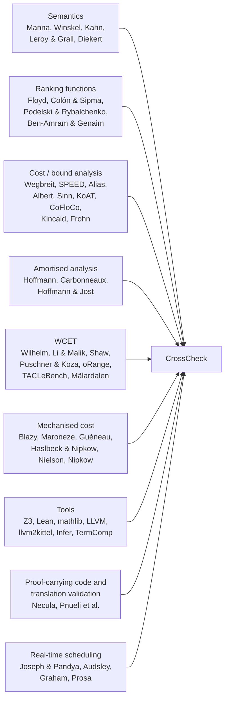

# Part 6 — The bibliography, as a map

`paper/crosscheck.bib`, shared by both papers; each paper's list contains only the entries it
cites (Paper I: 51, Paper II: 33). Theory-side related work (cost logics, ranking functions,
closed forms, amortisation, mechanised cost) is discussed in Paper I's `sec:related`; tool-side
related work (bound analysers, WCET flow analysis, verified and certified bounds, Clang's
function effects) in Paper II's `sec:related`. On 2026-11-13/14 the bibliographic data of
every entry were checked against Crossref, DataCite or Open Library (one error fixed). The
column **Read** says what the AI assistant actually read (`references/README.md`):
*A* = abstract, *S* = the sections the text relies on, — = not obtained or not read.
Summaries are short on purpose; read the originals before quoting a detail.

## Theory (Paper I)

| Key | Work | Role in the papers | Read |
|---|---|---|---|
| `manna1974mathematical` | Manna, *Mathematical Theory of Computation*, 1974 | fixed points, program semantics background | — |
| `winskel1993formal` | Winskel, *Formal Semantics of Programming Languages*, 1993 | big-step semantics | — |
| `kahn1987natural` | Kahn, *Natural Semantics*, 1987 | big-step (natural) semantics | — |
| `leroy2009coinductive` | Leroy & Grall, coinductive big-step semantics, 2009 | divergence captured coinductively (contrast) | A |
| `diekert1995traces` | Diekert & Rozenberg, *The Book of Traces*, 1995 | trace monoids | — |
| `matiyasevich1970enumerable` | Matiyasevich, 1970 | undecidability for polynomial arithmetic | — (data only from a reprint) |
| `baccelli1992synchronization` | Baccelli et al., *Synchronization and Linearity*, 1992 | the (max,+) semiring | — |
| `cousot1977abstract` | Cousot & Cousot, abstract interpretation, 1977 | contrast: fixed points in abstract domains | — |
| `floyd1967assigning` | Floyd, *Assigning Meanings to Programs*, 1967 | ranking functions | — |
| `colon2001synthesis` | Colón & Sipma, 2001 | linear ranking synthesis by Farkas | A |
| `podelski2004complete`, `podelski2004transition` | Podelski & Rybalchenko, 2004 | complete linear ranking synthesis; transition invariants | — |
| `benamram2014ranking` | Ben-Amram & Genaim, 2014 | linear ranking: PTIME over ℚ, coNP-complete over ℤ | A |
| `schrijver1986theory` | Schrijver, 1986 | Farkas' Lemma | — |
| `shaw1989reasoning`, `puschner1989calculating` | Shaw; Puschner & Koza, 1989 | the timing schema | — |
| `nielson1987hoare` | Nielson, 1987 | first Hoare-like logic for computation time | — (via Haslbeck & Nipkow) |
| `haslbeck2018hoare` | Haslbeck & Nipkow, 2018 | three time logics for IMP in Isabelle, sound and complete: closest prior work to the cost logic | S |
| `nipkow2002hoare` | Nipkow, 2002 | rule for recursive procedures | — |
| `necula1997proof` | Necula, 1997 | proof-carrying code: the idea behind the checker | — |
| `blumofe1999scheduling` | Blumofe & Leiserson, 1999 | work and span (parallelism paragraph) | — |
| `cormen2009introduction` | Cormen et al. | recurrences, Master Theorem | — |

## Cost and bound analysis

| Key | Work | Role | Read |
|---|---|---|---|
| `wegbreit1975mechanical` | Wegbreit, 1975 | first automatic cost analysis | — |
| `gulwani2009speed` | Gulwani et al., SPEED, 2009 | bounds from counters and invariants | — |
| `alias2010multi` | Alias et al., 2010 | multi-dimensional rankings, complexity bounds | A |
| `albert2011closed` | Albert et al., 2011 | cost relations solved in closed form (COSTA/PUBS) | — |
| `sinn2014complexity` | Sinn et al., 2014 | amortised bounds via lexicographic rankings (Loopus) | A |
| `brockschmidt2016analyzing` | Brockschmidt et al., 2016 | runtime and size bounds (KoAT) | A |
| `lommen2022automatic` | Lommen et al., 2022 | KoAT2, twn-loops | A |
| `floresmontoya2014cofloco` | Flores-Montoya & Hähnle, 2014 | CoFloCo | — |
| `kincaid2019closed`, `frohn2020calculus`, `bardin2008fast` | closed forms, loop acceleration | contrast with exact closed forms | A (Frohn) |
| `hoffmann2012multivariate`, `carbonneaux2015compositional`, `hoffmann2022two` | amortised resource analysis (RAML, C4B), survey | contrast: amortisation; certified bounds for C in Coq | A (survey) |

## WCET and benchmarks (Paper II)

| Key | Work | Role | Read |
|---|---|---|---|
| `wilhelm2008worst` | Wilhelm et al., WCET survey, 2008 | what WCET analysis needs | — |
| `li1995ilp` | Li & Malik, IPET, 1995 | path-based bound calculation | — |
| `demichiel2008orange` | de Michiel et al., oRange, 2008 | WCET loop-bound tool compared | — |
| `falk2016taclebench`, `gustafsson2010malardalen` | TACLeBench; Mälardalen | the benchmarks (TACLeBench gathers several suites, Mälardalen among them) | S; A |
| `blazy2013formal`, `maroneze2014formally` | Blazy, Maroneze et al. | loop bounds and WCET verified in Coq/CompCert | A |
| `gueneau2018fistful` | Guéneau et al., 2018 | asymptotic bounds in Coq | A |
| `giesl2019termcomp` | Giesl et al., TermComp, 2019 | TPDB benchmarks | A |

## Tools

| Key | Work | Read |
|---|---|---|
| `demoura2008z3`, `demoura2021lean4`, `mathlib2020` | Z3, Lean 4, mathlib | A |
| `lattner2004llvm` | LLVM (ScalarEvolution is used, not described there) | A |
| `falke2011termination` | llvm2kittel: memory loads become unknown values | S |
| `infercost` | Infer cost checker documentation ("We do not handle recursion") | web page read |
| `clangeffects` | Clang function effects / RealtimeSanitizer documentation | web page checked |
| `agmai2026responsible` | AGMAI policy on AI-generated mathematics | web page checked |
| `crosscheckTheory`, `crosscheckTool` | the two companion papers | — |

## Added in steps 5-6 (Nov 2026; data checked on Crossref, content not read)

| Key | Work | Role in the papers | Read |
|---|---|---|---|
| `pnueli1998translation` | Pnueli, Siegel & Singerman, *Translation Validation*, TACAS 1998 | the idea behind validating certificates against the source (Paper I `subsec:validation`, Paper II) | — |
| `necula2000translation` | Necula, *Translation Validation for an Optimizing Compiler*, PLDI 2000 | same, for a compiler | — |
| `joseph1986finding` | Joseph & Pandya, *Finding Response Times in a Real-Time System*, Comput. J. 1986 | the response-time equation (`thm:response-time`); Crossref lists only the first author | — |
| `audsley1993applying` | Audsley et al., *Applying New Scheduling Theory to Static Priority Pre-emptive Scheduling*, SEJ 1993 | response-time analysis | — |
| `graham1966bounds` | Graham, *Bounds for Certain Multiprocessing Anomalies*, BSTJ 1966 | greedy scheduling bound (`prop:graham`) | — |
| `cerqueira2016prosa` | Cerqueira, Stutz & Brandenburg, *PROSA*, ECRTS 2016 | the general mechanized schedulability theory (Coq), to contrast with our small model | — |

