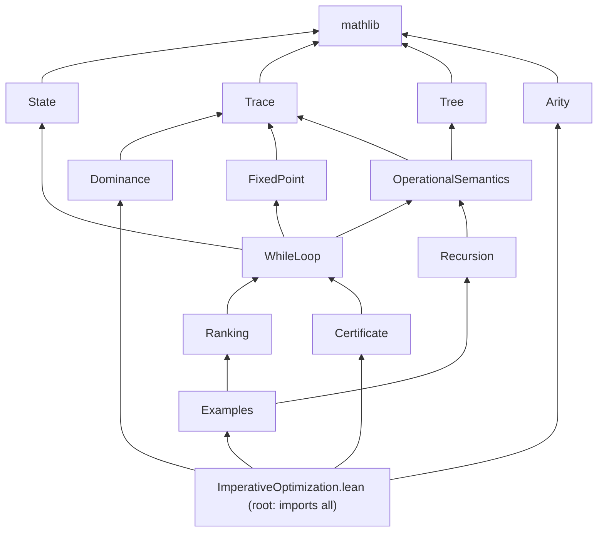

# Part 6 — The Lean development, module by module

This part documents every module of `formalization/ImperativeOptimization/`: what each
definition models, what each theorem says (in Lean and in words), how the key proofs
work line by line, and the modelling caveats you must know when comparing with the
paper ("statement fidelity", `AI_USAGE.md` §3 item 1). Lean syntax is explained in
[Part 5](05-lean-tutorial.md).

Contents

- [Overview and import graph](#overview-and-import-graph)
- [`State`](#state) · [`Trace`](#trace) · [`FixedPoint`](#fixedpoint) · [`Dominance`](#dominance)
- [`OperationalSemantics`](#operationalsemantics) · [`WhileLoop`](#whileloop) · [`Ranking`](#ranking)
- [`Tree`](#tree) · [`Recursion`](#recursion) · [`Certificate`](#certificate) · [`Arity`](#arity)
- [`Examples`](#examples)
- [Cross-cutting caveats (read before talking to a Lean expert)](#cross-cutting-caveats)

## Overview and import graph



(Arrows point from a module to what it imports.) Everything is in
`namespace ImperativeOptimization`; tree functions are in `ImperativeOptimization.BTree`;
examples in `ImperativeOptimization.Examples`. Every file starts with the MIT header.

| Module | Lines | Role |
|---|---|---|
| `State` | 31 | pointed states, partial transitions |
| `Trace` | 303 | traces, iteration, cost, prefix order, minimal exit, nested loops |
| `FixedPoint` | 75 | valuation of traces, homomorphism |
| `Dominance` | 93 | branch rule; (unused by the paper) big-O preorder |
| `OperationalSemantics` | 56 | loop/recurrence records, `MinimalIter` |
| `WhileLoop` | 252 | big-step semantics of `while` ⇔ minimisation; path selectors |
| `Ranking` | 125 | integer ranking potentials, termination, WCET envelope |
| `Tree` | 315 | binary computation trees, grafting, tree order, powers |
| `Recursion` | 236 | linear and binary recursion ⇔ minimisation; depth envelope |
| `Certificate` | 147 | what the plugin relies on: relational ℚ-potentials, Farkas, loop cost |
| `Arity` | 230 | trees of any arity; depth and size potentials |
| `Examples` | 270 | the paper's four examples |

---

## `State`

```lean
abbrev PointedState (S : Type) : Type := Option S          -- S⊥, none = ⊥
def PartialTransition (S : Type) : Type := S → Option S   -- f : S ⇀ S
def extendToPointed (f : PartialTransition S) : PointedState S → PointedState S
  | none => none          -- strict: ⊥ ↦ ⊥
  | some s => f s
def stateId … := id
def stateComp (f g) := g ∘ f                               -- "f then g"
```

Models `def:state-transition`. A partial function is encoded as a total function into
`Option S` (the standard encoding; the paper's "relation with at most one image" is
equivalent). `extendToPointed f` is `f⊥` (it is `Option.bind`). No theorems here.

## `Trace`

### Definitions

| Lean | Paper | Meaning |
|---|---|---|
| `Trace Instr := List Instr` | `Σ*` | traces as lists |
| `traceIter t n`, notation `t ^[n]` | `tⁿ` | `t^[0] = []`, `t^[n+1] = t^[n] ++ t` |
| `cost t := t.length` | `cost` | instruction count |
| `OrderByComposition u w := ∃ v, w = u ++ v`, infix `⊑` | `def:order-by-composition` | prefix order |
| `wcost ω t := (t.map ω).sum` | `‖·‖_ω` | weighted cost |
| `ExitsAt evalTrace t cond s₀ n` | "`⟦tⁿ⟧(s₀)` exits" | defined *and* `cond` false |
| `nestedTrace t₁ t₂ n m := (t₁ ++ t₂^[m])^[n]` | `(t₁·t₂ᵐ)ⁿ` | nested loop trace |
| `SubsequenceOrder`, infix `⊑_sub` | — | sublist order (**removed from the paper**, kept in Lean) |

`ExitsAt` uses `match` on the result: `some s` ⇒ `cond s = false`; `none` (fault) ⇒
`False` — a faulting state never exits, as in the paper. The `instance … Decidable
(ExitsAt …)` that follows is needed by `Nat.find`.

### Theorems

| Lean | Statement in words | Paper |
|---|---|---|
| `traceIter_succ` | `t^[n+1] = t ++ t^[n]` (power can be unfolded on the left too) | — |
| `cost_additive` | `cost (u ++ v) = cost u + cost v` | `prop:poset-properties` |
| `cost_iter` | `cost (t^[n]) = n * cost t` | `prop:poset-properties` |
| `order_refl`, `order_trans`, `order_antisymm` | `⊑` is a partial order | `prop:poset-properties` |
| `iter_monotone` | `n ≤ m → t^[n] ⊑ t^[m]` | `prop:n-monotony` |
| `order_cost_le` | `u ⊑ w → cost u ≤ cost w` | `prop:poset-properties` |
| `iter_monotone_iff` | `t ≠ [] → (t^[n] ⊑ t^[m] ↔ n ≤ m)` | `prop:n-monotony` |
| `wcost_nil`, `wcost_append`, `wcost_iter`, `wcost_one` | weighted cost is additive, `n`-fold, unit weights = `cost` | `def:subadditive-norm` |
| `exists_minimal_iteration` | if some `n` exits, there is `n̄` that exits, no `k < n̄` exits, and `cost (t^[n̄]) = n̄ * cost t` | `thm:minimal-trace` |
| `nested_trace_cost` | `cost (nestedTrace t₁ t₂ n m) = n * cost t₁ + n * m * cost t₂` | `prop:nested-cost` |
| `nested_trace_prefix` | one outer iteration is a prefix of the nested trace (`n ≥ 1`) | — |
| `sequential_loops_cost`, `sequential_loops_prefix` | sequential loops: cost adds, first is a prefix | `prop:nested-cost` |
| `subseq_*`, `prefix_le_subseq`, `iter_subseq_nested`, `inner_subseq_nested`, `nested_trace_cost_*_le` | sublist order facts | not in the paper any more |

### Key proofs, line by line

**`iter_monotone`** — `n ≤ m → t^[n] ⊑ t^[m]`:

```lean
  have h_ex : ∃ k, m = n + k := Nat.exists_eq_add_of_le h   -- write m = n + k
  rcases h_ex with ⟨k, rfl⟩                                 -- replace m everywhere
  induction k with                                          -- induction on the gap k
  | zero => rw [Nat.add_zero]; exact order_refl (t ^[n])    -- t^[n] ⊑ t^[n]
  | succ k ih =>
    ...                                                     -- ih : t^[n] ⊑ t^[n+k]
    rcases ih' with ⟨v, hv⟩                                 -- t^[n+k] = t^[n] ++ v
    use v ++ t                                              -- t^[n+k+1] = t^[n+k] ++ t = t^[n] ++ (v ++ t)
    rw [hv, List.append_assoc]
```

**`iter_monotone_iff`** — the converse uses costs:

```lean
  · intro h
    have hc := order_cost_le h                 -- cost (t^[n]) ≤ cost (t^[m])
    rw [cost_iter, cost_iter] at hc            -- n * cost t ≤ m * cost t
    have hpos : 0 < cost t := List.length_pos.mpr ht   -- t ≠ [] ⟹ length > 0
    exact Nat.le_of_mul_le_mul_right hc hpos  -- cancel the positive factor
  · exact iter_monotone t
```

**`exists_minimal_iteration`** — the μ-operator:

```lean
  let n_bar := Nat.find h_term                 -- least n with ExitsAt … n
  exact ⟨n_bar, Nat.find_spec h_term,          -- it exits
         fun k hk => Nat.find_min h_term hk,   -- nothing smaller exits
         cost_iter t n_bar⟩                    -- cost formula
```

Note: the theorem takes `evalTrace` as an **arbitrary** parameter of type
`Trace Instr → Option S → Option S`; it is a statement about well-ordering, valid for any
valuation. The link with the actual valuation is made in `WhileLoop`.

## `FixedPoint`

```lean
def evalTrace (interp : Instr → S → Option S) : Trace Instr → Option S → Option S
  | [], s => s                                    -- ⟦ε⟧ = id
  | i :: is, some s => match interp i s with      -- run first instruction
                      | some s' => evalTrace interp is (some s')
                      | none => none              -- fault: stop
  | _ :: _, none => none                          -- strict on ⊥
```

This is the valuation `⟦·⟧` of `def:trace-functional`, defined by recursion on the list
(the paper defines it by freeness; Lean's definition *is* the unique homomorphism, and
the theorems below prove the homomorphism laws).

| Lean | Statement | Paper |
|---|---|---|
| `evalTrace_none` | `⟦t⟧(⊥) = ⊥` (strictness) | — |
| `evalTrace_concat` | `⟦t₁ ++ t₂⟧ s = ⟦t₂⟧ (⟦t₁⟧ s)` | homomorphism, `eq:iter-hom` |
| `evalTrace_iter` | `⟦t^[n]⟧ s = (⟦t⟧)^[n] s` | `eq:iter-hom` |
| `solution_soundness` | unfolding `⟦t^[n]⟧` one step (case split on `n`) | — (the name is historical; the docstring says it is an auxiliary unfolding lemma) |

**`evalTrace_concat`**, the interesting proof: induction on `t₁` *generalizing* `s`
(because the recursive call runs on a different state). In the `cons` case, split on `s`
(`none`: everything is `none` by `evalTrace_none`) and then on the result of the first
instruction (`cases h : interp i s'`): fault ⇒ both sides `none`; success ⇒ the induction
hypothesis at the new state. `change` is used to expose the `match` so that `cases`
can act on it.

**`evalTrace_iter`**: induction on `n`; `t^[n+1] = t^[n] ++ t`, then `evalTrace_concat`,
the IH, and mathlib's `Function.iterate_succ_apply'`.

## `Dominance`

| Lean | Statement | Paper |
|---|---|---|
| `AsympDominates f g` (infix `≼_O`) | `∃ C N₀, ∀ n ≥ N₀, f n ≤ C * g n` (big-O) | **removed** from the paper |
| `dominance_refl`, `dominance_trans` | preorder | removed |
| `branch_supremum_bound` | `c + (if b then x else y) ≤ c + max x y` | `prop:tropical-dominance`, `prop:tropical-collapse` |
| `add_dominated_by_max`, `max_dominated_by_add` | `f + g` and `max f g` are big-O-equivalent | removed |
| `condTrace c t_c t_then t_else s` | `t_c ++ (if c s then t_then else t_else)` | `τ_if`, `eq:cond-selector` |
| `condTrace_cost_le` | `cost (condTrace …) ≤ cost t_c + max (cost t_then) (cost t_else)` | `prop:tropical-dominance` |

`condTrace_cost_le`'s proof: `unfold condTrace; rw [cost_additive]; cases c s <;> simp` —
split on the Boolean, and `simp` knows `x ≤ max x y` and `y ≤ max x y`.

`CLAUDE.md`: the `≼_O` material stays in Lean but must not be reintroduced in the paper.

## `OperationalSemantics`

Records for program schemes and the μ-predicate on orbits of a **total** update:

```lean
structure LoopConstraint (S : Type) where
  cond : S → Bool
  stepState : S → S
  stepCost : ℕ
def solveLoop lc s₀ n_bar := ((lc.stepState^[n_bar]) s₀, n_bar * lc.stepCost)

def MinimalIter (cond : S → Bool) (f : S → S) (s₀ : S) (n : ℕ) : Prop :=
  cond ((f^[n]) s₀) = false ∧ ∀ k < n, cond ((f^[k]) s₀) = true

structure LinearRecurrence (S) where cond fwd back stop     -- frame-independent
def solveLinearRecurrence lr s₀ n_bar := lr.back^[n_bar] (lr.stop (lr.fwd^[n_bar] s₀))
```

`MinimalIter cond f s₀ n` = "`n` is μ of the orbit": exits at `n`, continues before.
`MinimalIter.unique`: proof by trichotomy `n < m ∨ n = m ∨ n > m`; in the strict cases
the smaller index would both exit and continue — `cases h1` closes the impossible
`true = false`. `isLoopSolution lc s₀ n := MinimalIter lc.cond lc.stepState s₀ n`.

## `WhileLoop`

The central module: `thm:extensional-equivalence` and `prop:min_x`.

### Definitions

```lean
inductive WhileBigStep (cond : S → Bool) (f : S → Option S) : S → S → Prop
  | exit {s} : cond s = false → WhileBigStep cond f s s
  | step {s s' s''} : cond s = true → f s = some s' → WhileBigStep cond f s' s'' → WhileBigStep cond f s s''

def MinimalExit (cond : S → Bool) (f : S → Option S) (s₀ : S) (n : ℕ) (sf : S) : Prop :=
  (extendToPointed f)^[n] (some s₀) = some sf ∧ cond sf = false ∧
  ∀ k < n, ∃ s, (extendToPointed f)^[k] (some s₀) = some s ∧ cond s = true

def runTrace (τ : S → Trace Instr) (f : S → S) : ℕ → S → Trace Instr
  | 0, _ => []
  | n + 1, s => τ s ++ runTrace τ f n (f s)          -- ρₙ(s) of def:path-selector
```

`MinimalExit … n sf` is exactly conditions (1)–(2) of `thm:extensional-equivalence`
with the body as a partial function `f` (iterated through `f⊥`).

### Theorems

| Lean | Statement | Paper |
|---|---|---|
| `extendToPointed_iterate_none` | `f⊥ⁿ(⊥) = ⊥` | strictness |
| `WhileBigStep.minimalExit` | big-step ⇒ ∃ n, MinimalExit | (⇒) |
| `MinimalExit.whileBigStep` | MinimalExit ⇒ big-step | (⇐) |
| `whileBigStep_iff_minimalExit` | big-step ⇔ ∃ n, MinimalExit | `prop:min_x` |
| `MinimalExit.unique` | `n` and `sf` are unique | `prop:min_x`, `thm:extensional-equivalence` |
| `WhileBigStep.deterministic` | big-step is deterministic | `thm:extensional-equivalence` |
| `evalTrace_eq_extend` | `evalTrace interp t = (fun s => evalTrace interp t (some s))⊥` | glue |
| `while_trace_semantics` | the theorem with `⟦t^n⟧` in place of `f⊥ⁿ` | `thm:extensional-equivalence` |
| `extendToPointed_iterate_total`, `whileBigStep_total_iff` | total body: big-step ⇔ `MinimalIter` and `sf = gⁿ(s₀)` | glue to `OperationalSemantics` |
| `solveLoop_sound` | a `MinimalIter` solution gives the big-step result | |
| `runTrace_const` | constant selector: `runTrace = t^[n]` | `def:path-selector` |
| `runTrace_cost_le`, `runTrace_wcost_le` | `∀ s, cost (τ s) ≤ W` ⇒ `cost (runTrace τ f n s) ≤ n * W` | `prop:worst-case-step` |

### Key proofs, line by line

**(⇒) `WhileBigStep.minimalExit`** — induction on the derivation:

```lean
  induction h with
  | exit hc => exact ⟨0, rfl, hc, fun k hk => absurd hk (Nat.not_lt_zero k)⟩
      -- n = 0: f⊥⁰(s) = s, exits, and "∀ k < 0" is vacuous
  | @step s s' s'' hc hf _ ih =>
    rcases ih with ⟨n, h1, h2, h3⟩           -- IH for s' with count n
    refine ⟨n + 1, ?_, h2, ?_⟩               -- take n + 1
    · rw [Function.iterate_succ_apply]       -- f⊥ⁿ⁺¹(s) = f⊥ⁿ(f⊥(s))
      show (extendToPointed f)^[n] (f s) = some s''
      rw [hf]; exact h1                       -- f s = some s'
    · intro k hk
      cases k with
      | zero => exact ⟨s, rfl, hc⟩            -- k = 0: the initial state continues
      | succ k => …                           -- k + 1: shift to the IH at s'
```

**(⇐) `MinimalExit.whileBigStep`** — induction on `n` for all `s₀`: for `n + 1`, `k = 0`
gives `cond s₀ = true`; case split on `f s₀`: `none` would make `f⊥ⁿ⁺¹(s₀) = ⊥`,
contradicting `= some sf` (this is the paper's "strictness forces …" step); `some s'`
lets the IH build the derivation from `s'`, closed by `WhileBigStep.step`.

**`while_trace_semantics`** is then three rewrites: unfold `MinimalExit`, replace
`(evalTrace interp t)^[n]` by `evalTrace interp (t^[n])` (`evalTrace_iter`) and the
pointed extension by `evalTrace` itself (`evalTrace_eq_extend`).

**`runTrace_cost_le`**: induction on `n` generalizing `s`;
`cost (τ s ++ rest) = cost (τ s) + cost rest ≤ W + n * W`, closed by `omega` after the
`ring` fact `(n + 1) * W = n * W + W`.

## `Ranking`

`thm:lyapunov-bound` for **integer** potentials and a **total** update `f : S → S`.

```lean
def rankBound (V₀ Δ : ℤ) : ℕ := Int.toNat ((V₀ + Δ - 1) / Δ)   -- max(0, ⌈V₀/Δ⌉)
```

| Lean | Statement | Paper |
|---|---|---|
| `ranking_descent` | if `cond` held at steps `0..k−1`, then `V (f^[k] s₀) ≤ V s₀ − k·Δ` | proof step |
| `ranking_bound` | descent + positivity on continuing states, `Δ > 0`, and `cond` held at `0..n−1` ⇒ `n ≤ rankBound (V s₀) Δ` | `thm:lyapunov-bound` (bound) |
| `ranking_terminates` | ∃ n, `MinimalIter cond f s₀ n ∧ n ≤ rankBound (V s₀) Δ` | `thm:lyapunov-bound` (termination) |
| `wcet_bound`, `wcet_bound_weighted` | `cost (runTrace τ f n s₀) ≤ rankBound (V s₀) Δ * W` for any reached `n` | `thm:lyapunov-bound` (cost) |
| `nested_wcet_bound` | if each `τ s` costs ≤ `c₁ + M·c₂`, `n` iterations cost ≤ `n·c₁ + n·M·c₂` | nested-loop envelope |

**`ranking_bound`**, line by line:

```lean
  cases n with
  | zero => exact Nat.zero_le _                       -- 0 ≤ anything
  | succ m =>
    have hdesc := ranking_descent … s₀ m …            -- V(s_m) ≤ V(s₀) − m·Δ
    have hpos := h_pos (f^[m] s₀) (h_run m (by omega))-- 0 < V(s_m)   (s_m still continues)
    have hlt : (m : ℤ) * Δ < V s₀ := by linarith      -- combine
    have hle : (m : ℤ) * Δ + 1 ≤ V s₀ := Int.add_one_le_iff.mpr hlt   -- integers!
    have h1 : ((m : ℤ) + 1) * Δ ≤ V s₀ + Δ - 1 := by … linarith
    have h2 : (m : ℤ) + 1 ≤ (V s₀ + Δ - 1) / Δ := Int.le_ediv_of_mul_le hΔ h1
    unfold rankBound
    omega                                             -- m + 1 ≤ toNat(…)
```

The integrality step (`< ⟹ +1 ≤`) is where ℤ matters; `Certificate` redoes this for
ordered fields with `⌊·⌋`.

**`ranking_terminates`**: by contradiction, if no iterate exits then `cond` holds at all
of them, and `ranking_bound` with `n = rankBound + 1` gives `rankBound + 1 ≤ rankBound`
(`omega`). So `∃ n, cond … = false`; `Nat.find` gives the least one, which is a
`MinimalIter`, and `ranking_bound` bounds it.

**Caveat.** `wcet_bound` bounds the trace of `n` *completed* iterations (the body
traces); the final failing guard is accounted for separately in `while_cost_bound`
(`Certificate`). The hypotheses `h_decr`/`h_pos` quantify over *all* states with
`cond s = true` — in practice one restricts `S` to an invariant (paper: "established on
an inductive invariant").

## `Tree`

Binary trees, the tree order and tree powers (`def:tree-algebra` … `prop:tree-power-complexity`).

### Definitions

| Lean | Meaning |
|---|---|
| `inductive BTree α \| leaf : α → BTree α \| node : BTree α → BTree α → BTree α` | binary trees with labelled leaves |
| `size` (leaf 1, node `1 + l + r`), `leafCount`, `depth` (leaf 0, node `1 + max`) | cost, leaves, depth |
| `graft t₁ t₂`, infix `⊗` | replace every leaf of `t₁` by `t₂` |
| `cata leafVal combine` | catamorphism (fold) |
| `GraftOrder`, infix `⊑_graft` | `∃ t', t₂ = t₁ ⊗ t'` (uniform grafting) — *not* the paper's order |
| `fullTree a d` | full binary tree of depth `d` |
| `inductive TreePrefix`, infix `⊑_tree` | **the paper's tree order**: `ofLeaf a t : leaf a ⊑_tree t`; `ofNode : l ⊑ l' → r ⊑ r' → node l r ⊑ node l' r'` |
| `leftLabel` | label of the leftmost leaf (an element of `α`, needed to build `fullTree`) |
| `treePow b d` | `B^{⊗d}` on shapes: `treePow b 0 = leaf ()`, `treePow b (d+1) = b ⊗ treePow b d` |
| `cherry` | `node (leaf ()) (leaf ())`, the elementary branching step |

### Theorems

| Lean | Statement | Paper |
|---|---|---|
| `size_pos`, `size_add_one` (`size + 1 = 2 · leafCount`), `leafCount_le_size` | basic counts | — |
| `graft_size` | `size (t₁ ⊗ t₂) = (size t₁ − leaves t₁) + leaves t₁ · size t₂` | grafting size identity |
| `graft_leafCount` | `leaves (t₁ ⊗ t₂) = leaves t₁ · leaves t₂` | |
| `graft_unit_leaf`, `graft_assoc` | `t ⊗ leaf = t`; associativity | |
| `graftOrder_refl`, `graftOrder_trans`, `graftOrder_treePrefix` | uniform grafting order ⊆ tree order | |
| `fullTree_work_closed_form` | `size (fullTree a d) = 2^(d+1) − 1` | |
| `fullTree_depth` | depth of full tree is `d` | |
| `treePrefix_refl`, `treePrefix_trans`, `treePrefix_antisymm` (on `BTree Unit`) | partial order | `prop:tree-order-properties` |
| `treePrefix_size_le`, `treePrefix_depth_le` | monotone size and depth | (1) |
| `treePrefix_graft` | `t ⊑_tree t ⊗ t'` | (2) |
| `treePrefix_fullTree` | `depth t ≤ d → t ⊑_tree fullTree a d` | (3) |
| `size_le_of_depth_le`, `size_le_of_depth` | `depth ≤ d → size ≤ 2^(d+1) − 1` | (3) |
| `treePow_leafCount` | `leaves (B^{⊗d}) = leaves(B)^d` | `prop:tree-power-complexity` (1) |
| `treePow_size_succ`, `treePow_size` | `size (B^{⊗d}) = 2 · L^d − 1` (binary form) | (2) |
| `treePow_cherry`, `treePow_cherry_size` | `cherry^{⊗d} = fullTree () d` | (2) |
| `treePow_succ'`, `treePow_chain` | `B^{⊗(d+1)} = B^{⊗d} ⊗ B`; chain | (3) |

### Key proofs

**`treePrefix_trans`**: induction on the first derivation `h1`, generalizing `t₃`. Leaf
case: `leaf a ⊑ anything`. Node case: `h2` must be `ofNode` (`cases h2`), and the IHs
combine the subtrees.

**`treePrefix_antisymm`** is only for `BTree Unit`: with labels, `leaf a ⊑_tree leaf b`
holds for *any* `a`, `b`, so antisymmetry fails unless labels are trivial. The paper's
trees are unlabelled shapes, so this matches.

**`graft_size`**: induction on `t₁`; leaf: `1 − 1 + 1·size t₂`; node: IHs plus
distributivity, closed by `omega` with `leafCount_le_size` facts (needed because of
truncated subtraction).

**`size_le_of_depth_le`**: `t ⊑_tree fullTree (leftLabel t) d`, so
`size t ≤ size (fullTree …) = 2^(d+1) − 1`. The `leftLabel` trick provides an element
of `α` to label the full tree (Lean needs a value; the type might otherwise be empty).

**`treePow_size`**: from `size_add_one` (`size + 1 = 2·leaves`) and `treePow_leafCount`,
by `omega` — the paper's `I(L^d−1)/(L−1) + L^d` specialises to `2L^d − 1` for binary
shapes (where `I = L − 1`).

## `Recursion`

### Linear recursion (`prop:linrec`)

```lean
structure FramedRecurrence (S R : Type) where
  cond : S → Bool;  fwd : S → S;  back : S → R → R;  stop : S → R
def unwind fr : ℕ → S → R
  | 0, s => fr.stop s
  | n + 1, s => fr.back s (unwind fr n (fr.fwd s))     -- back(s₀, back(s₁, … stop(sₙ)))
inductive FramedBigStep fr : S → R → Prop
  | base : fr.cond s = false → FramedBigStep fr s (fr.stop s)
  | call : fr.cond s = true → FramedBigStep fr (fr.fwd s) r → FramedBigStep fr s (fr.back s r)
```

| Lean | Statement |
|---|---|
| `framedBigStep_iff` | `FramedBigStep fr s r ↔ ∃ n, MinimalIter fr.cond fr.fwd s n ∧ r = unwind fr n s` |
| `LinearRecurrence.toFramed` | frame-independent recursion as a framed one (`back` ignores `s`) |
| `unwind_toFramed` | then `unwind = solveLinearRecurrence` (`backⁿ ∘ stop ∘ fwdⁿ`) |
| `linRec_iff` | the frame-independent equivalence |
| `linear_recursion_cost` | `cost (t_fwd^[n] ++ t_stop ++ t_back^[n]) = n·(cost t_fwd + cost t_back) + cost t_stop` |

Proof structure of `framedBigStep_iff` mirrors the while-loop proof: (⇒) induction on the
derivation, `n` grows by one at each `call`; (⇐) induction on `n` generalizing `s`.

### Branching recursion (`prop:tree-optimization`, `prop:tree-envelope`)

```lean
structure TreeRecurrence (S R) where cond; fwdL fwdR : S → S; combine : R → R → R; stop : S → R

def IsExecTree tr : BTree Unit → S → Prop        -- t is THE execution tree from s
  | leaf _, s => tr.cond s = false
  | node l r, s => tr.cond s = true ∧ IsExecTree tr l (tr.fwdL s) ∧ IsExecTree tr r (tr.fwdR s)

def LeavesExit tr : BTree Unit → S → Prop        -- feasibility: every leaf exits
  | leaf _, s => tr.cond s = false
  | node l r, s => LeavesExit tr l (tr.fwdL s) ∧ LeavesExit tr r (tr.fwdR s)

def evalTree tr : BTree Unit → S → R             -- catamorphism over the call tree
```

Positions `π` of the paper are implicit: the state at a subtree is obtained by applying
`fwdL`/`fwdR` along the path, which the recursive definitions do automatically.
Difference between the two predicates: `IsExecTree` also requires `cond = true` at
internal nodes (no over-expansion); `LeavesExit` does not.

| Lean | Statement | Paper |
|---|---|---|
| `exec_leavesExit` | the execution tree is feasible | |
| `exec_least` | `IsExecTree t s → LeavesExit t' s → t ⊑_tree t'` | least feasible tree |
| `exec_unique` | two execution trees are equal (antisymmetry) | uniqueness |
| `exec_size_min` | execution tree has minimal size among feasible trees | minimal cost |
| `TreeBigStep`, `treeBigStep_iff` | `TreeBigStep tr s v ↔ ∃ t, IsExecTree tr t s ∧ v = evalTree tr t s` | value = catamorphism |
| `exec_depth_le` | depth potential `V : S → ℕ` decreasing at both calls ⇒ `depth ≤ V s` | `prop:tree-envelope` |
| `exec_size_le` | ⇒ `size ≤ 2^(V s + 1) − 1` | `prop:tree-envelope` |

**`exec_least`**, line by line (the paper's proof, literally):

```lean
  induction t with
  | leaf a => intro s t' _ _; exact BTree.TreePrefix.ofLeaf a t'    -- a leaf is below anything
  | node l r ih_l ih_r =>
    intro s t' h h'
    obtain ⟨hc, hl, hr⟩ := h                     -- cond s = true, subtrees are exec trees
    cases t' with
    | leaf b =>                                  -- feasible t' is a single leaf:
      have hf : tr.cond s = false := h'          --   its leaf must exit at s
      rw [hc] at hf                              --   but cond s = true
      cases hf                                   --   true = false: impossible
    | node l' r' =>
      obtain ⟨hl', hr'⟩ := h'
      exact BTree.TreePrefix.ofNode (ih_l _ _ hl hl') (ih_r _ _ hr hr')   -- compare subtrees
```

The induction hypotheses are "for all states" because `intro s` comes after `induction`
(the statement is `∀ s t', …`).

## `Certificate`

Soundness of what the plugin computes (paper: relational variant of
`thm:lyapunov-bound`, `subsubsec:smt-synthesis`, `sec:implementation`).

```lean
variable {S : Type} {α : Type} [LinearOrderedField α]     -- α = ℚ in the plugin
```

| Lean | Statement |
|---|---|
| `run_descent` | along a run `σ` of a relation `step` where `V` drops by ≥ 1 per step: `V (σ k) ≤ V (σ 0) − k` |
| `ranking_bound_floor` | if `V s' ≤ V s − 1` and `1 ≤ V s` whenever `step s s'`, every run of `n` steps has `n ≤ ⌊V (σ 0)⌋₊` |
| `ranking_bound_of_le` | same with any `K ≥ V (σ 0)`: `n ≤ ⌊K⌋₊` — **the number the plugin reports** |
| `while_ranking_floor` | specialisation to `while cond do s := f s` |
| `partial_ranking_floor` | specialisation to a body that may fault (`f : S → Option S`) |
| `farkas_sound` | `λ ≥ 0`, `c = Σ λᵢ aᵢ`, `Σ λᵢ bᵢ ≤ d`, and `aᵢ·x ≤ bᵢ` for all `i` ⇒ `c·x ≤ d` |
| `farkas_sound_affine` | the form used in `Solver.cpp`: premises `pᵢ·x + qᵢ ≤ 0`, target `c·x + d ≤ 0`, certificate `c = Σ λᵢ pᵢ`, `d ≤ Σ λᵢ qᵢ` |
| `while_cost_bound` | `n ≤ K` iterations of guard (≤ `Wg`) + body (≤ `Wb`) then a final guard cost ≤ `K·(Wg + Wb) + Wg` |

How runs are represented: a run is a sequence `σ : ℕ → S` with `step (σ k) (σ (k+1))`
for `k < n`. This handles nondeterminism (the relation can have several successors) and
partiality (no successor = the run stops), which is why only the run length is bounded
and termination is not claimed (see the paper's "Scope of the mechanization").

**`ranking_bound_floor`**:

```lean
  cases n with
  | zero => exact Nat.zero_le _
  | succ m =>
    have hd := run_descent step V h_decr σ (m + 1) h_run m (by omega)  -- V(σ m) ≤ V(σ 0) − m
    have hp := h_pos _ _ (h_run m (by omega))                          -- 1 ≤ V(σ m)
    apply Nat.le_floor                                                  -- goal: ↑(m+1) ≤ V(σ 0)
    push_cast
    linarith                                                            -- m + 1 ≤ V(σ 0)
```

Compared with `ranking_bound`, the decrease is normalised to 1 and positivity is `≥ 1`,
so no integrality argument is needed; the floor appears only at the end.

**`farkas_sound`**: rewrite `Σⱼ cⱼ xⱼ` as `Σᵢ λᵢ (Σⱼ aᵢⱼ xⱼ)` (swap the sums,
`Finset.sum_comm`), then bound each term using `λᵢ ≥ 0` and the premise
(`mul_le_mul_of_nonneg_left`), and conclude with `Σ λᵢ bᵢ ≤ d`. `ι` (premises) and `κ`
(variables) are finite types (`[Fintype ι]`), so `∑ i, …` is a finite sum.

**`while_cost_bound`** is `runTrace_cost_le` with `W = Wg + Wb` plus the final guard.

## `Arity`

Call trees of arbitrary arity; the counting bounds of `prop:size-potential` and
`prop:tree-envelope` for any `b`.

### Definitions

```lean
mutual
inductive RTree (α : Type) : Type | node : α → Forest α → RTree α
inductive Forest (α : Type) : Type | nil : Forest α | cons : RTree α → Forest α → Forest α
end
```

`RTree.node x f`: an activation with argument `x` and children forest `f`. Mutual
functions: `size`, `depth` (single node 0; `Forest.depth` is `1 +` the max child depth,
0 for no children), `Forest.length`, `BranchLE b` (every node has ≤ `b` children).
`geom b d = 1 + b·geom b (d−1)` = `1 + b + … + b^d`.

A recursive scheme is `calls : α → List α` (the arguments of the self-calls made by an
activation with argument `x`). `RTree.IsCallTree calls t` says the children of a node
labelled `a` are, in order, the call trees of `calls a` (`Forest.IsCallForest`).

### Theorems

| Lean | Statement | Paper |
|---|---|---|
| `geom_pos`, `geom_one` (`geom 1 d = d + 1`) | basic | |
| `geom_closed` | `c · geom (c+1) d + 1 = (c+1)^(d+1)` — i.e. `geom b d = (b^{d+1}−1)/(b−1)` with `b = c+1` (stated without division) | closed form |
| `RTree.size_le_geom` / `Forest.size_le_geom` | branching ≤ b and depth ≤ d ⇒ `size ≤ geom b d` | depth envelope, any arity |
| `RTree.size_le_potential` / `Forest.size_le_potential` | `∀ x, 1 + Σ_{y ∈ calls x} U y ≤ U x` ⇒ `(size t : β) ≤ U (root t)` for call trees, `β` an ordered field | size potential |
| `callTree_size_le_potential` | ⇒ `size t ≤ ⌊U (root t)⌋₊` | `prop:size-potential` (1) |
| `RTree.callTree_shape` / `Forest.callTree_shape` | ≤ `b` calls per activation and `V : α → ℕ` decreasing at each call ⇒ call tree has branching ≤ b and depth ≤ `V root` | |
| `callTree_size_le_geom` | ⇒ `size t ≤ geom b (V root)` | `prop:size-potential` (2) |

**`RTree.size_le_potential`** (the size-potential argument):

```lean
  | .node a f, h => by
    have hf := Forest.size_le_potential calls U hU f (calls a) h  -- children: size f ≤ Σ U(calls a)
    have ha := hU a                                               -- 1 + Σ U(calls a) ≤ U a
    simp only [RTree.size, RTree.root]                            -- size = 1 + size f
    push_cast
    linarith                                                      -- 1 + size f ≤ U a
```

`Forest.size_le_potential` walks the forest and the argument list together; the two
impossible cases (forest and list of different lengths) are closed with
`absurd h (by simp [Forest.IsCallForest])`.

**Statement-fidelity note.** The Lean theorem is about any tree satisfying `IsCallTree`;
the paper says "if the call terminates, its call tree has …". The link "a terminating
call has a call tree" is by definition in the paper and is not a separate Lean theorem
(there is no big-step semantics for general-arity recursion in Lean; for binary
recursion, `treeBigStep_iff` provides it).

## `Examples`

The four examples of `sec:examples`, each at three levels (closed form, minimality,
big-step agreement), plus envelopes.

| Example | Lean | What is proved |
|---|---|---|
| Parametric loop | `ParametricState`, `parametricLoopStep` (`(i,x,y) ↦ (i+2, y+2, y+5)`), `parametricLoop` (`cond = i < 13`, `stepCost = 4`), `parametricIterations R = toNat((13 − R + 1)/2)` | `parametricLoopStep_iter_i/y`, `_iter_x_succ` (closed forms of iterates); `parametric_loop_closed_form`; **`parametric_loop_minimal`** (for every `R`, the count is the μ); `parametric_loop_bigstep` (big-step reaches the solved state); **`parametric_loop_ranking`** (`V = 13 − i`, `Δ = 2` gives exactly `parametricIterations R`: the envelope is tight); `parametric_loop_x`, `parametric_loop_y` |
| Infinite loop | `infiniteLoopCond i = (i ≠ 1)`, `infiniteLoopStep _ = 0` | `infinite_loop_no_finite_exit`; **`infinite_loop_diverges`**: no big-step derivation |
| Linear recursion | `fooLinearRec` (`cond a > 4`, `fwd a−2`, `back a+9`, `stop a+6`) | `linear_recursion_solution` (= 37), `linear_recursion_depth` (`n̄ = 3` is minimal, by `decide`/`interval_cases`), **`linear_recursion_bigstep`** |
| Binary recursion | `binCountdown` (`cond x > 0`, both `fwd = x − 1`, `combine +`, `stop 1`) | `binary_recursion_work_count` (7), `binary_recursion_return_value` (4, by `rfl`), `binary_recursion_exec_tree` (the full tree of depth 2 is the execution tree, by `simp`), **`binary_recursion_bigstep`**, **`binary_recursion_envelope`** (`V = toNat x` ⇒ `size ≤ 2^(toNat x + 1) − 1`) |

Modelling note on the parametric loop (in the docstring): one iteration is the
successful guard `i++ < 13` plus the body, so the state evolves by `i += 2`, and the
guard is evaluated on the value of `i` *before* its increment; the final failing guard's
extra `++` is not part of the iterated update (the paper's final `i = R + 2n + 1`).
This is a modelling choice to check against the C semantics when verifying.

`parametric_loop_ranking` is the "non-vacuity" check required by `CLAUDE.md`: it shows
the hypotheses of `ranking_bound` are satisfiable on a real example.

## Cross-cutting caveats

What a Lean expert (or a careful referee) may point out, and the honest answer:

1. **Binary only for the tree order.** `TreePrefix`, `treePow`, `exec_least`,
   `TreeBigStep` are binary. Counting bounds are general (`Arity`). The paper lists this.
2. **Labels vs shapes.** Antisymmetry holds on `BTree Unit` only — fine because call
   trees are shapes.
3. **Total vs partial updates.** `Ranking` (termination + bound) assumes a total `f`;
   `Certificate` handles relations but proves only the bound on run length.
4. **Abstract valuation.** `exists_minimal_iteration` and `ExitsAt` take the valuation
   as a parameter; the concrete `evalTrace` enters in `WhileLoop`.
5. **Conditions on all states.** Ranking hypotheses quantify over every state where the
   guard holds; using an invariant means instantiating `S` with a subtype (`{s // Inv s}`),
   which the Lean code does not do explicitly. A referee may ask for an invariant-relative
   version; it is a routine generalisation (not done).
6. **Unused material.** `≼_O`, `⊑_sub`, `GraftOrder`, `solveLoop`'s cost component and
   `solution_soundness` are not used by the paper's statements. Their docstrings, and the
   root module doc (`ImperativeOptimization.lean`), say so explicitly; docstrings refer to
   paper statements by LaTeX label (e.g. `thm:minimal-trace`), not by number (cleaned up
   on 2026-11-12).
7. **What is not in Lean at all**: equation generation, Farkas completeness, the plugin,
   Z3 (paper `sec:mechanization`).
8. **Axioms.** `#print axioms` on the main theorems gives `propext`, `Classical.choice`,
   `Quot.sound` (`Classical.choice` enters through classical reasoning in mathlib and in
   tactics such as `by_contra`; it is standard and accepted in mathematics). Say "no axioms beyond Lean's three standard ones".
9. **Reproducibility.** `lake-manifest.json` is gitignored, so dependency revisions are
   pinned only by the mathlib tag `v4.16.0` in `lakefile.lean`. For an archived artifact,
   commit the manifest.
