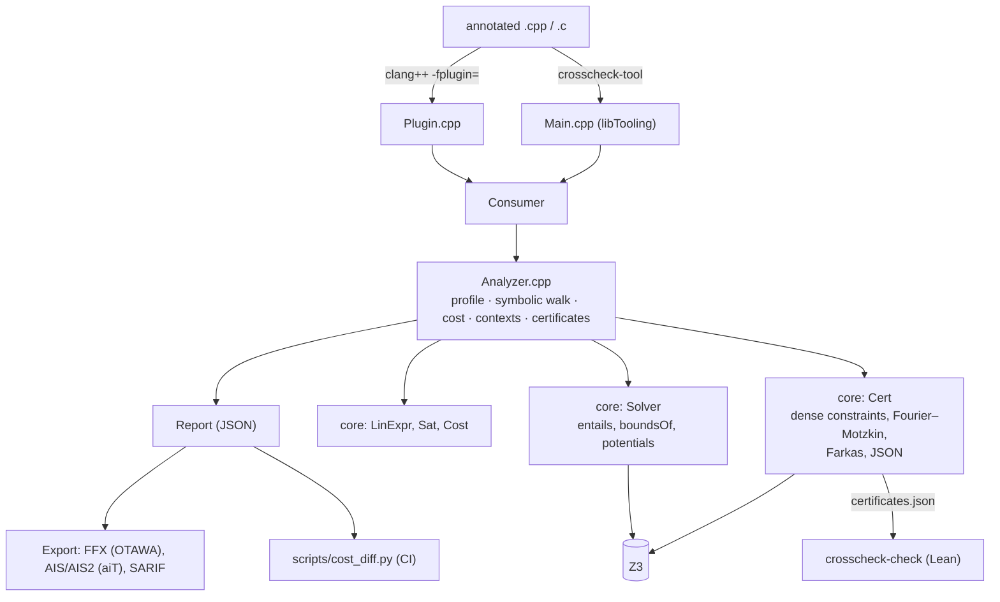
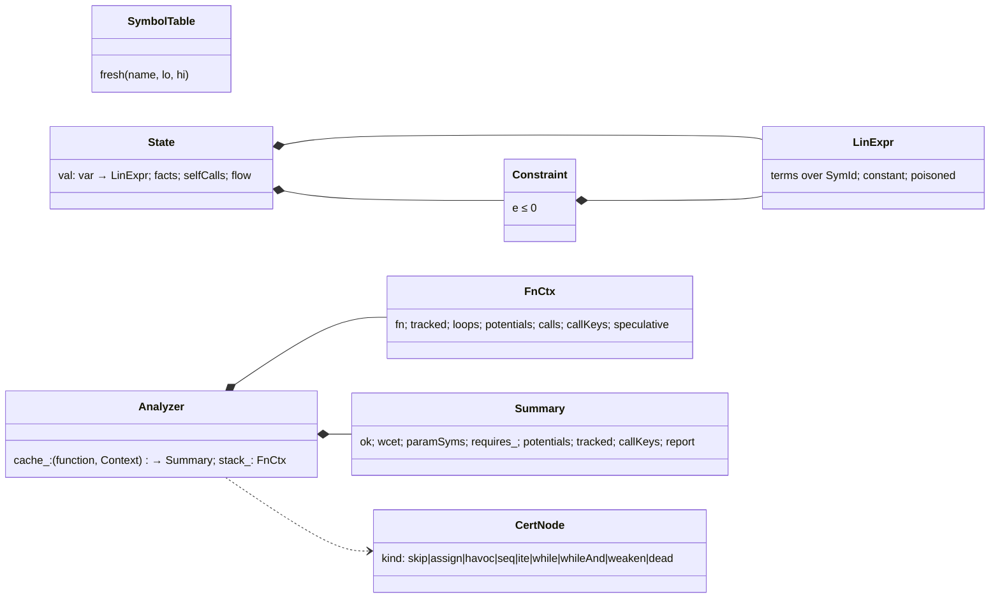
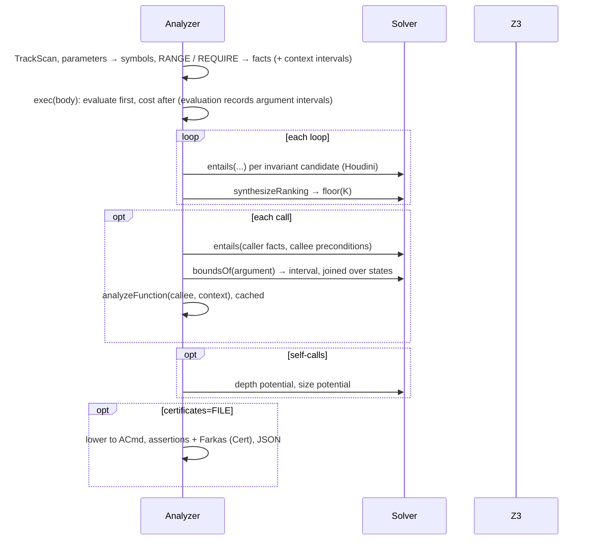
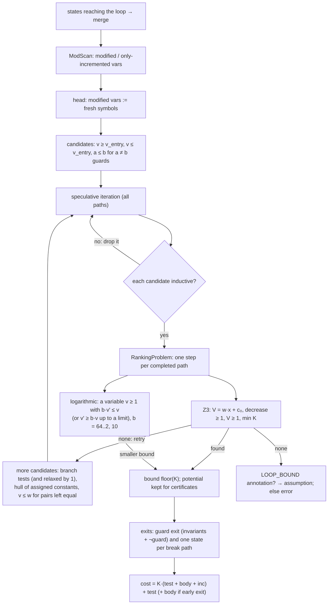
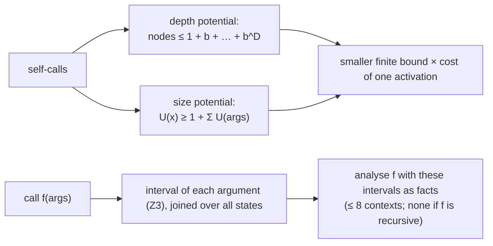
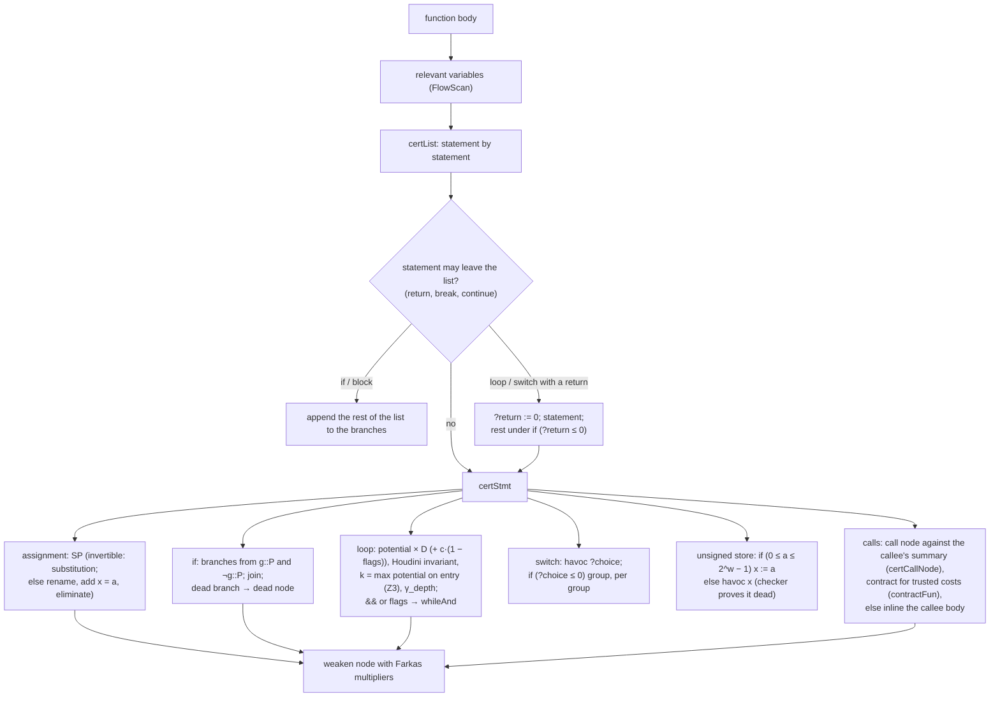
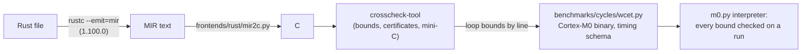
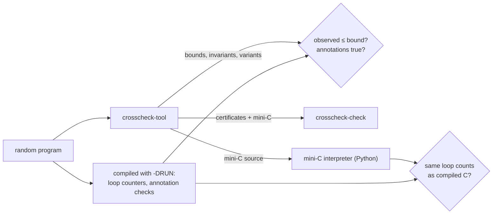

# Part 6 — The Clang plugin, inside

**Before reading.** This part assumes Part 2: symbolic values and facts (sections 2.4 and
2.7), invariants by guess-and-check (2.3), potentials synthesised with Z3 and Farkas (2.2,
2.5, 2.7), intervals and calling contexts (2.8), Fourier–Motzkin in the certificate
generator (2.9), the timing schema (2.12). Words used below:

| Word | Meaning |
|---|---|
| symbol (`SymId`) | an unknown value with a name and a range, e.g. the parameter `n` on entry; never changes |
| `LinExpr` | an affine expression over symbols, e.g. `2·n + i₀ + 3` |
| fact (`Constraint`) | a linear constraint `e ≤ 0` over symbols, true on the current path |
| poison | "not affine / unknown": the expression is replaced by a fresh symbol, losing information but never adding false facts |
| `State` | the map from program variables to `LinExpr`, plus the facts, along one path |
| `Summary` | the result for a function: bound, parameters, requirements, potentials, report |
| context | one interval per integer parameter (section 2.8) |
| `Sat` | saturating natural numbers with ∞ (for costs) |
| `ACmd` / `CertNode` | a node of a certificate program (Part 3, section 3.6) |

`clang-plugin/`, about 9,500 lines of C++ (`src/`) and its tests (183 in `ctest`). User manual:
`clang-plugin/README.md`; certificate format: `docs/certificate-format.md`.

## 1. One example, end to end

```cpp
CROSSCHECK_DEADLINE(500)
int sum(const int* a, CROSSCHECK_RANGE(0, 64) int n) {
  int s = 0;
  for (int i = 0; i < n; ++i) s += a[i];
  return s;
}
```

`crosscheck-tool --summary --opt=certificates=c.json sum.cpp -- -std=c++20 -Iinclude` gives
`OK sum: 453 units`, and `crosscheck-check c.json` gives `ACCEPTED sum: bound 453`.

| Part | Units (unit weights) | Why |
|---|---|---|
| `int s = 0; int i = 0;` | 2 | two assignments |
| test `i < n` | 2 | comparison + branch |
| body `s += a[i]`, then `++i` | 3 + 2 | subscript, compound assignment; increment |
| loop | 64 × (2 + 5) + 2 = 450 | potential `64 − i` (Z3), `K = 64`, `while_cost_bound` |
| `return s;` | 1 | |
| **total** | **453** | ≤ 500: accepted |

## 2. Architecture



Rules (`CLAUDE.md`): `core` includes no Clang header (it is unit-tested alone); `analysis`
does not know whether it runs as plugin or tool.

## 3. Data structures



- **Symbols are immutable**: a variable maps to an affine expression over symbols; an
  assignment changes the map, never a symbol. A fact, once true on a path, therefore stays
  true, and facts are never removed (soundness rule 1).
- **Poison** means "unknown": overflow or non-affine values. Dropping a premise is always
  sound.
- **`Sat`**: saturating naturals with ∞, and `0 × ∞ = 0`.
- **Context**: one interval per integer parameter; `cache_` is keyed by (function, context).

## 4. Analysing one function



## 5. Loops

**Cost control (2026-11-17).** Inner loops are re-analysed in every round of the
Houdini refinement of the enclosing loops (rounds^depth). Two measures, neither of which
changes what is proved: the solver queries `entails`/`isFeasible`/`boundsOf` are cached
under their closed premises, with one Z3 context per thread (`core/Solver.cpp`); and the
option `budget` (default 500,000 units of solver work per function, deterministic) stops
the optional searches once spent and caps the refinement at two rounds, dropping a set
that is not yet inductive (`searchBudgetLeft`). `cjpeg_transupp`: 2,277 s → 742 s
(cache) → 376 s (budget), same bounds.

| Construct | How the analysis reads it |
|---|---|
| `c ? a : b` | a fresh value with the facts true in both arms (`m <= a` if the other arm proves its value `<= a`, …) and the hull of the arms' intervals |
| `while (p != q)` | the body starts on two paths, `p < q` and `p > q` (first unresolved disequality of the guard) |
| `static int n = 0;` in a function | nothing at a call (initialised once, before the first call); the value on entry is unknown, as for a global |



**Logarithmic potentials** (`execLoop`, after the linear search): for each loop variable,
`entails` checks on every path back to the head that `b·v' ≤ v` (decreasing; `v ≥ 1` at
the start of the iteration) or `v' ≥ b·v` (growing; `v ≥ 1` on entry, `v ≤ K` under the
test, `K` from `boundsOf`), for the largest base in 64, 32, 16, 10, 8, 4, 3, 2. The result,
`⌊log_b K⌋ + 1`, replaces the linear bound when smaller. They need exact facts about
`x >> k` and `x / c`: in **unsigned** types these used to be dropped (the range check
`0 ≤ v ≤ UINT_MAX` cannot be proved, symbols have no type limits); `/`, `>>`, `%`, `&` of
an operand of the same unsigned type are now exact (`shrinking`): the result lies between
0 and the operand, so it cannot wrap. In certificates, `x << k` and `x *= c` in signed
types are `x·2^k`, `x·c` (no overflow assumed, as everywhere for signed arithmetic).

**Farkas, by hand** (`sum`): premises `0 ≤ n ≤ 64`, `i ≥ 0`, `i − n + 1 ≤ 0`. Positivity
of `V = 64 − i` means `i − 63 ≤ 0`, which is `1·(i − n + 1) + 1·(n − 64)`. The
multipliers `(1, 1)` are the certificate; `farkas_sound_affine` says this suffices.

**Must-be-rejected tests**: no progress on one path; moving bound; unsigned wrap; step
possibly 0; aliasing through a pointer; `continue` skipping the increment; an inner loop
undoing the outer progress; a counter reset; a diverging do-while; and 6 call cases
(unknown or wrapping argument, recursive callee, global argument…).

## 6. Recursion and calls



Examples (`benchmarks/divide_and_conquer.cpp`): `range_max` gets 511 activations from a
size potential (a depth potential would give about 2⁵¹⁰); `merge_sort` gets 3,148,271 units
(no amortisation); `table_lookup` gets a linear depth (no logarithmic potential in the
plugin).

## 7. Certificates (`Analyzer.cpp`, section "Certificates", ≈ line 2213; `core/Cert.cpp`)



**Mini-C export** (`MiniC.cpp`, option `minic`): a second, independent translation of the
same function, from the syntax only (variable numbering and cost model are its only
inputs). The checker compares it with the certificate's program (`MiniC.validate`), so a
generator bug shows as `NOT VALIDATED`, never as a wrong bound. The exporter's rules, in
one table:

| C | mini-C |
|---|---|
| read of a tracked signed variable | `var x` |
| integer constant expression | `lit k` |
| signed `+ − ×`, unary `−`, value-preserving conversion | exact |
| anything else read (memory, untracked, unsigned arithmetic, narrowing) | `other` |
| `x = e`, `x += e`, `x -= e`, `x++` on a tracked variable | `assign` (exact only if converting back preserves values) |
| any other statement without calls | `cost w` |
| `if`, `while`, `for` (tests `< <= > >=`, `!`, `&&` in loops) | the same |
| `return` outside loops | `cost`; the rest of the body goes into the branches |
| `x = y / c`, `% c`, `& c`, `>> k`; stores into `unsigned`; calls of functions of the file | `div`, `assignU`, `call` |
| `break`, `continue`, `return`, `switch`, `do` | written as they are (`JStmt`, key `jsource`); the checker eliminates them (`MiniC.elim`, proved) |
| tracked globals | ordinary variables of the certificate (assumed: nothing else writes them during the function) |
| calls in tests, `goto`, static locals, volatile/aliased tracked variables, tables | refused (`source_refused`) |

Early exits, on `for (i = 0; i < n; i++) { if (c) break; k++; }` (flag `?break0`,
found by name; weights in brackets):

```
i = 0;  ?break0 = 0 [0];
while (i < n && ?break0 <= 0) {
  if (c) ?break0 = 1 [branch]; else k++;        // the rest of the list moves into the else
  if (?break0 <= 0) [0] i++;                    // the increment, unless the loop was left
}
```

`continue` sets `?continue<d>` (cleared at the start of each iteration; the increment
still runs); `return` pays its cost, sets `?return`, and what follows the loop runs under
`if (?return <= 0)`. Since prompt 46 this rewriting is done by the checker (`MiniC.elim`)
and proved (`MiniC.sim`, `validatedJ_sound`); it costs one loop test more than C after a
jump. A `switch` group is under `?case<d> := ?; if (?case<d> <= 0)`, one variable per
`switch` nesting depth. `fuzz_bounds.py` interprets the exported source with its direct
meaning (`MiniCJ`) and compares loop counts with the compiled C.

With `minic`, dead branches are lowered for real (`deadCode`), loops in them with the
potential 0, so that the dead node contains the source's code.

What is easy to get wrong, and why the code is as it is:

- **Syntactic lists.** The checker compares some lists exactly (assignment preconditions,
  loop pre- and postconditions). `Cert.cpp` reproduces Lean's `vadd`, `vsmul`, `unit`,
  `Lin.subst`, `toLin`, `negLin` and `ghost`, so that vectors match, trailing zeros
  included.
- **Rational reasoning.** The checker's Farkas check is rational, so `normalize` divides by
  a gcd only when the constant is divisible too (no integer tightening).
- **Overflow.** Products in Fourier–Motzkin are checked; an overflowing combination is
  dropped (a weaker assertion, still sound). Z3's multipliers are scaled to integers and
  re-verified before emission.
- **Relevance.** Only the variables that can influence control enter the certificate; this
  avoids the blow-up on DSP code with large constants (`jfdctint`).
- **Costs.** `costOf(e)` is the plugin's own `exprCost` in speculative mode, where a call
  costs only its overhead; the callee's body is inlined separately (both arms of a `?:`
  that call functions are inlined in sequence: a sum, where the plugin takes the max).
- **Jumps.** `break`, `continue` and `return` inside loops set flag variables; the loop
  test becomes `C test ∧ ?break ≤ 0 ∧ ?return ≤ 0` (`whileAnd`), and the potential gains
  `c·(1 − Σ flags)` because the leaving iteration does not decrease the C potential.
  An inlined callee gets its own flags (`certCall` saves and restores `exits`, `ret`,
  `hints`); before this, a callee's `return` inside a caller's loop crashed the
  generator.
- **Join hints.** When two branches are joined inside a loop body, the constraints the
  loop needs at the end of its body (`hints`) are tried as join candidates; without them
  a `return` in an inner loop lost the outer loop's ghost constraint.
- **Program certificates.** One per translation unit (`certNames_`, `certFuns_`): each
  certified function gets ghosts `x_p = γ_p` for its parameters and a symbolic bound `SB`.
  Loops try the test-derived potential (`n − i`) before the analyser's (`64 − i`) and keep
  the one with the smaller bound at the largest admissible parameters; the entry bound is
  symbolic (`symbolicUpper`) only if no looser there. Calls of certified functions are
  `call` nodes (`certCallNode`): parameters := arguments, precondition proved, argument
  bounds, frame. Trusted costs are contract entries (`contractFun`).
- **Legacy C (step 4).** Globals and statics: tracked if non-`volatile`, non-`const` and
  never address-taken in the TU (`scanGlobals`); `globalWrites` (transitive) clears them
  after calls and adds them to loop modifications (`ModScan::callWrites`). Fields `p->f`:
  `fieldSyms` at entry (`FieldScan`). Tables: `tableRange`. C integer tests: `evalCond`
  fallback `v != 0`. Intrinsics, `({ })`, `asm`: `asmCost`, `straightLine`. In
  certificates: one shared variable per global, field variables, `havocC` for divisions and
  tables. Each comes with the assumption listed in the report.
- **Unsigned.** `certAffine` is exact (signed arithmetic, value-preserving conversions
  only); `certModular` gives a value modulo 2^w for unsigned stores; `certStore` adds
  the range test. Nothing about wrap-around is decided by the generator alone.

## 8. Trusted base

| Step | Justified by |
|---|---|
| ranking certificate ⇒ ≤ ⌊K⌋ iterations | `ranking_bound_floor`, `ranking_bound_of_context` |
| Farkas multipliers ⇒ implication | `farkas_sound_affine` |
| loop cost, branch = max | `while_cost_bound`, `condTrace_cost_le` |
| recursion bounds | `callTree_size_le_geom`, `callTree_size_le_potential` |
| **an accepted certificate** ⇒ the bound of its program | `check_sound` (incl. `logloop_sound`, `growloop_sound`) |
| a **validated** certificate ⇒ the bound of the mini-C source | `validated_sound` (the exporter `MiniC.cpp` is trusted instead of the generator) |
| response time under interrupts | `response_time_bound`, `rtaHolds_sound` (inter-arrival times assumed) |
| AST → symbolic state, invariants, cost counting | trusted C++ (tests) |
| AST → certificate's program (lowering) | trusted C++ |
| Z3 | trusted for uncertified bounds only |

## 9. Tests (183 in ctest)

| Suite | Count | Checks |
|---|---|---|
| `core_test` (`LinExpr`, `Sat`, `Solver`, `Ranking`, `SizePotential`, `Bounds`, `Cert`) | 20 | arithmetic, entailment, intervals, potentials, the checker's vector operations, Farkas, elimination |
| `analyzer_test`: `Loops`, `Contexts`, `Recursion`, `Cost`, `Profile`, `Contracts`, `Deadline`, `Report`, `Options`, `Certificates` | 59 | expected bounds and behaviours (incl. summaries, call nodes, library contract files) |
| `Loops/Unsound`, `Calls/UnsoundContext`, `Unsound` (others) | 35 | must be rejected (incl. lexicographic loops whose inner counter is refilled with an unknown value or whose outer counter does not advance, a contract argument without a bound, globals reset by a callee or escaped, `volatile` limits, written fields, `--j` from 0; a deadline missed only under interrupts, a handler without a period; division on some paths only, a path that multiplies again, a possibly negative potential, doubling from 0, unsigned halved then increased) |
| `Loops.Logarithmic*`, `Loops.Lexicographic*`, `Interrupts.ResponseTime`, `Certificates.LogarithmicLoop`, `Certificates.LexicographicLoop` | 6 | logarithmic bounds (signed, unsigned, growing), lexicographic loops (exact bounds 5100, 5000, 150), response time, `whileLog` with the `?old` copy for `x >>= k` |
| `Globals`, `Fields`, `Tables`, `Cost.TargetIntrinsicsAndInlineAssembly`, `Loops.PreDecrementTest` | 5 | legacy C idioms |
| `c_annotations` | 1 | the annotations in C (`tests/c/annotations.c`) |
| `RealTime/Profile` | 11 | forbidden constructs |
| `Benchmarks` | 10 | Table `tab:plugin` figures |
| `plugin_accepts_*` / `plugin_rejects_*` | 10 | real `clang++ -fplugin=` runs |
| `Export` (in `analyzer_test`) | 5 | FFX, AIS, AIS2, SARIF contents |
| `exports_read_back`, `bounds_equal_baseline` | 2 | outputs parsed back (SARIF against its schema if given); example bounds = `benchmarks/bounds-baseline.json` |
| `certificates_accepted_by_lean_checker` | 1 | emit and check the certificates of the examples and of `tests/certificates/` (jumps, `switch`, `&&`, unsigned, interrupts, logarithmic and lexicographic loops); fails if the tool crashes (needs `-DCROSSCHECK_CHECKER=…`) |
| `Symbolic.*`, `Unsound.SymbolicModeStillNeedsAPotential`, `Unsound.OuterLoopWhoseBodyNeverCompletes` | 5 | parametric bounds without ranges (and what must still be rejected); the defect found by the random tests |
| `random_loops_bounds_hold`, `checker_mutants_rejected_or_sound` | 2 | random programs against executions; mutated certificates (section 11) |
| `minic_sources_validated` | 1 | `tests/c/minic.c` with `--opt=minic`: every `ok_*` validated, no `no_*` validated (unsigned, narrow counter, aliasing, `return` in a loop, division) |

## 10. Extending it

- **New statement kind**: a branch in `exec` (states *and* cost); in `certStmt` if it should
  be certified; tests, including a must-be-rejected case.
- **New certificate shape**: first a rule in Lean (`Language`), then `check`
  (`CheckerCore`) with its proof (`Checker`), then the generator. Never the other way round.
- **Debugging**: `--summary`; `report=FILE`; `crosscheck-check --print`. The report's
  `certificate` field says why a certificate is missing, with a line number.

Reading order: `attributes.hpp` → `core/LinExpr.hpp`, `Cost.hpp`, `Solver.hpp` →
`Analyzer.cpp`: `analyzeFunction` (≈ 2760), `exec` (≈ 2400), `execLoop` (≈ 2030),
`functionCost` (≈ 1590), certificates (≈ 2900; `certLoop` ≈ 3940), `responseTimes`
(≈ 5080) → `core/Cert.cpp` → `MiniC.cpp` → `tests/analyzer_test.cpp`.

## 11. Around the plugin: more tools



- **Rust** (`frontends/rust`): MIR → C, loops rebuilt as `while (test)` from the tests at
  the head, conditionals by post-dominators. Checked arithmetic becomes plain C arithmetic
  (bounds for non-panicking runs); other `assert`s and panics become `return 0;` (more
  behaviours in C), so a Rust `assert!(n <= 1000)` is a range checked at run time.
  `tests/test_rust.py` compares Rust and the generated C on random inputs.
- **Cortex-M0 cycles** (`benchmarks/cycles`): compiled at `-O1`, loops of the binary matched
  to source loops by debug line (the innermost source loop whose line range, `line` to
  `end_line` in the report, holds the loop's lines), per-instruction timings from Arm's
  manual, timing schema on the binary; a self-tested interpreter runs every kernel and
  checks every call and loop against its bound. Integer division comes from `runtime.c`.
- **Interrupts**: `CROSSCHECK_INTERRUPT(T)` handlers, `interrupt-overhead=N`,
  `response_time` in the report, claims in the certificate file.

Tools added on 2026-11-16 (`docs/proposals.md` section 6):

| Tool | File | Purpose |
|---|---|---|
| Random loop programs | `tests/fuzz_bounds.py` | bounds, exported invariants/variants, certificates and the mini-C export checked against executions of generated programs |
| Mutated certificates | `formalization/test/mutate_certificates.py`, `cert_interp.py` | tests the checker executable (unverified JSON reader included) with an independent interpreter of certificate programs |
| Project driver | `scripts/crosscheck_project.py` | a whole `compile_commands.json`: `project.json`, `index.html`, baseline for `cost_diff.py` |
| ACSL export | `scripts/acsl_export.py` | `requires`, `loop invariant`, `loop variant` from the report, for Frama-C/WP (not run through it here) |
| Symbolic mode | option `symbolic` (`execLoop`, `synthesizeRanking(..., unbounded)`) | loops with a potential but no numeric bound; the parametric bound is produced as a certificate (ghosts for `x`, `-x`, `x - y`) |
| Certified cycle bounds | `benchmarks/cycles/ipet.py` | IPET on the machine code, dual multipliers from scipy, integer potentials; format `crosscheck-binary-cycles` (code + instruction addresses + rows on address pairs), the checker decodes and builds the graph; `run_cycles.py --certify`, `crosscheck_link.py --certify`; `test_thumb.py` compares the Lean decoder |
| Stack bounds | `benchmarks/cycles/stack.py` | high-water mark on the binary's control-flow graph, checked on every emulated call |
| Qualification kit | `docs/qualification/` | requirements TOR-1..9 of the checker with evidence, checked by `check_traceability.py` |



Unbounded-loop errors now carry a likely cause (see `execLoop`, the branch that reports
"cannot derive an iteration bound").
