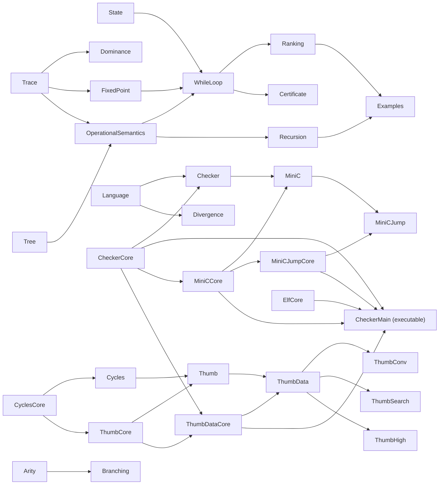

# Part 7 — Lean 4: enough to read and change this repository

`formalization/`: 36 modules, about 20,000 lines, 855 theorems (Paper I: about 11,600 lines and 525 theorems; Paper III: the nine `Cycles*`/`Thumb*` modules, about 7,900 lines and 330 theorems), plus `CheckerMain.lean` (the
checker program). Lean `v4.36.0`, mathlib `v4.36.0` (`v4.16.0` up to the release `v1.0`).

## 1. The mental model

A theorem is a type; a proof is a value of that type; checking a proof is type-checking
(Curry–Howard). The small *kernel* re-checks everything; tactics are untrusted helpers.

| C++ | Lean |
|---|---|
| `int f(int x);` | `def f (x : ℤ) : ℤ := …` |
| `std::pair<A, B>` | a proof of `P ∧ Q`: one of `P` and one of `Q` |
| `std::variant<A, B>` | a proof of `P ∨ Q`: one of `P` or one of `Q` |
| function `B f(A)` | a proof of `P → Q` |
| template over `T` | a proof of `∀ x, P x` |
| `static_assert(2 + 2 == 4)` | `example : 2 + 2 = 4 := rfl` |

Functions are total and pure: partiality is `Option` (⊥ = `none`), recursion must
terminate. Types can depend on values (`t ⊑ w`, `n ≤ m`).

```bash
cd formalization
lake exe cache get        # once: prebuilt mathlib
lake build                # 0 errors, 0 warnings expected
lake build crosscheck-check && .lake/build/bin/crosscheck-check --print test/certificates/count.json
```

In an editor (VS Code + Lean extension) the *infoview* shows the goal at the cursor.

## 2. The language, by example from this repository

```lean
inductive Cmd (ι S : Type) where           -- an inductive type: a tagged union
  | skip | atom (w : ℕ) (r : S → S → Prop) | seq (c₁ c₂ : Cmd ι S)
  | ite (w : ℕ) (b : S → Bool) (c₁ c₂ : Cmd ι S) | while (w : ℕ) (b : S → Bool) (c : Cmd ι S)
  | call (w : ℕ) (p : ι)

structure Lin where                        -- a record
  sv : List Int
  lv : List Int
  c : Int
  deriving DecidableEq                     -- generated equality test (used by `check`)

def dot : List ℤ → Env → ℤ                 -- structural recursion on the list
  | [], _ => 0
  | a :: l, f => a * f 0 + dot l (fun i => f (i + 1))
```

- **`Prop` vs `Bool`**: `b s = true` is a proposition about a boolean; `decide p` turns a
  decidable proposition into a `Bool`. The checker returns `Bool` so that it can run;
  `check_sound` says what `true` means.
- **Inductive predicates** define relations by rules: `Exec Φ c s t n` has one constructor
  per big-step rule; `Derivable` has one per proof rule. Proofs about them go by
  `induction h` over the derivation.

## 3. Tactics you will meet

| Purpose | Tactics |
|---|---|
| structure | `intro`, `rintro ⟨x, hx, rfl⟩`, `exact`, `apply`, `refine ⟨_, ?_⟩`, `constructor`, `use`, `have`, `show`, `calc`, `·`, `<;>`, `by_contra` |
| cases / induction | `cases h with`, `rcases`, `obtain`, `induction n with`, `… generalizing s`, `induction n using Nat.strong_induction_on`, `interval_cases`, `subst` |
| rewriting | `rw [h, ← h']`, `simp [defs]`, `simp only`, `simpa using h`, `dsimp`, `unfold`, `push_cast`, `norm_num` |
| decision | `omega` (ℕ/ℤ linear, also `/`, `%` by constants, `max`, `toNat`), `linarith` / `nlinarith` (ordered fields), `ring`, `decide` (evaluate a closed decidable statement — used to *run* the checker inside a proof) |

Rules of thumb: arithmetic side condition → `omega` (ℕ, ℤ) or `linarith` (ℚ);
an identity → `ring`; induction on a relation with a fixed command → first
`generalize hW : Cmd.while w b c = W at h`, then `induction h`, closing the other cases by
`cases hW` (see `while_exec_bound`).

## 4. Numbers and coercions

- `ℕ` subtraction truncates (`3 − 5 = 0`): `omega` knows it.
- Casts `(n : ℚ)` are inserted automatically; `push_cast`, `exact_mod_cast` and `norm_cast`
  move them around.
- `⌊x⌋₊` is `Nat.floor`; `Nat.floor_mono`, `Nat.le_floor`, `Nat.lt_floor_add_one` are the
  lemmas used for bounds.
- `Int` division `k / d` is Euclidean; `Rat.floor_intCast_div_natCast` links it to `⌊k/d⌋`.

## 5. The modules



| Module | Lines | Key content |
|---|---|---|
| `State` | 31 | `PointedState S := Option S`, partial transitions |
| `Trace` | 303 | traces, `traceIter`, `cost`, `wcost`, prefix order `⊑`, `exists_minimal_iteration`, nested loops |
| `Tree` | 315 | `BTree`, `graft`, `TreePrefix` (the paper's tree order), `fullTree`, `treePow_*` |
| `Dominance` | 93 | branch rule `condTrace_cost_le`, `branch_supremum_bound` (also the unused `≼_O`) |
| `Norms` | 157 | the trace-level bounds for *every* subadditive cost norm, not only the instruction count: `CostNorm` (with `costNorm`, `wcostNorm` as instances), `runTrace_le`, `condTrace_le`, `blocks_le` (k conditional blocks), `wcet_bound`; the prefix order's least element and well-foundedness (`order_nil`, `order_wf`), the least exiting trace (`minimal_iteration_least`, `runTrace_prefix`) |
| `FixedPoint` | 75 | `evalTrace`, homomorphism `evalTrace_concat`, `evalTrace_iter` |
| `OperationalSemantics` | 56 | `MinimalIter`, `LoopConstraint`, `LinearRecurrence` |
| `WhileLoop` | 252 | `WhileBigStep`, `whileBigStep_iff_minimalExit`, `while_trace_semantics`, `runTrace_cost_le` |
| `Ranking` | 125 | integer potentials: `ranking_bound`, `ranking_terminates`, `wcet_bound` |
| `Recursion` | 236 | linear recursion (`framedBigStep_iff`), trees (`exec_least`, `treeBigStep_iff`, `exec_size_le`) |
| `Certificate` | 280 | relational rational potentials `ranking_bound_floor`; invariants/contexts `ranking_bound_of_context`, `call_bound_of_context`; `farkas_sound`; `while_cost_bound`; `lex_potential`, `lex_ranking_bound`, `log_ranking_bound` |
| `Arity` | 230 | trees of any arity, `callTree_size_le_geom`, `callTree_size_le_potential` |
| `Branching` | 380 | trees with a fixed branching factor `b` (`KTree b`): the paper's tree order, grafting, powers, full trees and the execution tree of a `b`-ary recursion (`KRecurrence.exec_least`, `bigStep_iff`) |
| `Language` | 852 | `Cmd`, `Exec`, `Pre`, `Valid`, `Derivable` (9 rules), **`soundness`**, `ValidSym`, `validSym_call`; **`valid_whileSum`** (amortised loop rule: body cost a function of the potential, Paper I `prop:amortised-loop`(1)), **`valid_whileMono`** (part (2): a monotone bound of the potential itself, for costs that grow as the potential falls); **`valid_whileSize`** (size facts of a loop, Paper I `prop:size-facts`); examples `countLoop_cost`, `down_cost` |
| `Divergence` | 170 | infinite executions (`Div`, a greatest fixed point: Lean 4 has no coinductive types) and **`div_prefixes_unbounded`**: with positive loop-test and call weights, an infinite execution has prefixes of every cost, so a valid bound excludes it (`derivable_no_div`) |
| `CheckerCore` | 544 | the checker's definitions, no mathlib: `Lin`, `PExp`, `entails1`, symbolic bounds `SB` (with quadratic terms `q`, `qsub`, `SB.mul`, `SB.qcomb`), `ACmd` (with `whileAnd`, `whileLog`, `whileGrow`, `whileUp`, `call`), `ilog` (structural, so `decide` evaluates it), `FunCert`, **`check`**, **`checkProgram`** |
| `Checker` | 2,774 | **`check_sound`** (triple and frame, given `FunSpec` of the callees), `loop_sound`, `triloop_sound` (amortised form `triOk`: body bound `a + c·γⱼ`, closed form `triBound2`; example `triCert_checks`, `triCert_69_rejected`, `triCert_cost`), `SB.qcomb_ge`, `SB.eval_mul`, `dotQ_crossQ` (quadratic bounds; example `prodCert_checks`, `prodCert_5_rejected`, `prodCert_cost`), `uploop_sound` (node `whileUp`: `γⱼ = k − pot` in the body, closed form `upSum_closed`/`upBound2`; example `upCert_checks`, `upCert_53_rejected`, `upCert_cost`), `sizeloop_sound` (node `whileSz`: size facts `f ≤ U` on entry, growing by at most `h` per iteration, give `f ≤ U + max(h,0)·⌊k/d⌋` after the loop; example `szCert_checks`, `szCert_exit`, three refused variants), `logloop_sound`, `growloop_sound` (logarithmic loops via the same loop rule), `ilog_eq`, `loopBoundOk_sound`, **`program_sound`** (induction over the functions; contracts as hypotheses), `certified_cost_le`; examples by `decide`: `countCert_checks`, `countSym_checks` (bound `1 + 2·max(0,n)`), `exProgram_checks` and `exMain_cost` (a call), `exProgram_17_rejected` |
| `MiniCCore` | 279 | mini-C, no mathlib: `MExp`, `MCond`, `MStmt` (incl. `divStore`, `assignU`, `call`, each lowered to existing checker programs: `divFacts`, `divOf`, `storeArg`); **`lower`** (its meaning, as a program of the checker); normal form `nf` (annotations, `weaken`/`dead`, `skip` and nesting of sequences removed); **`validate`** |
| `MiniC` | 312 | `CImp`/`CEquiv` (same executions and prefixes), congruences, `seq_assoc`, `nf_equiv`, **`validated_sound`** (accepted program + validated body ⇒ the source meets the bound); examples `countCert_validated`, `countCert_not_validated` |
| `MiniCJumpCore` | 390 | no mathlib: `JStmt` (mini-C with `break`, `continue`, `return`, `switch`, `do`), scans `hasRet`/`escB`/`escC`, frames, **`tr`** / **`elim`** (jumps eliminated with flags, continuation-passing), **`validateJ`**, `quietCmd` (called functions do not touch the ghost variables) |
| `MiniCJump` | 2,740 | `JExec`/`JExecD` (direct semantics with outcomes), `Quiet`, `exec_transfer`, `lower_quiet`, flag invariants (`okFlags`, `JumpOK`), **`sim`** (simulation by induction on the derivation, with a loop part and a `switch`-chain part), `desugar_exec`, `tr_desugar`, **`validatedJ_sound`**; examples `breakSrc_elim`, `breakSrc_flag_clash` |
| `ResponseCore` | 50 | no mathlib: `rtaHolds C hs R` (`C + Σ cₖ⌈R/Tₖ⌉ ≤ R`), `rtaSearch` (the iteration); used by the checker program |
| `Interrupts` | 290 | schedule model `Admissible` (the activations of a handler are a set, possibly infinite; `before` takes those released before a slot), `sporadic_count`, `handler_demand`, **`response_time_bound`**, `rtaHolds_sound`; example schedules `oneRun_admissible`, `perRun_admissible` (a handler activated every 5 slots forever) |
| `ForkJoin` | 140 | greedy (list) scheduling `Greedy`, **`greedy_bound`** (Graham: `p·L ≤ W + p·S`), `forkjoin_bound` (with certified task bounds), `makespan_lower` (for every assignment of tasks to processors, the makespan is at least `W/p` and at least every task) |
| `Stack` | 150 | stack depth as a high-water mark: activation trees `ActTree`, `highWater`, **`highWater_le_of_bound`** (the composition rule of `benchmarks/cycles/stack.py`), `highWater_le_depth` (from a recursion depth) |
| `CyclesCore` | 100 | no mathlib: `Graph`, `Edge`, `Row`, `Cert`, `checkFn`, `checkProgram` (the IPET dual check); used by the checker program (`crosscheck-cycles`) |
| `Cycles` | 210 | `Walk`, `Run` (depth-indexed, calls nested), `walk_bound` (potentials telescope), `sum_dot`, **`cycles_sound`**, **`program_sound`**; examples `exLoop_checks`, `exLoop_tight`, `exLoop_run` |
| `ThumbCore` | 340 | no mathlib: `decode` (ARMv6-M Thumb + Cortex-M0 cycles), `trans`, `closed`, `medges`, `buildFn`, `checkBinary` (jumps only with `jt`); jumps through a table: `JT`, `jumpTr`, `transJ`, exact values `xop`/`xres`, `pcWrite`/`pcDestV`; used by the checker program (`crosscheck-binary-cycles`, `--decode`) |
| `Thumb` | 310 | `Step`, `MRun` (PC-level semantics), `chain_walk`, `translate` (machine runs are graph runs), **`binary_sound`**; examples `exBinary_checks`, `exBinary_tight`, `exBinary_run`; far branches: `transF` (a listed `BL` goes to its target, no call), `farOk` (the link register read only at the entry), example `exFar_sound` in `ThumbData` |
| `ThumbDataCore` | 1,120 | no mathlib: `effect` and `stackEffect` (what each instruction does to `r0`-`r12`, the flags, SP and memory: the trusted specification), `Flags`, `flagsAdd`, `flagsSub`, `condHolds`; `condFacts` (conditions as linear facts on two ghost operands); certificates `DFun` (kinds, invariants, loops, SP offsets, tracked frame words, `frame`), `LoopCert`, `postS`, `obligations`, `loopRow`, **`checkData`**; used by the checker program (version 2, `--effect`); the window of a jump through a table: `wstep`, `wrun`, `jumpOk`, `interiorOk`; windows without `CMP`: `rngOps` (the bound an `ands`, `lsrs`, `uxtb` or `ldrb` puts on the register it writes), `jumpRng`, `interiorR`; windows bounded by the certified invariant: `invBound`, `congFits`, `jumpInv`; `shlCong` (after `lsls rd, rm, #k`, `rd` is a multiple of `2^k`) |
| `ThumbData` | 3,460 | data runs `EffOk`, `StackOk`, `DOkM` (the machine step; a jump goes to its computed address), `XOk`/`XChain` (exact values), `DOk` (a step along `transJ`), `DChain`, `DRun`; jumps through a table: `back_walk`, `jump_good`, `steps_good` (every step of a data run follows the graph), `back_walkR`, `jump_good_rng` (the form without `CMP`), `inv_prefix` (the invariant holds at a step once the earlier steps follow the graph), `jump_good_inv` (the form bounded by the invariant), examples `exSw_sound`, `exMask_sound`, `exPath_sound`; `condFacts_sound` (the flag lemmas `sub_z`, `sub_c`, `sub_nv`, `add_z`, `add_c`), `postE_eval`, `postS_eval` (address arithmetic modulo 2³² by `omega`), **`step_ok`**, **`chain_ok`** (invariants and telescoping potentials), `chain_rows`, `drun_mrun`, **`data_sound`**; examples `exData_checks`, `exData_tight`, `exData_sound`; a concrete simulator (`effOkB_sound`, `chainB_sound`, `dOkB_sound`) and `exData_run`, a data run of exactly 68 cycles, so the hypotheses are satisfiable and the bound attained (Paper III `thm:machine-loops`); preconditions on the arguments: `PreOk`, `PreAt`, `call_pre` (the callee's precondition holds at a call, from the caller's invariant), example `exCtx_g_sound`; shifts right and their flags: `shr_bounds`, `nzFacts_true`; logarithmic potentials: `potTr`, `potGoals_sound`, example `exLog_sound`; amortised rows: `loopRow_coef` (the coefficients of a row with an enclosing loop, `LoopCert.outer`), example `exAm_sound`; potentials per disjunct of the invariant: `potAtD` (the potential where disjunct `d` holds, `LoopCert.potAlt`), `tgtN_get` |
| `ThumbSearch` | 80 | TACLeBench's binary search as Clang compiles it: a logarithmic potential per disjunct of the invariant (the update `up = low - 1` wraps around to `2^32 - 1` when `low = 0` and joins the other paths before the test), 3 back edges, no trusted row; `exBs_sound`, `exBs_needs_alt` (refused without the potentials of the disjuncts); its `decide` takes a few minutes |
| `ThumbHigh` | 130 | loop counters in the high registers, as GCC compiles them: `exHi_*` (a loop counted in `r8` against `r9`), `exHc_*` (the same with a call in the loop: `r8` and `r9` kept under `abi`; refused with the counter in `r12`, which a call may change) |
| `ElfCore` | 260 | no mathlib, no theorem: the ELF file read as `m0.py` reads it (an executable at its addresses, a relocatable object placed and relocated), `check` (the certificate's code and function entries against the file); `crosscheck-check --elf` |
| `ThumbConv` | 950 | the calling convention checked instead of assumed: linked runs `DRunL` (a callee runs from the caller's state; exact `PUSH`/`POP`; hypothesis `SaveSafe`, no stack smashing), the check `convOk` (in `ThumbDataCore`), **`drunL_drun`**, **`data_sound_conv`**; also in functions with jumps through tables (the steps follow `transJ`, by `steps_good`); examples `exConv_run`, `exClobber_refused`, `exSwConv_sound`, `exSwClobber_refused` |
| `Examples` | 270 | the paper's four examples |

## 6. Three proofs worth reading

**`ranking_bound_floor`** (`Certificate`): along a run, `V(σ k) ≤ V(σ 0) − k` (induction,
`run_descent`); the last step has `V ≥ 1`; so `n ≤ V(σ 0)`, and `Nat.le_floor` finishes.

**`soundness`** (`Language`): `induction h`, one case per rule. The set of assumptions `Γ`
grows in the `call` rule, so the statement is an implication `(Γ valid) → Valid …` and each
case starts with `intro hΓ`; the `call` case is a strong induction on the rank.

**`check_sound`** (`Checker`): `induction c`, one case per certificate node; each case
applies the corresponding `valid_*` lemma of `Language`. The loop case sets the logical
variable `γⱼ` to the current potential with `Function.update ρ j (pot.eval s)` and uses
`holds_update_logical` (the invariant does not mention `γⱼ`).

**`logloop_sound`** (`Checker`): no new rule of the logic. The proof applies
`valid_while` (the linear loop rule) to the potential `logPot b pot = ⌊log_b pot⌋ + 1`
(0 if `pot ≤ 0`); the only arithmetic is `logPot_step` (`b·y ≤ x`, `1 ≤ x` ⇒
`logPot y + 1 ≤ logPot x`, from `Nat.log_div_base` and `Nat.log_mono_right`).
`growloop_sound` is the mirror image, with `N − ⌊log_b pot⌋` and `log_grow`.

**`triloop_sound`** (`Checker`): a new derived rule, `valid_whileSum` (`Language`): if an
iteration from `s` costs at most `W (V s)` and `V` drops by `d`, any `F` with `F X ≥ w`
and `w + W v + F (X − d) ≤ F X` (for `d ≤ v ≤ X`) bounds the loop from `V ≤ K` by `F K`
(induction on the execution, as `valid_while`, with `X` in place of the iteration count).
For `W v = a + c·v` the checker uses the closed form `triBound2` (doubled, no division):
`triBound2_step` is the step identity (`ring` once `⌊X/d⌋ = ⌊(X−d)/d⌋ + 1`), `triBound2_ge`
the base case. In the proof `γⱼ` is set to the potential before the iteration, as in
`loop_sound`; `SB.eval_only` reads the body bound there.

## 7. Common errors

| Message | Usually means |
|---|---|
| `unknown identifier 'ℕ'` | file without mathlib: write `Nat`, `Int` (`CheckerCore`) |
| `don't know how to synthesize placeholder` | a `_` Lean cannot infer: name the variable (`@whileTrue _ _ _ s' …`) |
| `omega could not prove the goal` | a non-linear term or a missing hypothesis: `have` it first |
| `failed to synthesize instance` | a missing type class (decidability, order); add the instance argument or `decide`-able form |
| unused variable warning | prefix with `_`; the build must stay warning-free |
| very long build of an executable | it imports mathlib: executables must import only `CheckerCore` and Lean core |

## 8. Exercises

1. Prove `countLoop_cost` for `n ≤ 20` (bound `41`).
2. State and prove `valid_skip` for a two-element `skip; skip`.
3. Build a certificate JSON for `while (i < n) i += 2` and run `crosscheck-check` on it.
4. Which rule of the logic does the checker's `call` node implement? (Answer: rule 6, the
   call rule, with the callee's triple instantiated at the arguments — a summary,
   `validSym_call`; contracts are the assumed triples of rule 8. Rule 9, recursion, is not a
   checker case: calls go to earlier functions only.)
