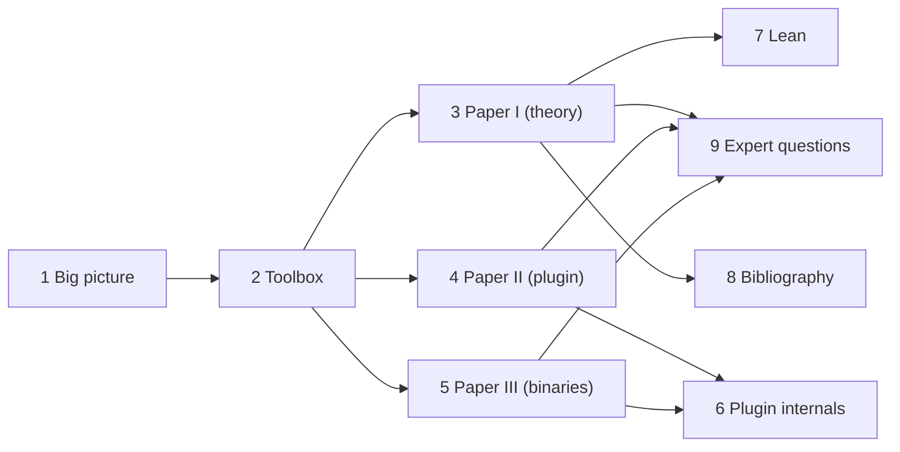

# CrossCheck — Companion Guide

This guide explains CrossCheck from the ground up: what problem it solves, every idea
the three papers rely on, how the Clang plugin, the checker and the Lean proofs work,
and how to answer the questions of specialists.

It is written for a software engineer who knows C or C++ and what "real-time" means
(deadlines, worst-case execution time, interrupts), but who has **no** background in
program semantics, linear programming, SMT solvers or proof assistants. Every technical
word is explained the first time it appears, with a small example, and where possible
with a picture. Nothing is assumed from the papers: the guide is meant to be read
**before** them, and then next to them.

> **Status.** Written by an AI assistant (Claude, model Opus 5.5) from the repository
> sources, rewritten on 2026-11-18 at the author's request (the previous version was too
> condensed). The explanations of the code and of the papers were checked against the
> sources at that date; the bibliography part says, per reference, what was actually
> read. Read the originals before relying on a detail. See `AI_USAGE.md`.

## What CrossCheck is, in four sentences

1. A **compiler plugin** reads a C or C++ function and computes, without running it, an
   upper bound on how much work it can do — for example "at most 331 operations", or
   "at most 3 + 339·n operations for an input of size n".
2. For the functions it can handle, it also writes a **certificate**: a file with all the
   arithmetic facts that justify the bound (loop invariants, decreasing quantities,
   coefficients of linear combinations).
3. A small **checker**, whose correctness is proved in the proof assistant Lean, reads the
   certificate and re-verifies every fact with integer arithmetic only. If it accepts,
   the bound is guaranteed, whatever bugs the plugin may have.
4. The same idea is carried down to the **machine code**: cycle bounds of the compiled
   binary on an Arm Cortex-M0, with the loop bounds themselves re-proved on the
   instructions.

## The parts

| Part | File | What you get | Reading time |
|---|---|---|---|
| 1 | [01-big-picture.md](01-big-picture.md) | The problem, the idea, one example followed from C source to certified cycles, the three papers, what is trusted | 1 h |
| 2 | [02-toolbox.md](02-toolbox.md) | **The building blocks**, one by one, with pictures and worked numbers: loops and potentials, invariants, linear constraints, Farkas' Lemma, linear programming and duality, Z3 and what CrossCheck asks it, intervals and calling contexts, Fourier–Motzkin (where CrossCheck uses it, and where not), difference constraints and shortest paths, abstract interpretation and widening, cost envelopes, recursion, certificates, Lean, machine code | 4–5 h |
| 3 | [03-paper-theory.md](03-paper-theory.md) | Paper I, section by section, in plain words, with its Lean names | 2–3 h |
| 4 | [04-paper-tool.md](04-paper-tool.md) | Paper II: the plugin and the evaluation; the numbers to remember and how they were obtained | 1–2 h |
| 5 | [05-paper-binary.md](05-paper-binary.md) | Paper III: certified cycle bounds of machine code, loop bounds and stack slots included | 2 h |
| 6 | [06-plugin.md](06-plugin.md) | The plugin's code: architecture, a function followed through the analyser, certificates, tests | 2 h |
| 7 | [07-lean.md](07-lean.md) | Lean 4 from scratch with this repository's code; the modules; three proofs read line by line | 3 h |
| 8 | [08-bibliography.md](08-bibliography.md) | The references as a map, and what was actually read | 30 min |
| 9 | [09-expert-questions.md](09-expert-questions.md) | Questions a reviewer will ask, answers, weak points, glossary | 1 h |



**If you have one evening:** Part 1, then sections 2.1–2.6 of Part 2 (potentials,
invariants, linear constraints, Farkas, linear programming, Z3), then Part 9.

**If you must present Paper III:** Part 1, sections 2.4–2.6, 2.10–2.11 and 2.15 of Part 2,
then Part 5.

## Conventions

- Math is written in plain Unicode (`≤`, `Σ`, `⌊x⌋`), so the files read in any editor.
  Formulas are explained in words next to them.
- Paper statements are named by their LaTeX label (for example `thm:lyapunov-bound`),
  because numbers change when a paper is edited. Search the `.tex` file for the label.
- Lean names are in code font (`ranking_bound`); find them with
  `grep -rn ranking_bound formalization/`.
- **"In the code"** boxes say where an idea lives in the repository. **"Expert phrasing"**
  boxes give the words a specialist would use. **"Pitfall"** boxes say what is easy to
  get wrong, and what a reviewer may attack.
- Pictures are in `img/` and are drawn by `tools/figures.py` (plain Python, no package);
  diagrams are Mermaid blocks, rendered by GitHub and by the PDF build.

## PDF version

`crosscheck-guide-ebook.pdf` (in this folder, not committed) is the whole guide as one PDF,
with a page for e-readers. To rebuild it (Node.js and Chrome or Chromium needed):

```bash
python3 docs/guide/tools/figures.py     # the pictures
cd docs/guide/tools
npm install                             # once
node build-pdf.mjs                      # e-reader page; --format=a4 for printing
```

## Keeping this guide in sync

The guide quotes Lean names, plugin classes and paper labels. When one of them is renamed
or removed, update the guide in the same change (the same rule as for the papers' tables
and `formalization/formalization.yaml`).
