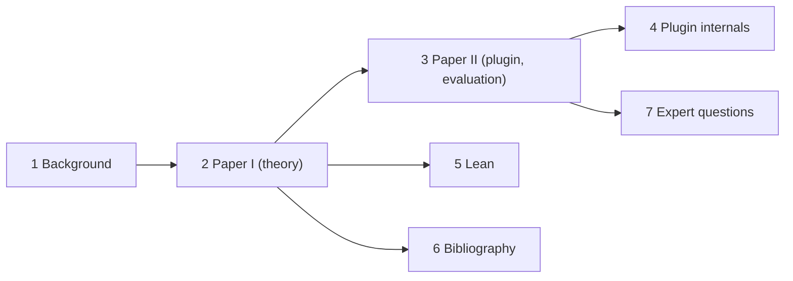

# CrossCheck — Companion Guide

This guide explains everything that the paper (Papers I and II, `paper/theory/` and `paper/tool/`), the Lean
development (`formalization/`) and the Clang plugin (`clang-plugin/`) use or introduce.
It assumes the reader is a software engineer who:

- knows C++ well and knows what real-time means (deadlines, WCET, interrupt handlers);
- understands the *idea* of CrossCheck (loops and recursion as minimisation problems);
- has little background in programming-language theory, logic or proof assistants
  (beyond having read Manna's *Mathematical Theory of Computation* out of curiosity).

The goal is that after reading it you can explain every sentence of the paper,
read every line of the Lean code, change the plugin, and answer questions from
experts in semantics, static analysis, WCET analysis and formal proof.

> **Status of this document.** Written by an AI assistant (Claude, models Fable 5.2 and
> Opus 5.5, November 2026) from the repository sources, and shortened on 2026-11-14 (from
> about 4,700 to about 1,100 lines, with 19 diagrams instead of 12). The explanations of the code and
> of the papers are checked against the sources. Part 6 says, per reference, what was
> actually read; read the originals before relying on a detail. See `AI_USAGE.md`.

## Reading order



| Part | File | What you get | Time |
|---|---|---|---|
| 1 | [01-background.md](01-background.md) | the concepts the papers take for granted, one section each | 2 h |
| 2 | [02-paper.md](02-paper.md) | Paper I: every result in plain words with its Lean name; the worked examples | 2 h |
| 3 | [03-paper-tool.md](03-paper-tool.md) | Paper II: what the plugin does, how certificates are produced, the results to remember | 1 h |
| 4 | [04-plugin.md](04-plugin.md) | the plugin's code: architecture, data, loops, recursion, calls, certificates, tests | 2 h |
| 5 | [05-lean.md](05-lean.md) | Lean 4 from scratch with this repository's code; the 20 modules; three proofs to read | 3 h |
| 6 | [06-bibliography.md](06-bibliography.md) | the references as a map and tables, with what was actually read | 30 min |
| 7 | [07-expert-questions.md](07-expert-questions.md) | questions, answers, weak points, phrases, glossary | 1 h |

Short on time: Parts 2, 3 and 7.

## Conventions

- Math is written in plain Unicode (`≤`, `⊑`, `Σ*`, `⌈x⌉`) so the files read well
  in any editor.
- Paper statements are referred to by their LaTeX label (e.g. `thm:lyapunov-bound`),
  as in `CLAUDE.md`, because numbers change when the paper changes.
- Lean names are written in code font (`ranking_bound`); they can be searched with
  `grep -rn ranking_bound formalization/`.
- "Expert phrasing" boxes give the vocabulary a specialist would use for an idea.

## PDF version

`crosscheck-guide-ebook.pdf` (in this folder, not committed) is the whole guide as one PDF
with a 100 × 133 mm page for e-readers: clickable contents and bookmarks, and large
diagrams on their own page (rotated to landscape when that makes them bigger). To rebuild
it after editing the guide (needs Node.js and Google Chrome or Chromium):

```bash
cd docs/guide/tools
npm install                        # once
node build-pdf.mjs                 # e-reader page; add --format=a4 for printing
```

## Keeping this guide in sync

This guide quotes Lean names, plugin classes and paper labels. When one of them is
renamed or removed, update the guide in the same change (the same rule as for
Table 1 of the paper and `formalization/formalization.yaml`).
