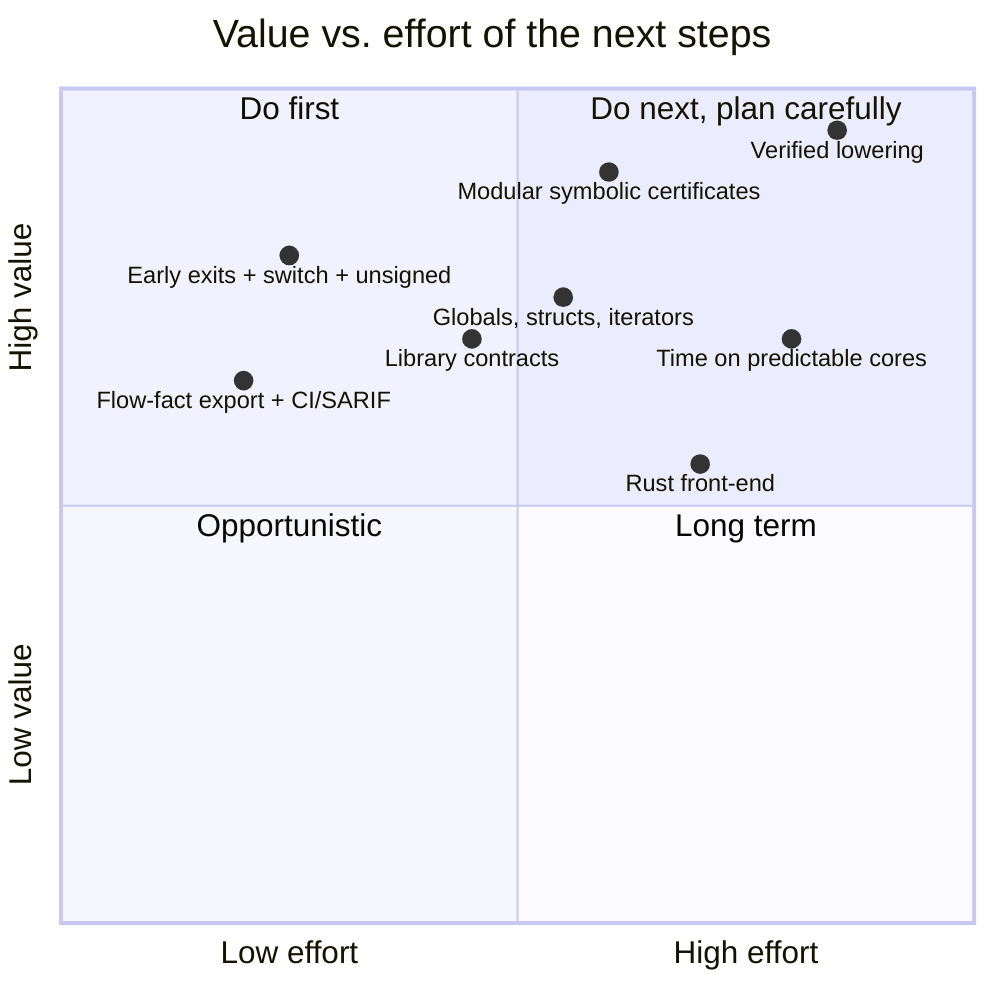

# Proposals: scientific contribution, industrial value, legacy code

Written on 2026-11-14, after the evaluation (Paper II) and the first certificate results.
Each item says what it is, the evidence that it matters (from our own measurements where
possible), and whether it needs new theory and Lean work (**T**) or only engineering under
the existing certificates (**E**). `docs/implementation-plan.md` remains the task list;
this file is the argument for the order.

## 1. Where we stand

- **Strong**: soundness record (no bound below an observed count); certificates for 156 of
  158 bounded TACLeBench functions (142 before step 1 of §5), all accepted by a verified checker; in-context loop
  bounds identical to oRange's wherever both exist.
- **Weak**: the translation from C++ to the certificate is unverified; no symbolic bounds
  (TPDB: 165 vs 288 for KoAT2); small benchmarks; cost is not time.

## 2. Scientific relevance and innovation

| # | Proposal | Why it is a contribution | Kind |
|---|---|---|---|
| S1 | **Verified lowering.** A mini-C (structured control, signed/unsigned integers, read-only arrays, calls) with a Lean semantics; the plugin exports the function's AST as JSON; the lowering to `ACmd` is written *in Lean* and proved to preserve cost. | Closes the only remaining gap: an accepted certificate would then bound the *C function*, not a program the plugin wrote. Few cost analyses for C have a verified front-end (CompCert-based work is the reference point to cite). | T |
| S2 | **Modular symbolic certificates.** Certificates whose bounds are affine (later polynomial) in the parameters, one per function, with a checked call rule (`validSym_call`, rule 9 for recursion) instead of inlining. | Turns the checker into a verified checker of *parametric* resource bounds — rare in the literature — and removes the coverage gap with KoAT2/CoFloCo on TPDB as is. Also needed by S1 and by library contracts. | T + E |
| S3 | **Richer potentials in the checker**: lexicographic and logarithmic loop rules (`prop:lex-log` is proved on runs; make them rules and checker cases), then amortised (potential-based) rules for nested loops. | Certificates for multi-phase loops, binary search, and amortised costs, all checked; connects AARA-style analysis to verified checking. | T |
| S4 | **Relative completeness of the generator**: every loop the analyser bounds (affine potential, Houdini invariant, single linear test) receives an accepted certificate. | A precise statement of what the certified fragment covers; turns the 142/158 figure into a theorem plus a list of out-of-fragment constructs. | T |
| S5 | **Time on predictable processors**: weights for an in-order core without caches (e.g. a RISC-V or Cortex-M0-class core), and a check that the compiled code's loops match the source loops (translation validation on the binary). | A certified end-to-end WCET bound for predictable hardware; for complex hardware, certified flow facts for existing timing analysers (I1). | T + E |
| S6 | **Fork-join and interrupts**: work/span rules in the logic; per-handler bounds as input to response-time analysis. | Extends the framework to the two forms of concurrency real-time code actually uses. | T |

## 3. Industrial value and engineering interest

| # | Proposal | Value | Kind |
|---|---|---|---|
| I1 | **Export flow facts** (loop bounds, in-context) to aiT (AIS annotations) and OTAWA (FFX). **Done** (not yet run inside OTAWA/aiT); SWEET dropped: it computes flow facts and has no documented input format for loop bounds. | Plugs into qualified WCET workflows today; replaces hand-written loop bounds, a known source of error. | E |
| I2 | **CI integration**: SARIF output for code-scanning UIs; a "cost diff" on pull requests (bound of each function before/after); failure on regression beyond a budget. | Turns bounds into a review signal for embedded teams. **Done**: `sarif=FILE` (schema-validated), `scripts/cost_diff.py`, baseline ctest. | E |
| I3 | **Tool qualification kit for the checker** (DO-178C / ISO 26262): requirements, tests, the Lean proof as evidence, the trusted base listed. | Qualifying a small checker is far cheaper than qualifying an analyser; this is the industrial case for certificates. | E |
| I4 | **Library contracts**: versioned contract files (cost as a function of sizes) for C library functions (`memcpy`, `memset` with a size), CMSIS-DSP, the Embedded Template Library, `std::array` / `std::span` algorithms; amortised or average-case functions rejected. Contracts enter as assumed triples (rule 8) and are listed in the report. | Makes real code bases analysable without rewriting library calls; the C++ standard gives no constants, so contracts must be per implementation. | T (checker) + E |
| I5 | **Whole-project driver**: run on `compile_commands.json`, cache summaries across translation units, an HTML/JSON dashboard of bounds, certificates and reasons. | Needed for any code base larger than a file. | E |
| I6 | **Rust front-end on MIR**, emitting the same certificates. | Ownership removes aliasing; MIR is simpler than the Clang AST; the checker is reused unchanged. | E |

## 4. Extending the language subset for legacy code

Ordered by measured effect (blockers counted on TACLeBench and the example programs) and
by how common the idiom is in legacy C (MISRA-style code).

```mermaid
flowchart LR
  A["break / continue / return in loops<br/>(TACLeBench: 11 functions)"] --> B["switch<br/>(examples: on_frame, next_phase)"]
  B --> C["unsigned and size_t counters<br/>(4 + crc32, ring_read)"]
  C --> D["&& / || loop tests<br/>(ring_read, md5)"]
  D --> E["globals, static locals<br/>(filterbank, bitcount, isqrt)"]
  E --> F["struct fields, const tables"]
  F --> G["pointer iterators<br/>p < a + n, begin/end"]
  G --> H["recursion in certificates"]
  H --> I["floats with constant bounds"]
```

| Construct | How | Kind |
|---|---|---|
| `break`, `continue`, `return` in loops | **done**: flag variables in the generator, and one checker node `whileAnd` (conjunctive test, proved in `check_sound`); a logic with jump postconditions was not needed | T (small) |
| `switch` (with fall-through) | **done**: one nondeterministic conditional per group of cases; fall-through is the sequence | E |
| unsigned / `size_t` | **done**: every unsigned store is a conditional whose wrapping branch the checker proves dead; 64-bit types use the test `a ≤ 2^62` | E |
| `&&`, `||` in loop tests | **done**: the guard list of `whileAnd`; other conjuncts (`||`, `!=`, memory) as choice variables | T |
| globals, `static` locals | tracked as variables under a single-writer assumption listed in the report; `volatile` and atomics never tracked | E |
| struct fields, arrays with constant index | scalar replacement; `const` lookup tables with known contents give bounds from their values | E |
| pointer iterators | an offset variable for `p` over a known array (`p < a + n`, `std::array` / `std::span` iterators) | E |
| recursion | rule 9 with ranks from the depth or size potential | T |
| `do … while`, forward `goto` to a cleanup label | restructuring in the generator | E |
| floats with constant start, step and limit | exact IEEE evaluation of the trip count, certified by evaluation in the checker (`decide`-style) or listed as an assumption | T or E |
| function pointers with a declared target set | annotation listing the targets; the bound is the maximum | E (trusted) |

## 5. Recommended order

1. **Early exits, `switch`, unsigned** (§4, first three rows): closes most measured
   certificate gaps; small Lean work. Then re-measure, including the TACLeBench
   *sequential* and *app* categories. **Done 2026-11-14**: TACLeBench certificates 142 →
   156 of 158; `run_tacle.py --category sequential --category app` (results in
   `benchmarks/tacle/README.md`).
2. **Flow-fact export and CI/SARIF** (I1, I2): immediate industrial value, no theory.
   **Done 2026-11-14**: FFX, AIS, AIS2, SARIF, cost diff; FFX values equal oRange's on 114
   TACLeBench loops. Open: loading the files into OTAWA and aiT on compiled code.
3. **Modular symbolic certificates + library contracts** (S2, I4): the main scientific and
   industrial step; closes the TPDB gap and makes real code bases tractable. **Done in the
   checker and the generator (2026-11-14)**: symbolic bounds `SB`, `call` nodes against
   summaries, assumed contracts, `program_sound`; contract files. Open: the *analyser* still
   needs numeric ranges, so the TPDB gap "as is" remains; polynomial bounds; recursion in
   the checker (rule 9).
4. **Globals, structs, iterators** (§4): legacy coverage, measured on an open-source
   embedded code base (choose one with a permissive licence and MISRA-like style).
   **Done 2026-11-15** on CMSIS-DSP (`benchmarks/cmsis`): globals and statics, fields
   through pointer parameters, constant tables, C integer tests, Arm intrinsics, statement
   expressions, inline assembly, `input-range`, annotations in C; 357 → 616 of 786
   functions bounded (with ranges). Pointer iterators were **not** done: neither CMSIS-DSP
   nor TACLeBench controls loops by pointer comparison often enough to show up among the
   blockers; logarithmic loops (FFTs) are now the largest blocker.
5. **Verified lowering** (S1): the flagship result for a venue paper on certified cost
   analysis. **Done 2026-11-15, as translation validation** rather than a lowering written
   in Lean: the plugin exports each certified function as mini-C (`MiniC.cpp`, syntactic,
   independent of the generator); the checker compares it with the certificate's program
   up to a normal form (`MiniC.validate`), and `MiniC.validated_sound` (Paper I
   `thm:validated`) transfers the bound. The generator leaves the trusted base for the
   validated functions: 93 of the 158 TACLeBench kernel certificates and 113 of the 231
   sequential/app ones, none failing.
   Open: calls in mini-C (a congruence of the semantics in the procedure environment, and
   following the generator's choice between summary and inlining), unsigned arithmetic,
   division/shift/mask (the generator's `havocC` facts, to be derived by `lower`), jumps
   inside loops.
6. **Time on predictable cores** (S5), **fork-join and interrupts** (S6), **Rust** (I6).
   **S6 done 2026-11-15**: Lean `Interrupts` (response-time bound for a computation under
   sporadic handlers, executable check `rtaHolds` in the checker) and `ForkJoin` (Graham's
   bound for independent tasks, with certified task bounds); plugin `CROSSCHECK_INTERRUPT`,
   `response_time` in the report, deadlines checked against it, response-time claims in
   certificate files. Open for S6: the busy-period argument (activations pending at the
   start), fork-join in the plugin, dependencies between tasks.
   **S5 done 2026-11-15** (`benchmarks/cycles`): cycle bounds of the TACLeBench kernels
   compiled for a Cortex-M0, from CrossCheck's loop bounds (binary loops matched by debug
   lines), each checked against an emulated run: 102 of 267 functions, 5 entry functions
   (bound/observed 1.24 to 2.49), no violation. Open: software floating point, a check on
   hardware, other cores. **I6 (Rust) done 2026-11-15** on textual MIR (rustc 1.100.0
   pinned; the user accepted an interface that may evolve): `frontends/rust` translates MIR
   to C for the analyser (free functions over integers and slices), checked by a
   differential test against Rust. Open: slice iterators, `loop`/`break`, structs, a
   `stable_mir` driver.

Each step should end, as the previous ones did, with re-run figures, must-be-rejected
tests, Lean proofs for every new checker rule, and the papers, READMEs and guide updated
together.
