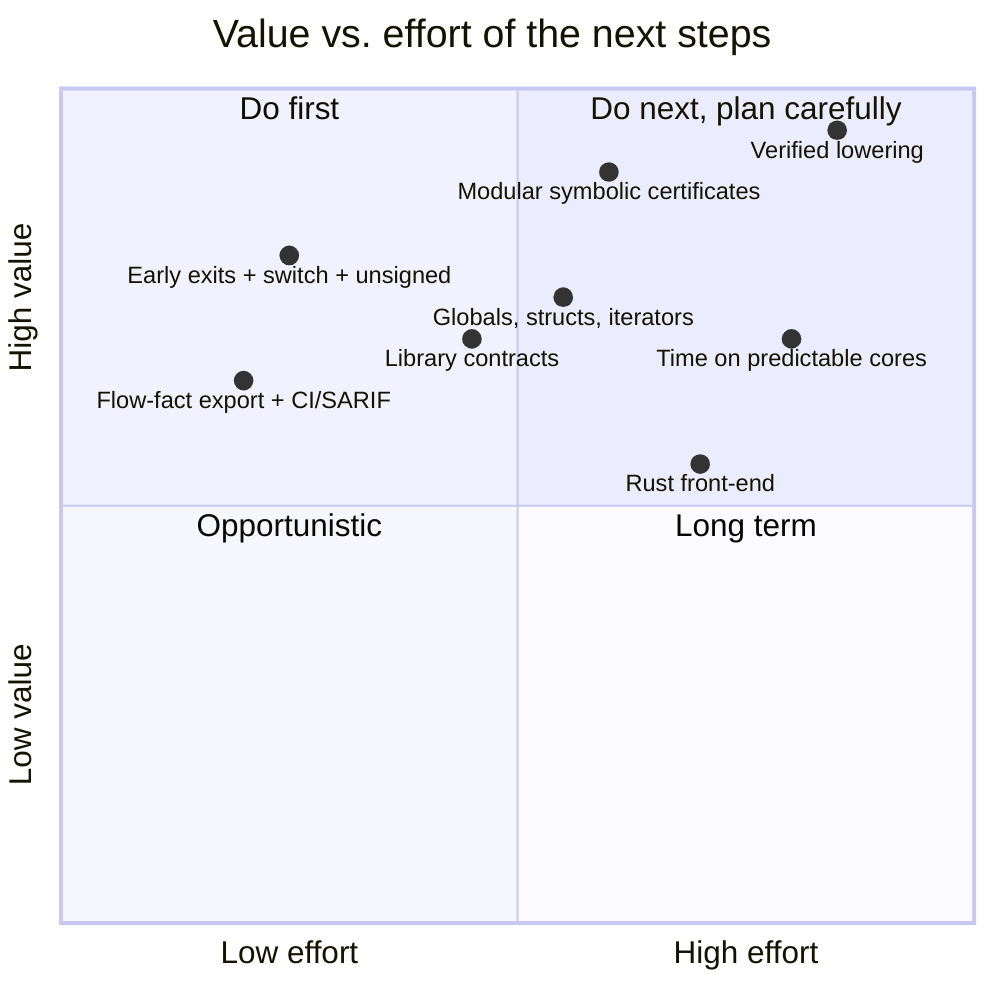

# Proposals: scientific contribution, industrial value, legacy code

Written on 2026-11-14, after the evaluation (Paper II) and the first certificate results.
Each item says what it is, the evidence that it matters (from our own measurements where
possible), and whether it needs new theory and Lean work (**T**) or only engineering under
the existing certificates (**E**). `docs/implementation-plan.md` remains the task list;
this file is the argument for the order.

## 1. Where we stand

- **Strong**: soundness record (no bound below an observed count); certificates for 156 of
  158 bounded TACLeBench functions (142 before step 1 of §5), all accepted by a verified checker; in-context loop
  bounds identical to oRange's wherever both exist.
- **Weak**: the translation from C++ to the certificate is unverified; no symbolic bounds
  (TPDB: 165 vs 288 for KoAT2); small benchmarks; cost is not time.

## 2. Scientific relevance and innovation

| # | Proposal | Why it is a contribution | Kind |
|---|---|---|---|
| S1 | **Verified lowering.** A mini-C (structured control, signed/unsigned integers, read-only arrays, calls) with a Lean semantics; the plugin exports the function's AST as JSON; the lowering to `ACmd` is written *in Lean* and proved to preserve cost. | Closes the only remaining gap: an accepted certificate would then bound the *C function*, not a program the plugin wrote. Few cost analyses for C have a verified front-end (CompCert-based work is the reference point to cite). | T |
| S2 | **Modular symbolic certificates.** Certificates whose bounds are affine (later polynomial) in the parameters, one per function, with a checked call rule (`validSym_call`, rule 9 for recursion) instead of inlining. | Turns the checker into a verified checker of *parametric* resource bounds — rare in the literature — and removes the coverage gap with KoAT2/CoFloCo on TPDB as is. Also needed by S1 and by library contracts. | T + E |
| S3 | **Richer potentials in the checker**: lexicographic and logarithmic loop rules (`prop:lex-log` is proved on runs; make them rules and checker cases), then amortised (potential-based) rules for nested loops. | Certificates for multi-phase loops, binary search, and amortised costs, all checked; connects AARA-style analysis to verified checking. | T |
| S4 | **Relative completeness of the generator**: every loop the analyser bounds (affine potential, Houdini invariant, single linear test) receives an accepted certificate. | A precise statement of what the certified fragment covers; turns the 142/158 figure into a theorem plus a list of out-of-fragment constructs. | T |
| S5 | **Time on predictable processors**: weights for an in-order core without caches (e.g. a RISC-V or Cortex-M0-class core), and a check that the compiled code's loops match the source loops (translation validation on the binary). | A certified end-to-end WCET bound for predictable hardware; for complex hardware, certified flow facts for existing timing analysers (I1). | T + E |
| S6 | **Fork-join and interrupts**: work/span rules in the logic; per-handler bounds as input to response-time analysis. | Extends the framework to the two forms of concurrency real-time code actually uses. | T |

## 3. Industrial value and engineering interest

| # | Proposal | Value | Kind |
|---|---|---|---|
| I1 | **Export flow facts** (loop bounds, in-context) to aiT (AIS annotations) and OTAWA (FFX). **Done** (not yet run inside OTAWA/aiT); SWEET dropped: it computes flow facts and has no documented input format for loop bounds. | Plugs into qualified WCET workflows today; replaces hand-written loop bounds, a known source of error. | E |
| I2 | **CI integration**: SARIF output for code-scanning UIs; a "cost diff" on pull requests (bound of each function before/after); failure on regression beyond a budget. | Turns bounds into a review signal for embedded teams. **Done**: `sarif=FILE` (schema-validated), `scripts/cost_diff.py`, baseline ctest. | E |
| I3 | **Tool qualification kit for the checker** (DO-178C / ISO 26262): requirements, tests, the Lean proof as evidence, the trusted base listed. | Qualifying a small checker is far cheaper than qualifying an analyser; this is the industrial case for certificates. | E |
| I4 | **Library contracts**: versioned contract files (cost as a function of sizes) for C library functions (`memcpy`, `memset` with a size), CMSIS-DSP, the Embedded Template Library, `std::array` / `std::span` algorithms; amortised or average-case functions rejected. Contracts enter as assumed triples (rule 8) and are listed in the report. | Makes real code bases analysable without rewriting library calls; the C++ standard gives no constants, so contracts must be per implementation. | T (checker) + E |
| I5 | **Whole-project driver**: run on `compile_commands.json`, cache summaries across translation units, an HTML/JSON dashboard of bounds, certificates and reasons. | Needed for any code base larger than a file. | E |
| I6 | **Rust front-end on MIR**, emitting the same certificates. | Ownership removes aliasing; MIR is simpler than the Clang AST; the checker is reused unchanged. | E |

## 4. Extending the language subset for legacy code

Ordered by measured effect (blockers counted on TACLeBench and the example programs) and
by how common the idiom is in legacy C (MISRA-style code).

```mermaid
flowchart LR
  A["break / continue / return in loops<br/>(TACLeBench: 11 functions)"] --> B["switch<br/>(examples: on_frame, next_phase)"]
  B --> C["unsigned and size_t counters<br/>(4 + crc32, ring_read)"]
  C --> D["&& / || loop tests<br/>(ring_read, md5)"]
  D --> E["globals, static locals<br/>(filterbank, bitcount, isqrt)"]
  E --> F["struct fields, const tables"]
  F --> G["pointer iterators<br/>p < a + n, begin/end"]
  G --> H["recursion in certificates"]
  H --> I["floats with constant bounds"]
```

| Construct | How | Kind |
|---|---|---|
| `break`, `continue`, `return` in loops | **done**: flag variables in the generator, and one checker node `whileAnd` (conjunctive test, proved in `check_sound`); a logic with jump postconditions was not needed | T (small) |
| `switch` (with fall-through) | **done**: one nondeterministic conditional per group of cases; fall-through is the sequence | E |
| unsigned / `size_t` | **done**: every unsigned store is a conditional whose wrapping branch the checker proves dead; 64-bit types use the test `a ≤ 2^62` | E |
| `&&`, `||` in loop tests | **done**: the guard list of `whileAnd`; other conjuncts (`||`, `!=`, memory) as choice variables | T |
| globals, `static` locals | tracked as variables under a single-writer assumption listed in the report; `volatile` and atomics never tracked | E |
| struct fields, arrays with constant index | scalar replacement; `const` lookup tables with known contents give bounds from their values | E |
| pointer iterators | an offset variable for `p` over a known array (`p < a + n`, `std::array` / `std::span` iterators) | E |
| recursion | rule 9 with ranks from the depth or size potential | T |
| `do … while`, forward `goto` to a cleanup label | restructuring in the generator | E |
| floats with constant start, step and limit | exact IEEE evaluation of the trip count, certified by evaluation in the checker (`decide`-style) or listed as an assumption | T or E |
| function pointers with a declared target set | annotation listing the targets; the bound is the maximum | E (trusted) |

## 5. Recommended order

1. **Early exits, `switch`, unsigned** (§4, first three rows): closes most measured
   certificate gaps; small Lean work. Then re-measure, including the TACLeBench
   *sequential* and *app* categories. **Done 2026-11-14**: TACLeBench certificates 142 →
   156 of 158; `run_tacle.py --category sequential --category app` (results in
   `benchmarks/tacle/README.md`).
2. **Flow-fact export and CI/SARIF** (I1, I2): immediate industrial value, no theory.
   **Done 2026-11-14**: FFX, AIS, AIS2, SARIF, cost diff; FFX values equal oRange's on 114
   TACLeBench loops. Loaded into OTAWA on 2026-11-16 (step 17 below), after placement on the binary loops; aiT: open.
3. **Modular symbolic certificates + library contracts** (S2, I4): the main scientific and
   industrial step; closes the TPDB gap and makes real code bases tractable. **Done in the
   checker and the generator (2026-11-14)**: symbolic bounds `SB`, `call` nodes against
   summaries, assumed contracts, `program_sound`; contract files. Open: the *analyser* still
   needs numeric ranges, so the TPDB gap "as is" remains; polynomial bounds; recursion in
   the checker (rule 9).
4. **Globals, structs, iterators** (§4): legacy coverage, measured on an open-source
   embedded code base (choose one with a permissive licence and MISRA-like style).
   **Done 2026-11-15** on CMSIS-DSP (`benchmarks/cmsis`): globals and statics, fields
   through pointer parameters, constant tables, C integer tests, Arm intrinsics, statement
   expressions, inline assembly, `input-range`, annotations in C; 357 → 616 of 786
   functions bounded (with ranges). Pointer iterators were **not** done: neither CMSIS-DSP
   nor TACLeBench controls loops by pointer comparison often enough to show up among the
   blockers; logarithmic loops (FFTs) are now the largest blocker.
5. **Verified lowering** (S1): the flagship result for a venue paper on certified cost
   analysis. **Done 2026-11-15, as translation validation** rather than a lowering written
   in Lean: the plugin exports each certified function as mini-C (`MiniC.cpp`, syntactic,
   independent of the generator); the checker compares it with the certificate's program
   up to a normal form (`MiniC.validate`), and `MiniC.validated_sound` (Paper I
   `thm:validated`) transfers the bound. The generator leaves the trusted base for the
   validated functions: 93 of the 158 TACLeBench kernel certificates and 113 of the 231
   sequential/app ones, none failing.
   Open: calls in mini-C (a congruence of the semantics in the procedure environment, and
   following the generator's choice between summary and inlining), unsigned arithmetic,
   division/shift/mask (the generator's `havocC` facts, to be derived by `lower`), jumps
   inside loops.
6. **Time on predictable cores** (S5), **fork-join and interrupts** (S6), **Rust** (I6).
   **S6 done 2026-11-15**: Lean `Interrupts` (response-time bound for a computation under
   sporadic handlers, executable check `rtaHolds` in the checker) and `ForkJoin` (Graham's
   bound for independent tasks, with certified task bounds); plugin `CROSSCHECK_INTERRUPT`,
   `response_time` in the report, deadlines checked against it, response-time claims in
   certificate files. Open for S6: the busy-period argument (activations pending at the
   start), fork-join in the plugin, dependencies between tasks.
   **S5 done 2026-11-15** (`benchmarks/cycles`): cycle bounds of the TACLeBench kernels
   compiled for a Cortex-M0, from CrossCheck's loop bounds (binary loops matched by debug
   lines), each checked against an emulated run: 102 of 267 functions, 5 entry functions
   (bound/observed 1.24 to 2.49), no violation. Open: software floating point, a check on
   hardware, other cores. **I6 (Rust) done 2026-11-15** on textual MIR (rustc 1.100.0
   pinned; the user accepted an interface that may evolve): `frontends/rust` translates MIR
   to C for the analyser (free functions over integers and slices), checked by a
   differential test against Rust. Open: slice iterators, `loop`/`break`, structs, a
   `stable_mir` driver.

7. **Logarithmic potentials** (part of S3), chosen after steps 1-6 because halving loops
   were the largest measured blocker on CMSIS-DSP. **Done 2026-11-15**: checker node
   `whileLog` with `logloop_sound` (reduced to the logic's loop rule), analyser and
   generator (constant entry bound, no early exits); a generator bug on `x >>= k` fixed.
8. **Growing logarithmic loops** (a counter multiplied towards a limit, `len <<= 1`).
   **Done 2026-11-15**: checker node `whileGrow` with `growloop_sound`; unsigned `/`, `>>`,
   `%`, `&` exact in the analyser (they cannot wrap), which is what had kept step 7 from
   changing the CMSIS-DSP figures. Kernels: 132 loops for every call, 141 in context, 11
   entry functions; CMSIS-DSP loops with ranges 1024 -> 1044 (functions unchanged at 616);
   TPDB with ranges 171. Open: certificates for the two `fft` functions (an invariant
   showing the potential positive), early exits in logarithmic loops, symbolic entry bounds.
9. **Lexicographic potentials** (the rest of S3): next.

Each step should end, as the previous ones did, with re-run figures, must-be-rejected
tests, Lean proofs for every new checker rule, and the papers, READMEs and guide updated
together.

## 6. Review of 2026-11-15 and order after step 8

Written after steps 1-8, at the author's request (advice on solidity, scientific
contribution, industrial value and benchmark results). The author asked for all of it to
be carried out in order. Statements about industrial practice and the benchmark names
(ROSACE, PapaBench, NASA cFS) come from the model's memory: **check before relying on
them**.

### 6.1 Weak points found

| Weak point | Why it matters | Remedy (step) |
|---|---|---|
| 93 of 158 kernel certificates are validated against the source (since step 11: 143 of 161; 147 with early exits and `switch` exported) | for the others the unverified generator is trusted | mini-C with calls, unsigned variables, division (11) |
| the link from mini-C to C is informal | last unproved step of the chain | run mini-C (its Lean semantics, executable) and the compiled C on random inputs (10); long term, CompCert Clight |
| soundness evidence is one fixed input per kernel | none for sequential/app and CMSIS-DSP | random loop programs run against their bounds; mutated certificates must be rejected (10) |
| the analyser needs numeric input ranges | TPDB as is: 10 programs, KoAT2 288 | parametric analyser (12) |
| time is one core, compared with our own interpreter | the exported flow facts were never loaded into OTAWA or aiT | an end-to-end OTAWA run (13) |
| breadth over depth (Rust, cycles, interrupts are thin) | reviewers and users judge the weakest link | no new front-end or target until 10-13 are done |

### 6.2 Contribution to claim

The foundations of Paper I (order-by-composition, loops as optimisation problems) mostly
restate classical results. The less common part is the certified chain: a verified
checker, validation against the source, response times from certified bounds. The papers
should centre their claims there (an author decision; the abstracts already say what is
proved and what is not).

### 6.3 Where the industrial value is

Flight-control code generated from models (SCADE, Simulink) has constant loop bounds; its
hard problem is hardware timing, which CrossCheck does not address. The value is in:

- **qualification**: a small proved checker is cheaper to qualify (DO-330) than an
  analyser; a kit skeleton (requirements, traced tests, trusted base) is the entry ticket;
- **certified flow facts for existing WCET tools** (OTAWA, aiT), replacing hand-written
  loop bounds;
- **hand-written code** (drivers, protocol stacks, RTOS, crypto, new C++ and Rust), with
  compile-time deadline checks and cost diffs in CI;
- **stack bounds**, a DO-178C objective, often wanted before WCET;
- **a bridge to Frama-C**: invariants and loop variants exported as ACSL, re-provable by WP;
- **engineering basics**: a whole-project driver, analysis speed, messages that say why a
  loop is unbounded and which annotation would fix it;
- **recognised benchmarks**: ROSACE, PapaBench, NASA cFS rather than kernels only.

### 6.4 Order

| Step | Content | Kind | Status |
|---|---|---|---|
| 9 | Lexicographic potentials: checker node, proof by the loop rule, analyser, generator, must-be-rejected tests | T | **done 2026-11-16**, without a new checker node: with a constant inner bound the pair is an affine potential (`lex_potential`); the analyser retries with more candidate invariants and hands them to the generator. Binary search bounded (linearly). Not covered: a symbolic inner bound (a product) |
| 10 | Soundness tests: random loop programs run against their bounds; mutated certificates rejected; mini-C interpreter against compiled C | E | **done 2026-11-16**: `fuzz_bounds.py`, `mutate_certificates.py`; two defects found and fixed (a loop whose body never completes reported with 0 executions; a mini-C source written for an inexpressible loop test) |
| 11 | Mini-C extended (unsigned, division/shift/mask, calls), in the order of the measured refusals | T | **partly done 2026-11-16**: quotient, remainder, shift and mask by a constant (`divStore`), stores into unsigned variables (`assignU`), calls (`call`); kernels validated 93 -> 143 of 161, then 147 with early exits and `switch` written with flags (140 with all their callees). Open: tracked globals (6), calls in tests (2), callees without an entry of their own (4); **2026-11-16 (prompt 46)**: `break`/`continue`/`return`/`switch`/`do` given a meaning in Lean and eliminated by the checker (proved: `MiniC.validatedJ_sound`), tracked globals exported; kernels 152 of 161 validated; **2026-11-17 (prompt 49)**: static locals exported (and their initialisation fixed in the analysis: once, not at every call), ROSACE/DEBIE 309 of 480 validated |
| 12 | Parametric analyser: bounds affine in the parameters without input ranges; TPDB as is | T + E | **done 2026-11-16** as option `symbolic`: potentials without a numeric entry bound, the bound in the parameters is the certificate's (logical variables also for `-x` and `x - y`). The analyser's own costs stay numeric. **Products of parameters done 2026-11-17 (prompt 50)**: quadratic terms in `SB` (`q`, compared as a subsequence), `SB.mul`, a third form of `loopBoundOk` (symbolic entry and linear body bounds, `d = 1`), `SB.qcomb` for calls (`SB.qcomb_ge`), example `prodCert_cost`; generator: the product where it used to give up. Open: degree above 2 (three nested loops over parameters), decrease above 1 in the product form, quadratic argument bounds at calls |
| 13 | Explanations for unbounded loops (which annotation would fix it); whole-project driver on `compile_commands.json` | E | **done 2026-11-16**: cause in the error message; `scripts/crosscheck_project.py` |
| 14 | Stack-depth bounds (high-water mark: a new resource in the theory), checked against the Cortex-M0 runs | T + E | **done 2026-11-16**: Lean `Stack` (`highWater_le_of_bound`, `highWater_le_depth`), `benchmarks/cycles/stack.py`; 143 of 267 kernel functions, 24 calls compared, no violation. Open: recursion from a depth bound, frames adjusted by a register |
| 15 | ACSL export of invariants and variants | E | **done 2026-11-16** (`scripts/acsl_export.py`), tested as run-time checks on random programs; **not run through Frama-C** (not installed here) |
| 16 | Qualification-kit skeleton for the checker | E | **done 2026-11-16** (`docs/qualification/`): 9 requirements with evidence, traceability checked in CI; not reviewed by a specialist |
| 17 | End-to-end OTAWA run with our flow facts; a recognised benchmark | E | **done in part (2026-11-16)**: OTAWA 2.3 (image built by the author) computes an IPET bound for all 107 functions that have a cycle bound, from 199 flow facts placed on the binary loops by `benchmarks/cycles/run_otawa.py` (label + offset; the source-line FFX is not placed by OTAWA on `-O1` code), one unit per instruction; 11 executed calls compared, no bound below an execution. Open: a Cortex-M0 description for OTAWA (cycles instead of instructions), source-line flow facts that survive optimisation, aiT. **ROSACE and DEBIE integrated 2026-11-17 (prompt 49)**: `run_tacle.py --category parallel` (TACLeBench's own copies; PapaBench does not compile as distributed; cFS not fetched); **in cycles too (prompt 46)**: `otawa/m0time.cpp` gives OTAWA block times from our Cortex-M0 table, 107 functions bounded, never below our timing schema; **other processors (2026-11-17, prompt 53)**: OTAWA's own loops matched by `otawa_flow.py` (same bounds as `wcet.py`'s matching on the 107 Cortex-M0 functions), TACLeBench compiled for a Cortex-M4 and bounded by OTAWA's `stm32` models (168 and 162 of 267 functions; not checked against executions), back end of `crosscheck_link.py --processor`, which also takes whole linked programs (one report per file). **Certified cycle bounds (2026-11-17, prompt 54)**: IPET certificates of the Cortex-M0 binaries checked by `crosscheck-check` (Lean `Cycles.program_sound`, Paper I `prop:cycles`; prior work Maroneze et al. 2014): 107/107 accepted, never above the timing schema; `crosscheck_link.py --certify`. **Graph built from the machine code (2026-11-17, prompt 55)**: the checker decodes the code (Lean `Thumb.decode`) and builds the graphs (`Thumb.binary_sound`, Paper I `thm:machine-cycles`); same 107 bounds; decoder compared with `m0.py` (all encodings) and llvm-objdump. Open: aiT; a decoder validated on hardware or derived from Arm's specification; certificates for the OTAWA processors |
| 18 | Recursion in the checker (rule 9); amortised bounds for nested loops | T | **amortisation started 2026-11-16 (prompt 47)**: derived rule `valid_whileSum` (body cost a function of the potential, Paper I `prop:amortised-loop`), checker form `triOk` of the loop nodes (body bound `a + c·γⱼ`, `triloop_sound`), generator: inner entry bounds in the enclosing potentials; covers inner loops from the outer counter to a constant limit (`ludcmp_main` 4,907 → 3,674). **`j < i` done 2026-11-16 (prompt 48)**: general rule `valid_whileMono` (a monotone bound of the potential itself, `prop:amortised-loop`(2)), checker node `whileUp` (in the body `γⱼ = k − pot`; `upOk`, `uploop_sound`); `ludcmp_main` 3,674 → 3,474. Prior work found and cited: Healy et al. 2000 (non-rectangular nests by summation, WCET), Albert, Genaim and Masud 2011 (costs of successive iterations as arithmetic sequences). Not covered: an outer body with both shapes (quadratic in the counter), entry bounds in parameters. Recursion **not done**. **Design (2026-11-17)**: a function certificate gets an optional rank, the index `r` of a logical variable (any affine measure of the parameters, through a constraint of the precondition); a new node `callRec` calls the function itself with, besides the fields of `call`, Farkas certificates of `inst[r] ≤ γ_r − 1` and `γ_r ≥ 1`; `checkProgram` checks a ranked function with itself appended to the earlier ones. Proof: `program_sound` by strong induction on `(ρ r).toNat`, and `check_sound` generalised by a predicate on the valuation (rank at most `n`) preserved by the loop cases' updates of their own logical variables (`j ≠ r`, to be checked), with the self-call case using the induction hypothesis for the smaller rank. Rule 9 of the logic (`Derivable.call`) is the model. Low industrial priority (MISRA C forbids recursion). Recursion: low industrial priority (MISRA C forbids it), a full Lean development (soundness by induction on the rank for program certificates). Amortisation: needs a potential-based logic (cost bounded by a difference of potentials), a new theory step; the measured need is the `fft` nest (cycle bound 970 times the run) and triangular loops (`bsort`, 2.49) |

The author's own verification items (`AI_USAGE.md` section 3) remain what blocks the arXiv
submission; no step above replaces them.
