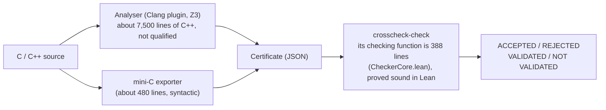

# Qualification kit of the certificate checker (skeleton)

This directory is the start of the evidence a user would need to *qualify*
`crosscheck-check` as a verification tool in a certified development (for instance under
DO-330, the tool-qualification supplement of DO-178C, or ISO 26262-8 clause 11). It is a
skeleton written by an AI assistant from general knowledge of those standards: **it has
not been reviewed by a certification specialist, claims no compliance, and the mapping to
a tool qualification level is the applicant's decision.** What it contains is concrete and
checked by scripts.

## Why the checker, and not the analyser



The analyser may contain defects: a wrong bound gives a certificate that the checker
rejects. Only what the verdict rests on needs qualification: the checker, and, for a
validated certificate, the exporter and the hypotheses under which a C function means its
mini-C description (no signed overflow, no aliasing of the tracked variables).

## Contents

| File | Role |
|---|---|
| `requirements.yaml` | tool operational requirements (TOR-1 ... TOR-9), each with its evidence: Lean theorems, test files, CI steps, inspection notes |
| `check_traceability.py` | fails if a requirement has no evidence, a Lean name is not declared where stated, a test file is missing or a CI step is absent; prints the traceability matrix |
| `run_tests.sh` | requirement-based tests not otherwise in CI: exit statuses (TOR-6), integers beyond 64 bits (TOR-7) |
| `../../formalization/test/mutate_certificates.py` | robustness of the unverified reader (TOR-8): mutated certificates |

```bash
python3 docs/qualification/check_traceability.py
sh docs/qualification/run_tests.sh formalization/.lake/build/bin/crosscheck-check
python3 formalization/test/mutate_certificates.py formalization/.lake/build/bin/crosscheck-check \
    formalization/test/certificates/program.json
```

All three run in CI (`.github/workflows/lean_build.yml`).

## Tool identification and configuration

| Item | Value |
|---|---|
| Tool | `crosscheck-check`, built by `lake build crosscheck-check` from `formalization/CheckerMain.lean` |
| Verified definitions | `ImperativeOptimization/CheckerCore.lean`, `MiniCCore.lean`, `ResponseCore.lean` (no mathlib) |
| Proofs | `Checker.lean`, `MiniC.lean`, `Interrupts.lean` (mathlib), checked by `lake build`; no `sorry`, no axiom beyond Lean's three standard ones |
| Compiler | Lean 4 `v4.16.0` (pinned in `lean-toolchain`); the executable is produced by Lean's compiler and a C compiler |
| Input | certificate files, `docs/certificate-format.md` (versions 1 and 2) |
| Output | one line per function, program, validation and response claim; exit status 0, 1 or 2 |

## What the verdict rests on (trusted base)

| Trusted | Why it is not covered by the proofs | Mitigation here |
|---|---|---|
| Lean's kernel | it checks the proofs | independent re-checking of the proofs is possible with an external checker (not done here) |
| Lean's compiler and runtime, the C compiler | the theorems are about the definitions, the executable is compiled from them | requirement-based tests on the executable; mutation test |
| `CheckerMain.lean` (JSON reader, printing, exit status), about 420 lines | not verified | mutation test (TOR-8), exit-status tests (TOR-6); small enough for review |
| The cost semantics of certificate programs (`Language.lean`) | it is the definition the theorems refer to | read it: `Exec`, `Pre`; the independent interpreter `cert_interp.py` implements it a second time |
| For VALIDATED: the mini-C exporter and "C function = its mini-C description" | outside the checker | exporter tests (`tests/c/minic.c`), comparison of interpreted mini-C with compiled C on random programs (`tests/fuzz_bounds.py`) |
| Weights of the cost model; "cost unit = time" | a certificate bounds a cost, not a time | stated in every report; see Paper II, Limitations |

## Open items before this could support a real qualification

- A tool qualification plan and the tool's intended use in the user's process (which
  verification activity the checker replaces or automates): the applicant's documents.
- Review of the requirements by someone other than their author; independence of the
  tests from the development.
- Structural coverage of `CheckerMain.lean` by the tests (not measured).
- A statement on the Lean compiler: either evidence for it, or a second implementation of
  the checker compared on all certificates (the Python interpreter checks executions, not
  the checking function).
- Configuration management of the tool binary (a tagged, archived release with its hash).
- Known limitations of the checker itself: no recursion, bounds affine in the parameters,
  loop potentials affine or logarithmic (`docs/certificate-format.md`).
