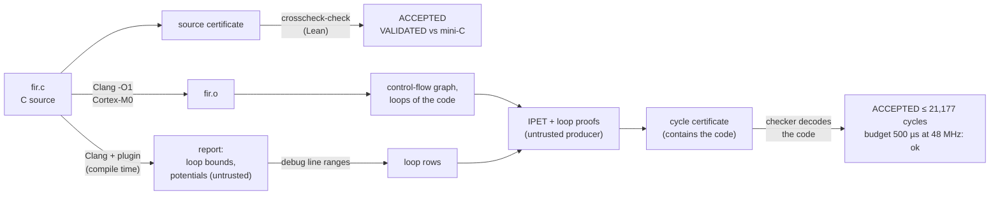

# CrossCheck

Certified cost bounds, from the C source to the machine code

<div class="pt-8 opacity-80">
A verified checker in Lean 4 · a Clang plugin · Cortex-M0 binaries
</div>

<div class="abs-br m-6 text-sm opacity-60">
Luca Dall'Olio · github.com/ldallolio/crosscheck
</div>

---

# The question

**How long can this function take, in the worst case?**

- Real-time code has deadlines: a control step, an interrupt handler, a filter block
- Measuring gives a time that *was* observed, not a bound
- A static analysis gives a bound, but the analysis is a large program that may be wrong

<v-click>

CrossCheck splits the work:

| | does | trusted? |
|---|---|---|
| **producer** (Clang plugin, binary analysis) | finds bounds, writes a **certificate** | no |
| **checker** (`crosscheck-check`, compiled from Lean) | accepts or rejects the certificate | its soundness is a **Lean theorem** |

</v-click>

---
layout: two-cols
---

# Loops as optimization

Executions are **traces** in $\Sigma^*$, ordered by prefix (*order-by-composition*):
$u \sqsubseteq w \iff \exists v,\ w = u \cdot v$, and cost is monotone along $\sqsubseteq$.

A loop `while (P) t` from $s_0$ ends after the **least** exiting iteration count:

$$
\bar n = \min\{\, n \mid \neg P(\llbracket t^n \rrbracket(s_0)) \,\}
$$

and its trace $t^{\bar n}$ is the $\sqsubseteq$-least exiting trace
(Lean `exists_minimal_iteration`, `minimal_iteration_least`).

Branching recursion: the same with computation **trees** and grafting.

::right::

<div class="pl-6 pt-16">

Exact solutions exist only for simple loops, so the analysis **relaxes**:

- a **ranking potential** $V$ with $V \ge 1$ under the test and
  $V' \le V - 1$ per iteration bounds the iterations by $\lfloor V(s_0) \rfloor$
- branches collapse to the max (tropical semiring), sequences add
  (the *timing schema*: Shaw; Puschner & Koza)
- implications between linear constraints are proved by **Farkas multipliers**:
  non-negative numbers that a checker verifies by arithmetic alone

</div>

---

# Theory: a cost logic and its checker

Triples $\{P\}\ c\ \{Q\}\!\downarrow\! B$: from $P$, every execution of $c$ —
terminated **or not** — costs at most $B$, and ends in $Q$.

```text
{I ∩ b ∩ {V = v}} body {I ∩ {V ≤ v − 1}} ↓ W      V ≥ 1 on I ∩ b      V ≤ K on C
──────────────────────────────────────────────────────────────────────────────── (loop)
          {I ∩ C} while b do body {I ∩ ¬b} ↓ ⌊K⌋·(ω(b) + W) + ω(b)
```

Rules for sequence, branch, procedures (recursion by rank), assumed contracts.

A **certificate** is the program annotated with assertions, potentials, bounds and Farkas
multipliers. The checker recomputes nothing hard: it checks equalities and inequalities.

```lean
theorem check_sound (fs : List FunCert) (Φ : ℕ → Cmd ℕ Env)
    (hfs : ∀ f F, fs[f]? = some F → FunSpec Φ f F) (c : ACmd) :
    ∀ (P Q : List Lin) (B : SB), check fs P c B Q = true → ∀ ρ,
      Valid Φ (holds P ρ) c.toCmd (B.eval ρ) (holds Q ρ) ∧ ...
```

Symbolic bounds in the parameters: $c + \sum_j c_j \max(0,\gamma_j) + \sum c_{ij}\max(0,\gamma_i)\max(0,\gamma_j)$.

---

# The pipeline of the running example



`python3 docs/slides/demo/run_demo.py` regenerates every artifact of the next slides.

---

# 1 · The code

<<< @/demo/fir.c c {all|12-17|19-27|19-20}

- `CROSSCHECK_RANGE(1, 56)`: an **assumption** on the callers, listed in the report
- `CROSSCHECK_DEADLINE_US(500)`: a time budget — a property of the binary, checked **after** compilation

---

# 2 · Compile time: what the plugin says

```text
fir.c:12:31: remark: crosscheck: 'dot': worst-case cost bound 85 units
fir.c:20:5:  remark: crosscheck: 'fir_peak': worst-case cost bound 5269 units
             (time budget 500 us, checked after linking), under 1 assumption(s)
```

The report (`demo/out/report.json`, excerpt) — **untrusted facts**, found with Z3:

```json
{ "name": "fir_peak", "wcet": 5269, "deadline_us": 500,
  "loops": [ { "line": 22, "end_line": 25, "bound": 56, "verified": true,
               "potential": "n - i", "invariants": ["-i <= 0"] } ],
  "assumptions": [ "preconditions of 'fir_peak' hold at its external call sites" ] }
```

`dot`: loop at line 14, potential `-k + 8`, bound 8. Units: one per operation (the weights are configurable).

---

# 3 · The source certificate, checked

```text
$ crosscheck-check demo/out/source-cert.json
ACCEPTED dot: bound 85
VALIDATED dot: the certificate's program is the lowering of its source
ACCEPTED fir_peak: bound 5 + 94*max(0,γ0)
VALIDATED fir_peak: the certificate's program is the lowering of its source
PROGRAM  docs/slides/demo/fir.c: ACCEPTED
```

- The bound of `fir_peak` is **symbolic in its parameter** $n$: $5 + 94\max(0,n)$; at $n = 56$: 5,269
- The call of `dot` is checked against `dot`'s own certified summary (85)
- **VALIDATED**: the checker also proves that the certificate's program is the meaning of a
  mini-C export of the function (translation validation, Lean `validated_sound`)

A loop node of the certificate (excerpt): invariant, potential `(e, d)`, entry bound,
Farkas multipliers `{"mu": 1, "lam": [0, 1]}` for "invariant ∧ test ⇒ e ≥ d", body bound.

---

# 4 · The compiler: Cortex-M0 machine code

`clang --target=thumbv6m-none-eabi -mcpu=cortex-m0 -O1 -g` · `llvm-objdump -d -l` (`demo/out/fir.s`)

```asm {all|8-15}
00000000 <dot>:
       0:  push  {r4, r5, r7, lr}          ; fir.c:12
       2:  add   r7, sp, #0x8
       4:  lsls  r0, r0, #0x2              ; fir.c:14
       6:  ldr   r1, [pc, #0x18]
       8:  adds  r1, r1, r0
       a:  movs  r2, #0x0
       c:  ldr   r3, [pc, #0x14]
      10:  ldr   r4, [r3, r2]              ; fir.c:15   <- loop head
      12:  ldr   r5, [r1, r2]
      14:  muls  r5, r4, r5                ;  32 cycles (small multiplier)
      16:  adds  r0, r5, r0
      18:  adds  r2, r2, #0x4              ; fir.c:14
      1a:  cmp   r2, #0x20
      1c:  bne   0x10                      ;  back edge
      1e:  pop   {r4, r5, r7, pc}
```

The compiler rewrote the loop: the counter is a **byte offset** `r2 = 0, 4, …, 28`, compared with 32.

---

# 5 · From source loops to binary loops

Each binary loop is matched with a source loop through the **debug line table**:

- the plugin's report gives each source loop its range `line … end_line`
- of the lines of the binary loop's own instructions, keep those inside some source loop;
  choose the **innermost** source loop that holds them all

`dot` at `0x10`: lines 14, 15 → source loop 14–15 (bound 8) · `fir_peak` at `0x44`: lines 22–24 → loop 22–25 (bound 56)

<v-click>

**This step is trusted** (checked on emulated runs only). Simpler rules failed on real code:

| rule | failure found |
|---|---|
| largest bound over all lines | `matrix1`: 105× too loose (a stale line) |
| line of the back-edge branch | GCC's rotated loop of `fft` got its **inner** loop's bound (11 instead of 1,023) |
| line ranges (current) | — |

</v-click>

---

# 6 · The cycle certificate

IPET: maximize the cycles over the edge counts that respect the loop rows — a linear program.
Its **dual solution** is the certificate (`demo/out/cycles-cert.json`):

```json
{ "format": "crosscheck-binary-cycles", "version": 2, "mul_cycles": 32,
  "code": { "base": 0, "halfwords": [46512, 44802, 128, 18694, ...] },
  "programs": [{ "functions": [
    { "name": "fir_peak", "nodes": [40, 42, ...],
      "rows": [{ "coef": [[58, 68, -56], [66, 68, 1]], "rhs": 0,
                 "note": "loop at 0x44: at most 56 back edges per entry" }],
      "certificate": { "scale": 1, "pot": [21177, 21171, ...], "mult": [371], "bound": 21177 } } ] }] }
```

The checker **decodes the code itself** (Lean `Thumb.decode`: ARMv6-M Thumb and the
Cortex-M0 cycle table), builds the graph, and checks the potentials and multipliers:

```lean
theorem binary_sound (mul : Nat) (c : Code) (fs : List BFun) (Cs : List Cert)
    (h : checkBinary mul c fs Cs = true) (d e i : Nat) (tot : Int)
    (hrun : MRun mul c fs d e tot) (hfind : find (fs.map (·.entry)) e = some i) :
    tot ≤ ((Cs.map Cert.bound).getD i 0 : Nat)
```

---
layout: two-cols
---

# 7 · A loop proved on the code

For `dot`'s loop the bound is not taken from the source: it is **proved on the instructions**.

- invariant per instruction, on `r0`–`r7` and the operands of the last flag-setting operation
- congruence: `r2 ≡ 0 (mod 4)`
- potential $(28 - r_2)/4$, decreasing on the back edge `bne 0x10`
- **7 back edges** per entry (source bound 8: the binary counts back edges)
- 110 obligations, each with Farkas multipliers

::right::

<div class="pl-6 pt-14">

```text
ACCEPTED dot: at most 356 cycles
  (16 instructions, 17 edges, 1 rows)
ACCEPTED dot: loop bounds of the machine code,
  1 rows certified, 0 trusted
  (110 obligations, 27 congruences)
ACCEPTED fir_peak: at most 21177 cycles
PROGRAM  program: ACCEPTED (...; 1 loop rows
  certified on the machine code, 1 trusted;
  callees assumed to preserve r4-r7 and SP)
```

`fir_peak`'s loop runs to the **parameter** `n`: no bound on the code alone, so its row
(56, from the source and the range) stays **trusted**.

Lean `ThumbData.data_sound`: invariants and potentials checked against a semantics of the
instructions' effects on registers and flags.

</div>

---

# 8 · Execution, time budget, tampering

**Emulated run** (`m0.py`, the same timing table), `fir_peak(56)`:
**20,806 cycles** observed ≤ **21,177** certified (ratio 1.018); `dot`: 356 = 356.

**After linking** (`clang-plugin/scripts/crosscheck_link.py --certify --clock-mhz 48`):

```text
ok    fir_peak: bound 23571 cycles = 491.062 us, budget 500 us
processor: cortex-m0 (certified cycle bounds); trusted: the Lean specification of the
Cortex-M0 (Thumb.decode: instruction decoding and cycles, zero-wait-state memory); that the
code in the cycle certificate is the binary's; the Lean checker (Thumb.binary_sound); no
interrupt is taken while the function runs; the compiler preserves the source loops'
iteration counts; the plugin's loop bounds
```

(23,571 here: without loop certificates `dot`'s row is the source bound, 8. With a budget of 400 µs the step **fails**, exit status 1 — usable as a post-build check.)

**One cycle less** in the certificate:

```text
REJECTED fir_peak: at most 21176 cycles (23 instructions, 26 edges, 1 rows)
PROGRAM  program: REJECTED (...)
```

---
zoom: 0.8
---

# 9 · Time and complexity

Wall time of each step of the example (`demo/out/times.json`, on the author's machine):

| step | role | time |
|---|---|---:|
| plugin (analysis, certificate, mini-C export) | untrusted producer | 0.54 s |
| checker on the source certificate | **verified** | 0.06 s |
| compilation, disassembly | compiler | 0.07 s |
| binary analysis, IPET, loop proofs | untrusted producer | 0.86 s |
| checker on the cycle certificate | **verified** | 0.06 s |
| time budget after linking | | 0.67 s |

- The producers **search** (Z3, linear programs with HiGHS, zone analyses); the checker only
  **verifies**: exact integer arithmetic over the certificate, no solver, no search
- At scale: 29 TACLeBench kernels, 223 binary functions, 8,333 instructions checked in 0.15 s;
  the full Cortex-M0 run with loop certificates: 5 to 16 minutes (`--jobs 4`)
- Bounds are at most **quadratic** in the parameters (products of two terms): a deliberate restriction of the checker

---

# What is trusted, in each mode

| mode | trusted |
|---|---|
| plugin alone | the analyser (C++, unverified) and Z3 |
| certificate accepted | the lowering from C to the certificate's program |
| certificate **validated** | the syntactic export to mini-C; no signed overflow, no aliasing of tracked variables |
| cycle bounds (Cortex-M0) | the Lean specification of the processor (decoder, cycles, zero-wait-state memory); that the certificate's code is the binary's; the loop rows not certified on the code (their match with source loops) |
| loops certified on the code | additionally the effects of the instructions on registers and flags (compared with an interpreter on every 16-bit encoding) |

Always: the Lean kernel and compiler, no interrupt during the function, Lean's three standard axioms.

---

# Benchmarks: TACLeBench, 29 kernels, no annotation

Loop bounds compared with the benchmarks' **flow facts** (maxima for fixed inputs):

| 220 loops | bounded | = fact | > fact | < fact |
|---|---:|---:|---:|---:|
| for every call | 133 | 105 | 27 | 1 |
| in the calling contexts of `main` | 142 | 131 | 9 | 2 |

- None of the bounds below a flow fact is below an **observed** count (208 loops reached; two flow facts are themselves below the observed count)
- 165 functions bounded; **161 certified**, all accepted; **152 validated** against mini-C
- Larger programs (23 sequential + 2 app, up to 10,000 lines): 572 loops, 330 bounded in context; ROSACE and DEBIE: 480 certificates, all accepted
- With 84 trusted loop annotations in 18 kernels: `main` bounded in 23 of 29 (10 without)

---
zoom: 0.9
---

# Tool comparison (same kernels)

| 220 loops | CrossCheck | CrossCheck in context | LLVM SCEV | oRange |
|---|---:|---:|---:|---:|
| bounded | 133 | 142 | 113 | 131 |
| = / > / < flow fact | 105 / 27 / 1 | 131 / 9 / 2 | 108 / 5 / 0 | 127 / 3 / 1 |
| below an observed count | 0 | 0 | 0 | **1** |

| 267 functions | CrossCheck | KoAT2 | CoFloCo | Infer |
|---|---:|---:|---:|---:|
| numeric / symbolic bound | 165 / 0 | 119 / 23 | 128 / 11 | 190 / 14 |
| entry functions bounded | 12 | 5 + 5 symbolic | 8 | 14 + 2 symbolic |

KoAT2 and CoFloCo on the same integer programs (llvm2kittel), default options, untuned.
Infer's results are not upper bounds in every case (no recursion). TACLeBench favours
CrossCheck: its loops have constant bounds.

---

# Complexity benchmarks and an embedded library

**TPDB**, C complexity category (553 programs with symbolic costs):

| | programs bounded |
|---|---:|
| CrossCheck as is (numeric bounds only) | 11 |
| CrossCheck, inputs in [−1000, 1000] | 215 |
| KoAT2 / CoFloCo (all inputs) | 288 / 264 |
| CrossCheck **certified in the parameters**, no range | **147** (133 symbolic, 14 constant), all accepted |

**CMSIS-DSP** (Arm, 786 functions, 1,235 loops, Cortex-M4 target):
161 functions bounded as is; **616 (78%)** with input ranges, the file's group as context
and illustrative `memset`/`memcpy` contracts. Blockers: loop bounds read from memory,
calls into other parts of the library.

---
zoom: 0.78
---

# Machine code: Cortex-M0, 29 kernels

| | Clang `-O1` | GCC `-O1` |
|---|---:|---:|
| functions with a cycle bound (of 267) | 107 | 107 |
| calls / loops compared with emulated runs, violations | 11 / 45, 0 | 73 / 65, 0 |
| `main`: bound / observed | 1.24–2.46 | 1.31–2.51 |
| functions with a **certified** cycle bound | 121 | 112 |
| kernel loops certified on the code (both assumptions) | 257 of 403 | 74 of 215 |
| loops of the division routines certified | 116 of 116 | 29 of 29 |

- **OTAWA** with the same loop bounds as flow facts: the same 107 functions; geometric mean of bound / executed 2.32 (instructions), 2.69 (cycles)
- OTAWA's STM32 models (Cortex-M4 / M7): 169 / 163 functions bounded (not checked against executions)
- Stack bounds: 143 functions, 24 calls compared, 19 exact
- GCC's binaries found three defects that Clang's did not show (data model, loop matching, a producer that did not terminate) — all fixed

---
zoom: 0.72
---

# The Lean formalization

- 33 modules, about 16,000 lines, **692 theorems**, no `sorry`, only Lean's three standard axioms
- The checker program `crosscheck-check` is compiled from the same Lean definitions (no mathlib)
- `formalization.yaml`: every paper statement ↔ its Lean theorems

| | Lean |
|---|---|
| traces, trees, minimal exit, ranking bounds, subadditive cost norms | `Trace`, `Tree`, `Ranking`, `Norms` |
| cost logic with procedures, recursion and contracts | `Language.soundness` |
| certificate checker, programs, symbolic bounds | `Checker.check_sound`, `program_sound` |
| validation against mini-C, with `break`/`continue`/`return`/`switch` | `validated_sound`, `validatedJ_sound` |
| response times under interrupts, fork-join (Graham) | `response_time_bound`, `greedy_bound` |
| cycle bounds of machine code; loop bounds on the code | `Thumb.binary_sound`, `ThumbData.data_sound` |

**Not** mechanized: the C++ analyser, the translation from C, the processor specification's
faithfulness to the hardware (a board harness exists; it has not been run).

---

# Limitations

- **Cost is not time** except on a predictable processor; caches and pipelines need a micro-architectural analysis (OTAWA's models are used, not checked)
- Bounds are **affine or quadratic** in the parameters; amortisation only for triangular nests
- The analyser needs **numeric ranges** for its own bounds; symbolic bounds exist as certificates
- Loops bounded by values in **memory** or by data (sorting passes, string scans) are not bounded
- The Cortex-M0 specification is ours, compared with our interpreter, not with hardware
- Research prototype: one compiler front end (Clang 18), one processor certified (Cortex-M0)

---
layout: center
class: text-center
---

# Summary

A bound is **found** by untrusted tools and **accepted** by a small checker proved sound in Lean —
from the C source to the instructions of the binary.

<div class="pt-6 text-sm opacity-80">

Papers I (theory, Lean) · II (plugin, evaluation) · III (machine code) — `paper/`<br/>
Code, benchmarks, guide: github.com/ldallolio/crosscheck · AI use: `AI_USAGE.md`<br/>
This deck: `docs/slides` (`npm run dev`), artifacts: `python3 docs/slides/demo/run_demo.py`

</div>
